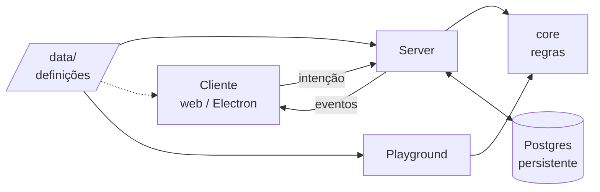
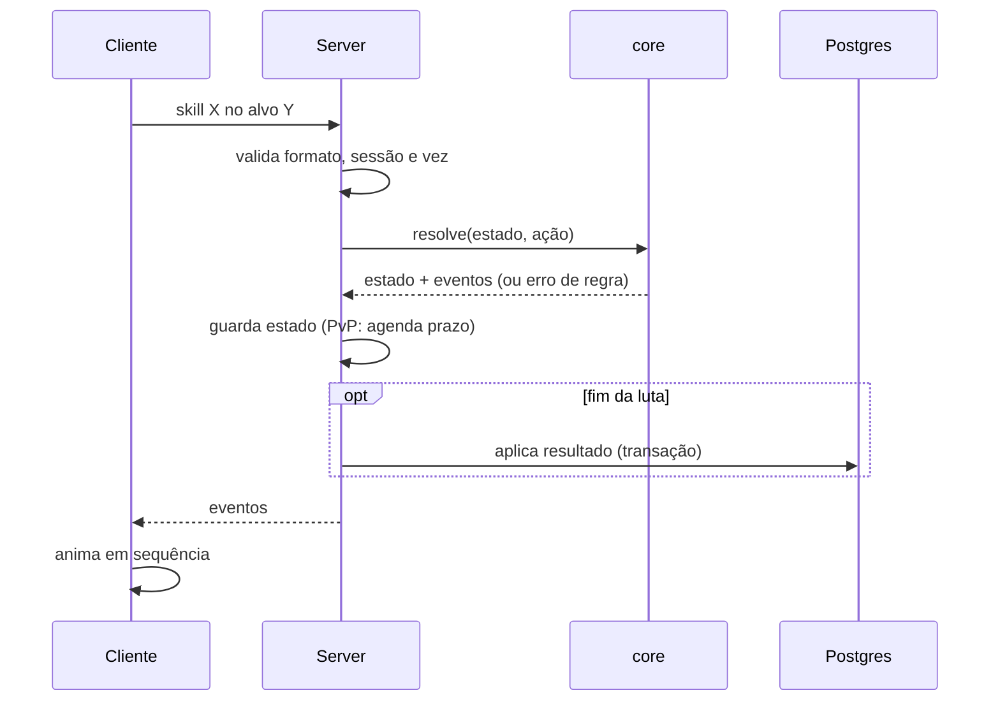

## Sidinei:

Queria conversar sobre uma coisa, eu estou começando a fica com ansiedade em cima do meu jogo eras do brasil ou meu mmrpg ansiedade de ter ele em mãos logo, mas aqui tem um ponto importante eu não tenho certeza se essa ansiedade é para ter meu jogo feito algo meu construido ou ansiedade para ter um jogo que eu quero jogar nos meus moldes dado que meu jogo estou colocando mecanicas de outros jogos que acho legais e coisas tipo jogo x acho legal mas não tem coisa y, jogo w acho legal mas não tem coisa z e meu jogo tem y e z e mais outras coisas que vou achando legal coisa como "o jogo perfeito que quero jogar eu estou fazendo" e ai claro entra em todo aquele debate de idle ou não idle, se eu realmente gosto e to querendo idle ou se to só jogando e indo mais para o idle devido a necessidade e não pelo meu gosto mesmo, se eu tivesse tempo para jogar se minhas horas de gameplay não fosse interrompida para eu precisar ninar o bebe ou coisa do tipo se eu ainda ia ficar no idle ou ia para um jogo mais ação ou coisas assim, um exemplo teve uma epoca e acho que ate agora passei a jogar mais jogos arpg tipo poe2 ou last epoch porque era um jogo quase que um mmorpg lite que eu podia pausar eu estava abrindo mão ali de algumas lifes skills que gosto as vezes de fazer, um mercado menos complexos engulindo algumas mecanicas de hack slash de arpg para poder encaixar minha necessidade, e jogos que pode me entregar isso sem ser mmorpg pode ser ruim por conta de achar o mercado parado tipo eu não fazer diferença na mecanica economia do jogo. Eu ja abrir mão a muito tempo e não só de agora jogos que obrigatoriamente precisa de um grupo para evoluir sempre estou preferindo jogos que de para evoluir solo ja quando comecei essa migração por outro motivos então sinto meu gosto ser moldado pela necessidade e não pelo gosto e tenho medo disto impactar no meu eras do brasil ou qualquer mmorpg. Voltando para ansiedade eu sei que demora para fazer mmorpg eu sei e ja assumir que sou muito novato de game dev e estou fazendo jogos pequenos ja por issso para aprender e não me afundar no escopo então sei que esse jogo vai demorar bastante para ficar jogavel. E acho que isso pode me dar gatilho de imediatista.

---

## Claude:

Sidinei, acho que você está misturando duas ansiedades que se parecem, mas pedem respostas diferentes. Vale separar.

**Ansiedade de "ter algo meu construído" ou de "ter o jogo que eu quero jogar"?**

Faz um teste mental: imagina que amanhã um estúdio lança um jogo praticamente igual ao Eras do Brasil, com o y, o z e tudo o que você queria. O que sobra em você?

Se a sensação for "ótimo, vou jogar isso", então a ansiedade é de jogador. Nesse caso, construir um MMORPG sozinho, como novato e com 3 horas fragmentadas por noite, é o caminho mais lento possível até o jogo que você quer jogar. Saber disso já alivia, porque você para de cobrar do projeto algo que ele não consegue entregar tão cedo.

Se a sensação for "poxa, mas era o *meu*", então é ansiedade de criador. Essa se alimenta de outra forma: ver coisas suas funcionando, não ter o jogo completo.

Meu palpite é que são as duas. Mas o lado criador pode ser alimentado bem antes do lado jogador.

**O gosto moldado pela necessidade não é um gosto falso**

Você começou a preferir solo, pausável e idle por causa da vida que tem. Isso não torna essas preferências menos suas. Gosto quase sempre é moldado por contexto: a gente gosta do que cabe na nossa vida. E tem um detalhe importante: o público de jogos solo, pausáveis ou idle é em grande parte gente exatamente como você, adulto, com filho e emprego. Você não está distorcendo o design, está enxergando um público por dentro.

O risco real é outro: transformar uma restrição de sessão numa identidade de gênero. "Idle ou não idle" talvez seja a pergunta errada. Olhando o que você descreveu (PoE2, Last Epoch, mercado vivo, life skills), o que você busca parece ser:

- um jogo que respeite sessões interrompidas: pausa, progresso assíncrono, nada que te puna por largar o controle para ninar o bebê;
- a sensação de que sua ação importa num mundo compartilhado, com uma economia que se mexe por sua causa;
- progressão solo viável.

Isso são requisitos de design, não um gênero. Dá para ter um combate mais ativo quando você tem tempo e sistemas que andam sozinhos quando não tem. Muitos jogos misturam as duas coisas. Assim você não aposta o Eras do Brasil inteiro numa resposta sobre um gosto que pode mudar quando seu filho crescer.

**O "jogo perfeito" como colagem**

"Jogo X sem Y, jogo W sem Z, o meu tem Y + Z + mais o que eu achar legal" é a receita clássica de escopo infinito e de jogo sem identidade. Um filtro que ajuda: para cada mecânica que entrar, pergunte que experiência central ela serve. Você mesmo já disse que a magia é o núcleo da sua identidade de jogador. Esse pode ser um pilar. Uma mecânica que não conversa com os pilares vai para uma lista de "talvez um dia", não para o design.

**Sobre o imediatismo**

Você já fez a coisa certa ao assumir que é novato e começar por jogos pequenos. O que pode faltar é ligar esses jogos pequenos ao Eras do Brasil. Um ou dois desses projetos de aprendizado podem ser fatias do Eras: um protótipo só do loop de coleta e mercado, só do combate com magia, só do progresso offline. Isso dá três coisas de uma vez:

- o "algo meu funcionando" que acalma a ansiedade de criador;
- um teste prático do debate idle ou não idle, jogando o seu próprio protótipo nas suas sessões interrompidas, em vez de teorizar;
- peças que talvez sobrevivam até o jogo grande, ou pelo menos o aprendizado delas.

Sendo honesto, nenhuma estratégia faz o MMORPG ficar jogável rápido. O que dá para mudar é de onde vem a recompensa: do jogo pronto, que está longe, ou dos pedaços que você já consegue ver funcionando.

Fazendo o teste mental do estúdio lançando o seu jogo amanhã, qual foi sua reação instintiva?

---

## Sidinei:

Eu ia testar imediatamente assim como estou tentando diversos que vejo que parece ter mecanicas parecidas por exemplo o que estou abrindo direto aqui é o scapewatch idle mmo recentemente eu estava mais programando e a um bom tempo não jogo nada que não seja idle e que deixe rodando nas minhas sessões de programação hoje tirei um tempo para jogar e vou no last epoch porque tem temporada nova, mas o scape vai ficar aberto no notebook ao ladom eu não sei dizer se depois de um tempo jogando o meu jogo perfeito feito por outra empresa eu ia ficar talvez muita como em bdo que tenho 2mil horas ou em new world que entrava direto, ou se ia procurar outra coisa ou ia sentir falta de não é meu, mas acredito que saindo por outra empresa eu iria parar de querer fazer meu mmorpg acho que a vontade ia continuar e eu ia querer fazer o eras melhorado.

---

## Claude:

Repara no que você acabou de responder: mesmo com o jogo perfeito lançado por outra empresa, a vontade de fazer o Eras continuaria, e você ia querer fazer um Eras melhorado. Isso diz bastante. O motor principal não é "quero jogar isso logo", é "quero que isso exista feito por mim". A ansiedade de jogador existe, mas parece secundária.

E isso é uma boa notícia, porque a ansiedade de criador não precisa do jogo pronto para ser alimentada. Ela se alimenta de progresso visível: um sistema funcionando, um protótipo que você abre e sente "isso é o Eras". O imediatismo fica bem mais fácil de lidar quando a recompensa está em marcos pequenos, e não em "jogável daqui a anos".

Sobre o debate idle ou não idle, acho que sua rotina já responde mais do que você imagina. Olha o que você faz na prática: o Scapewatch rodando no notebook do lado, programando ou jogando outra coisa, e o Last Epoch quando sobra um tempo de verdade e tem temporada nova. Isso não é "gosto de idle" nem "gosto de ação". É gostar de **duas camadas ao mesmo tempo**: uma que anda sozinha em segundo plano e outra ativa, para quando você tem tempo de sentar e jogar.

E o seu histórico de antes da necessidade aponta para o mesmo lugar. O BDO, onde você tem 2 mil horas, é justamente um jogo que mistura combate ativo com um monte de coisa que roda sozinha: processamento, pesca AFK, trabalhadores, comércio, uma economia viva. O New World também tinha um peso grande de crafting, coleta e mercado. Então o seu gosto "puro" já tinha esse formato híbrido. A paternidade talvez só tenha mudado a proporção, e não o gosto em si.

Isso tira um pouco do medo de o Eras ser moldado só pela necessidade. Se ele tiver uma camada de progresso assíncrono ou idle e uma camada ativa opcional, ele serve tanto para o Sidinei de hoje, que nina o bebê no meio da sessão, quanto para um Sidinei futuro com mais tempo livre. Você não precisa adivinhar qual dos dois é o "verdadeiro".

O que te prendeu por 2 mil horas no BDO? Foi o combate, as life skills, a economia ou outra coisa? Acho que essa resposta é um bom candidato a pilar do Eras.

---

## Sidinei:

Parando para pensar o BDO é um otimo e um pessimo exemplo ao mesmo tempo, primeiro eu jogo BDO desde quando lançou na verdade antes de lançar na LATAM eu joguei em um server privado e acho que fiquei 8 horas jogando seguido com um amigo quando lançou no latam eu comprei o pacote mais caro e sinceramente nesse tempo todo eu fiz quase todo tipo de conteudo missão, grind, fiz muita life skills lembro que deixava o cavalo upando e ia para faculdade e focava na life skill de cavalo porque era  unica que dava para fazer algo afk capturava muito cavalos lembro que passei a virada do ano com um amigo pegando cavalo t5 enchi todos meus estabulos no jogo eu era rico de cavalo só não fui mais porque fiquei um tempo sem jogar e foi muito tempo e t5 ficou muito comum t6 tambem e até lendario meu estoque de cavalo defasou mas eu investir bastante nessa life skill comprei até skin para aumentar rendimento, mas bdo foi marcado com muitas indas e vindas minha seja por sentir falta de contudos tipo dungeons depois talvez por sentir falta de uma progressão de dropar equipamento ao inves de material para upgrade e o principal muitas indecisões ao criar classe sempre achando que a proxima era a minha e depois não tendo identidade com a classe e mais atualmente não jogo bdo porque sempre preciso esta na ação quando to no grind e eu não tenho muito tempo e se eu largar o teclado ja era.  Outro jogo que me pegava muito era albion online quando comecei a jogar fiquei muitas horas seguidas coletando, refinando, craftando, lutando até chegar na necessidade de ir pra red e para black sempre tinha medo de perder meus itens, mas sempre gostei da ideia do albion do faça o que você quiser, você é o que você veste e tudo que você fizer importa para economia e é relevante a economia a progressão e a customização do albion é sensacional mas o pvp forçado ganks e o medo de perder itens me pegava e agora mais ainda apesar de agora ter muito mais conteudos que gosto te muito mais coisas solos, se eu tiver jogando e precisar sair correndo para nina o bebe eu volto morto e sem item o problema é que esse pvp e essas mortes com perda de itens é o que faz a economia girar e combate dele vale uma ressalva não preciso apertar 123...9 as vezes f1,f2,f3...f9 para o combate são poucas skills e conectadas, o bdo tem muitas skills mas você solta ela em combos que envolve com a gameplay. Outro mmorpg que me pegou muito foi o new world aquele eu cheguei a falar que ia ser meu mmrpg difinitivo tinha combate que eu gostava tinha life skils tinha comercio e não era pvp forçado as vezes ate fazia la pelo combate o que me distanciou dele foi, exploit a criação de item não estava tão relevante porque o itens melhores era dropado de dungeons que precisava de grupo os de craft sempre era pior e o mercado dele ficou muito ruim não valia a pena vender e comprar item então ele acabou virando um jogo de dungeons e quando iam corrigir isso colocando craft que você sentia que estava fazendo algo relevante ou dungeons solo o jogo fechou. 

E acho que toda essa historia e gostos esta escancarados no eras do brasil na linha do tempo do game.
E que o idle x ação seria um jogo que eu consiga progredir afk nem que seja com o jogo aberto mas que não precise de 100% da minha atenção que eu possa jogar depois eu mesmo movimentando e fazendo as coisas e que não seja tão punitivo caso eu precise sair urgente para ninar o bebe.
sobre mecanica e sistemas do meu jogo perfeito dar para tirar de tudo que falei mas algumas coisas a ser listada complementando com o que falei caso eu esqueça algum ou tenha preguiça de digitar:

* Jogo com economia e mercado relevante
* Life skills que faça sentido para progressão e que o que você faça importa
* Craft relevante que o que você craft seja relevante para você ou para o mercado e que o item que você craft não seja apenas sucata
* Poucas skills nada de piano de skills ou então conecatadas (eu gostava de cabal que apesar ter isso ele tinha questão do combo que no final só apertava 1 tecla)
* Nada de classe presa porque vou viver criando personagem
* Sem necessidade de criar alts
* Você é o que você veste quer ser mago se vista como um quer ser um guerreiro se vista como um mas claro progressão em cima disto, inclusão de builds e poder jogar de forma hibrida
* Mmo mas que eu possa jogar solo e não seja penalizado por isso
* Que exista progressão de item podendo pegar itens melhores ou melhorando os que tenho para ter a sensação de dropar um item que queria muito
* E mais coisas que não lembro e estou com preguiça de digitar....

---

## Claude:

Esse histórico é praticamente um documento de design. E dá para resumir sua lista numa frase: **o Albion sem o PvP forçado, com o combate enxuto e a vontade do New World, e a camada AFK do BDO.** Isso já é uma identidade, e não uma colagem aleatória, porque todas essas peças apontam para o mesmo jogador.

Agora a parte que acho mais útil: alguns itens da lista brigam entre si. Não é para descartar nenhum. É que o Eras vai ter personalidade justamente pela forma como você resolver essas tensões.

**Economia relevante × não ser punitivo.** Esta é a principal. Você mesmo percebeu: no Albion, o que faz a economia girar é a perda de itens. Item que nunca sai do jogo vira acúmulo, e acúmulo mata o mercado. Foi um pedaço do que aconteceu com o New World. Se você tira a perda por PvP e por morte, precisa colocar outros "ralos" no lugar: desgaste e durabilidade de verdade, consumíveis que importam, upgrade que consome itens, crafts que usam outros itens como insumo, e itens que se prendem ao personagem depois de usados. Morrer pode custar algo leve, como durabilidade, sem custar o item. E, para o caso do bebê, um mecanismo de "saiu do combate e o personagem se protege" resolve a outra metade do problema.

**Craft relevante × a sensação de dropar o item que você queria.** Foi exatamente aqui que o New World quebrou: o drop superava o craft e o crafter virou sucateiro. Você precisa decidir quem produz o melhor item do jogo. Alguns caminhos que preservam as duas coisas:

- o drop raro é um componente, uma receita ou uma base especial, e só o crafter finaliza;
- o drop vem com atributos únicos, e o craft serve para melhorar ou refinar;
- os dois geram itens de topo, mas com funções diferentes.

Assim, dropar algo raro continua emocionante, e o crafter continua indispensável.

**Solo sem penalidade × ser MMO.** O que resolve aqui é a interdependência pelo mercado, e não pelo grupo. Você joga sozinho, mas o minério que você coletou vira a espada de outro jogador. Isso o Albion já faz bem, e é o que te dá a sensação de "o que eu faço importa" sem exigir que você esteja num horário fixo com mais quatro pessoas.

**Sem classe presa × identidade.** Repara no seu histórico do BDO: classe presa gerou indecisão eterna e a sensação de "a próxima é a minha". O sistema de "você é o que veste" resolve a indecisão. Só que, sem classe nenhuma, existe o risco de nunca se sentir ninguém. A identidade precisa vir de outro lugar: visual forte do equipamento (aquilo que você sente falta no Scapewatch), builds com nome e cara, e maestria acumulada numa arma ou escola de magia. E isso casa direitinho com pouca skill: a arma ou o cajado define 3 a 5 habilidades conectadas, no estilo do Albion e do combo do Cabal.

**AFK × ativo.** A sua definição ficou muito boa: progride sem exigir 100% de atenção, você joga ativamente quando pode, e sair de repente não destrói nada. Uma divisão natural seria colocar life skills, trabalhadores e criação de animais na camada que anda sozinha (o seu cavalo do BDO), e deixar o combate e a exploração como camada ativa. O cuidado é não deixar o AFK render tanto que jogar ativamente pareça opcional.

Se você tivesse que escolher hoje, o que mais te atrai como "ralo" da economia do Eras: desgaste e quebra de itens, ou crafts que consomem outros itens?

---

## Sidinei:

Economia relevante × não ser punitivo concordo bastante com você
Sobre: Craft relevante × a sensação de dropar o item que você queria.  Com new world era ruim porque beleza o melhor item era dropado e la tinha de dropar peça me isso em obrigava a um dg em grupo não com gate não dava para eu conseguir sozinho isso o albion tem o craft e o drop relevante, com a mecanica de tudo produzido pelo player até o que dropa de bau que são recarregados ao vender para o mercado negro. Gosto da suas ideias tambem.
Solo sem penalidade × ser MMO. isso concorco com voce o mmo pode ser a parte de você faz parte do eco sistema do mundo não precisa ser ande com mais x pessoas
Sem classe presa × identidade aquei falei errado não era identidade era identificação imagina eu fazer uma classe depois de x tempo perde identificação ou decobrir no endgame eu não me vejo nessa classe eu teria que fazer outro personagem e abandonar o antigo por isso que no bdo eu tenho o meu primeiro mago mesmo tendo outros personagens que viraram main porque eu investir tanto tempo quanto dinheiro nele que dar até pena de apagar. E concordo com em todos os pontos nisso tambem somente 1 coisa poucas skills nas barra mas não é ter poucas opções.

Sobre a resposta eu vejo um pouco dos 2 desgate e quebra de item porem recuperar desgaste pode fazer consumir 1 item do mesmo sei la ou quebra um item pode gerar recurso, e para craftar um item melhor sempre precisa de outro como material isso funciona bem não sei se um base ou um do mesmo (não precisa ser com os mesmo atributos.) ou sei la coisa do tipo. Por exemoplo eu tenho um cajado que me dar x de magia e y de mana e um cajado que dar x de força e y de destreza esse eu posso usar como material para alguma coisa.

---

## Claude:

Entendi a diferença entre identidade e identificação, e ela muda a solução. O problema não é o personagem não ter cara, é você investir tempo e dinheiro e descobrir no endgame que não se vê mais naquilo. Sem classe presa, o personagem nunca fica "errado": quem muda é o que ele veste e o caminho que segue. O mago antigo do BDO não seria abandonado, ele só mudaria de rumo, levando junto o que já acumulou. Para isso funcionar de verdade, o progresso precisa ficar no personagem e não na build: maestrias por arma ou escola de magia que nunca se perdem, life skills, reputação, cavalos. Trocar de caminho tem um custo, mas nunca joga o investimento fora.

E "poucas skills na barra, mas muitas opções" é um modelo bem conhecido: um repertório grande e uma barra pequena. O Guild Wars 1 tinha centenas de skills e só 8 slots; no Albion, cada peça de equipamento oferece algumas habilidades para escolher. A complexidade fica na montagem da build, fora do combate, e a execução continua leve. Isso também combina com sessão interrompida: pensar na build pode acontecer no celular, ninando o bebê; jogar exige pouca coordenação.

**Sobre a sua ideia para os ralos**

Ela é boa, e o mais forte nela é o exemplo do cajado. Num jogo normal, um cajado de força e destreza é sucata para um mago. No seu modelo, ele vira material. Isso resolve dois problemas de uma vez: quase todo drop passa a ter valor, e surge demanda no mercado por itens "errados", porque o guerreiro que dropou um cajado de magia tem para quem vender.

O que você descreveu forma um ciclo de vida do item: usa, desgasta, repara consumindo outro item, um dia quebra, é desmanchado e vira material, que alimenta o upgrade ou o craft de outro item. Todo item termina consumido em algum momento, e é exatamente isso que mantém a economia viva sem precisar de perda por morte.

Três cuidados para o ciclo não vazar:

- **Toda conversão perde valor.** Desmanchar um item tem que devolver menos do que custou produzi-lo. Se devolver o mesmo ou mais, deixa de ser ralo e vira impressora de recurso.
- **Reparar consumindo um item igual pune quem só tem um.** Vale ter um caminho alternativo, como o crafter reparando com materiais. Isso, de quebra, dá mais um papel econômico para quem crafta.
- **Material específico ou genérico?** Dá para ter as duas camadas. O sacrifício direto de item da mesma família (cajado alimenta cajado) dá o bônus maior e cria demanda por categoria no mercado. A essência genérica, vinda do desmanche, serve para qualquer item, mas rende menos. Assim o específico vale mais sem que o genérico vire lixo.

Uma variação que você pode gostar: o item sacrificado tem uma chance de transferir um atributo para o item principal. Aí aquele cajado de força com um atributo raro passa a valer muito para alguém. Isso adiciona complexidade, então talvez fique para depois, mas cria aquela emoção de "dropei o material que eu queria", que conversa com a sensação de drop que você também quer.

Pensando na camada AFK: você imagina que ela produz mais matéria-prima (coleta, criação de animais) ou que também pode processar e reparar itens enquanto você está fora?

---

## Sidinei:

Sobre a durabilidade dar para seguir um modelo parecido com o bdo onde tem 2 tipos de durabilidade 1 a durabilidade de fato e 2 o teto desta durabilidade o 1 pode descer por uso e eu preciso de um material mais basico pra isso e o 2 por tentativa de upgrade ou por morte ou sei la ainda não pensei nisso, e esse poderia aumenta somente com arma da mesma familia ou um item criado por crafters

---

## Claude:

Esse modelo de duas camadas encaixa muito bem no ciclo que você montou, porque cada camada vira um ralo de natureza diferente.

**A durabilidade atual é manutenção.** Ela cai com o uso, é barata de recuperar e usa material básico. É um custo pequeno e frequente, e tem um efeito colateral ótimo: cria demanda permanente por material de nível baixo. O jogador novo ou o coletor casual sempre tem para quem vender, e isso dá vida ao começo da economia.

**O teto é o ralo de verdade.** Ele cai raramente, em eventos marcantes, e é caro de recuperar, exigindo um item da mesma família ou algo feito por crafter. É aqui que os itens realmente saem do jogo. Restaurar o teto com item da mesma família é o mesmo princípio do cajado de força virando material, e o item de restauração feito por crafter dá a eles um produto que nunca perde mercado.

Sobre o que reduz o teto, algumas ideias e cuidados:

- **Falha de upgrade** funciona bem, mas aqui o BDO é um alerta. Falhar várias vezes seguidas, ver o teto despencar e precisar de cópias e mais cópias do item foi um dos pontos mais frustrantes do jogo, e virou loop de cash shop. Se você usar esse mecanismo, deixe a perda previsível: perda fixa e pequena por falha, ou uma chance que aumenta a cada tentativa (o equivalente aos failstacks), para que o azar nunca seja infinito.
- **Morte** reduzindo o teto é coerente com o "não punitivo": você não perde o item, ele só envelhece um pouco. O ponto é garantir que sair de repente para ninar o bebê raramente resulte em morte. Se o personagem tiver algum mecanismo de recuo ou proteção quando você larga o teclado, morrer passa a ser consequência de jogar mal, e não de ter uma vida fora do jogo.
- Uma terceira opção, que eu acho elegante: **deixar a durabilidade atual chegar a zero custa teto.** Quem faz a manutenção não perde nada; quem descuida, perde. Isso dá sentido à camada básica sem punir ninguém por interrupção.

O que eu evitaria é o uso normal reduzir o teto, porque aí a camada de manutenção perde o propósito e tudo vira desgaste permanente.

E isso leva a uma decisão que fecha o ciclo: quando o teto chega a zero, o que acontece com o item? Ele quebra de vez e só serve para desmanche, ou fica inutilizável até alguém restaurá-lo?

---

## Sidinei:

Respondendo isso: 

Pensando na camada AFK: você imagina que ela produz mais matéria-prima (coleta, criação de animais) ou que também pode processar e reparar itens enquanto você está fora?

Pode ser material prima e processo ou sei la tendo em poder fazer tudo porem de maneira reduzida em algumas coisas

Concordo com Falha de upgrade e realmente mas uma previsão dar para por exemplo o player ver antes de fazer o upgrade preciso me preparar. Só não posso deixar o teto descer rapido se eu seguir para se tiver com durabilidade zero porque se não fica mais punitivo que o upgrade que eu escolhe quando fazer upgrade ja a reparação eu não escolho eu sempre tenho que fazer porque vai descer com uso.

Sobre a morte dar para instanciar a batalha para ter um pause, seja ela idle, turno ou ação. Para o ninar o bebe seja um botão de panico pauso e pronto não perco nada mas tambem não ganho.

Sobre: 

E isso leva a uma decisão que fecha o ciclo: quando o teto chega a zero, o que acontece com o item? Ele quebra de vez e só serve para desmanche, ou fica inutilizável até alguém restaurá-lo?

Não sei se faria quebrar de vez imagina um item super raro quebrar de vez, acho que vale mais a pena restaura-lo

---

## Claude:

Dá para ver o desenho do Eras ganhando forma. Vou passar por cada ponto.

**AFK faz tudo, mas rende menos.** É um bom princípio, e dá para afinar com uma regra simples: o AFK entrega volume e o jogo ativo entrega qualidade. Enquanto você está fora, o personagem coleta, processa e até luta, mas as coisas raras, os bônus e as melhores chances ficam com quem está jogando. Assim o AFK nunca parece inútil, e jogar ativamente nunca parece opcional.

E isso se conecta com a sua preocupação sobre a reparação: se a manutenção é obrigatória e acontece sempre, ela é a candidata perfeita para a camada AFK. O personagem repara sozinho consumindo material básico do baú. O ralo continua funcionando, mas sem exigir sua atenção, e o risco de chegar a zero por descuido praticamente some.

**Durabilidade zero.** Concordo com a sua lógica: o upgrade é um risco que você escolhe, o desgaste é inevitável, então não podem punir igual. Um caminho limpo é a durabilidade zero não tocar no teto. O item só para de funcionar (perde os atributos ou não pode ser equipado) até você reparar. O inconveniente já é a punição. E a ideia de mostrar o custo e o risco do upgrade antes de tentar é ótima: "me preparar para o upgrade" vira um objetivo de jogo, não uma roleta.

**Instância com botão de pânico.** Resolve o problema do bebê de forma direta: pausa, não perde, não ganha. Só tem uma tensão com a parte MMO: quanto mais coisa acontece em instância, menos o mundo parece compartilhado. Uma divisão que funciona é ter as instâncias solo com pausa como o lugar do combate sério e do grind, e o mundo aberto como espaço de coleta, comércio, viagem e encontros, com um recuo seguro em vez de pausa. Em grupo a pausa não funciona, mas grupo é opcional no seu jogo, então isso não é problema.

**Teto zero restaurável, sem quebra.** Faz sentido, perder de vez um item raro é bem frustrante. Só note uma consequência: se nenhum item sai do jogo, os itens raros vão se acumulando ao longo dos anos e perdem valor. O ralo continua existindo na restauração, porque ela consome itens, mas o item raro em si é eterno. Para compensar, ajuda ter alguma outra forma de o item sair do mercado. A mais comum é o item ficar preso ao personagem depois de equipado: ele continua existindo, mas não volta a circular. Outra é o próprio jogador escolher sacrificá-lo como material para algo melhor, o que você já tem no ciclo.

Você gostaria que os itens ficassem presos ao personagem ao equipar, ou prefere que tudo continue negociável, como no Albion?

---

## Sidinei:

Ainda não pensei sobre isso realmente preciso de um ralo para itens raros mas tambem ainda não pensei por exemplo o albion não tem itens tão raros por conta disto perder um item raro é muito ruim, mas ai posso fazer uma mecanica que tinha no cabal itens +1 +2 +3... e o que serve de material somente são os crus isso dado com raridade, estou pensando e e digitando, mas sinceramente ainda não refletir sobre esse vai ser um item que preciso pensar bastante. Se por exemplo a morte baixar o teto de durabilidade para 0 fazendo com que o item foi "perdido" mas recuperavel, aumentaria o ralo de uso do itens da mesma familia e se for item raro ele tem seu valor então um item raro mesmo que com atributo errado ele é raro e vale muito é um descarte de luxo para eu recuperar meu item raro de uso habitual e o principal a restauração não ser de vez ser um pedaço apenas ai para não punir eu removeria a regra do cabal de usar somente o base poderia usar os ja encantados.  e ai fica a criterio de quem vai usar.

---

## Claude:

Repara que, pensando e digitando, você quase resolveu o ralo de itens raros sem perceber. Se um item raro com atributo errado vira "descarte de luxo" para restaurar outro item raro, então os raros têm uma porta de saída do jogo: eles são consumidos para manter vivos os raros que estão em uso. O preço de um raro passa a ter um piso natural, que é o valor dele como material, e ele nunca vira lixo. Essa era justamente a peça que faltava.

A restauração por pedaços reforça isso: cada item consumido devolve uma parte do teto, e um raro devolve um pedaço maior. A demanda é contínua, não um evento único. E liberar os itens encantados como material, deixando a decisão para o jogador, também faz sentido, desde que se mantenha a regra de antes: toda conversão perde valor. Um +3 pode render mais que um cru, mas sempre bem menos do que custou para chegar a +3. Assim, ele vira uma escolha ("vale mais usar ou sacrificar?"), e não uma forma de gerar valor do nada.

Sobre a morte zerar o teto: é uma mudança de peso em relação ao "não punitivo" de antes, mas acho que ela se sustenta por causa do botão de pânico. Se interrupção nunca mata, a morte só vem de jogar mal ou de arriscar demais. Aí ela fica parecida com o upgrade: uma consequência de uma escolha, não algo inevitável. Uma forma de reforçar isso é o risco depender do lugar, um pouco como as zonas do Albion: em conteúdo tranquilo, morrer custa um pedaço do teto; em conteúdo perigoso, zera. Você escolhe se quer levar o raro para lá.

O único cuidado que eu teria é com o caso extremo: você morre, o raro zera e não há material disponível no mercado. Se a restauração depende só de itens da mesma família, o item pode ficar parado por muito tempo. Ter o kit de crafter como caminho alternativo, mais caro ou mais lento, mas sempre disponível, garante que o item nunca fique travado, só custando mais para voltar.

Faz sentido deixar isso como uma decisão aberta, como você disse. Pelo menos as peças principais já estão na mesa: desgaste com manutenção automática, teto como ralo, morte e upgrade como riscos escolhidos, e raros saindo do jogo como material de luxo.

---

## Sidinei:

Agora outra coisa muito importante: combate 

Como seria o combate: 

* autobattle total com loadout
* turno puro com pause
* turno com opção de auto battle?
* combate action


E outra como é o encontro com mob? Eu vou nele e entro na instancia de combate com ele e ao matar vou para outro? Ou vou nele e sempre vai vim do mesmo como idle?

Algumas ideias que eu estava pensando: 

* Ser algo em turno instanciado com luta contra 1 mob acabou a luta vou para o proximo
* Ter uma opção de caçada automatica (nessa opção eu defino loadout baseado nas minhas skills com sequencia de quais soltarem tento o ataque basicom ocmo opção caso  todas da lista esteja em coldown) ao clicar em caçada automatica começa o auto grind e aqui não tem o mesmo valor de jogar ativo, recurso são menos, itens raros o drops é muito mais baixo. E (essa opção esta muito em aberto ainda não pensei sobre) no automatico eu posso encontrar outros players que estão no automatico naquele mesmo local ou mob não sei para uma batalha pvp e eu ter um loadout configurado para esse tipo de encontro e ter uma configuração de tentar fugir ou ir para luta uma coisa que não pensei é se somente se encontra 2 no auto caçada ou quem esta caçado ativo pode ver e lutar, ou o ativo pode trabalhar com tag de pvp ligada e combate pvp de ativo é contra ativo e auto battle é contra auto battle com opções de scape ou stop de auto battle para não consumir todos meus recursos. Uma mistura de Norroth® Online com Lootnorne ou sei la outros parecidos.

---

## Claude:

Das quatro opções, a que melhor atende tudo o que você definiu até agora é **turno com opção de auto battle**. E a sua ideia já aponta para ela. Vou explicar por que, comparando as opções com os seus requisitos.

**Comparando as quatro opções**

O **combate action** é o mais caro de construir: netcode, animação, sensação de impacto, hitbox, latência. Além disso, ele briga com a pausa e com a camada AFK. Para um dev solo iniciante, é a forma mais rápida de o escopo explodir.

O **autobattle total** resolve o AFK, mas mata a camada ativa: se o jogo se joga sozinho, jogar ativamente perde o sentido.

O **turno puro** resolve a pausa de graça, porque no solo basta não existir timer de turno, e o botão de pânico praticamente já vem pronto. Mas ele não tem camada AFK.

O **turno com auto** usa o mesmo motor de combate para as duas camadas. Você constrói um sistema só, e o auto é apenas o mesmo combate com as decisões tomadas por uma lista de prioridades em vez de por você. E tem uma vantagem que conversa com a sua carreira: um MMO por turno é, no fundo, um problema de backend. O servidor é a autoridade, o estado é discreto e o tráfego é pequeno. É o tipo de coisa que você já sabe fazer.

**O cuidado principal: o ativo precisa ter decisões que o auto não toma**

Se a única diferença entre ativo e auto for a recompensa, jogar ativo vira só "o auto, mas mais lento e com você clicando". O ativo precisa ser melhor porque você pensa. Um recurso clássico para isso é mostrar a intenção do inimigo, como no Slay the Spire: você vê que o mob vai dar um golpe pesado no próximo turno e decide se defende, interrompe ou aguenta. A lista de prioridades do auto não reage a isso, ou reage mal. Assim, a recompensa maior do ativo é consequência de jogar melhor, não apenas um bônus arbitrário.

O seu loadout com sequência de skills e ataque básico como fallback é basicamente o sistema de Gambits do Final Fantasy XII, que é uma boa referência. Lá dava para criar regras como "se aliado com HP abaixo de 30%, cura", o que deixa a montagem do auto interessante por si só, sem que ele se jogue melhor do que você.

Também vale pensar na proporção. O auto rendendo bem menos é o certo, mas se render pouco demais o jogador que você é hoje vai se sentir obrigado a estar sempre ativo, e a camada AFK perde a função.

**Encontro com mobs**

Dá para casar com as duas camadas:

- **No ativo**, você vê os mobs no mapa, escolhe com quem lutar e entra numa instância um contra um (ou contra um grupo pequeno). Quando acaba, volta ao mapa e escolhe o próximo. Elites e chefes ficam visíveis no mundo, o que dá a sensação de explorar.
- **No auto**, você escolhe uma zona de caça e o jogo gera um fluxo contínuo de lutas contra os mobs daquela zona, no estilo idle.

Assim, o mundo existe para quem está jogando, e o fluxo de lutas existe para quem está fora.

**PvP no auto: a parte mais delicada**

Aqui está o ponto em que o seu histórico mais precisa ser ouvido. Ser atacado enquanto está ausente é exatamente o que você odiava no Albion: o gank enquanto você está ninando o bebê. Por isso, das opções que você levantou, a que eu seguiria é a terceira, com a separação:

- **ativo contra ativo**, com a flag de PvP ligada;
- **auto contra auto**, com loadout de PvP e configuração de fuga ou de parar o auto;
- **nunca ativo contra auto**, porque isso é gank de quem está ausente, mesmo que o sistema chame de outra coisa.

Duas sugestões para esse modelo. Primeiro, faça o opt-in pela zona, e não por um botão global: zonas contestadas dão recompensa melhor, e quem caça lá aceita o risco. Isso repete o princípio que você usou no upgrade e na morte, risco escolhido e não imposto. Segundo, mantenha o risco limitado: perder parte do que caçou e um pedaço do teto, nunca o equipamento.

E um detalhe técnico que pode salvar esse sistema: o PvP do auto não precisa que os dois jogadores estejam online ao mesmo tempo. Ele pode usar um "retrato" do loadout do outro jogador, como nas arenas assíncronas. Num MMO indie com população pequena, isso é a diferença entre um sistema com vida e uma zona vazia.

Quanto a prioridade, eu deixaria o PvP para depois. O núcleo é o turno um contra um com intenção visível, mais o auto com lista de prioridades. Isso, inclusive, é um protótipo pequeno e fechado, que poderia ser um dos seus jogos de aprendizado e já seria um pedaço real do Eras.

Você pensa em mostrar a intenção do inimigo no ativo, ou tem outra ideia do que faria o jogo ativo ser melhor do que o auto além da recompensa?

---

## Sidinei:

Antes de responder isso exis outra dúvida que é a movimentação em combate vai ser em grid com movimentação ou combate tipo Pokémon ou narroth online? Com o personagem frente a frente com mob ou grupo de mobs soltando skills,  falo isso porque queria entender depender da escolha como seria resolvido skills e avanço no inimigo, skills de controle de grupo ou magos e arqueiros que vao sempre querer ficar afastados. Se o auto caça e o ativo vai ser do mesmo jeito ou ativo com grid e auto caça mostrando frente a frente, como poderia resolver e ser essa movimentação?

---

## Claude:

Essa decisão pesa mais do que parece, porque ela define se magos e arqueiros têm identidade de verdade. Vou comparar as três abordagens e depois falar de ativo e auto.

**Grid com movimentação (estilo Final Fantasy Tactics)**

Distância, alcance, empurrão, área de efeito e controle de grupo funcionam de forma literal. O arqueiro recua, o guerreiro avança, a magia de área pega quem estiver junto. É o modelo mais rico taticamente, mas também o mais caro: pathfinding, IA que sabe se posicionar, regras de linha de visão, e um auto que precisa decidir não só qual skill usar, mas também para onde andar. As lutas também ficam mais longas, e o grid brilha com muitas unidades; num um contra um ele fica vazio.

**Frente a frente puro (estilo Pokémon)**

É simples, rápido, barato de construir e trivial para o auto. O problema é exatamente o que você apontou: a distância não existe. Mago e guerreiro lutam do mesmo jeito, e a identidade de "ficar afastado" vira só um texto na descrição da skill.

**O meio-termo: distância abstrata em uma linha**

Visualmente continua frente a frente, mas por baixo existe uma distância numérica ou posições em fila. A melhor referência é o Darkest Dungeon: cada personagem ocupa uma posição de 1 a 4, e cada skill diz de quais posições pode ser usada e quais posições alcança.

No seu caso, algo como uma linha com distâncias perto, médio e longe resolve tudo o que você perguntou:

- **Corpo a corpo** precisa estar perto. Avançar custa um turno, ou existe uma skill de investida que avança e ataca ao mesmo tempo.
- **Mago e arqueiro** querem distância. Têm skills de recuo, e os mobs corpo a corpo avançam a cada turno. Ficar longe é um esforço contínuo, não algo de graça.
- **Controle de grupo** ganha função clara: enraizar impede o avanço, empurrar aumenta a distância, puxar traz o arqueiro inimigo para perto.
- **Grupos de mobs** ficam em fila: os da frente protegem os de trás. Para chegar no arqueiro inimigo você mata a linha de frente, usa uma skill de alcance longo ou puxa ele. A magia de área atinge posições vizinhas.

Isso também favorece as builds híbridas do "você é o que veste": um cajado com adaga secundária, por exemplo, faz sentido justamente porque a distância importa.

**Ativo e auto: mesmo sistema**

Eu evitaria grid no ativo e frente a frente no auto, porque aí seriam dois sistemas de regras diferentes. Você teria que balancear tudo duas vezes, e um loadout que funciona num não funcionaria no outro.

Com uma regra só, a diferença fica na apresentação. O ativo mostra a luta completa e você decide. O auto usa exatamente as mesmas regras, com decisões vindas da lista de prioridades ("se a distância for maior que meu alcance, avança"), e pode até rodar no servidor sem renderizar nada, só simulando e entregando o resultado. Isso é muito mais leve, e combina com a ideia de backend que comentei antes.

E isso responde, em parte, à pergunta que ficou pendente: a distância dá ao jogo ativo decisões que o auto toma mal. Saber a hora de recuar, quando gastar o enraizamento ou quando puxar o arqueiro é o tipo de leitura que uma lista de prioridades faz de forma rígida, e um jogador atento faz melhor.

---

## Sidinei:

Seria algo mais ou menos assim como no video só que em turno? Com o player escolhendo as skills no modo ativo e os mobs e os players andando em linha reta ate se encontrarem ou ate um determinado ponto, ou somente mob andando ou ninguém andando como darkest dungeon?

[Arquivo anexado: RavenIdle_1.mp4]

---

## Claude:

Vi o vídeo. É o Raven Idle: você escolhe um encontro no mapa (com dificuldade fácil, média ou difícil), entra numa cena de batalha vista de cima, o personagem fica praticamente parado enquanto os mobs vêm até ele, e embaixo aparece a rotação de skills com a próxima destacada, os consumíveis, o auto-cura e o auto-mana, e um diário da luta. Tudo em tempo real e automático.

Dá para fazer algo bem parecido em turno. Comparando as três formas de movimento que você levantou:

**Todos andam até se encontrar.** Visualmente é o mais vivo, mas, se a distância conta nas regras, isso anula a vantagem do mago e do arqueiro: os dois lados fecham a distância juntos e o alcance quase não importa. Só funciona se for uma animação de aproximação antes de a luta começar de verdade.

**Só o mob anda (o que acontece no vídeo).** É a opção que melhor casa com o sistema de distância. A cada turno, os mobs corpo a corpo avançam uma casa, e a distância vira um recurso que vai acabando. O mago e o arqueiro ganham turnos livres antes do contato, o guerreiro espera ou usa uma investida, e o controle de grupo (enraizar, empurrar) compra mais turnos. O jogador não fica preso: andar para frente ou recuar é uma ação do turno, como uma skill. Visualmente fica muito próximo do vídeo, e as regras continuam sendo a linha de distância de antes.

**Ninguém anda (Darkest Dungeon).** É o mais simples. As posições ficam fixas, e só skills de empurrar, puxar ou trocar de lugar mexem nelas. Funciona bem, mas você perde a sensação de "o mob está vindo e eu preciso decidir o que fazer antes que ele chegue", que é justamente o que dá graça ao ranged.

Eu iria na segunda, com o jogador podendo gastar o turno para se mover.

Um detalhe que resolve o ativo e o auto de uma vez: no **auto**, os turnos são resolvidos sozinhos em intervalos fixos, então a luta parece quase em tempo real, igual ao vídeo. No **ativo**, o jogo para a cada turno e espera sua decisão. É o mesmo motor, só muda quem decide e quanto tempo o turno espera. E o botão de pânico continua sendo só "parar de avançar os turnos".

Algumas coisas do vídeo valem copiar diretamente:

- **A rotação visível com a próxima skill destacada** é exatamente o seu loadout do auto. O jogador vê a ordem e entende por que o auto fez o que fez.
- **O auto-cura e o auto-mana** são regras simples de prioridade ("se o HP estiver abaixo de X, usa poção"), o começo natural do sistema estilo Gambits.
- **A escolha de dificuldade no mapa** antes de entrar conversa com o risco escolhido que você usou na morte e no upgrade.
- **O modo mini** é perfeito para a camada AFK: a luta continua rodando num cantinho enquanto você programa.

Para grupos de mobs, a única adaptação é visual: mesmo que na tela eles venham de direções diferentes, nas regras eles estão em fila na mesma linha, com os da frente protegendo os de trás.

[Arquivo anexado: grid_0.png]

[Arquivo anexado: grid_2.png]

---

## Sidinei:

No vídeo o player nao anda em direção ao mob nao? Pensei que andandava apesar dele ficar sempre no centro da tela o cenário se move e se move diferente do mob então move o cenário e o mob.

Sobre o vídeo a única coisa importante é o combate e tela de combate escolha de skills e tudo, caso o player ande ou alguma coisa do tipo sua preocupação de tirar a identidade de ataque a distância eu entendo mas dar para colocar atacante a distância nao anda em direção do inimigo nem mob nem player somente corpo a corpo e a distância ter ataques que empurre o inimigo ou pule ou teleporte para trás.

Coisas como escolha de dificuldade e modo mini nao importa a escolha de dificuldade principalmente modo mini só em um super futuro.

Outra coisa importante é escolher a perspectiva se vai ser isometrico ou de lado ou coisa do tipo e se vai ser 3d ou 2d. Mas tem pontos importantes:

- sou novato em design apesar de hoje tem ia que ajude muito
- quero que mostre o item equipado cada item vai mudar o visual do player
- vai ter animação das skills

[Arquivo anexado: RavenIdle_1_2.mp4]

---

## Claude:

Você tem razão, olhei de novo quadro a quadro: o cenário se desloca enquanto o personagem fica no centro. A câmera segue o jogador, então ele anda em direção ao mob. Corrigido.

A sua regra resolve bem a questão do ranged: **quem ataca à distância não anda, quem luta corpo a corpo anda**, e o ranged tem skills de empurrar, saltar para trás ou teletransportar. Isso vale dos dois lados: o mob arqueiro fica parado atirando enquanto o seu guerreiro vai até ele, e o mob corpo a corpo vem até o seu mago. O alcance continua tendo identidade, e o movimento passa a ser parte da identidade de cada estilo.

**Perspectiva e 2D ou 3D**

Aqui o fator que mais pesa é o que você colocou como requisito: **cada item mudar o visual**. Isso é o que mais encarece arte, e a escolha certa depende de quantas vezes cada peça de equipamento precisa ser desenhada.

**2D pixel art desenhado quadro a quadro** (como o Raven Idle) é a armadilha. Cada peça de equipamento precisa ser desenhada em cada quadro de cada animação e em cada direção. Na visão de cima ou isométrica, com 4 a 8 direções, isso multiplica o trabalho de forma absurda. Existe um atalho, a biblioteca LPC (Liberated Pixel Cup), que tem centenas de equipamentos em camadas já prontos, mas a licença exige atribuição e compartilhamento, e o visual fica limitado ao que já existe.

**2D com esqueleto (cutout)** monta o personagem com partes separadas (cabeça, braços, tronco), animadas por ossos, como no Spine ou no Skeleton2D do Godot. Trocar o equipamento é trocar a imagem de uma parte, e todas as animações continuam funcionando. Na visão lateral, você só precisa de uma direção e espelha para o outro lado. É o 2D mais barato com equipamento visível.

**3D low-poly** funciona do mesmo jeito: o equipamento é um modelo preso ao esqueleto, e as animações servem para tudo. A vantagem é a quantidade de material pronto: pacotes modulares como os da KayKit, Quaternius e Synty já vêm com personagens e equipamentos que se encaixam, e o Mixamo tem animações gratuitas. Você pode escolher qualquer ângulo de câmera sem refazer arte. A desvantagem é a curva de aprendizado do 3D no Godot.

**Sobre a perspectiva**, há um argumento forte para a visão lateral: o seu combate acontece numa linha, e na visão lateral a distância é literalmente o eixo horizontal da tela. Avançar, recuar e empurrar ficam óbvios para quem está olhando. Na visão de cima ou isométrica, a tela sugere movimento em duas dimensões que as regras não têm.

Para as **animações de skills**, os efeitos visuais (fogo, gelo, raios) são sistemas de partículas nos dois casos e não dependem do equipamento. O corpo do personagem reusa as mesmas animações-base (lançar magia, golpe, disparo).

Pesando tudo, eu ficaria entre **2D cutout lateral** e **3D low-poly com câmera lateral ou levemente inclinada**. Para quem é novato em arte, o 3D com pacotes modulares tende a exigir menos arte nova por item. O 2D cutout dá mais controle sobre o estilo, mas exige desenhar cada peça.

E uma decisão de arquitetura que deixa essa escolha menos arriscada: cada item tem um identificador visual por slot (cabeça, tronco, arma), e o combate não sabe nada de arte. Assim você pode prototipar com bonecos simples e escolher o estilo final depois, sem mexer nas regras.

Você já tem na cabeça um visual que combine com a proposta do Eras do Brasil, algo mais estilizado ou mais realista?

[Arquivo anexado: g2.png]

---

## Sidinei:

O que foi decidido e consolidado até agora?

---

## Claude:

Separei o que você decidiu do que ainda está em aberto ou só foi sugerido por mim.

## Decidido

**Motivação e ritmo**
- A vontade principal é de criador: mesmo que outra empresa lançasse o "jogo perfeito", você continuaria querendo fazer o Eras.
- Idle × ação: progredir AFK com o jogo aberto, sem exigir atenção total, jogar ativamente quando puder e não ser punido por sair de repente.

**Pilares do jogo**
- Economia e mercado relevantes.
- Life skills que importam para a progressão.
- Craft relevante, nunca sucata.
- Poucas skills na barra, mas muitas opções para escolher.
- Sem classe presa e sem necessidade de alts.
- "Você é o que veste", com builds híbridas.
- MMO jogável solo sem penalidade: o MMO é fazer parte do ecossistema, não andar em grupo.
- Progressão de itens tanto por drop quanto por upgrade.

**Economia e durabilidade**
- Durabilidade em duas camadas:
  - a **atual** cai com o uso e é reparada com material básico;
  - o **teto** cai com falha de upgrade e com morte, e só é restaurado com item da mesma família ou com item feito por crafter.
- A restauração do teto acontece por pedaços, não de uma vez.
- Item raro com atributo errado serve como "descarte de luxo" para restaurar outro raro.
- Itens encantados também podem ser usados como material, e o jogador decide se compensa.
- Custo e risco do upgrade aparecem antes da tentativa.
- Durabilidade zero não pode derrubar o teto rápido, porque o desgaste é inevitável e o upgrade é escolha.
- Teto zero não destrói o item: ele fica recuperável.

**AFK e interrupções**
- O AFK pode fazer de tudo (matéria-prima, processamento etc.), mas de forma reduzida, com menos recursos e drop raro bem mais baixo.
- Combate instanciado, com botão de pânico: pausa, você não perde nada, mas também não ganha.

**Combate**
- Por turno e instanciado: termina uma luta, vai para a próxima.
- Caçada automática com loadout: uma sequência de skills, com ataque básico quando tudo estiver em cooldown.
- Apresentação no estilo do Raven Idle, mas em turno.
- Quem ataca à distância não anda; quem luta corpo a corpo anda. O ranged tem skills de empurrar, saltar para trás ou teletransportar.

**Visual (requisitos)**
- Cada item muda o visual do personagem.
- As skills têm animação.
- Você é novato em arte e design.

**Fora do escopo por agora:** escolha de dificuldade e modo mini.

## Em aberto

- **Ralo para itens raros**: você disse que precisa pensar bastante. Estão na mesa a morte zerar o teto, a regra de +N do Cabal e a dúvida entre item preso ao personagem ou tudo negociável.
- **O que mais reduz o teto**, além de upgrade e morte.
- **PvP no auto**: tudo ainda aberto, inclusive a separação entre ativo contra ativo e auto contra auto.
- **O que faz o jogo ativo ser melhor que o auto** além da recompensa. Sugeri mostrar a intenção do inimigo, mas você não respondeu.
- **Encontro com mobs**: sugeri mobs visíveis no mapa para o ativo e um fluxo contínuo de lutas por zona para o auto, sem confirmação sua.
- **Ativo e auto usando o mesmo motor de combate**: foi sugestão minha, você não fechou.
- **Grupos de mobs em fila**, com os da frente protegendo os de trás: também sugestão minha.
- **Perspectiva e estilo de arte**: a dúvida está entre 2D cutout com visão lateral e 3D low-poly com câmera lateral ou levemente inclinada.

Se quiser, posso transformar isso num documento do Eras para você ir atualizando.

---

## Sidinei:

Certo ja respondo sua perguntas mas o que estou pensando em fazer é o seguinte: 

* Responder suas propostas
* Anotar o que mais ficou aberto e pontas soltas
* Pedir a você o template de algum documento de design de game de um mmorpg pode ser enxuto
* Eu mesmo escrever esse documento com minhas palavras e não mais pedir para IA me entregar esse documento mesmo eu participando da decisão acredito que eu escrevendo vai ser melhor
* Rever meu plano de desenvolvimento hoje estou fazendo: criando 5 jogos pequenos para estudos 2 ja decididos o get numbers e o math crush ainda esta em aberto essa decisão, então começar a pensar em como posso encaixar pocs de mecanicas ou fatias do eras nessa lista e agora em um ordem de dificuldade
* Repensar se vou usar GO ou Node para poder ter coisas em mãos logo
* Fazer tudo a mão
* Sei que a IA vai falar que é meta trabalho que estou reabrindo decisões e um monte de coisa que eu ja definir mas nesse momento eu vou ignorar todas essas regras e essas coisas de IA farei o que pode ser mais saudavel para mim pensando nessa ansiedade
* Rever o que vou fazer com o projects que criei de Eras do Brasil e Desenvolvimento de jogos. 
* Vou mandar o historio deste chat para os 2 projects para ver a reação deles.


Respondendo suas perguntas: 

* Ralo para itens raros: você disse que precisa pensar bastante. Estão na mesa a morte zerar o teto, a regra de +N do Cabal e a dúvida entre item preso ao personagem ou tudo negociável.
   * Morrer vai zerar teto porem somente mortes ativas, mortes na automatica desgasta o teto por morte.
   * A regra do N vou congelar por enquanto
   * Vai ser tudo negociavel por enquanto
* O que mais reduz o teto, além de upgrade e morte.
   * Por enquanto só isso depois eu vou colocando mais coisas e equilibrando
* PvP no auto: tudo ainda aberto, inclusive a separação entre ativo contra ativo e auto contra auto.
   * Vou seguir o que sugeriu ativo x ativo com marcação de pvp e automatico x automatico.
* O que faz o jogo ativo ser melhor que o auto além da recompensa. Sugeri mostrar a intenção do inimigo, mas você não respondeu.
   * Concordo, mostrar a intenção do imimigo
   * Vai ter agora o que fazer nas ações com a nova estrutura de combate
* Encontro com mobs: sugeri mobs visíveis no mapa para o ativo e um fluxo contínuo de lutas por zona para o auto, sem confirmação sua.
   * Concordo escolho a zonas e ele vai meio que caçando mobs automatico seja grupo de mobs ou individual, e configuravel se quer lutar contra grupo, e chefes, ativo vai ver o grupo ou mob sozinho ou chefe e vai la e escolhe
* Ativo e auto usando o mesmo motor de combate: foi sugestão minha, você não fechou.
   * Sim, vai seguir o mesmo motor o auto vai ser tipo um modo espectador respeitando as configs de loadout
* Grupos de mobs em fila, com os da frente protegendo os de trás: também sugestão minha.
   * Sim grupo de mobs vai ser a fila ou então algo parecido com o  que é o ravenidle que parece ser mais de 1 fila
* Perspectiva e estilo de arte: a dúvida está entre 2D cutout com visão lateral e 3D low-poly com câmera lateral ou levemente inclinada.
   * Eu tendo mais para o 3D low poly camera levemente inclinada pela questão de desenhar em 2d
   * Perspectiva muito semelhante ao do ravenidle

[Arquivo anexado: 1791046708034_image.png]

---

## Claude:

Faz sentido o plano, e escrever o documento com as suas palavras é uma boa escolha: é ali que você vai descobrir o que realmente pensa sobre cada ponto.

Antes do template, duas pontas soltas que surgiram das suas respostas:

- **Morte no ativo zera o teto, no auto só desgasta.** Isso inverte o incentivo: o conteúdo perigoso fica mais seguro no auto. Se o ativo não render bem mais nesse tipo de conteúdo, os jogadores vão mandar o auto fazer o difícil. Vale anotar como item de balanceamento.
- **Perspectiva parecida com a do Raven Idle e mais de uma fila de mobs.** A visão de cima com profundidade combina bem com várias filas paralelas, mas cada fila a mais aproxima o sistema de um grid. Defina quantas filas existem e se o jogador pode trocar de fila. Isso muda bastante a complexidade de skills de área e de alvo.

Aqui vai um template enxuto. Coloquei perguntas-guia em cada seção para você responder com as suas palavras. O registro de decisões no final serve para guardar o porquê de cada escolha, e não só o quê; isso ajuda quando bater a vontade de reabrir alguma coisa.

```markdown
# Eras do Brasil — Documento de Design

## 1. Visão
- Pitch em 2 frases: o que é e para quem é?
- Pilares (máx. 5): o que nunca pode ser sacrificado?
- Anti-pilares: o que o jogo deliberadamente NÃO é?
- Referências: o que pego de cada jogo e o que rejeito?

## 2. Loops
- Loop de minuto: o que o jogador faz numa luta?
- Loop de sessão: o que faz em 30 min (com interrupções)?
- Loop de longo prazo: o que o traz de volta por meses?

## 3. Personagem e progressão
- Como o personagem evolui sem classe presa?
- O que fica no personagem para sempre (maestrias, life skills)?
- Como funcionam builds e híbridos?

## 4. Combate
- Estrutura do turno e da distância
- Movimento (corpo a corpo x distância), filas de mobs
- Intenção do inimigo: o que o jogador vê e decide
- Skills: barra, repertório, cooldowns, recursos
- Modo auto: loadout, prioridades, diferença de recompensa
- Pausa / botão de pânico

## 5. Itens e equipamento
- Slots e "você é o que veste"
- Raridades, atributos, upgrade (custo e risco visíveis)
- Durabilidade: atual e teto, o que reduz, como restaura

## 6. Economia
- Fontes: de onde entram recursos, itens e ouro?
- Ralos: por onde saem?
- Mercado: como funciona a compra e venda?
- Regra geral: toda conversão perde valor?

## 7. Life skills e craft
- Quais life skills existem e como se conectam?
- Por que o item craftado importa frente ao drop?

## 8. Camada AFK
- O que roda sem o jogador e com qual redução?
- O que é exclusivo do jogo ativo?

## 9. Mundo e encontros
- Zonas, mobs visíveis, chefes
- Caçada automática por zona e configurações

## 10. MMO, social e PvP
- Como o jogador solo participa do ecossistema?
- PvP ativo x ativo (marcação) e auto x auto
- Riscos e perdas no PvP

## 11. Arte e apresentação
- Estilo, perspectiva, câmera
- Visual do equipamento e animações de skill

## 12. Técnica
- Cliente, servidor, linguagem, persistência
- O que o servidor decide x o que o cliente só mostra

## 13. Escopo e fatias
- Qual a menor versão jogável?
- Quais protótipos/fatias validam cada sistema?

## 14. Questões em aberto
- (lista viva)

## 15. Registro de decisões
| Data | Decisão | Por quê | O que descartei |
|------|---------|---------|-----------------|
```

Se quiser depois, posso revisar o que você escrever ou ajudar a encaixar as fatias do Eras na sua lista de jogos de estudo por ordem de dificuldade.

---

## Sidinei:

Sobre isso: 

* Morte no ativo zera o teto, no auto só desgasta. Isso inverte o incentivo: o conteúdo perigoso fica mais seguro no auto. Se o ativo não render bem mais nesse tipo de conteúdo, os jogadores vão mandar o auto fazer o difícil. Vale anotar como item de balanceamento.
   * Tem uma coisa que pode levar em consideração o ativo eu posso fugir da batalha ou tentar fugir mais vezes se a fuga foi um tentativa sistematica. Não sei se não resolver fica em aberto para eu pensar
* Perspectiva parecida com a do Raven Idle e mais de uma fila de mobs. A visão de cima com profundidade combina bem com várias filas paralelas, mas cada fila a mais aproxima o sistema de um grid. Defina quantas filas existem e se o jogador pode trocar de fila. Isso muda bastante a complexidade de skills de área e de alvo.
   * 3 filas a da frente e 1 de cada lado para tanto o mobs poderem bater nos player quanto o player conseguir bater nos mobs. Raven idle é só 3 filas e nunca vai vim um mob atras do outro sempre vai vim os em filas diferentes e talvez possa até configurar qual a preferencia de ataque se é o mais proximo, se é o mais longe, se é o mais forte de nivel, se é o mais fraco de nivel, se é o com mais hp se é o com menos hp.

---

## Claude:

**Fuga no ativo**

Ajuda bastante, principalmente junto com a intenção do inimigo: você vê o golpe pesado chegando, percebe que não vai aguentar e foge. O risco do ativo passa a ser controlável por habilidade, e a morte com teto zerado vira consequência de uma decisão ruim, não de azar. A inversão de incentivo só continuaria valendo para quem joga mal no ativo.

Dois cuidados para quando você for pensar nisso:

- **Se fugir for fácil demais, ninguém morre no ativo**, e o teto zerado quase nunca acontece. O ralo enfraquece. A fuga precisa custar algo: perder o loot daquela luta, consumir um turno, ter uma chance de falhar.
- **A distância pode influenciar a chance de fuga.** Fugir de um mob corpo a corpo que ainda está longe é fácil; fugir dele colado em você é difícil. Isso conecta a fuga ao sistema de distância e faz o ranged ter mais facilidade para escapar, o que combina com a identidade dele.

Se mesmo assim a inversão incomodar, existe uma saída mais direta: os conteúdos mais perigosos, como chefes, podem ser exclusivos do ativo. Mas faz sentido deixar isso em aberto, como você disse.

**Três filas**

Ficou claro: uma fila à frente e uma de cada lado, cada uma com um mob, nunca um atrás do outro. Algumas consequências:

- **A ideia de "os da frente protegem os de trás" sai do sistema**, porque não existe fila em profundidade. Cada mob tem a própria distância até você, e é isso que define quem chega primeiro.
- **No máximo três mobs ativos ao mesmo tempo.** Para grupos maiores, os próximos podem entrar quando uma fila for liberada, como reforços. Isso precisa ser decidido.
- **Skills de área ficam simples de definir:** atinge só a fila do alvo, o alvo e as filas vizinhas, ou as três filas.
- **A preferência de alvo é ótima para o auto.** Mais próximo, mais longe, maior ou menor nível, mais ou menos HP: isso é exatamente uma regra de prioridade do loadout, no estilo dos Gambits. No ativo você escolhe na mão, mas a mesma configuração pode servir de alvo padrão.

Se um grupo tiver mais de três mobs, você imagina que os outros entram como reforço quando uma fila fica livre, ou que grupos sempre têm no máximo três?

---

## Sidinei:

Talvez eu abro mão de fila ter um atras do outro e a quantidade de mobs ainda não sei, isso ainda esta bem em aberto, porque tenho que ver certinho se vai ter grupo de muitos mobs ou eles vão aparecer. Isso vou sentindo no caminho. Ou é algo que tenho que decidir logo?

---

## Claude:

Não precisa decidir agora. Isso é o tipo de coisa que se descobre jogando, e decidir no papel tende a errar.

O que vale decidir cedo são as escolhas caras de mudar depois. Quantidade de mobs e profundidade de fila só ficam caras se o motor de combate assumir esses números de forma fixa. Se você modelar as filas como dados, por exemplo uma lista de filas em que cada uma pode ter zero ou mais mobs em ordem, então "3 filas com 1 mob cada", "3 filas com 2 mobs em profundidade" ou "reforços entrando quando uma fila esvazia" passam a ser configurações do encontro, e não reescritas do sistema.

E isso combina com construir em etapas no protótipo:

1. Um jogador contra um mob, numa fila, com distância e intenção do inimigo.
2. Três filas, com alvo e skills de área.
3. Profundidade e reforços, se a experiência pedir.

Cada etapa já é jogável e mostra se a próxima vale a pena. É provável que, ao jogar a etapa 2, você já sinta se faltam mais mobs ou se três é o suficiente.

Então pode deixar como questão aberta no documento, com uma nota de que o motor deve suportar variação no número de filas e na profundidade.

---

## Sidinei:

Certo agora ponto importante stacks quais stacks escolher aqui vamos dizer que não esta nada definido então comece a pensar na escolha do zero olhando para o que falamos nesse chat todos os pontos um por um.

---

## Claude:

Vou montar a escolha camada por camada, sempre partindo dos requisitos que apareceram nesta conversa e explicando o porquê de cada escolha.

## O princípio que organiza tudo

Antes de qualquer ferramenta, existe uma decisão de arquitetura que simplifica o resto: **o servidor decide tudo e o cliente só mostra.**

Ela vem direto do que você definiu:

- **O auto é um "modo espectador" do mesmo motor.** Se o combate roda no servidor e gera uma lista de eventos ("mob avançou", "Coldblast causou 300", "intenção: golpe pesado"), o cliente só reproduz essa lista. Ativo e auto usam exatamente o mesmo código, e o auto pode até rodar sem ninguém assistindo.
- **Economia relevante exige um servidor que seja a autoridade.** Você saiu do New World em parte por causa de exploits. Duplicação de item quase sempre nasce de o cliente decidir algo que deveria ser do servidor.
- **O turno facilita isso.** Não existe necessidade de prever movimento em tempo real nem de netcode complexo. O cliente manda "usei a skill X no alvo Y", o servidor resolve e devolve o resultado.

Uma consequência importante: como as regras ficam só no servidor, **o cliente e o servidor não precisam usar a mesma linguagem.** Isso libera as duas escolhas.

## Cliente: Godot (3D)

**Por quê:**

- Você já está estudando Godot nos jogos pequenos, então todo o aprendizado vai direto para o Eras.
- Suporta bem o 3D low-poly com câmera inclinada, que foi a sua escolha.
- O equipamento visual funciona prendendo modelos ao esqueleto do personagem (os nós de anexo a ossos do Godot fazem isso), e as animações são reaproveitadas para qualquer equipamento.
- Efeitos de skill são sistemas de partículas.
- A interface de inventário, rotação e consumíveis pode ser feita com os nós de UI do Godot, sem um framework à parte.
- Tem WebSocket nativo, e é gratuito, sem royalties.

**Alternativas que descartei:**

- **Unity:** você conhece de longe pelo Math Crush, mas dividiria o estudo entre duas engines sem ganho claro.
- **Cliente web (Three.js ou Babylon):** combina com o seu histórico, mas personagem modular animado em 3D dá bem mais trabalho manual do que no Godot.

**Linguagem no cliente:** GDScript. Como o cliente só exibe, não há motivo para usar C# e lidar com as limitações dele na exportação.

## Servidor: Node (TypeScript) ou Go

As duas atendem. Um MMO por turno não é pesado de processamento; o gargalo de verdade vai ser o banco e o desenho da economia, não a linguagem. Então a escolha depende do que você quer otimizar.

**Node com TypeScript:**

- É a sua linguagem mais forte, então é o caminho mais rápido para ter algo funcionando nas mãos, o que conversa diretamente com a ansiedade e o imediatismo de que falamos.
- O TypeScript ajuda a modelar itens, skills e eventos com tipos, o que reduz bugs nas regras.

**Go:**

- Une o estudo noturno com o trabalho, já que os projetos novos da empresa são em Go. Cada hora no Eras vira experiência profissional também.
- Gera um único binário, e a concorrência das goroutines é ótima para muitas caçadas automáticas rodando ao mesmo tempo.
- O custo é que você é iniciante, então vai andar mais devagar no começo.

**Minha inclinação:** se o objetivo principal agora é reduzir a ansiedade e ver o jogo nascer, Node com TypeScript. Se a sinergia com a carreira pesa mais, Go. Não acho que uma delas seja a escolha errada.

## Motor de combate: um módulo puro e determinístico

Independentemente da linguagem, o combate deve ser um módulo isolado: recebe o estado da luta e uma ação, devolve o novo estado e os eventos. Não acessa o banco nem a rede.

Com um gerador de números aleatórios com semente:

- uma luta pode ser reproduzida exatamente igual a partir da semente e das ações, o que ajuda muito a depurar;
- é fácil testar com testes unitários ("mago a distância 3 contra mob corpo a corpo deve ter 2 turnos livres");
- o modo auto é só o mesmo motor com as decisões vindas do loadout e da preferência de alvo;
- as filas como dados, que discutimos na última mensagem, cabem aqui naturalmente.

## Comunicação: WebSocket com JSON

O jogo precisa de conexão contínua para receber os eventos de combate e as atualizações do mercado. O WebSocket é suportado pelo Godot e por Node e Go sem esforço. Começar com JSON é o mais fácil de depurar; trocar para um formato binário só vale se o tráfego virar um problema, o que é improvável num jogo por turno.

## Banco de dados: PostgreSQL

A economia exige transações de verdade. Comprar no mercado, consumir um item para restaurar o teto ou craftar envolve várias mudanças que precisam acontecer todas juntas ou nenhuma. Se o servidor cair no meio de uma restauração, o item de material não pode sumir sem o teto ter subido, nem o contrário. O Postgres faz isso muito bem, e você já conhece SQL.

O Redis fica para depois. Um cache só se justifica quando houver um problema real de desempenho.

## Arte e ferramentas

- **Modelos:** pacotes modulares low-poly (KayKit, Quaternius, Synty) para começar. São personagens e equipamentos feitos para se encaixar.
- **Animações:** Mixamo, gratuito, para as animações-base do corpo.
- **Blender:** só o básico, para ajustar e exportar em glTF, o formato que o Godot importa melhor.
- **Versionamento:** Git com Git LFS para os arquivos de arte, que são grandes e binários.

## O que não decidir agora

Hospedagem, escala, sharding, anti-cheat avançado, balanceamento de carga. Tudo isso só faz sentido com o jogo rodando. No começo, o servidor roda na sua máquina.

## Resumo

| Camada | Escolha |
|---|---|
| Arquitetura | Servidor autoritativo; cliente só exibe eventos |
| Cliente | Godot 3D + GDScript |
| Servidor | Node/TypeScript (velocidade) ou Go (sinergia com o trabalho) |
| Combate | Módulo puro, determinístico, com semente |
| Comunicação | WebSocket + JSON |
| Banco | PostgreSQL com transações |
| Arte | Pacotes low-poly modulares + Mixamo + Blender básico |
| Versionamento | Git + Git LFS |

Pensando no Eras agora, o que pesa mais para você: ter algo funcionando logo ou fazer o estudo noturno contar também para a carreira em Go?

---

## Sidinei:

Vamos la sobre o godot eu sei que estou estudando ele, mas não tem problema se unity sai melhor para o jogo eu paro de estudar godot e vou para o unity inclusive existe plano de refazer o get numbers em unity. 

Sobre go e node essa é minha principal duvida as vezes tendo para o GO mas fico com medo de 2 cosias a ansiedade e começar a usar IA para fazer codigo coisa que eu não estava querendo muito fazer. Mas GO ele casa bem com a arquitetura e a questão do trabalho mas Node alem de ser minha linguagem principal acredito que posso ser mais rapido com ela ou talvez não. Sinceramente tenho muitas duvidas sobre esse ponto.

---

## Claude:

São duas dúvidas diferentes, então vou separar.

## Godot ou Unity

Sendo honesto: para 3D, a Unity é mais madura. Duas coisas pesam para o Eras:

- **Animação humanoide com retargeting.** O sistema da Unity aplica animações do Mixamo em qualquer personagem humanoide com pouquíssimo esforço, e isso conversa diretamente com equipamento modular.
- **Ecossistema de assets.** Muitos pacotes low-poly modulares, como os da Synty, são feitos pensando primeiro na Unity, e há muito mais tutoriais de 3D.

Do lado do Godot: ele é leve, open source e sem taxa nenhuma. A Unity tem histórico de mudanças polêmicas de licença, como a taxa por instalação de 2023, que depois foi cancelada; para um projeto de anos, a previsibilidade conta. E o 3D do Godot 4 dá conta de um low-poly com câmera fixa, que é um escopo modesto. Ele também tem retargeting de animação, só que com menos polimento.

Então eu não trocaria de engine por suposição. O ponto de risco é específico: **personagem modular com equipamento trocável e animações do Mixamo.** Testa isso no Godot numa ou duas noites: um personagem de um pacote modular, uma animação de ataque, trocar a arma e o capacete em tempo de execução. Se fluir, fica no Godot e aproveita o que já estudou. Se for sofrido, você tem um motivo concreto para ir para a Unity, e não apenas a sensação de que talvez ela seja melhor.

## Go ou Node

Os seus dois medos são legítimos, mas acho que nenhum deles é exatamente sobre a linguagem.

**Ansiedade e velocidade.** O Node é mais rápido no começo, mas a parte difícil do Eras não é a sintaxe; é o design do motor de combate, da economia e dos dados. Isso leva o mesmo tempo nas duas linguagens. E o Go é uma linguagem pequena, que você já usa no trabalho todos os dias. A curva para quem já é dev experiente costuma ser de semanas, e o trabalho acelera esse aprendizado. A diferença de velocidade existe, mas é menor e mais curta do que parece.

**A tentação da IA.** Ela aparece quando você trava, e travar acontece mais numa linguagem nova. Mas isso se resolve com a forma de usar a IA, não com a linguagem: pedir explicação de conceito, comparação de abordagens e revisão do código que você escreveu, que é exatamente o que você já definiu para os projetos pessoais. Em Go, isso funciona até melhor, porque a linguagem tem poucos jeitos de fazer cada coisa, então perguntar "qual é o jeito idiomático de fazer X?" rende respostas claras.

**Uma forma de decidir sem adivinhar.** O primeiro pedaço do servidor é o motor de combate, que é um módulo puro: sem banco, sem rede, sem framework, só regras. Ele pode ser escrito como um protótipo de terminal: um contra um, distância, intenção do inimigo e turnos impressos como texto. Algumas vantagens:

- Usa só a biblioteca padrão, então é o jeito mais limpo de aprender Go.
- O retorno é rápido: você vê a luta acontecendo no terminal desde a primeira noite.
- O que você aprender sobre o design do combate vale para qualquer linguagem.

Defina um prazo, por exemplo duas ou três semanas de noites. Se estiver fluindo e você estiver gostando, fica no Go e ganha a sinergia com o trabalho. Se a frustração estiver pesando, troca para o Node e reescreve, o que nessa fase é pouco código e o design já está pronto. Nos dois casos, você termina com o coração do Eras funcionando, que é o que alivia a ansiedade.

---

## Sidinei:

Agora vem a parte importante e que não sei se você sabia eu ja tinha um repo fazendo o eras do brasil idle veja ele: https://github.com/sidinei-silva/eras-do-brasil/tree/04-entrar-no-mundo

O que estou pensando em fazer, como agora eu mesmo vou fazer os documentos a mão "apesar de esta com muita preguiça" e muita coisa vai mudar, eu vou alterar o nome desse repo para eras-do-brasil-idle e arquivar ele, e vou copiar apenas algumas coisas que seja mutou a novo eras do brasil. Eu vou escrever um documento a mão tentando explicar todo o jogo, seguindo um pedaço desse layout e vou te enviar para vermos.

Como eu disse a IA vai querer me dar um "puxão de orelha" mas acredito que estamos refinando o produto para eu não começar fazendo algo que nem eu mesmo jogaria ou algo generico demais, ou raso demais.

Analise esse repo de frente com tudo que conversamos ponto a ponto e me diga sua opnião.

---

## Claude:

Li o repositório inteiro na branch `04-entrar-no-mundo`: os documentos de design, a arquitetura, a direção de arte, as fórmulas, o backlog e o backend em Go. A primeira coisa que salta aos olhos: **boa parte do que construímos nesta conversa já estava no repo.** Isso é ao mesmo tempo um alívio e um alerta, e vou explicar os dois.

## Ponto a ponto

**Conceito.** O repo define um MMORPG idle em que o jogador escolhe zona e ação e *observa*. O que mudou aqui foi a existência de uma camada ativa: o jogador decide durante a luta, lê a intenção do inimigo, escolhe se foge. Essa é a mudança real e central.

**Você é o que veste, sem classe, progressão.** Idêntico. Árvore do Destino com ramos independentes, maestria somando ao Poder de Item, afinidade por arma, especialização que não zera ao trocar de arma, skills vindas dos slots de equipamento. Aquele problema que você teve no BDO de perder a identificação com a classe já estava resolvido aqui. Fica tudo.

**Combate.** É a maior divergência. O repo diz explicitamente: auto-battler, **sem turno**, sem posicionamento ("área" é número de alvos, não alcance), ondas fechadas, a luta inteira resolvida no servidor e enviada como linha do tempo, com teto de 50 rodadas. E lista turno e posicionamento como fora do escopo.

A mudança tem justificativa: o posicionamento foi cortado porque o jogo só tinha auto, e agora você quer decisões ativas. Mas duas decisões da arquitetura precisam ser revistas:

- **Decisão 8, a luta inteira enviada de uma vez**, continua servindo para o auto, mas não para o ativo, que precisa de ida e volta turno a turno.
- **Decisão 7, o servidor nunca manda posição**, pode sobreviver no espírito: a distância por fila é um número abstrato, não uma coordenada. O cliente continua dono da cena; o servidor só sabe "o mob da fila 2 está a distância 3".

E existe uma ponte para a sua decisão de "dois relógios", em que velocidade de ataque e recarga precisam aparecer no resultado: o turno não precisa ser "cada um joga uma vez". No sistema de turnos condicionais do Final Fantasy X, a velocidade define a ordem, e skills pesadas atrasam o seu próximo turno. Você mantém a velocidade importando, mantém a pausa natural do turno e mantém a linha do tempo de eventos.

**Durabilidade.** O repo tem uma camada só, com faixas que reduzem o Poder de Item e uma faixa em que o item fica inutilizável. Ela é afetada por uso, morte e **tentativa de fuga fracassada**. Ou seja, a sua ideia de fuga no ativo já existia, e os mobs já têm um atributo de anti-fuga (fauna, humano, elite, chefe). As duas camadas (atual e teto) são uma evolução natural disso, não uma substituição.

**Economia.** Alinhado: mercado, prata, refino, estações, e materiais de tier baixo que continuam úteis nas cadeias de tier alto. O que a conversa acrescentou foi o ralo para itens raros e o teto como ralo principal. No repo, o MVP diz que não há perda de equipamento, o que é compatível com o teto zerado recuperável.

**PvP.** Aqui o repo está **mais maduro** que a conversa: consentido e mútuo, flag que só liga e desliga na cidade, artefato bruto que só cai para sinalizados (o incentivo para aceitar o risco), contador público por zona e o Faro. A separação entre ativo contra ativo e auto contra auto entra por cima disso, sem conflito.

**AFK e offline.** Idêntico: rende mais com o jogo aberto, mesmo minimizado, e limita bastante o ganho offline. O botão de pânico é novo, mas o "parar no meio" que corta a linha do tempo já é parente dele.

**Arte.** Exatamente onde chegamos: 3D low poly estilizado, Godot, câmera isométrica fixa 3/4, equipamento visível, animação curta, cenário modular e UI 2D por cima da cena. Até a dúvida do chibi já está registrada.

**Stack.** Go, Postgres, HTTP até entrar no mundo e WebSocket depois, servidor autoritativo, constantes em arquivos de dados. E isso responde boa parte da dúvida entre Go e Node: **você já tem cerca de 1.500 linhas de Go funcionando**, com conta, login e personagem prontos. Trocar para Node agora seria jogar fora código que funciona.

## O alívio e o alerta

**O alívio:** nesta conversa, você chegou de novo, de forma independente, a quase todas as decisões do repo. Isso indica que elas eram sólidas e que realmente refletem o que você quer. Não foi tempo perdido.

**O alerta:** o próprio arquivo de instruções do repo diz que você tende a revisitar as mesmas questões e que isso te custa semanas. Não é puxão de orelha; você mesmo escreveu isso. A diferença é que desta vez algo mudou de verdade: ao analisar como você joga hoje, ficou claro que um MMO só de observar não é o jogo que você jogaria. Isso justifica reabrir o combate e a camada ativa. Não justifica reabrir o resto.

## Sobre arquivar e começar do zero

Renomear para `eras-do-brasil-idle` e arquivar é uma decisão legítima se um recomeço limpo te faz bem. Mas eu ajustaria o "copiar apenas algumas coisas": pelo que vi, algo como 70% sobrevive. Lore, mundo, a Travessia, progressão, equipamento, PvP, economia, arte, arquitetura e o backend. O que de fato muda é:

- a seção de combate e as decisões de arquitetura 7 e 8;
- o enquadramento de "jogador observa" no pitch e no loop;
- a durabilidade, que evolui para duas camadas.

Uma sugestão para o seu documento escrito à mão: escreva-o lendo o antigo. Onde você concordar, reescreva com suas palavras e siga; onde não concordar, registre o que mudou e por quê. Vai ser bem mais rápido do que partir do branco, e a preguiça agradece.

Por fim, uma observação sobre a ansiedade. O backlog tem quatro fatias, todas de infraestrutura (conta, login, personagem, entrar no mundo), e ainda nenhuma luta. É muito trabalho sem ver o jogo acontecer. O protótipo de combate no terminal que comentamos é justamente o que estava faltando: o coração do Eras funcionando, em Go, sem depender de mais nenhuma fatia de infra. Talvez ele devesse vir antes da fatia 5.

---

## Sidinei:

Certo tem uma questão que precisa de uma decisão a movimentação pelo mapa e a exploração. Tenho alguns videos do norroth online que mostra algumas coisas que acho legal mas eles usam 2d e no meu caso seria 3d low poly mas a ideia de andar pelo mapa clicar no mob e abrir a luta em turno e tudo mais acho boa eles tem o botão de auto mas não vai ser assim no eras no eras vamos escolher uma região como combinamos e no norroth acho que não tem grupo de mobs. Existe outros jogos para referencia mas não lembro o nome. Qual poderia sera  decisão para o eras e como fica isso no servidor?

[Arquivo anexado: Video Project 2.mp4]

[Arquivo anexado: Video Project 1.mp4]

[Arquivo anexado: Video Project 3.mp4]

---

## Claude:

Vi os três vídeos. O Norroth mostra uma cidade com NPCs clicáveis, um mapa-múndi com regiões, zonas que se "descobrem" ao entrar, mobs nomeados e com nível andando pelo mapa, e, ao clicar num mob, uma janela de batalha por turno um contra um com a barra de skills.

Uma referência que talvez seja a que você não lembrou: **Dofus** (e Wakfu). Lá você clica num grupo de mobs no mapa e abre uma luta por turno. O grupo aparece no mapa como uma criatura líder, e ao passar o mouse você vê a composição completa. Isso resolve a questão de grupos, que o Norroth não tem.

## Proposta para o Eras

**Dentro de uma zona, no ativo:** movimento livre com clique, em 3D low poly. Os encontros ficam visíveis no mapa: mob sozinho, grupo (representado pelo líder, no estilo Dofus) e chefe. Você clica, o personagem vai até lá e abre a luta nas 3 filas.

**Entre zonas:** você anda até a saída ou usa o mapa do mundo, e a viagem consome tempo, como o repo já previa. A exploração vem de descobrir zonas, achar nós de coleta e encontrar elites e chefes.

**No auto:** você escolhe a zona e a configuração (grupos sim ou não, chefes sim ou não), e o servidor gera os encontros. Visualmente, o personagem pode andar pela zona como se estivesse caçando, mas isso é só apresentação.

Uma recomendação importante: **o auto não deve consumir os encontros visíveis do mapa.** Se consumisse, cem jogadores em auto esvaziariam o mapa, e quem joga ativo, que deveria ter a melhor experiência, não encontraria nada. O auto puxa de um conjunto virtual da zona; os mobs visíveis são do jogo ativo.

## Como fica no servidor

A boa notícia: a Decisão 7 do repo, de que o servidor nunca manda posição, consegue sobreviver no espírito.

**O que o servidor conhece:**

- a **zona** em que cada jogador está, que continua sendo a unidade de tudo;
- os **encontros** de cada zona como estado de jogo: um identificador, o modelo (mob, grupo ou chefe), o ponto de spawn (um identificador, não uma coordenada), o status (disponível, em combate, morto) e o horário de respawn;
- as **sessões de combate** em andamento.

**O que fica só no cliente:** o layout da zona, onde fica cada ponto de spawn, o caminho até o mob e as animações. O cliente recebe "o encontro 17 está disponível no ponto 4" e sabe onde o ponto 4 fica no terreno dele.

**O fluxo de um clique:**

1. O cliente anda até o mob, o que é pura apresentação.
2. O cliente envia o comando "engajar encontro 17".
3. O servidor confere: o jogador está nessa zona? O encontro está disponível? Se sim, reserva o encontro e abre a sessão de combate.
4. O servidor publica no tópico da zona "encontro 17 em combate", e os outros clientes mostram o mob ocupado ou o escondem.
5. Ao fim, o servidor registra o resultado e agenda o respawn.

O servidor não precisa validar a distância entre o jogador e o mob, porque estar na zona já basta. Isso elimina toda a parte cara de MMO em tempo real, como sincronização de posição, validação de velocidade e controle de área de interesse.

**Os outros jogadores na tela:** se você quiser ver gente andando, o servidor só repassa o destino de cada clique pelo tópico da zona, com baixa frequência. Isso é presença, não regra de jogo, então nenhuma imprecisão afeta o resultado.

**O auto:** o servidor não usa o mapa. Ele sorteia encontros do conjunto virtual da zona conforme a configuração e roda o mesmo motor de combate.

Isso conversa com as Decisões 8 e 9 do repo: as lutas viram sessões no servidor e os tópicos por zona carregam os eventos de encontro e presença.

## A decisão que falta

Os encontros visíveis devem ser **compartilhados** (se outro jogador pegar o mob, ele some para você, como num MMO clássico) ou **pessoais** (cada jogador vê as próprias cópias, sem competição)?

O compartilhado dá mais sensação de mundo vivo, mas com população pequena gera disputa ou zona vazia. O pessoal é mais amigável para jogar solo, mas o mundo parece menos compartilhado. Um meio-termo comum é mobs comuns pessoais, e elites e chefes compartilhados.

[Arquivo anexado: vg1.png]

[Arquivo anexado: vg2.png]

[Arquivo anexado: vg3.png]

---

## Sidinei:

Tenho alguns pontos em cima disto:

* Fiquei com uma duvida então para o server o que importa são os pontos de interesse  que o player vai tipo barraca x, mob y, e não no meio do mundo aberto local x clico para o local y?
* O entre zonas no ativo colocar tempo de viagem acho que não é bom penaliza o ativo ter que esperar viajar
* Concordo completamente o auto pode colocar para ver o player mas não deixar ele roubar os mobs dos ativos.
* Concordo tambem com mobs comuns serem pessoal e  eleites e chefes compartilhados 
* Uma coisa que eu tava pensando é como funcionaria o pvp ativo? Exemplo no albion como é tudo no mundo aberto o player corre atras do outro engaja na luta tenta prender e tudo mais enquanto o outro foge a luta ja acontece ali, mas como o server só conhece os pontos de interesse o player andando entre cada ponto de interesse é apenas visual e animação, como um player ativo vai lutar o pvp com o player ativo? Vai ser matchmaking? Vai ser uma escolha? Vou tentar clicar no player no mapa, mas ai como não tem blocos de caminho que o servidor conheça o player vai poder clicar no outro de uma ponta do mapa ao outro e o que vai correr vai para uma zona de interesse? Não sei como encaixar isso nesse estrutura

---

## Claude:

**Pontos de interesse.** Isso mesmo. Para o servidor, o mundo é um conjunto de zonas, e cada zona tem pontos de interesse: a barraca, o NPC, o nó de coleta, o encontro com o mob, a saída para outra zona. O jogador clicar no meio do mapa e andar até um ponto qualquer é coisa do cliente. O servidor só entra em ação quando o jogador interage com um ponto de interesse ("abrir loja", "coletar nó 3", "engajar encontro 17", "sair pela saída norte").

**Viagem no ativo.** Concordo: um cronômetro esperando é punição pura no ativo. A caminhada já é o custo, e ela é jogo: no caminho você vê mobs, nós de coleta e chefes. No servidor, a regra deixa de ser tempo e passa a ser adjacência: a saída norte da zona A leva à zona B, e o servidor só aceita a troca de zona por uma saída válida. A viagem rápida entre cidades descobertas pode custar prata. O tempo de viagem continua fazendo sentido para o auto, que é onde o repo já o usava.

**Auto sem roubar mobs, comuns pessoais, elites e chefes compartilhados.** Fechado.

## PvP ativo

Você encontrou o limite do modelo: sem posição no servidor, não existe a perseguição do Albion no mundo aberto. Mas dá para resolver de uma forma que combina com o resto do Eras: **a perseguição acontece dentro do combate, e não no mapa.**

**O engajamento é por zona.** Isso, inclusive, já está decidido no seu repo: o PvP é procurado dentro da própria zona, o contador mostra quantos sinalizados existem nela e o Faro mostra quem são. Você seleciona um alvo sinalizado (clicando nele no mapa ou pela lista do Faro), e o servidor confere: os dois estão na mesma zona, os dois estão sinalizados, o alvo não está numa área segura. Se sim, a luta começa. Não importa se o outro estava do outro lado do mapa, porque a zona é a unidade, assim como no PvE.

**A perseguição vira a distância nas filas.** A luta já começa com uma distância entre os dois, e aí entram os sistemas que você já tem:

- o corpo a corpo precisa encurtar a distância, o ranged tenta manter;
- o controle (enraizar, lentidão) é literalmente o "tentar prender" do Albion;
- a fuga usa a mecânica que o repo já tinha: tentativa de fuga com chance, atributo de anti-fuga e custo de durabilidade se falhar.

O "corre atrás, prende, o outro foge" acontece, só que em turnos e sobre a distância. E o ranged tendo mais facilidade de fugir continua coerente com a identidade dele.

**Quem ataca pode ter uma vantagem pequena**, como agir primeiro ou começar um pouco mais perto. Isso torna o ataque surpresa uma escolha com valor, sem precisar de posição real.

**Duas questões que surgem nesse modelo:**

- **O turno no PvP precisa de tempo limite.** No PvE você pode pensar à vontade; no PvP, não dá para o outro esperar para sempre.
- **O botão de pânico não pode pausar o PvP**, porque viraria um escudo. Uma solução que encaixa no que você já definiu: ao apertar o pânico numa luta PvP, o auto assume com o seu loadout de PvP e a sua configuração de fuga. Você não fica parado apanhando, e o oponente não perde a luta. É o risco que você aceitou ao se sinalizar, mas amortecido pelo seu próprio preparo.

Falta decidir uma coisa: se o alvo já estiver numa luta contra mobs, você pode engajá-lo (o gank clássico, que é o que dá tensão ao PvP do Albion), ou o engajamento espera a luta dele terminar?

---

## Sidinei:

Pensando sobre essas questão no PVP e acho que posso ter encontrado um caminho: 

* Perfeito sinalizado posso clicar nele no mapa o atacante pode ter uma pequena vantagem não sei qual ainda mas no proximo dot uma vai aparecer
* Quando eu clicar em atacar pergunta se vou lutar manualmente ou automatico
* O atacado recebe como se fosse um pedido de PVP com contagem de tempo para escolher manual ou automatico, que o padrão é sempre o automatico. Caso ele esteja AFK o auto assume, ai vai do loadout dele se ele escolheu ja tentar fugir (aqui vai ser as regras e quais mecanicas automatizadas posso colocar se vai tentar fuga em algum momento e quais os momentos)
* Regra de tempo no combate por turno ativo e se eu estourar o tempo perco esse turno e liga o modo auto sozinho
* Sobre poder engajar quem ja esta lutando ainda não decidir acho que vou permitir fica mais facil remover do que colocar, e o cara ja ta ativo com o pvp ligado e ainda com opção de modo auto faz sentido poder ser engajado ele ja assumiu todos os riscos e existe a proteção dele. Mas ai ao ser engajado e começar o novo combate pvp reseta o tempo das skills e o hp e mana.

---

## Claude:

Esse desenho ficou bem coerente com o resto do Eras. Os pontos fortes:

- O atacado nunca fica sem defesa: o padrão é o auto, e ele age conforme o loadout que a própria pessoa preparou. Ser engajado com o bebê no colo deixa de ser derrota automática.
- O mesmo motor permite lutas mistas, um no manual e outro no auto, sem nenhuma regra especial.
- O "pedido" não é uma permissão para lutar, já que os dois estão sinalizados; é só a escolha do modo. Vale deixar isso claro na interface, para ninguém achar que pode recusar.

Três ajustes que eu faria:

**1. Estouro de tempo: perder o turno ou o auto assumir?** Se o auto liga, ele pode agir naquele mesmo turno. Perder o turno *e* ligar o auto vira punição dupla para quem só se distraiu. Eu deixaria assim: o tempo estoura, o auto joga aquele turno e continua até você retomar o controle, e retomar é permitido a qualquer momento. O manual continua sendo a melhor opção, porque o auto é rígido, mas a interrupção não é um desastre.

**2. Reset ao ser engajado no meio de uma luta PvE.** Aqui há uma consequência importante, que tem dois lados.

O primeiro é de design: o que torna o gank do Albion tenso é pegar alguém enfraquecido. Com o reset de HP, mana e cooldowns, o PvP vira sempre um duelo justo. É uma escolha válida e combina com o "não punitivo", mas fica registrado que esse é o efeito.

O segundo é um **exploit de conluio**. Imagine que você está perdendo uma luta ativa contra um mob, em que a morte zera o teto. Um amigo sinalizado te engaja em PvP, seu HP é resetado, e você escapa da morte no PvE. O PvP vira uma saída de emergência.

Isso se resolve decidindo o que acontece com a luta PvE interrompida. Ela poderia contar como fuga: sem loot, com o custo de durabilidade de fuga, e o encontro volta a ficar disponível. Assim, o reset deixa de ser vantagem. Sem essa regra, o reset vira brecha.

**3. A vantagem do atacante fica mais importante.** Com o reset, atacar não dá nenhum ganho de estado, então a pequena vantagem que você vai definir passa a ser o único incentivo para tomar a iniciativa. Vale ter isso em mente quando escolher qual será.

Sobre a fuga automática: quando chegar a hora de definir as regras, elas cabem bem no mesmo formato de condições do loadout, como "tentar fugir se o HP cair abaixo de X%", "se o oponente tiver Poder de Item muito maior" ou "logo no primeiro turno, se for engajado". É o mesmo sistema de prioridades do PvE, só com outras condições.

---

## Sidinei:

Pensando sobre essas questão no PVP e acho que posso ter encontrado um caminho: 

* Perfeito sinalizado posso clicar nele no mapa o atacante pode ter uma pequena vantagem não sei qual ainda mas no proximo dot uma vai aparecer
* Quando eu clicar em atacar pergunta se vou lutar manualmente ou automatico
* O atacado recebe como se fosse um pedido de PVP com contagem de tempo para escolher manual ou automatico, que o padrão é sempre o automatico. Caso ele esteja AFK o auto assume, ai vai do loadout dele se ele escolheu ja tentar fugir (aqui vai ser as regras e quais mecanicas automatizadas posso colocar se vai tentar fuga em algum momento e quais os momentos)
* Regra de tempo no combate por turno ativo e se eu estourar o tempo perco esse turno e liga o modo auto sozinho
* Sobre poder engajar quem ja esta lutando ainda não decidir acho que vou permitir fica mais facil remover do que colocar, e o cara ja ta ativo com o pvp ligado e ainda com opção de modo auto faz sentido poder ser engajado ele ja assumiu todos os riscos e existe a proteção dele. Mas ai ao ser engajado e começar o novo combate pvp reseta o tempo das skills e o hp e mana.
- outro ponto é não precisa seguir o que esta no repo porque o repo é do eras quando era modo idle eu mandei o repo só para contextualizar qual vai ser o procedimento e não porque quero seguir com o que ja tem feito.

---

## Claude:

Entendido sobre o repo: ele fica como contexto do processo, não como base de decisão. Daqui em diante, trato o que decidimos aqui como ponto de partida.

O desenho de PvP ficou bom, principalmente por reaproveitar o que já existe: o mesmo motor, o auto como rede de proteção e a fuga configurável no loadout. Alguns pontos para ajustar:

**O "pedido" de PvP.** Só cuidado com o nome e a interface: o atacado não pode recusar, ele só escolhe o modo. Se parecer um convite, o jogador vai esperar um botão "recusar". Algo como "você foi atacado: manual ou automático?" deixa isso claro. E a contagem deve ser curta, alguns segundos, porque o atacante também está esperando.

**Estourar o tempo do turno.** Aqui tem uma pequena contradição: perder o turno e ligar o auto ao mesmo tempo é punir duas vezes. Se o auto assume, ele pode jogar o próprio turno que estourou. Perder o turno só faria sentido para impedir alguém de enrolar de propósito, mas o tempo limite já resolve isso, porque enrolar não traz vantagem nenhuma. E no caso do bebê, perder um turno no PvP pode decidir a luta. Eu deixaria o auto jogar o turno.

**Voltar do auto para o manual.** Vale permitir no meio da luta: você volta de ninar o bebê e retoma o controle no próximo turno. Isso fecha a lógica de "não ser punido por sair".

**Fuga no auto.** É uma boa lista de regras para o loadout de PvP: tentar fugir logo no início, fugir quando o HP cair abaixo de X, fugir se o oponente for muito mais forte, ou nunca fugir.

**Engajar quem já está lutando, com reset.** Concordo com o princípio de que é mais fácil remover do que adicionar. Mas o reset tem duas consequências que você precisa pesar:

- **Ele elimina o motivo do gank.** No Albion, atacar alguém no meio de uma luta é atraente porque a pessoa está enfraquecida. Com HP, mana e recargas zerados, atacar alguém em combate dá o mesmo resultado que atacar alguém parado. Sobra só o efeito de interromper a caçada do outro.
- **Ele cria uma brecha.** Se eu estiver perdendo uma luta contra um chefe, um amigo sinalizado me ataca, eu ganho o reset e saio da luta difícil. Ou seja, um "ataque" vira cura de emergência.

Para fechar a brecha, a luta contra o mob precisa terminar de vez quando o PvP começa: sem loot, com o mob voltando a ficar disponível, e contando como uma fuga, com o custo de durabilidade que isso implica. Ela nunca é retomada depois.

E aí você escolhe: o reset torna o PvP justo, mas o gank perde sentido; manter o estado atual torna o gank tenso e arriscado, como no Albion. Como você já disse que vai sentir no caminho, as duas opções cabem no motor, então dá para testar.

**Ainda em aberto:** qual é a vantagem do atacante. As candidatas naturais são agir primeiro, começar um pouco mais perto ou o atacado começar com a fuga mais difícil no primeiro turno.

---

## Sidinei:

Essa forma de fechar a brecha:

Para fechar a brecha, a luta contra o mob precisa terminar de vez quando o PvP começa: sem loot, com o mob voltando a ficar disponível, e contando como uma fuga, com o custo de durabilidade que isso implica. Ela nunca é retomada depois.

Não dar certo porque o cara do pvp sempre pode tentar ir para alguem lutando sabendo que ali o caraja vai perder durabilidade ou coisa assim, se for para penalizar ou penaliza em deixar o hp como esta ou tirar a durabilidade dar para deixar o hp ja que vai poder configurar ou tomar pote de hp ou tenta fungir

Concordo com o nome não seria convite de pvp.
Sobre ligar modo auto no meio da luta sem perder o turno tem uma questão então o a build do loadout do ativo tem que ser a mesma do pvp? Eu pensei em perder o turno e ligar modo auto era por conta disto para trocar em usar o loadout ou então ser assim eu posso montar 2 builds 1 pvp e 1 pve. e nessas build eu ja monto loadout, então o loadout não é escolher o equipamento e sim "automatizar" meu combate.

Vou mandar 2 videos do jogo dominus automa que tras algumas ideias muito boas que dar para usar como referencia, mas ele me parece automatizado demais, uma vez vi algum jogando não sei se era a versão mas parecia que o player nem escolhia para onde andar parecia que andava sozinho e o modo automatizado dele é bem completo e complexo podendo escolher até qual gatilho faz a habilidade ser soltada, o que eu acho um pouco demais por enquanto ou não é?

[Arquivo anexado: Dominus Automa - Gameplay Trailer _ Stress Test sign ups live now.mp4]

[Arquivo anexado: Dominus Automa - Steam Multiplayer Playtest _ Launch Trailer.mp4]

---

## Claude:

Vi os dois vídeos. O Dominus Automa é bem próximo visualmente do que você quer para o Eras: 3D low poly com câmera inclinada, cozinha, coleta e teleportes. E ele traz uma resposta pronta para a sua dúvida sobre o loadout.

## A brecha do PvP

Você tem razão: punir com durabilidade cria um incentivo para atacar justamente quem está lutando. Manter o HP como está resolve melhor, e de quebra fecha a brecha sozinho: se não há reset, ser atacado por um amigo não cura ninguém. E o atacado ainda tem saídas: a configuração dele, as poções e a fuga. A luta contra o mob simplesmente termina, o mob volta a ficar disponível e ninguém leva o loot. Com isso, o gank volta a ter sentido e a tensão do Albion aparece, mas sempre dentro de um risco que o atacado aceitou ao se sinalizar.

## Loadout é automação, não equipamento

Essa separação esclarece muito o desenho. Na prática, são dois conceitos:

- **Build**: o equipamento que você veste, que define quais skills você tem disponíveis.
- **Automação**: o que o auto faz com essas skills, ou seja, a ordem de prioridade, as condições, a preferência de alvo e as regras de fuga.

E o Dominus faz exatamente o que você pensou: na tela de presets de habilidade, há configurações separadas por tipo de inimigo, como **comum, chefe e jogador hostil**. A mesma build tem uma automação para cada contexto, e o jogo escolhe qual usar conforme o oponente.

Aplicando no Eras: se o auto assume no meio de um PvP, ele usa o preset de PvP automaticamente. Não há troca a fazer, então não há motivo para perder o turno. O auto joga o turno que estourou com a configuração certa.

Um detalhe de design: como as skills vêm do equipamento, trocar uma peça pode tirar uma skill que o preset usava. O preset precisa lidar com isso, por exemplo pulando skills que você não tem mais, em vez de quebrar.

Ter várias builds de equipamento salvas para trocar rápido é um recurso separado e pode vir depois.

## A complexidade da automação do Dominus

Nos vídeos, cada habilidade aceita até cinco condições, como "inimigo com mais de X% de vida". Para começar, acho que é demais, mas a ideia mais importante do Dominus está no texto dessa própria tela: **por padrão, as habilidades são usadas assim que ficam disponíveis, e as condições são opcionais.** O auto funciona sem configurar nada, e quem quiser se aprofunda. A complexidade é opcional, não obrigatória.

Para o Eras, eu começaria com:

- ordem de prioridade das skills, que já é a própria barra, da esquerda para a direita, como no Dominus;
- uma condição simples por skill, baseada no HP (o seu ou o do inimigo);
- preferência de alvo;
- regra de fuga;
- presets por contexto: comum, chefe e PvP.

Se a condição for modelada como dado (quem, atributo, comparação, valor), acrescentar outros tipos depois é barato, e você não fica preso a decidir isso agora.

Mas existe um limite que vale definir desde já: **as condições do auto não devem enxergar a intenção do inimigo.** Se o auto puder configurar "inimigo vai dar golpe pesado, então defenda", ele faz automaticamente a leitura que deveria ser o diferencial do jogo ativo. A intenção ser exclusiva do ativo é o que garante que jogar manualmente seja realmente melhor, e não só mais trabalhoso.

E sobre o personagem que parecia andar sozinho: o Dominus se vende como "totalmente automatizado", e esse é o ponto em que o Eras se diferencia. Lá a automação é o jogo; aqui, ela é a rede de proteção para quando você não pode jogar.

[Arquivo anexado: dg1.png]

[Arquivo anexado: dg2.png]

---

## Sidinei:

Concordo e faz muito sentido. Quando eu tava pesquisando sobre DOFUS e WAKFUS para poder fazer como referência do meu jogo, eu vi muita gente comentando sobre a complexidade do WAKFUS ser desnecessária em comparação ao DOFUS. E eu vi até a seguinte frase que achei muito interessante, que era O player CLT que trabalha o dia todo, à noite quando ele quer jogar, ele quer relaxar. Ele não quer ter que ficar pesquisando e estudando jogo nenhum. E meu jogo, como ele vende muito para esse jogador CLT, né? Já que é o meu cenário e é a característica que o meu jogo quer entregar, eu acho que essa complexidade não deve ir para o Eras do Brasil. O que você acha sobre isso?

---

## Claude:

Concordo com a direção, e acho que essa frase deveria virar um pilar do documento. Só faria uma distinção, porque "sem complexidade" pode levar a um jogo raso, e você não quer isso.

O jogador CLT não quer **estudar para conseguir jogar**. Isso é diferente de não querer **profundidade**. Você mesmo é esse jogador e passou 2 mil horas no BDO, gostava da economia do Albion e hoje joga Last Epoch, que tem um sistema de builds bem profundo. O que te cansa não é o jogo ter camadas, é ser obrigado a dominar todas elas para não ficar para trás.

Então eu formularia o pilar mais ou menos assim: **fácil de entender, profundo para quem quiser.** Na prática, isso vira algumas regras:

- **Todo sistema tem um padrão que funciona sem configurar nada.** Foi o que vimos no Dominus: as skills são usadas assim que ficam prontas, e as condições são um extra.
- **Ninguém precisa de wiki para progredir.** O jogo explica o básico dentro dele mesmo. Pesquisa fora é para otimizar, não para entender.
- **A profundidade fica onde o jogador escolhe ir.** Quem gosta de mercado vai fundo no mercado; quem só quer caçar, caça.
- **Pensar não pode ser exigido nos momentos de cansaço.** Montar a build e a automação pode ser feito com calma, até no celular; a luta em si deve ser leve de executar.

E aplicar esse filtro com honestidade vai pegar coisas que nós mesmos desenhamos aqui. A durabilidade em duas camadas, o teto restaurado por pedaços com itens da mesma família, os ralos de raros, os presets por contexto: cada um faz sentido sozinho, mas, somados, podem virar exatamente o tipo de coisa que o jogador cansado não quer entender. Não acho que precise cortar nada agora, mas vale passar cada sistema pela pergunta: **um jogador que nunca leu nada sobre isso consegue jogar normalmente, e o sistema só aparece quando ele quer ir além?** Se a resposta for não, o sistema precisa de um padrão melhor ou de uma apresentação mais simples, não necessariamente ser removido.

Isso também ajuda contra o "jogo perfeito" de que falamos no começo da conversa: cada mecânica nova que você achar legal em outro jogo passa a ter um teste concreto antes de entrar no Eras.

---

## Sidinei:

Perfeito e faz sentido demais. Uma outra coisa que eu quero ver é fazer uma passagem de pente fino sobre as mecânicas e o que a gente vai é, carregar do álbum para o Eras. Por exemplo, a progressão, as skills, as skills por armas, é, o que do álbum a gente vai levar para o Eras do Brasil e o que não faz sentido levar. Vamos fazer esse pente fino para ver o que é cada mecânica.

---

## Claude:

Vou passar pelas principais mecânicas do Albion e separar em três grupos: o que levar quase igual, o que levar adaptado e o que deixar de fora. Tudo aqui é proposta para você decidir; em cada uma, digo o porquê, usando o que já definimos e o filtro do jogador cansado.

## Levar quase igual

**Sem classe, você é o que veste.** É o seu pilar. O Albion prova que funciona por anos.

**Progressão pelo que você usa (Árvore do Destino).** No Albion, a fama da luta vai para as linhas de equipamento que você está vestindo, e as especializações aumentam o Poder de Item daquela linha. Isso é exatamente o "o investimento nunca se perde ao trocar de caminho" que resolve o seu problema do BDO. Leva.

**Skills vindas do equipamento.** No Albion, a arma dá as skills principais (algumas com escolha entre opções, outras fixas por tipo de arma), e cabeça, peito e botas dão uma skill cada. Isso é a "barra pequena, muitas opções": as opções estão na escolha do equipamento e da skill de cada slot. E dá uma barra de cerca de 6 skills ativas, a mesma quantidade da rotação do Raven Idle. Leva, ajustando as recargas de segundos para turnos.

**Tiers e Poder de Item.** Um número único que resume a força do equipamento é fácil de entender. Leva.

**Cadeia de produção: coleta, refino, craft.** Com materiais de tier baixo entrando nas receitas de tier alto, o que mantém o começo da economia vivo. Leva.

**Tudo é feito por jogadores.** Isso é o coração do "o que você faz importa para a economia". Leva.

**Artefatos: o drop que vira craft.** No Albion, mobs derrubam artefatos, que são componentes usados para craftar armas especiais. É exatamente a ponte entre drop e craft que discutimos: o drop é emocionante e o crafter continua indispensável. Leva.

**Taxas do mercado como ralo de prata.** Taxa de venda e de anúncio tiram prata do jogo sem punir ninguém. Leva.

## Levar adaptado

**Tier, encantamento e qualidade.** No Albion, um item tem os três eixos ao mesmo tempo, algo como "tier 6, encantamento 2, obra-prima", e isso confunde muito quem está começando. É um caso claro de falhar no filtro do jogador cansado. Proposta: tier mais **um** eixo extra, qualidade ou encantamento, não os dois.

**Durabilidade e reparo.** O Albion repara com prata. No Eras, isso já virou as duas camadas: a atual com material básico e o teto com itens da mesma família.

**Morte.** O Albion tem perda total de itens nas zonas vermelhas e pretas. No Eras, isso foi substituído pelo teto zerado recuperável e pelo HP mantido no gank.

**Zonas por risco.** No Albion, a cor da zona define as regras de PvP e de perda. No Eras, o PvP é por sinalização, mas a ideia de que o lugar define o tamanho do risco continua útil para a morte: conteúdo tranquilo custa pouco teto, conteúdo perigoso zera.

**Trabalhadores e diários.** No Albion, você enche um diário fazendo uma atividade, entrega a um trabalhador, e ele devolve recursos com o tempo, mesmo com você fora. Isso é uma camada AFK pronta e encaixa perfeitamente no Eras.

**Foco.** No Albion, é um recurso diário que se acumula até um limite e melhora o rendimento do refino e do craft. Ele favorece quem joga pouco, porque o foco junta enquanto você está fora. Vale considerar, mas é mais um conceito para explicar, então eu só colocaria se o craft precisar disso.

**Montarias.** No Albion, elas dão velocidade e capacidade de carga. No Eras, como a viagem no ativo é andando, a montaria pode acelerar a caminhada e aumentar o que você carrega. E criar montarias pode ser uma life skill, o que conversa com o seu histórico de cavalos no BDO.

**Peso e carga.** Existe no Albion para dar sentido ao transporte. No Eras, eu simplificaria para uma capacidade de inventário, e a bolsa e a montaria aumentariam esse limite.

## Deixar de fora (ou para muito depois)

**Mercados separados por cidade e transporte arriscado.** No Albion, levar mercadoria de uma cidade para outra é uma atividade lucrativa justamente por causa do risco de PvP no caminho. Para um jogador solo e cansado, isso é tedioso, e num jogo de pontos de interesse a viagem não tem a mesma tensão. Proposta: um mercado único global no começo.

**Conteúdo obrigatório em grupo.** Territórios de guilda, batalhas grandes, Hellgates. Contradiz o pilar de jogar solo sem penalidade. Se vier algum dia, será opcional.

**Perda total no PvP.** Já substituída.

**Ouro premium e economia de assinatura.** Monetização está fora do escopo agora.

**Ilhas e moradia.** Interessantes, inclusive como lugar para criar animais, mas são para muito depois.

## Uma ideia do Albion que vale olhar de perto

As **masmorras solo** do Albion (as corrompidas e as Brumas) são instâncias feitas para uma pessoa, e algumas têm PvP consentido dentro delas. Elas conversam com o seu jogo: conteúdo instanciado, solo, com risco escolhido. Pode ser uma forma natural de colocar desafio para quem joga sozinho sem depender de grupo.

Quer que a gente aprofunde algum desses grupos? Acho que o próximo mais importante seria o das skills por arma, porque ele define a cara do combate por turno.

---

## Sidinei:

Existe algumas coisas que quero pontuar sobre essa mecanicas: 

* Sem classe
   * Concordo plenamente
* Progressão pelo que você usa
   * Concordo plenamente
* Skills vinda do equipamento
   * Concordo plenamente
* Tiers e Poder de Item.
   * Concordo plenamente
* Cadeia de produção: coleta, refino, craft.
   * Concordo plenamente 
* Tudo é feito por jogadores.
   * Concordo plenamente
* Artefatos: o drop que vira craft.
   * Concordo plenamente
* Taxas do mercado como ralo de prata.
   * Concordo plenamente
* Tier, encantamento e qualidade.
   * Vejo um pouco diferente, e dar para adaptar para ter os 3 porque eu vejo o seguinte o tier é como se fosse o level do equipamente ele define o gate se o player pode usar o equipamento, o encatamento é dar aumento de poder a um equipamento para o player não fica preso no gate (foi o que entendi sobre o que é isso no albion), a qualidade do equipamento ela é o que diferença no equipamento fiz uma pesquisa e descobrir isso nas diferenças: Resumo das Diferenças
Característica	Encantamento (.1, .2, .3, .4)	Qualidade (Normal a Obra-Prima)
Tipo de Aumento	Valor fixo de IP.	Bônus percentual que escala com as suas specs.
Dependência de Spec	Não depende de maestria para dar o valor base.	Multiplica o ganho de IP baseado na sua proficiência.
Custo-Benefício	Geralmente mais barato para subir o IP rapidamente em tiers médios.	Itens "Obra-Prima" costumam ser caros demais para o ganho real de IP no PvP comum.
* Durabilidade e reparo.
   * Concordo dado que é facil coletar automatico ou seja eras é mais facil coletar que o albion então preciso de ralo para material também.
* Morte.
   * Concordo mas deixo um parentese que precisa ser analisa com mais calma toda essa questão porque faz parte do balanceamento
* Zonas por risco.
   * Acredito que isso eu quero levar para dar profundidade de dificuldade, como hoje vai ter muita coisa de combate automatica loadout e tudo mais dar para ter as zonas como definidas anteriormente e com zonas 100% pvp como as blacks acredito que no repo ja tem essa definições.
* Trabalhadores e diários.
   * Concordo plenamente e ainda vou ver essa mecanica direito para colocar porem no futuro
* Foco.
   * Concordo plenamente e ainda vou ver essa mecanica direito para colocar porem no futuro
* Montarias
   * Concordo plenamente, antes estava pensando na montaria tambem ajudar na fuga no pre engaje ou no meio da luta mas essa parte da montaria ajudar nisso eu posso pensar mais no futuro, mas velocidade e aumento de carga já entra no inicio
* Peso e carga.
   * Acredito que dar para levar porque precisamos ter alguns gate para o automatico, e quem sabe transporte também não vira mecanica ou conteudo no eras no futuro. 
* Mercados separados por cidade e transporte arriscado
   * Isso precisa ser pensado concordo com seus pontos, meu medo é como vai ficar a economia do jogo, porque mercados separados é o que dar um pouco de diversão a economia do jogo regiões com quantidade de algum recurso maior que outros e tudo mais, e isso tem 3 mecanicas afetas transporte  que afeta peso e carga que afeta montaria.
* Conteúdo obrigatório em grupo.
   * Concordo, talvez atividade em grupo dar bonus, eu vi uma mecanica legal não lembro aonde acho que no warframe que se você abria uma reliquia em grupo dava mais chance de você escolher a opção de drop que você quer por exemplo se o boss final ou o bau final dropa 10 tipo de itens ou sei la peças diferente, se você entrar solo sua chance de achar o que você quer é 1 em 10 se você entrar com mais 4 pessoas, cada pessoa tem tambem a aleatoriedade e os drops podem repetir, e você pode escolher o item que o player do grupo achou no bau "sem tirar dele" então vira uma chance que vai desde 1 em 10 até 4 em 10 se ninguem repetir. Não sei ainda pensei agora mas pode ser uma das coisas para incentivar.
* Perda total no PvP.
   * Faz sentido mas ainda precisamos ver o risco da morte se perde nem que seja parte do inventario.
* Ouro premium e economia de assinatura.
   * Vai entrar marcado como futuro
* Ilhas e moradia.
   * Uma das coisas mais futuro de todas mas um dia vai ter
* As masmorras solo
   * Concordo plenamente, acredito que isso eu possa colocar mais no futuro.

---

## Claude:

Fico com os pontos que você trouxe de novo ou que ainda pedem conversa; o resto está fechado.

## Tier, encantamento e qualidade

Faz sentido manter os três, desde que cada um tenha um papel claramente diferente. Sobre a sua pesquisa, só um aviso: não tenho certeza de que a qualidade no Albion escala com a especialização. Pelo que sei, é um bônus fixo de Poder de Item por nível de qualidade. Vale conferir na wiki. Mas, para o Eras, o que importa é o papel de cada eixo, não a fórmula do Albion:

- **Tier: o portão.** Define o que você pode usar.
- **Encantamento: o investimento deliberado.** E aqui tem uma unificação boa: o encantamento pode ser exatamente o sistema de upgrade que já decidimos, com custo e risco visíveis antes e a falha reduzindo o teto. Não é um sistema novo, é o mesmo.
- **Qualidade: a sorte e a habilidade do crafter.** A especialização em craft aumenta a chance de sair uma obra-prima. Isso dá identidade e reputação aos crafters, que viram "o cara que faz as melhores armaduras".

Para passar no filtro do jogador cansado, a interface mostra um número em destaque, o Poder de Item, e deixa tier, encantamento e qualidade como detalhe para quem quiser entender de onde ele vem.

## Ralo de material

Você percebeu algo importante: no Eras é muito mais fácil coletar do que no Albion, por causa do auto, então o material entra em grande volume. Os ralos naturais são: o refino com perda (10 de minério viram menos de 10 de barra), o reparo consumindo material básico, consumíveis como comida e poção, que são gastos de verdade, e a taxa do mercado. E o ponto abaixo, sobre a morte, pode ser outro.

## Perda parcial na morte

Isso encaixa bem: na morte, o equipamento fica, mas você perde parte do que estava carregando, ou seja, o material coletado que ainda não foi guardado. Repare como isso conversa com outras peças:

- é mais um ralo de material, exatamente o que você acabou de pedir;
- dá sentido ao peso e à carga: carregar muito é lucrativo, mas arriscado;
- cria uma decisão simples e boa: "volto para guardar ou continuo caçando?"

## Zonas pretas, 100% PvP

Funciona como risco escolhido: entrar na zona é a sinalização. Mas há duas perguntas para quando você for desenhar:

- Na zona preta, um ativo pode atacar quem está no auto? Nas outras zonas decidimos que não, mas a zona preta é justamente o lugar onde todo risco é aceito.
- O botão de pânico funciona lá? Pela regra do PvP, ele passaria o controle para o auto.

## Mercados separados

O seu medo é legítimo: regiões com abundância de recursos diferentes tornam a economia interessante. Mas existe um risco que pesa muito num jogo indie: **cada mercado separado divide os jogadores.** Com pouca gente, dez mercados regionais viram dez mercados vazios, e a economia morre.

Um meio-termo: começar com poucos mercados, dois ou três polos, cada um com recursos que são abundantes na sua região. As diferenças de preço continuam existindo, e o transporte entre polos vira uma atividade, com peso, carga e montaria fazendo sentido, sem que o mercado fique sem liquidez. O risco no transporte só aparece se o caminho passar por zonas perigosas. Se a população crescer, você abre mais mercados.

## Bônus de grupo no estilo Warframe

A mecânica que você lembrou é das relíquias do Warframe: cada jogador do grupo abre a sua relíquia, todas as recompensas sorteadas aparecem e cada um escolhe qualquer uma delas, mesmo repetida, sem tirar de ninguém.

Gosto muito dela para o Eras, porque **o grupo não ganha mais loot, ganha mais escolha.** O jogador solo continua recebendo a mesma recompensa de sempre, então não é penalizado; quem joga em grupo só tem mais chance de achar o item que quer.

Mas fica um alerta de escopo: tudo o que desenhamos até agora no combate é um jogador contra mobs. Conteúdo em grupo exige um combate com vários jogadores nas filas, ordem de turnos entre aliados e regras para quem sai no meio da luta. Isso é bem mais trabalho, então faz sentido marcar como futuro, como você já está fazendo com as masmorras solo.

---

## Sidinei:

Sobre:  Tier, encantamento e qualidade

Gostei da sua ideia só uma ressalva o encatamento vai ser diferente do albion então? Porque no albion o encatamente vai de acordo com o tier e material encantado ele é totalmente diferente e só vai até +3 eu acho veja esses 2 links para referencia: 

* https://all4albion.com/guides/albion-online-item-enchanting-guide/
* https://albiononline.com/news/guide-refining

Só acho que no albion não fala de risco visivel e falha reduzindo.

Ralo de material
Só uma coisa acho que vou colocar para reparo ser material refinado, e um kit de reparo (para cada tipo) exemplo para equipamentos placas, tecido e couro, para ferramentas, para montaria. Esses kits de reparos é craftado e é como se fosse uma ferramenta ele pode ser "recarregado" com material refinado, para o player usar para reparar seria uma forma do player levar material refinado para reparo e não precisa voltar a cidade para reparar mas a recarregar o material se perde e não pode ser usado em lugar nenhum, o kit não aumenta o peso conforme carregado, e ele não consome prata, nisso para não tirar o ralo da prata dar para na cidade o player poder reparar por prata e mais uma quantida de material refinado que é em menor quantidade que no kit.

Zonas pretas, 100% PvP
Sim faz sentido e respondendo suas perguntas: 
Na zona preta, um ativo pode atacar quem está no auto? Não a regra segue ativo x ativo, auto x auto
O botão de pânico funciona lá? Sim, funcionaria.

Mercados separados
Concordo plenamente

Bônus de grupo no estilo Warframe
Sim faz sentido e concordo vai ser conteudo futuro

Um ponto que eu estava pensando, o pvp atacante ele não corre e não tem risco nenhum em atacar alguem principalmente alguem que ja esta em batalha que pode esta com o hp baixo, acredito que precisamos pensar em ter algumas coisa.

---

## Claude:

## Encantamento: sim, seria diferente do Albion

Os dois links estão bloqueados para mim, mas confirmei por outras fontes. No Albion, o encantamento é **determinístico**: ou você crafta com materiais refinados encantados, ou leva o item pronto a uma forja de artefatos e aplica runas (para .1), almas (para .2) e relíquias (para .3). O .4 só é alcançável craftando com material .4. Não existe falha nem risco. Cada nível dá +100 de Poder de Item, igual a subir um tier, por isso um T4.4 e um T8.0 têm o mesmo poder; a diferença é o custo e o portão de especialização. Então o seu entendimento está certo: o encantamento é o jeito de ganhar poder sem ficar preso no portão do tier.

Um ajuste na sua pesquisa: pelas fontes que encontrei, a qualidade no Albion dá um bônus **fixo** de Poder de Item (de +0 no normal até +100 na obra-prima), e não um percentual que escala com a especialização.

O risco visível com falha reduzindo o teto vem do BDO, não do Albion. Para o Eras, dá para juntar os dois de um jeito que vira escolha:

- **Craftar já encantado**, com materiais encantados: resultado garantido, mas mais caro. É o caminho do crafter e da economia.
- **Encantar um item que você já tem**, com algo equivalente às runas: mais barato, mas com chance de falha visível antes e perda de teto se falhar. É o caminho do jogador.

Assim você não cria um quarto eixo; é o mesmo encantamento com duas portas: pagar pela certeza ou arriscar para economizar.

## Kit de reparo

A ideia é boa e resolve um problema real: reparar sem voltar à cidade, que conversa direto com a camada AFK. O auto pode usar o kit sozinho quando a durabilidade cair. E os dois caminhos são ralos: o material que entra no kit se perde, e na cidade sai prata mais um pouco de material.

Três pontos para pensar quando for detalhar:

- **Onde recarregar.** Se a recarga for possível em qualquer lugar, carregar material refinado para recarregar passa a ter peso, o que é coerente com a carga. Se só na cidade, o kit fica mais limitado.
- **O kit também se desgasta?** Se ele for craftado, ter durabilidade própria o transforma em mais um produto recorrente para os crafters.
- **Quantidade de tipos.** Placas, tecido, couro, ferramentas e montaria são cinco kits. Pelo filtro do jogador cansado, vale ver se dá para agrupar, mas é um detalhe de interface que dá para ajustar depois.

## Risco para o atacante

Você tem razão: hoje o atacante escolhe o momento, pega o outro enfraquecido e ainda tem uma vantagem. É preciso equilibrar. Algumas ideias que encaixam no que já existe:

- **O atacante se compromete.** Ele não pode tentar fugir nos primeiros turnos. Quem começou a briga não pode desistir assim que perceber que errou o cálculo.
- **Riscos assimétricos.** Se o atacante perder, ele perde mais do que o atacado perderia: mais teto, uma fatia maior do inventário carregado, ou o atacado leva parte dessa perda.
- **O mob continua na luta.** Se você atacar alguém que já está lutando, o mob não some: ele fica numa das filas e continua agressivo, podendo atacar qualquer um dos dois. Atacar alguém no meio de uma caçada deixa de ser um atalho seguro e vira uma aposta. E isso aproveita o sistema de filas sem criar nada novo.
- **Estado de agressor.** Depois de atacar, o atacante fica marcado por um tempo, e qualquer sinalizado pode atacá-lo sem ele ter a vantagem inicial.

Isso conversa com a questão que ficou em aberto sobre a vantagem do atacante. Quanto mais vantagem você der a ele, mais risco ele precisa carregar. Eu começaria pelo compromisso de não fugir e pelos riscos assimétricos, que são simples de entender, e deixaria o mob na luta como um tempero para testar.

---

## Sidinei:

Sobre: 

Encantamento: sim, seria diferente do Albion
Perfeito gostei e vamos deixar para encatamento até +4 igual o albion?

Sobre 

Kit de reparo: Onde recarregar. em qualquer lugar. O kit também se desgasta? esse não tenho certeza mas vou pensar quando detalhar. Quantidade de tipos tenho que ver mas pensei em ser diferente pelo seguinte motivo a quantidade de material para craftar esses tipos são diferentes uns pede mais de um material e menos do outro, se for agrupar como ficaria então e o que usaria para recarregar por tipos fica mais claro essas respostas


Risco para o atacante

* O atacante se compromete: gostei bastante disto. 
* O mob continua na luta: ficou confuso se o mob ficar e poder atacar qualquer um dos dois não vai ser filas retas vai ser filas bifurcadas tendo um 1 x 1 x 1, e se o mob atacar o player que foi atacado ele toma um punição de 2x1 não sei se é bom ou se é ruim, se player que ataca tem o mob contra ele se pode ser desmotivador isso é meu achismos a ideia em sim na teoria parece legal mas ela precisa amadurecer mais.
* Riscos assimétricos: gosto desta ideia tambem
* Estado de agressor Não entendi qual é essa vantagem inicial? A de fugir e o risco assimetrico? Gosto da ideia de um contador de que matou alguem, e depois dar para ter um de vingança o player que matou entra em uma lista negra do player que morreu por um tempo e ele ganha algumas vantagens por vingança.

---

## Claude:

**Encantamento até +4.** Faz sentido manter a mesma escala do Albion. Uma sugestão para aproveitar as duas portas: o encantamento de um item que você já tem (o caminho arriscado) vai até +3, e o +4 só sai craftando com material +4, como no Albion. Assim o topo absoluto fica exclusivo dos crafters, e a economia ganha um produto que só eles conseguem fazer.

**Kit por tipo.** O seu argumento é bom: se cada tipo de equipamento usa materiais diferentes, um kit por tipo deixa claro o que recarrega o quê. Agrupar exigiria um material de reparo genérico e uma regra de conversão, o que é mais abstrato e mais difícil de entender. Nesse caso, separar é a escolha mais simples para o jogador, então mantenha.

**O mob na luta.** Concordo que não amadureceu. Você apontou bem o problema: com o mob atacando qualquer um, a luta deixa de ser em filas retas e vira um confronto de três lados, e o atacado ainda pode acabar num dois contra um. Vale estacionar como ideia e voltar a ela depois de testar o PvP básico.

**Estado de agressor.** A "vantagem inicial" era a vantagem do atacante que ainda está em aberto (agir primeiro, começar mais perto). A ideia era só esta: depois de atacar, o agressor fica marcado por um tempo e vira um alvo legítimo para qualquer sinalizado. Quem atacar o agressor passa a ser o atacante e ganha a vantagem; o agressor, não.

A sua ideia de contador de mortes e lista de vingança encaixa bem e dá mais personalidade do que uma marcação genérica. Um cuidado: bônus de vingança podem ser explorados por dois amigos que se matam de propósito para gerar vantagens. Para evitar isso, os bônus podem valer só na luta contra quem te matou, ser apenas de combate (nada de loot extra) e expirar com o tempo. Um bônus natural, que não dá vantagem de poder, é saber em que zona o seu algoz está enquanto ele estiver na sua lista.

---

## Sidinei:

Perfeito concordo com o +4 ser somente crafter
Kit por tipo então esta fechado
Mob na luta sai então
Vantagem do sinalizado, se o player mata outro ele fica finalizado se outro player for atacar ele não é mais atacante o atacate é quem atacou ele então não faz sentido falar que ele perde a vantagem inicial porque ele ja não teria. O que dar para fazer é quem atacar ele enquanto estiver sinalizado ataca sem a desvantagem mas ai isso de sinalizado tem um problema é que o player esperar uma luta pvp para pegar o ganhador fragilizado.

Sobre o contador de morte e lista de vingança seria apenas de combate mesmo nada de mais item caindo ou mais xp ou coisa do tipo. Se houver marcação dar pra ser até matar alguem que lhe matou você não fica marcado. Mas pra isso precisa refinar a marcação.

---

## Claude:

Você tem razão, me expressei mal. Quem ataca o marcado já é o atacante e já teria a vantagem. O que a marcação muda é tirar a desvantagem: quem ataca um marcado não carrega o compromisso de não fugir nem o risco assimétrico, porque está punindo um agressor.

**O abutre esperando o vencedor fragilizado.** É um problema real, e ele vem justamente de o HP não ser restaurado. Mas dá para tratar de forma diferente conforme quem venceu:

- **Se o agressor venceu:** ser alvo de um abutre faz parte do preço de ter atacado. Ele escolheu o risco, então não precisa de proteção.
- **Se o atacado venceu:** ele não escolheu nada, só se defendeu. Uma janela curta de proteção depois da luta (tempo para tomar poção ou fugir) evita que ele seja punido duas vezes. A proteção acaba na hora se ele mesmo atacar alguém.

Isso mantém a lógica de todo o PvP do Eras: quem escolhe o risco carrega o risco.

**Vingança.** Fechado como algo só de combate, sem item, sem XP e sem loot extra. E não ficar marcado ao matar quem te matou é coerente: é uma resposta, não uma agressão. Sem recompensa material, não há o que explorar com dois amigos se matando de propósito.

Para quando você for refinar a marcação, ficam estas questões: quanto tempo ela dura, se ela se acumula com várias mortes, o que acontece se o marcado sair da zona, e se a janela de proteção do atacado vencedor conta como estado próprio ou como uma exceção da marcação.

---

## Sidinei:

* O abutre esperando o vencedor fragilizado.
   * Gostei faz sentido

Só precisamos ver se vai valer a pena ataca então precisa ser balanceado. 

Dito tudo isso qual é o consolidado até agora

---

## Sidinei:

* O abutre esperando o vencedor fragilizado.
   * Gostei faz sentido

Só precisamos ver se vai valer a pena ataca então precisa ser balanceado. 

Dito tudo isso qual é o consolidado até agora de tudo?

Antes no dia 3 teve esse consolidado: 

Separei o que você decidiu do que ainda está em aberto ou só foi sugerido por mim.

## Decidido

**Motivação e ritmo**
- A vontade principal é de criador: mesmo que outra empresa lançasse o "jogo perfeito", você continuaria querendo fazer o Eras.
- Idle × ação: progredir AFK com o jogo aberto, sem exigir atenção total, jogar ativamente quando puder e não ser punido por sair de repente.

**Pilares do jogo**
- Economia e mercado relevantes.
- Life skills que importam para a progressão.
- Craft relevante, nunca sucata.
- Poucas skills na barra, mas muitas opções para escolher.
- Sem classe presa e sem necessidade de alts.
- "Você é o que veste", com builds híbridas.
- MMO jogável solo sem penalidade: o MMO é fazer parte do ecossistema, não andar em grupo.
- Progressão de itens tanto por drop quanto por upgrade.

**Economia e durabilidade**
- Durabilidade em duas camadas:
  - a **atual** cai com o uso e é reparada com material básico;
  - o **teto** cai com falha de upgrade e com morte, e só é restaurado com item da mesma família ou com item feito por crafter.
- A restauração do teto acontece por pedaços, não de uma vez.
- Item raro com atributo errado serve como "descarte de luxo" para restaurar outro raro.
- Itens encantados também podem ser usados como material, e o jogador decide se compensa.
- Custo e risco do upgrade aparecem antes da tentativa.
- Durabilidade zero não pode derrubar o teto rápido, porque o desgaste é inevitável e o upgrade é escolha.
- Teto zero não destrói o item: ele fica recuperável.

**AFK e interrupções**
- O AFK pode fazer de tudo (matéria-prima, processamento etc.), mas de forma reduzida, com menos recursos e drop raro bem mais baixo.
- Combate instanciado, com botão de pânico: pausa, você não perde nada, mas também não ganha.

**Combate**
- Por turno e instanciado: termina uma luta, vai para a próxima.
- Caçada automática com loadout: uma sequência de skills, com ataque básico quando tudo estiver em cooldown.
- Apresentação no estilo do Raven Idle, mas em turno.
- Quem ataca à distância não anda; quem luta corpo a corpo anda. O ranged tem skills de empurrar, saltar para trás ou teletransportar.

**Visual (requisitos)**
- Cada item muda o visual do personagem.
- As skills têm animação.
- Você é novato em arte e design.

**Fora do escopo por agora:** escolha de dificuldade e modo mini.

## Em aberto

- **Ralo para itens raros**: você disse que precisa pensar bastante. Estão na mesa a morte zerar o teto, a regra de +N do Cabal e a dúvida entre item preso ao personagem ou tudo negociável.
- **O que mais reduz o teto**, além de upgrade e morte.
- **PvP no auto**: tudo ainda aberto, inclusive a separação entre ativo contra ativo e auto contra auto.
- **O que faz o jogo ativo ser melhor que o auto** além da recompensa. Sugeri mostrar a intenção do inimigo, mas você não respondeu.
- **Encontro com mobs**: sugeri mobs visíveis no mapa para o ativo e um fluxo contínuo de lutas por zona para o auto, sem confirmação sua.
- **Ativo e auto usando o mesmo motor de combate**: foi sugestão minha, você não fechou.
- **Grupos de mobs em fila**, com os da frente protegendo os de trás: também sugestão minha.
- **Perspectiva e estilo de arte**: a dúvida está entre 2D cutout com visão lateral e 3D low-poly com câmera lateral ou levemente inclinada.

Depois teve diversas outras conversas que falaram sobre esses e outros pontos
Depois mandei o repo do projeto idle.
Depois falei que o repo não é deterministico porque era quando era idle então as decisões aqui tem mais prioridade em cima do repo, e o repo foi só contexto
Depois falamos sobre mais coisas principalmente sobre raveidle, dofus, wakfu.
Depois falamos sobre automações do dominus automa
Depois achamos o pilar principal que o mmorpg é para jogadores CLT cansados pais e mae de familia que não tem tempo para jogar e quando quer jogar que se divertir e não estudar e pesquisar jogo, mas não pode ser muito raso. Então você deu o pilar assim: 

Então eu formularia o pilar mais ou menos assim: fácil de entender, profundo para quem quiser. Na prática, isso vira algumas regras:

Todo sistema tem um padrão que funciona sem configurar nada. Foi o que vimos no Dominus: as skills são usadas assim que ficam prontas, e as condições são um extra.
Ninguém precisa de wiki para progredir. O jogo explica o básico dentro dele mesmo. Pesquisa fora é para otimizar, não para entender.
A profundidade fica onde o jogador escolhe ir. Quem gosta de mercado vai fundo no mercado; quem só quer caçar, caça.
Pensar não pode ser exigido nos momentos de cansaço. Montar a build e a automação pode ser feito com calma, até no celular; a luta em si deve ser leve de executar.

Depois passamos por casa um dos sistemas e mecanicas do albion para ver o que fica e o que sai para refinar. 

Sabendo disto tudo qual é o consolidado até o momento. 
O proximo passo depois de você falar o consolidado vai ser pegar esse consolidade e colocar de frente com o que tem no repo para passar um pente fino no repo para saber se tem alguma coisa reaproveitavel lá, e como ficaria a arquitetura do game agora sabendo que o repo não é deterministico e a arquitetura foi pensando para o idle e não para o novo modelo de agora, logo não precisa o novo modelo de agora se adaptar para caber no repo e sim o que foi decidido no repo se for reaproveitavel ou adaptavel para os novos conceitos.

---

## Claude:

Juntei tudo desde o início da conversa. Onde algo foi proposta minha e você não confirmou, deixei em "Em aberto".

## Visão e pilares

**Motivação.** A vontade principal é de criador: mesmo que o "jogo perfeito" saísse por outra empresa, você continuaria querendo fazer o Eras.

**Público.** Jogadores CLT, pais e mães cansados, com pouco tempo, que querem se divertir e não estudar o jogo, mas que não querem um jogo raso.

**Pilar central: fácil de entender, profundo para quem quiser.**
- Todo sistema tem um padrão que funciona sem configurar nada.
- Ninguém precisa de wiki para progredir; pesquisa fora é para otimizar.
- A profundidade fica onde o jogador escolhe ir.
- Pensar não é exigido nos momentos de cansaço; a luta é leve de executar.

**Pilares de jogo.**
- Economia e mercado relevantes.
- Life skills que importam para a progressão.
- Craft relevante, nunca sucata; tudo é feito por jogadores.
- Poucas skills na barra, muitas opções.
- Sem classe presa e sem alts.
- "Você é o que veste", com builds híbridas.
- MMO jogável solo sem penalidade: o MMO é fazer parte do ecossistema.
- Progressão de item por drop e por upgrade.

**Idle × ação.** Progredir AFK com o jogo aberto, sem atenção total, jogar ativamente quando puder e não ser punido por sair de repente.

**O repo antigo é só contexto.** As decisões desta conversa têm prioridade.

## Progressão e equipamento

- Progressão pelo que você usa, no estilo da Árvore do Destino do Albion: o investimento nunca se perde ao trocar de caminho.
- Skills vêm do equipamento: arma, cabeça, peito e botas.
- Tiers e Poder de Item. A interface destaca o Poder de Item; tier, encantamento e qualidade são detalhes.
- **Tier** é o portão do que você pode usar.
- **Encantamento** vai até +4, com duas portas:
  - craftar com material encantado: resultado garantido e mais caro;
  - encantar um item que você já tem: mais barato, com risco visível antes, e a falha reduz o teto; vai só até +3.
  - O +4 é exclusivo de crafter.
- **Qualidade** é a sorte e a habilidade do crafter; a especialização aumenta a chance de obra-prima.
- Artefatos: o drop que vira componente de craft.

## Economia e durabilidade

**Durabilidade em duas camadas.**
- **Atual:** cai com o uso e é reparada com material refinado.
  - Kit de reparo por tipo (placas, tecido, couro, ferramentas, montaria), craftado, recarregável em qualquer lugar com material refinado. O material da recarga se perde, o kit não pesa e não gasta prata.
  - Na cidade, o reparo custa prata e uma quantidade menor de material refinado.
- **Teto:** cai com falha de upgrade e com morte (por enquanto só isso).
  - Restaurado por pedaços, com item da mesma família ou com item feito por crafter.
  - Item raro com atributo errado é "descarte de luxo"; itens encantados também servem de material.
  - Teto zero não destrói o item; ele fica recuperável.
- Durabilidade zero não pode derrubar o teto rápido.

**Morte.**
- Morte no ativo zera o teto; morte no auto só desgasta o teto.

**Mercado.**
- Tudo negociável por enquanto.
- Poucos polos de mercado (dois ou três), com recursos abundantes por região.
- Taxas do mercado como ralo de prata.

**Peso, carga e montaria.**
- Peso e carga existem, inclusive como limite para o auto.
- Montarias dão velocidade e capacidade de carga desde o início.

**Congelado:** a regra de +N do Cabal.

## AFK e interrupções

- O AFK pode fazer de tudo, mas reduzido: menos recursos e drop raro bem mais baixo.
- Combate instanciado com botão de pânico: pausa, não perde nada, não ganha nada.

## Combate

**Estrutura.**
- Por turno e instanciado; termina uma luta, vai para a próxima.
- Um único motor para ativo e auto; o auto é um "modo espectador" que segue a automação configurada.
- Intenção do inimigo visível no ativo, e as condições do auto não enxergam a intenção.
- Fuga possível no ativo.

**Filas e movimento.**
- Três filas: uma à frente e uma de cada lado.
- Quem ataca à distância não anda; quem luta corpo a corpo anda. O ranged tem skills de empurrar, saltar para trás ou teletransportar.
- Preferência de alvo configurável: mais próximo, mais longe, maior ou menor nível, mais ou menos HP.
- O motor trata filas e profundidade como dados, para a quantidade poder mudar.

**Automação (o "loadout").**
- Build é o equipamento; automação é o que o auto faz com as skills.
- Presets por contexto: comum, chefe e PvP.
- Começo simples: ordem de prioridade (a própria barra), uma condição por skill baseada em HP, preferência de alvo e regra de fuga. Sem configurar nada, as skills são usadas assim que ficam prontas.
- A condição é modelada como dado, para crescer depois.

## Mundo e encontros

- Dentro da zona, movimento livre com clique; o caminho é coisa do cliente.
- O servidor conhece zonas e pontos de interesse: NPC, barraca, nó de coleta, encontro, saída.
- No ativo, mobs, grupos e chefes ficam visíveis no mapa; você clica e entra na luta.
- No auto, você escolhe a zona e configura se luta contra grupos e chefes.
- O auto não consome os encontros visíveis do ativo.
- Mobs comuns são pessoais; elites e chefes são compartilhados.
- Sem cronômetro de viagem entre zonas no ativo: a caminhada é o custo.
- Zonas por risco, incluindo zonas pretas 100% PvP.

## PvP

**Regra geral.** Ativo contra ativo com sinalização; auto contra auto. Vale também nas zonas pretas, e o botão de pânico funciona lá.

**Fluxo.**
- Você clica num jogador sinalizado no mapa e escolhe lutar no manual ou no auto.
- O atacado recebe um aviso (não um convite) com contagem para escolher o modo; o padrão é o auto.
- Se ele estiver ausente, o auto assume com o preset de PvP, incluindo as regras de fuga.
- O turno tem tempo limite; se estourar, o auto assume com o preset de PvP.

**Atacar quem está lutando.**
- É permitido.
- O HP fica como está; não há reset.
- A luta contra o mob termina, o mob volta a ficar disponível e ninguém leva o loot.

**Risco do atacante.**
- O atacante se compromete: não pode fugir nos primeiros turnos.
- Riscos assimétricos: o atacante perde mais se perder.

**Marcação e vingança.**
- Quem mata fica marcado; quem ataca um marcado não carrega as desvantagens do atacante.
- Se o agressor venceu, não tem proteção contra abutres.
- Se o atacado venceu, ganha uma janela curta de proteção, que acaba se ele atacar alguém.
- Contador de mortes e lista de vingança, com bônus apenas de combate (nada de item, XP ou loot).
- Matar quem te matou não te marca.

## Visual

- 3D low poly, câmera levemente inclinada, perspectiva parecida com a do Raven Idle.
- Cada item muda o visual do personagem; skills têm animação.
- Você é novato em arte.

## Processo

- Você vai escrever o documento de design à mão, com o template.
- O repo vira `eras-do-brasil-idle` e é arquivado.
- Jogos pequenos de estudo, com fatias do Eras encaixadas por ordem de dificuldade.

## Em aberto

- **Vantagem do atacante** e se atacar vai valer a pena: precisa de balanceamento.
- **Detalhes da marcação:** duração, acúmulo, sair da zona, e como a janela de proteção se encaixa.
- **Morte:** perder parte do inventário carregado (proposta minha) e o balanceamento geral.
- **Fuga:** custo e chance, e a inversão de incentivo entre morrer no ativo e no auto.
- **Quantidade de mobs** por encontro e profundidade das filas.
- **Voltar do auto para o manual** no meio da luta: sugestão minha.
- **Kit de reparo com desgaste próprio.**
- **Viagem rápida** entre cidades descobertas: sugestão minha.
- **Ralos de material** além do kit: refino com perda e consumíveis foram sugestões minhas.
- **Arquitetura e stack:** servidor autoritativo com cliente só exibindo (proposta minha), Godot ou Unity (testar personagem modular), Go ou Node (protótipo de combate no terminal com prazo).

## Futuro

Trabalhadores e diários, foco, montaria ajudando na fuga, transporte como conteúdo, conteúdo em grupo com bônus no estilo Warframe, masmorras solo, várias builds de equipamento salvas, monetização, ilhas e moradia.

## Fora do escopo

Escolha de dificuldade e modo mini.

Pronto para o próximo passo: colocar isso de frente com o repo, ver o que se reaproveita e redesenhar a arquitetura a partir do modelo novo.

---

## Sidinei:

Dos em aberto eu tenho algumas visões: 

* Vantagem do atacante
   * Quais outras vantagens pode ter o atacante, eu acho que a vantagem posicional é arriscado porque tira a chance do atacado fugir, mas pode ser bom não sei ainda
   * Atacar alguem que ja ta brigando com hp baixo por si só ja é uma vantagem
   * Atacar allguem que anda pelo mapa ja não vejo tanta vantagem a não sei ficar com a parte do loot dele que vai cair
   * Isso vai ser em partes incentivos ao pvp que aos poucos vou colocando e balanceando
* Morte: perder parte do inventário carregado (proposta minha) e o balanceamento geral.
   * Faz sentido e perder parte do inventario vai existir
* Quantidade de mobs
   * Vou deixar isso configuravel para que possa mudar facil isso esta mais ligado ao balanceamento
* Kit de reparo com desgaste próprio.
   * Acho que não vou colocar porque o kit já é para não precisa ir toda hora na cidade
* Viagem rápida no futuro pretendo colocar tipo o R do albion online mas viagens rapida quebra o transporte
* Ralos de material além do kit: refino com perda e consumíveis foram sugestões minhas.
   * Faz sentido
* Arquitetura e stack: servidor autoritativo com cliente só exibindo (proposta minha), Godot ou Unity (testar personagem modular), Go ou Node (protótipo de combate no terminal com prazo).
   * Concordo mas até hoje não decidir a stack no server
* Concordo com todos os futuros e adicionaria a zona black para o futuro tambem
* Concordo com o fora de escopo realmente esses itens estão fora..

---

## Claude:

Atualizei mentalmente o consolidado com isso. Alguns comentários rápidos:

**Vantagem do atacante.** Concordo com a sua leitura: atacar alguém já enfraquecido é uma vantagem por si só, e atacar quem está passeando pelo mapa só vale pelo loot que cai. Se a vantagem posicional preocupa por tirar a chance de fuga, uma alternativa que não mexe nisso é a iniciativa: o atacante age primeiro, mas a distância inicial é a normal, e o atacado mantém todas as opções de fuga. Tratar isso como incentivos que você vai adicionando e balanceando aos poucos é o caminho certo; a maior parte só se ajusta jogando.

**Viagem rápida.** Você tem razão de que ela mata o transporte se ignorar a carga. O jeito comum de conciliar as duas é a viagem rápida ter custo proporcional ao peso carregado, ou só ser permitida sem carga. Assim ela serve para o jogador se deslocar, e não para levar mercadoria. Como é futuro, fica só a anotação.

**O resto entra assim no consolidado:**
- Perda de parte do inventário carregado na morte: decidido.
- Quantidade de mobs por encontro: configurável, como parte do balanceamento.
- Kit de reparo sem desgaste próprio: decidido.
- Ralos de material: refino com perda e consumíveis, além do kit.
- Arquitetura com servidor autoritativo e cliente só exibindo: decidido; a stack do servidor continua em aberto.
- Zonas pretas passam para o futuro.

A stack do servidor vai aparecer naturalmente no próximo passo: quando redesenharmos a arquitetura para o modelo novo e passarmos o pente fino no repo, dá para ver concretamente o que já existe em Go e quanto ele se encaixa. Pode mandar quando quiser começar.

---

## Sidinei:

Certo, vamos para o pente fino: https://github.com/sidinei-silva/eras-do-brasil/tree/04-entrar-no-mundo

---

## Claude:

Revisei o repo inteiro de novo na branch `04-entrar-no-mundo`: documentos, dados em JSON, o backend em Go (cerca de 1.460 linhas) e o simulador em Python. Não há cliente no repo ainda.

O resumo: **a infraestrutura e a arquitetura sobrevivem quase inteiras; o que precisa ser reescrito é o combate e o enquadramento de "jogo de observar".** Abaixo, o detalhe por área.

## 1. Código do backend

**Reaproveitar como está:**
- `account`, `auth` (JWT), `character`, os handlers HTTP, o middleware de autenticação, as migrations e os repositórios Postgres. São independentes do modelo de jogo.
- `bootstrap` como composition root e `main` quase vazio.
- O esqueleto de `game` (World, Zone, Player, GameState, EnterWorld com Command → Event). É pequeno, mas o padrão está certo e continua valendo.

**Uma correção que vale fazer já:** o `bootstrap` abre um único `pgx.Conn`, e uma conexão `pgx.Conn` não é segura para uso concorrente. Como os handlers HTTP rodam em paralelo, duas requisições simultâneas podem quebrar. O certo é usar um `pgxpool.Pool`. É uma troca pequena e independente de tudo o que mudou no design.

**Adaptar:**
- `gamedata/zones.go`. As zonas, os níveis de risco e os recursos continuam. Duas mudanças:
  - `Connections` com `TravelMinutes`: no ativo, a regra vira adjacência, sem cronômetro. O tempo pode continuar valendo para o auto.
  - `Camps`, com tamanho mínimo e máximo de grupo e elite: viram **encontros**, com ponto de spawn, um tipo pessoal (comum) ou compartilhado (elite e chefe) e uma composição que cabe nas filas.

## 2. Arquitetura (as 11 decisões)

**Continuam valendo:**
- **Os cinco princípios**: servidor autoritativo, Command → State → Event, tempo processado pelo servidor, concorrência segundo quem é dono do estado, escopo pequeno com fronteiras certas.
- **D1, o dono único do GameState.** Uma goroutine dona do estado continua adequada. Combate por turno é barato de processar, e o motor de combate será uma função pura chamada pelo loop. Se um dia houver contenção, particiona-se.
- **D2, comando e tick no mesmo loop.** Fica ainda mais útil: o tick passa a cuidar do tempo limite dos turnos de PvP, da contagem do aviso de ataque, do avanço das caçadas automáticas e do respawn de encontros. É o mesmo padrão de `EndsAt` que já existe, aplicado ao prazo de um turno.
- **D3, as três camadas de dados**, e **D4**, o bootstrap como composition root.
- **D5**, conta não é personagem, e **D6**, HTTP até entrar no mundo e WebSocket depois.
- **D9, tópicos em vez de salas.** O tópico da zona passa a carregar o estado dos encontros, a presença de outros jogadores e as sinalizações de PvP.
- **D11, o estilo de código Go.**

**Precisa ser reescrita:**
- **D7, coordenada não é estado.** A decisão sobrevive, mas a justificativa muda. Antes era "o combate não tem posicionamento"; agora é "o posicionamento é abstrato e vive dentro do combate". A distância de cada fila é estado de combate; coordenadas no mapa continuam sendo do cliente, e o servidor conhece zonas e pontos de interesse.
- **D8, onda fechada e a luta inteira enviada de uma vez.** É a única decisão que cai de verdade. No lugar dela entra a **sessão de combate**:
  - no ativo, o servidor espera um comando por turno;
  - no auto, os turnos avançam sozinhos a cada intervalo, e os eventos ainda podem ir em lote;
  - no PvP, há dois participantes, cada um em manual ou auto, com prazo por turno.
  - O "parar no meio" vira o **botão de pânico**, que pausa em vez de cortar. O teto de rodadas com impasse pode continuar como trava de segurança para o auto.

**Precisa ser revista:**
- **D10, persistência em pontos significativos.** Continua, mas a frase "transação fica para depois" não sobrevive ao design novo. Mercado, restauração de teto consumindo itens, recarga do kit e perda de inventário na morte movem itens entre lugares, e isso precisa ser atômico desde a primeira implementação. Caso contrário, é exatamente onde nascem as duplicações de item.

## 3. Documentos de design

**Reaproveitar:**
- Progressão: Árvore do Destino, afinidade, maestria, especialização ampla. É o que decidimos aqui.
- **Os slots**: seis ativos (Q, W e E da arma; cabeça, torso e botas) e quatro passivos, com a regra de que "o slot é a restrição". Isso é exatamente a barra de seis skills que discutimos.
- **As três árvores** (físico, projétil, mágico), com Q e W compartilhados pelas armas da árvore e o E fixo por arma.
- As tradições (colonial, indígena, encantada), o mundo, as eras, o Coração da Raiz e as facções: lore e estrutura que não discutimos aqui e que não conflitam com nada.
- O tutorial como máquina de estados em dados, e o conceito da Travessia.
- PvP: sinalização, incentivo do artefato bruto, contador, Faro e proteção do não sinalizado. As regras novas entram por cima.
- Poder de Item com encantamento de 0 a 4 e qualidade: já bate com o que decidimos.
- Na economia, a chance de material encantado na coleta, que alimenta o craft com material encantado.
- A direção de arte quase inteira: sockets de equipamento, esqueleto, conjunto mínimo de animações, paleta.

**Adaptar:**
- **Combate em `decisoes-de-design` e `formulas`.** "Dois relógios" (ataques por segundo, recarga em segundos) vira ordem de turno pela velocidade, no estilo dos turnos condicionais do Final Fantasy X, com recargas em turnos. Energia continua como recurso. A prioridade vira a automação.
- **Árvores e movimento.** Falta definir a regra de quem anda: projétil e mágico ficam parados, físico anda? E como ficam as armas híbridas?
- **Durabilidade.** Hoje é uma camada de 0 a 100, com perda na morte e na fuga fracassada, e reparo com prata. Vira as duas camadas, o kit de reparo e o reparo na cidade.
- **Interface e estados da cena** na direção de arte: precisa incluir a tela de combate com as filas, a intenção do inimigo e a escolha de skill.
- **Nomenclatura:** o repo tem um sistema adiado chamado "Teto de Poder de Item", e o teto da durabilidade usa a mesma palavra. Vale renomear um dos dois para não confundir.

**Reescrever:**
- O pitch e o loop em `o-jogo.md`: sai o "o jogador escolhe e observa", entra a camada ativa.

**Descartar ou arquivar:**
- `tools/sim.py`: simula o combate idle em tempo real. O protótipo de combate no terminal o substitui. Vale só manter a ideia de o simulador ler os mesmos JSON que o servidor.
- `historico-e-estudos.md`, que fica com o repo arquivado.
- Os arquivos voltados para a IA (`AGENTS.md`, `CLAUDE.md`, `contexto-do-projeto.md`). Da parte de método, vale levar só as regras que você mesmo quer manter.

## 4. A arquitetura no modelo novo

Partindo do que sobrevive, a peça nova é o combate, separado em três partes:

- **`combat`: o motor puro.** Recebe o estado da luta e uma ação, devolve o novo estado e os eventos. Tem gerador aleatório com semente e filas como dados, e não conhece tempo, rede nem banco. Ativo, auto e PvP usam o mesmo motor.
- **`automation`: a decisão do auto.** Uma função pura que recebe o estado visível da luta e o preset (comum, chefe ou PvP) e devolve uma ação. Por desenho, ela não recebe a intenção do inimigo.
- **Sessões no `game`.** O GameState passa a ter sessões de combate. Cada sessão sabe de quem é a vez, se cada participante está no manual ou no auto, o prazo do turno (resolvido pelo tick) e se está pausada (só no PvE solo).

O resto do GameState passa a conhecer:
- os encontros de cada zona: os compartilhados (elites e chefes) no estado da zona e os pessoais por jogador;
- as caçadas automáticas como atividades com `EndsAt`, puxando encontros de um conjunto virtual;
- sinalizações, marcações de agressor e listas de vingança.

## 5. Stack do servidor

Aqui o repo praticamente decide por você. Já existe Go funcionando, e a arquitetura (uma goroutine dona do estado, channels, tick) é o tipo de coisa em que o Go é natural. Trocar para Node significaria reescrever o que já funciona e redesenhar o modelo de concorrência. Eu ficaria no Go. O protótipo de combate no terminal continua valendo, agora como a primeira peça do pacote `combat` e não como teste de linguagem.

## Ordem sugerida

1. Trocar `pgx.Conn` por `pgxpool.Pool`.
2. Fechar a fatia 4, entrar no mundo, como está.
3. Construir o pacote `combat` como protótipo no terminal: um contra um, distância, intenção e turnos.
4. Só então o WebSocket e as sessões de combate.

---

## Sidinei:

Certo, o que vou fazer nesse exato momento é mergear a branch da fatia 4 para main, renomear o repo para colocar -idle no final. Criar o novo repo, e escrever a mão toda a doc mesmo que isso me dê preguiça e vai ser até bom porque eu vou acabar deixando enxuto de proposito e vai ser melhor para ler, assim que terminar eu vejo com os outros chats dos projetos o que vai acontecer com eles. Acho que um dos projects vai embora. 

Me mande como ficou o consolidade de tudo.

---

## Claude:

Aqui está o consolidado completo, já com as respostas dos itens em aberto e o resultado do pente fino no repo. Onde algo foi proposta minha e você não confirmou, está marcado.

## Visão e pilares

**Motivação.** A vontade principal é de criador: mesmo que o "jogo perfeito" saísse por outra empresa, você continuaria querendo fazer o Eras.

**Público.** Jogadores CLT, pais e mães cansados, com pouco tempo, que querem se divertir e não estudar o jogo, mas não querem um jogo raso.

**Pilar central: fácil de entender, profundo para quem quiser.**
- Todo sistema tem um padrão que funciona sem configurar nada.
- Ninguém precisa de wiki para progredir; pesquisa fora é para otimizar.
- A profundidade fica onde o jogador escolhe ir.
- Pensar não é exigido nos momentos de cansaço; a luta é leve de executar.

**Pilares de jogo.**
- Economia e mercado relevantes.
- Life skills que importam para a progressão.
- Craft relevante, nunca sucata; tudo é feito por jogadores.
- Poucas skills na barra, muitas opções.
- Sem classe presa e sem alts.
- "Você é o que veste", com builds híbridas.
- MMO jogável solo sem penalidade: o MMO é fazer parte do ecossistema.
- Progressão de item por drop e por upgrade.

**Idle × ação.** Progredir AFK com o jogo aberto, sem atenção total, jogar ativamente quando puder e não ser punido por sair de repente.

## Progressão e equipamento

- Progressão pelo que você usa, no estilo da Árvore do Destino: o investimento nunca se perde ao trocar de caminho.
- Skills vêm do equipamento: arma, cabeça, peito e botas.
- Tier e Poder de Item; a interface destaca o Poder de Item e deixa tier, encantamento e qualidade como detalhe.
- **Tier:** o portão do que você pode usar.
- **Encantamento até +4**, com duas portas:
  - craftar com material encantado: garantido e mais caro;
  - encantar um item existente: mais barato, com risco visível antes, e a falha reduz o teto; vai só até +3.
  - O +4 é exclusivo de crafter.
- **Qualidade:** sorte e habilidade do crafter; a especialização aumenta a chance de obra-prima.
- Artefatos: o drop que vira componente de craft.

## Economia e durabilidade

**Durabilidade atual.**
- Cai com o uso e é reparada com material refinado.
- Kit de reparo por tipo (placas, tecido, couro, ferramentas, montaria): craftado, recarregável em qualquer lugar com material refinado, sem desgaste próprio, sem peso e sem custo em prata. O material da recarga se perde.
- Na cidade, o reparo custa prata e uma quantidade menor de material refinado.
- Durabilidade zero não pode derrubar o teto rápido.

**Teto.**
- Cai com falha de upgrade e com morte (por enquanto só isso).
- Restaurado por pedaços, com item da mesma família ou item feito por crafter.
- Item raro com atributo errado é "descarte de luxo"; itens encantados também servem de material.
- Teto zero não destrói o item: ele fica recuperável.

**Morte.**
- No ativo, zera o teto; no auto, só desgasta o teto.
- Perde-se parte do inventário carregado.

**Mercado e ralos.**
- Tudo negociável por enquanto.
- Poucos polos de mercado (dois ou três), com recursos abundantes por região.
- Ralos: taxas do mercado (prata), refino com perda, consumíveis, recarga do kit e reparo na cidade.

**Peso, carga e montaria.**
- Peso e carga existem, inclusive como limite para o auto.
- Montarias dão velocidade e capacidade de carga desde o início.

**Congelado:** a regra de +N do Cabal.

## AFK e interrupções

- O AFK faz de tudo, mas reduzido: menos recursos e drop raro bem mais baixo.
- Combate instanciado com botão de pânico: pausa, não perde nada, não ganha nada.

## Combate

**Estrutura.**
- Por turno e instanciado; termina uma luta, vai para a próxima.
- Um único motor para ativo e auto; o auto é um "modo espectador" que segue a automação.
- Intenção do inimigo visível no ativo; as condições do auto não enxergam a intenção.
- Fuga possível no ativo.

**Filas e movimento.**
- Três filas: uma à frente e uma de cada lado.
- Quem ataca à distância não anda; quem luta corpo a corpo anda. O ranged tem skills de empurrar, saltar para trás ou teletransportar.
- Preferência de alvo configurável: mais próximo, mais longe, maior ou menor nível, mais ou menos HP.
- Quantidade de mobs por encontro e profundidade das filas são configuráveis, como parte do balanceamento.

**Automação.**
- Build é o equipamento; automação é o que o auto faz com as skills.
- Presets por contexto: comum, chefe e PvP.
- Começo simples: ordem de prioridade (a própria barra), uma condição por skill baseada em HP, preferência de alvo e regra de fuga. Sem configurar nada, as skills são usadas assim que ficam prontas.
- A condição é modelada como dado, para crescer depois.

## Mundo e encontros

- Dentro da zona, movimento livre com clique; o caminho é coisa do cliente.
- O servidor conhece zonas e pontos de interesse: NPC, barraca, nó de coleta, encontro, saída.
- No ativo, mobs, grupos e chefes ficam visíveis no mapa; você clica e entra na luta.
- No auto, você escolhe a zona e configura se luta contra grupos e chefes.
- O auto não consome os encontros visíveis do ativo.
- Mobs comuns são pessoais; elites e chefes são compartilhados.
- Sem cronômetro de viagem entre zonas no ativo: a caminhada é o custo.
- Zonas por risco.

## PvP

**Regra geral.** Ativo contra ativo, com sinalização; auto contra auto.

**Fluxo.**
- Você clica num jogador sinalizado no mapa e escolhe manual ou auto.
- O atacado recebe um aviso (não um convite) com contagem para escolher o modo; o padrão é o auto.
- Se ele estiver ausente, o auto assume com o preset de PvP, incluindo as regras de fuga.
- O turno tem tempo limite; se estourar, o auto assume com o preset de PvP.

**Atacar quem está lutando.**
- Permitido; o HP fica como está, sem reset.
- A luta contra o mob termina, o mob volta a ficar disponível e ninguém leva o loot.

**Risco do atacante.**
- Não pode fugir nos primeiros turnos.
- Riscos assimétricos: perde mais se perder.

**Marcação e vingança.**
- Quem mata fica marcado; quem ataca um marcado não carrega as desvantagens do atacante.
- Se o agressor venceu, não tem proteção contra abutres.
- Se o atacado venceu, ganha uma janela curta de proteção, que acaba se ele atacar alguém.
- Contador de mortes e lista de vingança, com bônus apenas de combate (nada de item, XP ou loot).
- Matar quem te matou não te marca.

**Incentivos ao PvP:** entram aos poucos, com balanceamento.

## Visual

- 3D low poly, câmera levemente inclinada, perspectiva parecida com a do Raven Idle.
- Cada item muda o visual do personagem; skills têm animação.
- Você é novato em arte.

## Arquitetura

- Servidor autoritativo; o cliente só exibe.
- Sessões de combate no servidor, um motor de combate puro e determinístico, e a automação como função pura que não vê a intenção do inimigo.

## Do repo antigo (análise do pente fino, não confirmada por você)

**Reaproveitar:**
- Conta, autenticação, personagem, handlers HTTP, migrations, repositórios e bootstrap.
- Os cinco princípios e as decisões 1 a 6, 9 e 11.
- Árvore do Destino, afinidade e maestria; os seis slots ativos e quatro passivos; as três árvores com E fixo por arma.
- Tradições, lore e mundo; tutorial em dados; regras de PvP do repo (sinalização, artefato bruto, contador, Faro); Poder de Item com encantamento de 0 a 4 e qualidade; material encantado na coleta; a maior parte da direção de arte.

**Adaptar:**
- A Decisão 7, com nova justificativa: o posicionamento é abstrato e vive dentro do combate.
- A Decisão 10: transações desde o início nas operações econômicas.
- Zonas: conexões viram adjacência no ativo, e acampamentos viram encontros.
- Os "dois relógios" viram ordem de turno pela velocidade, com recargas em turnos.
- A durabilidade vira duas camadas.
- A interface de combate entra na direção de arte.
- Renomear o "Teto de Poder de Item", para não confundir com o teto da durabilidade.

**Reescrever:** a Decisão 8 (onda fechada) e o pitch de "jogo de observar".

**Descartar ou arquivar:** o simulador em Python, o histórico e os arquivos voltados para IA.

**Correção técnica:** trocar `pgx.Conn` por `pgxpool.Pool`.

## Processo

- Mergear a fatia 4 na main, renomear o repo para `eras-do-brasil-idle` e arquivar.
- Criar o repo novo e escrever toda a documentação à mão, enxuta de propósito.
- Depois, revisar os projetos do Eras e de Desenvolvimento de Jogos.
- Jogos pequenos de estudo, com fatias do Eras por ordem de dificuldade.

## Em aberto

- **Stack do servidor:** recomendei ficar em Go, pelo código e pela arquitetura que já existem.
- **Godot ou Unity:** testar personagem modular com equipamento trocável e animações do Mixamo.
- **Vantagem do atacante:** posicional é arriscada; sugeri iniciativa (agir primeiro) sem mexer na distância.
- **Detalhes da marcação:** duração, acúmulo, sair da zona e como a janela de proteção se encaixa.
- **Fuga:** custo e chance, e a inversão de incentivo entre morrer no ativo e no auto.
- **Quem anda em cada árvore:** físico anda e projétil e mágico ficam parados? E as armas híbridas?
- **Voltar do auto para o manual** no meio da luta: sugestão minha.

## Futuro

Zonas pretas 100% PvP (com ativo contra ativo, auto contra auto e pânico funcionando), viagem rápida com custo pelo peso, trabalhadores e diários, foco, montaria ajudando na fuga, transporte como conteúdo, conteúdo em grupo com bônus no estilo Warframe, masmorras solo, várias builds de equipamento salvas, monetização, ilhas e moradia.

## Fora do escopo

Escolha de dificuldade e modo mini.

---

## Sidinei:

E o template do documento? o que estou pensando em fazer é o seguinte.
Ter esse documento na pasta raiz de docs e esse é o ponto de entrada, nele falo sobro o jogo os pilares e quais mecanicas existes mas quando falar em mecanicas não entrarei em detalhes eu irei linkar para outro arquivo que vai ai sim falar um pouco mais sobre a mecanica, mas como eu disse será tudo enxuto. E um arquivo falando da arquitetura.

---

## Claude:

Uma estrutura que encaixa no que você descreveu:

```text
docs/
├── README.md              ← ponto de entrada: o jogo, os pilares e o índice de mecânicas
├── arquitetura.md
└── mecanicas/
    ├── progressao.md
    ├── equipamento.md     (tier, encantamento, qualidade, skills por slot)
    ├── durabilidade.md    (atual, teto, kit, morte)
    ├── economia.md        (mercado, craft, coleta, ralos, peso e carga)
    ├── combate.md         (turnos, filas, movimento, intenção, fuga)
    ├── automacao.md       (presets, prioridade, condições)
    ├── mundo.md           (zonas, pontos de interesse, encontros)
    ├── afk.md
    └── pvp.md
```

A lista é só ponto de partida a partir do consolidado. Junte ou separe conforme for escrevendo.

**Ponto de entrada (`docs/README.md`)**

```markdown
# Eras do Brasil

## O jogo
<!-- 2 a 3 frases: o que é e para quem é -->

## Público
<!-- quem joga e qual é a realidade dele -->

## Pilar central
<!-- fácil de entender, profundo para quem quiser + as regras -->

## Pilares
<!-- lista curta -->

## Não é
<!-- o que o jogo deliberadamente não é -->

## Loop
- Minuto:
- Sessão:
- Longo prazo:

## Mecânicas
<!-- uma linha por mecânica + link -->
- [Combate](mecanicas/combate.md): 
- [Automação](mecanicas/automacao.md): 

## Arquitetura
Ver [arquitetura.md](arquitetura.md).

## Futuro
<!-- só a lista, sem detalhe -->

## Fora do escopo
```

**Mecânica (`docs/mecanicas/<nome>.md`)**

```markdown
# <Mecânica>

## O que é
<!-- 2 a 3 frases -->

## Por que existe
<!-- qual pilar ela serve -->

## Como funciona
<!-- regras principais, sem número de balanceamento -->

## Sem configurar nada
<!-- o que acontece para quem nunca mexe nisso (o teste do pilar central) -->

## Para quem quer ir fundo
<!-- a profundidade opcional -->

## Liga com
<!-- links para as outras mecânicas que ela toca -->

## Em aberto
<!-- dúvidas ainda não decididas -->

## Decisões
| Data | Decisão | Por quê |
|------|---------|---------|
```

A seção "Sem configurar nada" força cada mecânica a passar pelo pilar central na hora de escrever. Se ela ficar difícil de preencher, é sinal de que o sistema está complexo demais. O registro de decisões no fim de cada arquivo guarda o porquê perto da regra, o que ajuda quando bater a vontade de reabrir algo.

**Arquitetura (`docs/arquitetura.md`)**

```markdown
# Arquitetura

## Princípios
<!-- servidor autoritativo, command → state → event, etc. -->

## Visão geral
<!-- cliente, servidor, banco e como conversam (um diagrama em texto basta) -->

## Componentes
<!-- um parágrafo por pacote/parte: responsabilidade e o que NÃO faz -->

## Fluxos principais
<!-- entrar no mundo, engajar encontro, turno de combate, caçada auto, PvP -->

## Dados
<!-- conteúdo estático (JSON) x estado do jogo x persistência -->

## Stack
<!-- linguagem, engine, banco, protocolo, e o porquê de cada -->

## Decisões
| Data | Decisão | Por quê | Alternativa descartada |
|------|---------|---------|------------------------|

## Não decidido de propósito
```

Na arquitetura, coloquei "alternativa descartada" no registro de decisões porque é o tipo de documento em que você mais vai se perguntar "por que não fiz de outro jeito?". Nas mecânicas, deixei mais enxuto.

---

## Sidinei:

Sobre a estrutura vale lembrar que o repo do jogo vai ser monorepo sabendo disto ainda faz sentido assim?

---

## Claude:

Faz, e o monorepo até reforça a escolha de deixar `docs/` na raiz: o design e a arquitetura valem para todas as partes, não só para o servidor ou para o cliente. Só mudam alguns detalhes:

```text
eras-do-brasil/
├── README.md              ← entrada do REPO: o que é, como rodar, onde estão as coisas
├── docs/
│   ├── README.md          ← entrada do DESIGN: o jogo, pilares, índice de mecânicas
│   ├── arquitetura.md     ← visão do sistema inteiro (cliente, servidor, dados, banco)
│   └── mecanicas/
├── backend/
│   └── README.md          ← só o técnico do servidor: rodar, testar, convenções Go
├── client/
│   └── README.md          ← só o técnico do cliente: abrir, exportar, convenções Godot
├── data/                  ← conteúdo do jogo, compartilhado entre servidor e cliente
└── tools/
```

**Dois READMEs com papéis diferentes.** O da raiz é a porta de entrada do repositório: o que é o projeto, como subir o ambiente e onde fica cada parte, com um link para `docs/README.md`. O de `docs/` é a porta de entrada do design. Se achar confuso ter dois arquivos com o mesmo nome, dá para chamar o de `docs/` de `jogo.md`, mas o GitHub exibe automaticamente o README de uma pasta quando você a abre, o que ajuda na leitura.

**A arquitetura fica em `docs/`, e o detalhe técnico fica perto do código.** O `arquitetura.md` explica como as partes conversam e por quê: servidor autoritativo, sessões de combate, o papel de `data/`. Como rodar o backend, as convenções de Go e a estrutura de pastas do Godot vão no README de cada pasta, porque mudam junto com o código daquela parte. Isso evita o documento de arquitetura virar um manual de instalação.

**`data/` na raiz.** Vale registrar no `arquitetura.md` que ele é compartilhado: o servidor lê as regras (skills, mobs, balanceamento) e o cliente lê o que precisa exibir (nomes, ícones, layout de zona). Isso é uma decisão de arquitetura, não um detalhe de pasta.

**Quando a arquitetura crescer**, o arquivo único pode virar uma pasta (`docs/arquitetura/servidor.md`, `cliente.md`, `dados.md`). Mas comece com um só; separar antes da hora vai contra o "enxuto de propósito".

---

## Sidinei:

Mande o template de cada um desses.

---

## Claude:

Aqui estão todos, já ajustados para o monorepo.

**`README.md` (raiz do repo)**

```markdown
# Eras do Brasil

<!-- 1 frase: o que é o projeto -->

## Estrutura
| Pasta | O que tem |
|-------|-----------|
| `docs/` | Design do jogo e arquitetura — comece por [docs/README.md](docs/README.md) |
| `backend/` | Servidor em Go |
| `client/` | Cliente em Godot |
| `data/` | Conteúdo do jogo (JSON), compartilhado entre servidor e cliente |
| `tools/` | Ferramentas de apoio |

## Rodando localmente
<!-- pré-requisitos e o mínimo para subir tudo; detalhes no README de cada pasta -->

## Status
<!-- em que fase o projeto está e o que está sendo feito agora -->
```

**`docs/README.md` (entrada do design)**

```markdown
# Eras do Brasil — Design

## O jogo
<!-- 2 a 3 frases: o que é e para quem é -->

## Público
<!-- quem joga e qual é a realidade dele -->

## Pilar central
<!-- fácil de entender, profundo para quem quiser + as regras -->

## Pilares
<!-- lista curta -->

## Não é
<!-- o que o jogo deliberadamente não é -->

## Loop
- Minuto:
- Sessão:
- Longo prazo:

## Mecânicas
<!-- uma linha por mecânica + link -->
- [Combate](mecanicas/combate.md): 
- [Automação](mecanicas/automacao.md): 

## Arquitetura
Ver [arquitetura.md](arquitetura.md).

## Futuro
<!-- só a lista, sem detalhe -->

## Fora do escopo
```

**`docs/mecanicas/<nome>.md`**

```markdown
# <Mecânica>

## O que é
<!-- 2 a 3 frases -->

## Por que existe
<!-- qual pilar ela serve -->

## Como funciona
<!-- regras principais, sem número de balanceamento -->

## Sem configurar nada
<!-- o que acontece para quem nunca mexe nisso -->

## Para quem quer ir fundo
<!-- a profundidade opcional -->

## Liga com
<!-- links para as outras mecânicas que ela toca -->

## Em aberto

## Decisões
| Data | Decisão | Por quê |
|------|---------|---------|
```

**`docs/arquitetura.md`**

```markdown
# Arquitetura

## Princípios
<!-- servidor autoritativo, command → state → event, etc. -->

## Visão geral
<!-- cliente, servidor, banco, data/ e como conversam (diagrama em texto) -->

## Partes do sistema
### Servidor
<!-- responsabilidade e o que NÃO faz -->
### Cliente
<!-- responsabilidade e o que NÃO faz -->
### Dados (`data/`)
<!-- o que o servidor lê, o que o cliente lê -->
### Banco
<!-- o que é persistido e quando -->

## Fluxos principais
<!-- entrar no mundo, engajar encontro, turno de combate, caçada auto, PvP -->

## Comunicação
<!-- HTTP, WebSocket, formato das mensagens -->

## Stack
<!-- linguagem, engine, banco, protocolo e o porquê de cada -->

## Decisões
| Data | Decisão | Por quê | Alternativa descartada |
|------|---------|---------|------------------------|

## Não decidido de propósito
```

**`backend/README.md`**

```markdown
# Backend

<!-- 1 frase: o servidor autoritativo do jogo. Arquitetura em docs/arquitetura.md -->

## Rodando
<!-- pré-requisitos, variáveis de ambiente, comando para subir -->

## Testes
<!-- como rodar -->

## Estrutura
<!-- uma linha por pacote: o que ele faz -->

## Convenções
<!-- estilo de código Go que você segue -->
```

**`client/README.md`**

```markdown
# Cliente

<!-- 1 frase: o cliente Godot, que só exibe. Arquitetura em docs/arquitetura.md -->

## Abrindo o projeto
<!-- versão do Godot, como abrir, como apontar para o servidor local -->

## Exportando
<!-- plataformas e como exportar -->

## Estrutura
<!-- pastas principais: cenas, scripts, assets -->

## Assets
<!-- de onde vêm (pacotes, Mixamo), licenças, onde ficam -->

## Convenções
<!-- nomes de cenas, scripts, nós -->
```

Coloquei uma seção de licenças nos assets do cliente porque, usando pacotes como KayKit, Quaternius ou Synty e animações do Mixamo, é importante registrar de onde veio cada coisa e em que termos, antes que o projeto cresça e isso fique difícil de rastrear.

---

## Sidinei:

Estou com dificuldades de achar: 


```markdown
## Loops
- Loop de minuto: 
- Loop de sessão: 
- Loop de longo prazo:

```

No meu jogo.

---

## Claude:

A dificuldade provavelmente vem de o Eras ter dois modos: o jogador ativo e o jogador no auto não fazem a mesma coisa minuto a minuto. Uma forma de destravar é pensar cada loop como uma pergunta, e aceitar que o de minuto pode ter duas respostas.

**Loop de minuto: o que o jogador faz repetidamente, em menos de um minuto?**
No ativo, é a luta: ver o encontro no mapa, clicar, ler a intenção do inimigo, decidir entre skill, movimento ou fuga, vencer e pegar o loot. A pergunta de design é: qual decisão interessante o jogador toma a cada turno? No auto, o jogador quase não tem loop de minuto, e tudo bem: quem trabalha é o personagem, e o jogador só dá uma olhada de vez em quando.

**Loop de sessão: o que acontece entre abrir e fechar o jogo, numa noite com interrupções?**
Pelo que decidimos, algo como: preparar a build e a automação → ir para uma zona → caçar ou coletar (no ativo ou no auto) → a carga enche e a durabilidade cai → reparar com o kit ou voltar à cidade → vender, refinar, craftar → ficar um pouco mais forte. A pergunta de design aqui é: a sessão continua fazendo sentido se for cortada no meio? Ela deveria, pelo pilar do jogador cansado.

**Loop de longo prazo: o que faz o jogador voltar por meses?**
Avançar na Árvore do Destino, subir de tier, encantar equipamento, virar referência como crafter, encarar zonas mais perigosas, entrar no PvP, ocupar um lugar na economia. A pergunta de design é: qual é o objetivo que o jogador ainda não alcançou e quer alcançar?

**Uma forma de checar se os três estão certos:** a recompensa de cada loop precisa alimentar o loop seguinte. O loot da luta vira material da sessão; o que você produz na sessão vira o equipamento do longo prazo; e o equipamento novo muda o que você faz nas lutas. Se algum elo não alimentar o próximo, é aí que falta mecânica ou sobra mecânica.

Se quiser, escreva a sua versão com as suas palavras e me mande para revisar.

---

## Sidinei:

Faz sentido essa lista de mecanicas? Não esta faltando nenhuma das principais ou algum não sobreoe outra? Porque pvp e afk não tem comentario de descrição?

└── mecanicas/ ├── progressao.md ├── equipamento.md (tier, encantamento, qualidade, skills por slot) ├── durabilidade.md (atual, teto, kit, morte) ├── economia.md (mercado, craft, coleta, ralos, peso e carga) ├── combate.md (turnos, filas, movimento, intenção, fuga) ├── automacao.md (presets, prioridade, condições) ├── mundo.md (zonas, pontos de interesse, encontros) ├── afk.md └── pvp.md

---

## Claude:

A falta de descrição no AFK e no PvP foi descuido meu. E, olhando de novo, há um arquivo sobrecarregado, um tema que atravessa vários arquivos e uma sobreposição a esclarecer.

**A economia está carregando duas mecânicas.** Coleta, refino, craft e especialização de crafter são o pilar das life skills e do "craft relevante", e não a mesma coisa que mercado e ralos. Vale separar em `producao.md` (o que se faz) e `economia.md` (como circula e por onde sai).

**A morte está espalhada.** Ela aparece na durabilidade (teto), na perda de inventário, no PvP e na diferença entre ativo e auto. Junto com as zonas por risco, ela forma um tema próprio: quanto você arrisca e o que perde. Um `risco.md` concentra isso, e os outros arquivos só linkam.

**AFK e automação podem se confundir.** A divisão que faz sentido: a automação é **como** o personagem luta sozinho (presets, prioridade, condições); o AFK é **o que** roda enquanto você está fora (caçada por zona, coleta, rendimento reduzido). O botão de pânico fica no combate, porque é uma regra da luta.

**Peso, carga e montaria** encaixam melhor no mundo, porque tratam de deslocamento e transporte, e ligam com o risco pela perda de inventário.

Uma versão revisada:

```text
mecanicas/
├── progressao.md    (Árvore do Destino, maestria, especialização)
├── equipamento.md   (tier, encantamento, qualidade, skills por slot, artefatos)
├── durabilidade.md  (atual, teto, kit de reparo, reparo na cidade)
├── producao.md      (coleta, refino, craft, life skills, especialização de crafter)
├── economia.md      (mercado, polos regionais, prata, taxas, ralos)
├── combate.md       (turnos, filas, movimento, intenção, fuga, botão de pânico)
├── automacao.md     (build x automação, presets, prioridade, condições, alvo)
├── afk.md           (caçada automática por zona, o que roda fora, rendimento reduzido)
├── mundo.md         (zonas, pontos de interesse, encontros, deslocamento, peso, carga, montaria)
├── risco.md         (zonas por risco, morte, perda de inventário)
└── pvp.md           (sinalização, fluxo de ataque, risco do atacante, marcação, vingança)
```

Não vejo nenhuma mecânica principal faltando para o que já decidimos. Duas coisas ficaram de fora de propósito: o tutorial, que ainda não discutimos no modelo novo, e a direção de arte, que não é mecânica e pode virar um `docs/arte.md` separado quando você chegar nela.

---

## Sidinei:

Tem um ponto que eu estava pensando: 

* Se no ativo morrer zero o teto e no auto não, o player pode querer ir para o auto de proposito quando ver que vai morrer, mesmo aceitando que vai morrer, então tenho 2 saidas ou se em algum momento eu soltei alguma skill ativa a morte sempre considera o ativo ou se entrou no modo automatico não sai do modo automatico até acabar a batalha

---

## Claude:

Bem visto. É exatamente a inversão de incentivo que tinha ficado anotada, só que agora em forma de exploit: no meio da luta, perceber que vai morrer e trocar para o auto só para pagar a morte mais barata.

As duas saídas fecham o exploit, mas com custos diferentes.

**Opção 1: se você agiu manualmente em algum momento, a morte conta como do ativo.**
O jogador continua podendo trocar para o auto quando quiser, por conveniência ou porque precisou sair, e a troca simplesmente não muda o preço da morte. É simples de entender e de implementar: a sessão só guarda uma marca dizendo "houve ação manual".

**Opção 2: entrou no auto, fica no auto até o fim da luta.**
Fecha o exploit, mas cria outros problemas. Você volta de ninar o bebê e não consegue retomar o controle de uma luta que o auto está jogando mal. E o PvP passa a ter uma armadilha: se o tempo do turno estourar uma vez e o auto assumir, você fica preso nele até o fim. Isso vai contra o pilar de não punir quem precisa sair.

Por isso eu iria na opção 1, e dá para simplificar ainda mais: **o preço da morte é definido pelo modo em que a luta começou.** Começou no ativo, é morte de ativo, não importa o que aconteça depois. Para o jogador, a regra fica fácil de entender: "se eu escolhi lutar manualmente, assumi o risco do manual". E a troca para o auto continua livre como rede de proteção.

Existe ainda uma terceira saída, mais radical: **acabar com a diferença.** Se a morte custasse o mesmo no ativo e no auto, não haveria nada a explorar, e a vantagem do ativo ficaria só na recompensa maior e nas decisões melhores. Você perde o "o ativo arrisca mais", mas elimina toda essa classe de problema de uma vez. Vale pensar se a diferença no preço da morte está realmente servindo a algum pilar, ou se a diferença na recompensa já basta.

---

## Sidinei:

concordo com oque essa chat aqui falou: 

Eu concordo com o diagnóstico e com a escolha da opção 1. Discordo só da simplificação final, e acho que a terceira saída tira uma coisa que está servindo a um pilar.
"Houve ação manual" é melhor que "modo em que começou"
A simplificação fecha o exploit num sentido só. Pense no caminho inverso: a luta nasce na caçada automática, você volta do quarto, vê o auto jogando mal e assume. Pela regra do "modo em que começou", você está jogando no manual, com intenção visível e fuga no turno certo, mas paga a morte barata do auto.
Isso desfaz a decisão que você acabou de tomar, de que o ativo pune mais e compensa com informação. Quem usou a compensação tem que pagar o preço.
A marca de "houve ação manual" cobre os dois sentidos com uma regra só. Ir do ativo para o auto não barateia a morte, porque a marca já existe. Ir do auto para o ativo encarece, porque a marca passa a existir. E de quebra ela resolve o item em aberto de "voltar do auto para o manual": é permitido sempre, só muda o preço.
Para o jogador, a frase continua simples: "se eu joguei manualmente em algum momento da luta, assumi o risco do manual". Para isso não virar armadilha, a interface precisa avisar no momento de assumir o controle, algo como "a partir daqui esta luta conta como manual". Sem esse aviso, o pai cansado descobre a regra pela pior via.
Fugir também conta como ação manual
Isso é uma consequência que vale escrever. Se tomar o controle só para tentar fugir não marcasse a luta, o auto ganharia a fuga do ativo de graça, e a decisão de que o auto foge pior por limiar de HP deixaria de valer.
Então quem assume para fugir e falha morre com preço de ativo. É duro, mas coerente: ele tinha a informação e escolheu agir.
Sobre acabar com a diferença
A pergunta do outro chat é boa ("a diferença no preço da morte serve a algum pilar?"), mas acho que a resposta é sim, e não é o pilar de o ativo arriscar mais. É o pilar de idle × ação: progredir AFK e não ser punido por sair de repente.
A morte do auto é mais barata porque o jogador não estava lá para reagir. A diferença na recompensa não faz esse papel: ela premia quem está presente, mas não protege quem está ausente. São funções diferentes, e tirar a diferença na morte faria o AFK pagar o preço cheio por uma luta que ele não podia jogar.
Então eu manteria a diferença e fecharia o exploit com a marca.
Para o documento
Em "Decisões":

* O preço da morte é o do ativo se houve qualquer ação manual na luta, fuga incluída. Caso contrário, é o do auto.
* A troca entre modos é livre nos dois sentidos, e a interface avisa quando a luta passa a contar como manual.
* A diferença no preço da morte existe para proteger o jogador ausente, não para premiar o presente.

A terceira decisão é a que vale ter escrita com o porquê, porque é a que você vai querer rediscutir quando estiver balanceando.

---- 

E vou seguir com esta decisão

---

## Claude:

Boa decisão, e a crítica está certa: a minha simplificação quebrava o caminho inverso. Quem assumisse o controle de uma luta que começou no auto teria a informação e a fuga do ativo pagando a morte barata, o que desfaz justamente o equilíbrio que a regra queria proteger. A marca de "houve ação manual" resolve os dois sentidos com uma regra só, e o argumento de que a diferença no preço da morte protege o ausente, e não premia o presente, é a melhor justificativa para mantê-la.

Só um caso de borda para você decidir quando escrever: **escolher o modo manual conta como ação manual, ou só agir conta?** No PvP, o atacado pode escolher "manual" no aviso, ser chamado pela criança antes do primeiro turno e ter o tempo estourado. Pela regra como está escrita ("qualquer ação manual"), ele não chegou a agir, então a luta continua com preço de auto. Isso é coerente com proteger o ausente, mas vale registrar explicitamente que a escolha do modo sozinha não marca a luta. O mesmo vale para o botão de pânico no PvE: pausar não é uma ação de combate, então também não deveria marcar.

---

## Sidinei:

Eu ja fiz os 2 primeiros arquivos, mas ainda não fiz commit, estão de acordo com o que debatemos nesse chat e com o consolidado feito?

[Anexo: README.md (4632 bytes)]

[Anexo: combate.md (13463 bytes)]

---

## Claude:

Os dois estão bem alinhados no geral, e a seção de fuga ficou muito boa. Separei o que diverge do consolidado, o que está faltando e sugestões menores.

## README.md

**Pilar central.** Ficaram três das quatro regras: falta "a profundidade fica onde o jogador escolhe ir". E a primeira perdeu força: "funciona de maneira direta" é mais vago do que "funciona sem configurar nada", que é o teste concreto (e é o nome da seção nos arquivos de mecânica).

**Pilares.** Faltam dois do consolidado: "progressão de item por drop e por upgrade" e "sem necessidade de alts". E "Poucas skills na barra" é o único sem descrição.

**Não é.** Vale incluir os dois anti-pilares que vieram do seu histórico: não é PvP forçado e não exige grupo para progredir.

**Loop de minuto.** "Vender ou usar os itens" já é coisa da sessão; o loop de minuto termina no loot. E repare no termo "experiência": a progressão é por fama na Árvore do Destino. Vale usar o mesmo vocabulário em todos os documentos.

## combate.md

**Diverge do consolidado:**
- **O atacante sempre entra no ativo.** No consolidado, o atacante escolhia manual ou auto ao clicar. Se você mudou de ideia de propósito, registre na tabela de decisões com o porquê.
- **PvP automatizado sem sinalização.** No ativo, o texto exige o modo PvP ligado; no automatizado, só a zona não pacífica. Do jeito que está, quem caça no auto sem sinalização numa zona disputada pode ser atacado.
- **"Perna" na lista de slots.** O consolidado e a própria seção de fuga falam em botas.
- **Configuração da caçada.** Fala de inimigos únicos ou grupos, mas falta a opção de chefes.

**Faltando, e são centrais:**
- **Intenção do inimigo.** É o diferencial do ativo e só aparece de passagem na fuga. Merece uma seção própria: o que o jogador vê no ativo e a regra de que a automação não enxerga.
- **Botão de pânico.** O pilar do jogador interrompido não aparece no documento: no PvE pausa, não perde e não ganha; no PvP passa o controle para o auto.
- **Tempo estourado no PvP.** Deixe explícito que o auto joga o turno que estourou, e não que o turno é perdido.
- **O que não marca a luta como ativa.** Escolher o modo no aviso e pausar com o pânico não contam como ação manual. É o caso de borda que discutimos.

**Ambíguo:**
- **Ordem de turno.** A iniciativa define quem começa, mas e depois, com vários inimigos? Cada mob tem o próprio turno? Todos agem juntos?
- **Usar item.** "Um item por turno" substitui a ação do turno ou acontece junto com uma skill?
- **"Largar Carga saiu".** Quem ler não sabe o que era. Meia frase explicando resolve.
- **Tabela de decisões** sem o título "## Decisões" acima.

**Sugestões:**
- **"Por que existe"** está falando de recompensa. O template pede o pilar: o combate existe para servir ao idle × ação, com o ativo recompensando a decisão e o auto protegendo quem não pode estar presente.
- **Tamanho.** O arquivo está ficando longo porque carrega conteúdo de outros arquivos. O engajamento no PvP e as regras de atacante e atacado podem ir para `pvp.md`; a prioridade de skills, itens e alvos, para `automacao.md`. No combate fica só a regra da luta, com links. Isso também ajuda a manter o enxuto que você queria.
- **"30 segundos"** é número de balanceamento, que o seu template diz para não colocar aqui. Dá para escrever "tempo limite por turno" e deixar o número para os dados.
- Uma revisão rápida de digitação antes do commit ("vim", "existo", "enfrente", "ver um inimigo").

---

## Sidinei:

Certo, sobre progressão de item por drop e por upgrade não é verdade se a progressão é na arvore do destino e tem gates que debloquea com ela que são os tiers. Sobre "Poucas skills na barra" eu não achei descrição para ela.

Sobre não é PvP forçado se no automatizado eu encontro em tempos e tempos player é forçado. 
Sobre O atacante sempre entra no ativo, então o consolidado esta errado só quem escolhe é o atacado o atacante ja esta jogando ativo e ele pode atacar um player que estava jogando no ativo e largou o teclado e o personagem no meio do mapa e foi fazer alguma coisa.

PvP automatizado sem sinalização. Quem esta numa caçada automatizada contra mobs nunca pode ser atacada por ativos, mesmo que no meio da caçada ele entre no pvp com outro automatizado 


```markdown
Se o jogador fez qualquer ação manual durante a luta, incluindo tentar fugir, a luta conta como ativa para o preço da morte, mesmo que ela termine no automatizado. Quando o jogador assume o controle de uma luta que estava no automatizado, a interface avisa que a partir dali ela passa a contar como ativa.

Se o jogador esta em uma caçada automatizada e muda para o modo ativo, ele fica ativo no combate mas ao finalizar a luta ele volta para o mundo no modo ativo tendo que voltar ao npc de caçada para voltar ao modo automatizado.

Se o jogador que esta na caçada automatizada encontra outro player automatizado e começa um PvP com outro automatizado ele não pode ir para o modo ativo até que a luta acabe, ele só pode alternar para movo ativo se estiver em combate com mobs.

Player automatizado nunca inicia a luta contra player ativo e vice versa.
```

Configuração da caçada automatizado não vai caçar chefes por enquanto

Intenção do inimigo. realmente vou colocar essa seção agora
Botão de pânico. não existe mais como no pve o turno espera ele e no pvp entra o modo auto não precisa de botão do panico

Sobre O que não marca a luta como ativa. não entendi e nem faz sentido

Concordo com a separação mas não sei como ficaria, atualizei os arquivo conforme você falou me diga como ficaria então a divisão

[Anexo: combate.md (14215 bytes)]

[Anexo: README.md (4659 bytes)]

---

## Claude:

Vou por partes.

**Progressão de item por drop e upgrade.** São duas coisas diferentes. A Árvore do Destino controla **o que você pode usar** (os tiers que ela libera). A progressão de item é **como você consegue e melhora o item dentro desse limite**: dropar o artefato que queria, encantar, achar uma obra-prima. Era o "sensação de dropar o item que eu queria muito" da sua lista original. Se você achar que isso já está bem coberto em `equipamento.md` e não precisa ser pilar, pode tirar sem problema.

**Descrição de "poucas skills na barra".** Uma sugestão para você escrever com suas palavras: a barra tem seis skills vindas do equipamento; a variedade está em trocar de arma e armadura e em escolher a skill de cada slot, e não em decorar dezenas de botões. Isso mantém a luta leve de executar, ligando com o pilar central.

**PvP forçado.** Você tem razão de que, no auto, o encontro com outro jogador acontece sem você escolher o momento. Mas ele só acontece em zonas não pacíficas, e entrar nelas é escolha sua. Então o anti-pilar seria algo como "não é um jogo em que o PvP te alcança onde você não escolheu ir". Se preferir não colocar, também é coerente.

**O atacante sempre no ativo.** Faz sentido: quem clicou para atacar está, por definição, jogando ativamente. Só uma observação: o consolidado tinha isso porque, numa mensagem anterior, você escreveu "quando eu clicar em atacar, pergunta se vou lutar manualmente ou automático". Mudar é legítimo; vale só registrar na tabela de decisões com o porquê, para você não estranhar daqui a três meses. Consequência boa: quem largou o personagem parado no mapa e foi atacado recebe o aviso, a contagem estoura e o auto assume.

**Caçada automatizada nunca é atacada por ativos.** Entendido, e o texto já reflete isso. Fica explícito que a sinalização só existe para o ativo; o PvP entre automatizados depende apenas da zona.

**Troca entre modos.** As regras novas fazem sentido, mas uma delas contradiz a tabela de decisões: "não pode ir para o ativo durante PvP entre automatizados" é uma exceção à troca livre nos dois sentidos. Registre como exceção, com o porquê (manter o PvP entre automatizados como automatizado dos dois lados).

**Botão de pânico.** Concordo que ficou redundante. No PvE o turno já espera, e no PvP o auto assume. O próprio formato resolveu o problema.

**"O que não marca a luta como ativa."** Com o pânico fora, sobra um caso só: o atacado escolhe "ativo" no aviso, mas é chamado antes de agir e o tempo do turno estoura. Ele chegou a fazer uma ação manual ou não? Pela regra de "qualquer ação manual", escolher o modo não é uma ação, então a morte seria com preço de auto. Se você acha que escolher "ativo" no aviso já deveria contar como ativo, é só escrever isso. É uma linha, mas ela evita a dúvida mais tarde.

**Chefes fora da caçada automatizada por enquanto.** Vale colocar em "Em aberto" ou no futuro do `afk.md`.

## Como ficaria a divisão

O critério: **o `combate.md` explica a luta em si; os outros arquivos explicam o que entra nela e o que sai dela.**

**`combate.md`, a luta**
- O que é, por que existe
- Entrada na luta: um parágrafo curto, com links para `mundo.md` (encontros), `afk.md` (caçada) e `pvp.md` (ataque)
- Área de combate: as três filas e o posicionamento dos inimigos
- Turnos: ordem por iniciativa; sem tempo limite contra NPCs; com tempo limite no PvP, com link
- Movimentação
- Habilidades: a barra de seis, o ataque básico e a recarga
- Intenção do inimigo
- Ações: usar item e fugir (chance, tentativa, cada árvore foge de um jeito, exceções)
- Ativo e automatizado: a troca entre modos e a marca de ação manual. O preço da morte em si fica em `risco.md`.

**`automacao.md`, como o personagem luta sozinho**
- Build e automação
- Prioridade de skills e de itens
- Preferência de alvo
- Limiar de fuga e a ordem de verificação (fuga, cura, habilidade)
- Presets por contexto: comum e PvP (e chefe, quando entrar)
- Os padrões que já vêm configurados

**`afk.md`, a caçada automatizada**
- NPC de caçada e como começar
- Configuração: inimigos únicos ou grupos (chefes fora por enquanto)
- Encontros periódicos
- Assumir o controle: a luta segue no ativo e a caçada termina
- Rendimento reduzido

**`pvp.md`, luta entre jogadores**
- Zonas pacíficas e não pacíficas e a sinalização (só para o ativo)
- Ativo contra ativo: clique, aviso com contagem, atacante sempre no ativo
- Automatizado contra automatizado: só em zona não pacífica e sem troca para o ativo
- Ativo nunca ataca automatizado
- Tempo limite do turno e o auto assumindo
- Fuga no PvP: o atacado pode fugir já no primeiro turno, o atacante não
- Atacar quem já está lutando, risco do atacante, marcação e vingança, proteção depois da fuga

**`risco.md`**
- O preço da morte no ativo e no automatizado, e por que é diferente
- Perda de inventário, zonas por risco

Com isso, cada regra mora num lugar só. O `combate.md` fica com a seção de fuga (que é a parte mais rica dele) e com links no lugar das regras de outros temas. Por fim, o "Por que existe" do combate continua falando de recompensa; vale ligá-lo ao pilar de idle × ação, como comentei antes.

---

## Sidinei:

Mande então como ficaria o arquivo combate.md divido sabendo que você tinha falado de ter esses arquivos já:

mecanicas/
├── progressao.md    (Árvore do Destino, maestria, especialização)
├── equipamento.md   (tier, encantamento, qualidade, skills por slot, artefatos)
├── durabilidade.md  (atual, teto, kit de reparo, reparo na cidade)
├── producao.md      (coleta, refino, craft, life skills, especialização de crafter)
├── economia.md      (mercado, polos regionais, prata, taxas, ralos)
├── combate.md       (turnos, filas, movimento, intenção, fuga, botão de pânico)
├── automacao.md     (build x automação, presets, prioridade, condições, alvo)
├── afk.md           (caçada automática por zona, o que roda fora, rendimento reduzido)
├── mundo.md         (zonas, pontos de interesse, encontros, deslocamento, peso, carga, montaria)
├── risco.md         (zonas por risco, morte, perda de inventário)
└── pvp.md           (sinalização, fluxo de ataque, risco do atacante, marcação, vingança)

E tem coisas dos consolidados que ainda vou colocar nesses arquivos, para fazer igual o combate e foi até bom que refinamos o consolidado e escrevemos as regras mais claras.

[Anexo: README.md (4865 bytes)]

[Anexo: combate.md (14215 bytes)]

---

## Claude:

Dividi o seu `combate.md` em cinco arquivos, mantendo o seu texto palavra por palavra. Só movi os trechos para o arquivo certo e coloquei links no lugar deles. Os arquivos estão logo abaixo.

**O que ficou onde:**
- **`combate.md`** ficou só com a luta: área e filas, turnos, movimentação, habilidades e recarga, itens, fuga, intenção do inimigo e a marca de ação manual. As decisões de fuga e da marca ficaram nele.
- **`automacao.md`** recebeu a prioridade de skills e itens, a preferência de alvo, o limiar de fuga com a ordem de verificação e os padrões de "Sem configurar nada" que estavam no combate.
- **`afk.md`** recebeu a caçada automatizada, o "chefes fora por enquanto" e a regra de assumir o controle encerrando a caçada.
- **`pvp.md`** recebeu o engajamento entre jogadores, o tempo do turno, a trava de modo no PvP entre automatizados e a fuga do atacante e do atacado.
- **`risco.md`** recebeu as duas decisões sobre o preço da morte.

**O que deixei como comentário para você escrever:**
- Nos arquivos novos, as partes do consolidado que ainda não estavam no seu texto, como o rendimento reduzido do AFK, a marcação e a vingança no PvP, e o preço da morte em si no risco.
- Três decisões que você tomou nesta conversa e que ainda não estão em nenhuma tabela: a saída do botão de pânico, o atacante sempre no ativo e a trava de modo no PvP entre automatizados.
- O caso de borda do PvP (escolher "ativo" no aviso sem chegar a agir), no "Em aberto" do `pvp.md`.

O "Sem configurar nada" do `combate.md` ficou vazio, porque tudo o que estava ali era sobre o automatizado. Vale pensar no que o jogador que só entra e luta no ativo encontra sem configurar nada. E lembre de acrescentar os novos arquivos na lista de mecânicas do `README.md`.

[Arquivo anexado: combate.md]

[Arquivo anexado: automacao.md]

[Arquivo anexado: afk.md]

[Arquivo anexado: pvp.md]

[Arquivo anexado: risco.md]

---

## Sidinei:

Certo eu alterei o combate.md e vou commitar somente ele priimeiro qual o proximo arquivo me recomenda? 

Dentre esses:

O que ficou onde:

* `combate.md` ficou só com a luta: área e filas, turnos, movimentação, habilidades e recarga, itens, fuga, intenção do inimigo e a marca de ação manual. As decisões de fuga e da marca ficaram nele.
* `automacao.md` recebeu a prioridade de skills e itens, a preferência de alvo, o limiar de fuga com a ordem de verificação e os padrões de "Sem configurar nada" que estavam no combate.
* `afk.md` recebeu a caçada automatizada, o "chefes fora por enquanto" e a regra de assumir o controle encerrando a caçada.
* `pvp.md` recebeu o engajamento entre jogadores, o tempo do turno, a trava de modo no PvP entre automatizados e a fuga do atacante e do atacado.
* `risco.md` recebeu as duas decisões sobre o preço da morte.


mecanicas/
├── progressao.md    (Árvore do Destino, maestria, especialização)
├── equipamento.md   (tier, encantamento, qualidade, skills por slot, artefatos)
├── durabilidade.md  (atual, teto, kit de reparo, reparo na cidade)
├── producao.md      (coleta, refino, craft, life skills, especialização de crafter)
├── economia.md      (mercado, polos regionais, prata, taxas, ralos)
├── combate.md       (turnos, filas, movimento, intenção, fuga, botão de pânico)
├── automacao.md     (build x automação, presets, prioridade, condições, alvo)
├── afk.md           (caçada automática por zona, o que roda fora, rendimento reduzido)
├── mundo.md         (zonas, pontos de interesse, encontros, deslocamento, peso, carga, montaria)
├── risco.md         (zonas por risco, morte, perda de inventário)
└── pvp.md           (sinalização, fluxo de ataque, risco do atacante, marcação, vingança)

---

## Claude:

Eu recomendo o **`automacao.md`**, por três motivos:

- **Já está quase pronto.** A maior parte do conteúdo veio do seu próprio texto do combate. Falta escrever o "O que é", o "Por que existe" e os presets por tipo de luta, então é uma vitória rápida logo depois do commit.
- **O assunto está fresco.** Você acabou de escrever as regras da luta que a automação segue, e as duas coisas se explicam juntas.
- **Os outros dependem dele.** Tanto o `afk.md` quanto o `pvp.md` falam em "segue a automação" e "preset de PvP". Com a automação escrita, esses dois só precisam apontar para ela.

Depois dele, uma ordem que segue as dependências:

1. **`afk.md`**: pequeno e se apoia na automação.
2. **`durabilidade.md`**: precisa vir antes do risco, porque o preço da morte é falado em termos de teto.
3. **`risco.md`**: preço da morte, perda de inventário e zonas.
4. **`pvp.md`**: o mais cheio de questões em aberto, então vale escrevê-lo com o resto já firme.

Os de progressão, equipamento, produção, economia e mundo formam outro bloco, que pode vir depois sem atrapalhar este.

---

## Sidinei:

Eu tava conversando com um amigo e ele me falou que seria melhor eu fazer tudo com JavaScript logo, inclusive a parte do client, usando um Fuzzer ou algum outro engine de JavaScript, não lembro mais o nome. É, o bom disso é que eu vou ter a, o jogo já funcionando logo para eu poder testar se vai funcionar a POC do jeito que eu quero é, e como os dados eles estão separados do servidor é relativamente mais tranquilo eu migrar para o Node caso eu precise sem ter que, que ter a, a performance já no estado inicial do jogo sem nem eu precisar de performance o que você acha sobre isso?

---

## Claude:

O motor que o seu amigo citou provavelmente é o **Phaser**, a engine de jogos em JavaScript mais conhecida. E acho que ele tem um bom ponto, mas vale separar duas coisas que estão misturadas na sugestão.

**Para o protótipo, o argumento dele é forte.** O que você precisa testar agora é se o combate funciona do jeito que você imagina: turnos, filas, distância, intenção do inimigo, fuga e a troca entre ativo e automatizado. Nada disso precisa de 3D, de modelos ou de animação. Dá para testar com quadrados e barras de vida numa página do navegador. E em JavaScript (eu iria de TypeScript) você é mais rápido, o que conversa diretamente com a ansiedade e com o medo de recorrer à IA quando travar: na linguagem que você domina, você trava menos.

**Existe uma vantagem que eu subestimei antes:** com TypeScript nos dois lados, o motor de combate, aquele módulo puro e determinístico, pode ser o mesmo código no servidor e no cliente. O protótipo roda inteiro no navegador sem servidor nenhum, e depois o mesmo módulo vai para o servidor. Em Go isso não é possível; o motor teria de existir só no servidor.

**Para o jogo final, o Phaser não serve.** Ele é uma engine 2D, e você decidiu por 3D low poly com equipamento visível. Em JavaScript, o 3D seria Three.js, Babylon.js ou PlayCanvas, e montar personagem modular animado neles dá bem mais trabalho manual do que no Godot ou na Unity. Por outro lado, a interface pesada do Eras (inventário, mercado, automação) é exatamente o tipo de coisa que você faz bem em HTML e CSS. Isso tem prós e contras, e é uma decisão para depois do protótipo.

**Um ponto do argumento não se sustenta:** os dados estarem separados não torna a migração do servidor tranquila. O JSON migra fácil, mas as regras, as sessões de combate, o mercado e a persistência teriam de ser reescritos. Então escolha a linguagem do servidor pensando em ficar com ela, e não em migrar depois.

**O que eu faria:**
1. Protótipo do combate em TypeScript, no navegador, com visual mínimo (Phaser ou até HTML puro), com o motor de combate como módulo puro, separado da tela.
2. Se o protótipo funcionar e você estiver confortável, seguir com Node e TypeScript no servidor. O que existe em Go hoje é conta, login e personagem, que você reescreve rápido na sua linguagem principal.
3. A engine do cliente final fica para depois, com o teste do personagem modular em Godot, Unity ou Babylon.

Isso não é reabrir uma decisão: a stack do servidor ainda estava em aberto. E o protótipo responde às duas perguntas de uma vez: se o combate é divertido e se você se sente bem trabalhando nessa stack.

---

## Sidinei:

Eu tava conversando com um amigo e ele me falou que seria melhor eu fazer tudo com JavaScript logo, inclusive a parte do client, usando um Phase ou pixijs ou alguma outro engine de JavaScript veja as opções, não lembro mais o nome. É, o bom disso é que eu vou ter a, o jogo já funcionando logo para eu poder testar se vai funcionar a POC do jeito que eu quero é, e como os dados eles estão separados do servidor é relativamente mais tranquilo eu migrar para o Node caso eu precise sem ter que, que ter a, a performance já no estado inicial do jogo sem nem eu precisar de performance o que você acha sobre isso?

---

## Claude:

O seu amigo tem um ponto bom, mas a sugestão mistura duas decisões diferentes, e vale separá-las.

**Primeiro, uma correção sobre as engines.** Phaser e PixiJS são engines **2D**. Escolher uma delas não é só trocar de linguagem: é reabrir a decisão de arte, de 3D low poly com câmera inclinada para 2D. E lembre do motivo que pesou lá: em 2D, cada peça de equipamento precisa ser desenhada em cada quadro de animação, a não ser que você use esqueleto (cutout). Se quiser JavaScript **em 3D**, as opções são Three.js, Babylon.js e PlayCanvas. Funcionam, mas personagem modular com animação dá mais trabalho manual nelas do que no Godot ou na Unity.

**Servidor em Node: faz sentido, e é a parte mais forte do argumento.**
- É a sua linguagem mais forte, então a POC sai mais rápido, e isso conversa direto com a ansiedade de ver o jogo funcionando.
- Performance não é problema num jogo por turno nesta fase. Você tem razão de que otimizar agora seria antecipar algo que não existe.
- Um detalhe curioso: a arquitetura que você já tem, com um único dono do estado do jogo processando comandos em sequência, é exatamente como o Node funciona por natureza, com o loop de eventos de uma thread só.
- Com TypeScript dos dois lados, o motor de combate pode ser **o mesmo código** no servidor e no cliente. Isso permite rodar a POC inteira no navegador antes de existir servidor.
- O que você perde: a sinergia com o Go do trabalho, e as cerca de 1.500 linhas de Go, que são quase só infraestrutura (conta, login, personagem) e fáceis de refazer.

Sobre migrar depois: como o motor de combate é puro e os dados estão separados em JSON, reescrever o servidor em Go mais tarde é viável, se um dia precisar. Mas é uma reescrita de verdade, então não conte com ela como algo trivial.

**O que eu faria:** separar a POC da decisão final de engine. O que você quer testar agora é se o combate funciona do jeito que você imagina: filas, distância, intenção do inimigo, fuga, ativo e auto. Isso não precisa de arte nem de engine. Um motor de combate em TypeScript, rodando no navegador com uma interface simples em HTML ou canvas, responde a essa pergunta em poucas semanas de noites, e o mesmo código serve depois para um servidor Node.

Enquanto isso, a dúvida do cliente continua sendo resolvida pelo teste que já estava combinado: personagem modular com equipamento trocável e animação. Se o 3D se mostrar caro demais para você, aí sim faz sentido reabrir a arte e considerar 2D, e o Phaser passa a ser uma opção real.

Uma pergunta para fechar: você está aberto a voltar para o 2D, ou o 3D low poly continua sendo um requisito?

---

## Sidinei:

Eu tava conversando com um amigo e ele me falou que seria melhor eu fazer tudo com JavaScript logo, inclusive a parte do client, usando um Phase ou Pixijs ou alguma outro engine de JavaScript veja as opções, nem que seja como prototipo. O bom disso é que eu vou ter a, o jogo já funcionando logo para eu poder testar se vai funcionar a POC do jeito que eu quero é, e como os dados eles estão separados do servidor é relativamente mais tranquilo eu migrar para o Node caso eu precise sem ter que, que ter a, a performance já no estado inicial do jogo sem nem eu precisar de performance o que você acha sobre isso?

---

## Claude:

Acho que o seu amigo está certo no ponto principal, desde que fique claro **o que** o protótipo vai validar. São duas decisões diferentes misturadas aí, e separá-las ajuda.

## Protótipo e jogo final são decisões separadas

O que você precisa descobrir agora não é se Go ou Node aguentam o MMO. É se **o combate é divertido**: turnos, três filas, distância, intenção do inimigo, fuga, a troca entre ativo e auto. Essa é a pergunta mais arriscada de todo o design, e nenhuma escolha de stack responde a ela. Para isso, o melhor é a ferramenta que te leva mais rápido a jogar, e para você essa ferramenta é JavaScript/TypeScript.

Os argumentos a favor:

- **É a sua linguagem mais forte.** Menos travas, mais velocidade e menos tentação de pedir código para a IA.
- **O protótipo nem precisa de servidor.** O motor de combate pode ser um módulo puro em TypeScript rodando no próprio navegador, com o inimigo controlado localmente. Sem conta, login, banco ou WebSocket: só a luta.
- **Esse mesmo módulo pode virar o servidor depois.** Se você seguir com Node, o motor que você escreveu para o protótipo roda igualzinho no servidor. Essa é a vantagem real de ficar tudo em JavaScript, e é maior que a performance, que de fato não importa agora.
- **Feedback rápido** é exatamente o que alivia a ansiedade de que falamos no começo.

## As opções de engine em JavaScript

**2D:**
- **Phaser:** um framework de jogo completo, com cenas, entrada, animações, carregamento de assets e física. É a escolha mais rápida para prototipar.
- **PixiJS:** só o renderizador. Desenha muito bem e rápido, mas o resto (cenas, entrada, estado) é com você.
- **Excalibur:** engine 2D feita em TypeScript desde o início, menor e menos popular que o Phaser.

**3D:**
- **Three.js:** o renderizador 3D mais usado na web, com um ecossistema enorme, mas é uma biblioteca; o resto você monta.
- **Babylon.js:** uma engine 3D mais completa, escrita em TypeScript, com animação, carregamento de modelos e ferramentas próprias.
- **PlayCanvas:** engine 3D com editor visual no navegador.

Phaser e Pixi são 2D, e você decidiu por 3D low poly. Para o protótipo isso não importa: ele vai validar regras, não arte. Retângulos coloridos nas três filas e uma barra de skills já respondem se o combate funciona. Se mais tarde você quiser o cliente final também na web, o Babylon.js seria o candidato natural para o 3D com equipamento modular.

## Os cuidados

- **Defina o protótipo como descartável**, ou pelo menos a parte visual. O risco clássico é o protótipo virar o produto sem ninguém ter decidido isso, e aí você descobre tarde que a arquitetura não cabe no MMO.
- **Separe o motor da tela desde o primeiro dia.** O módulo de combate não pode saber nada de Phaser. É isso que permite reaproveitá-lo no servidor, seja ele em Node ou portado para Go.
- **Não reabra a stack final agora.** Vale escrever no documento: "o protótipo de combate será em TypeScript no navegador; a stack final será decidida depois dele, com base no que ele mostrar". Isso evita que a mesma pergunta volte a cada conversa e respeita aquela regra de só reabrir uma decisão quando algo de fato mudar. Neste caso mudou: você ganhou um caminho mais rápido para validar o design.
- **Coloque um prazo.** Duas ou três semanas de noites para ter uma luta jogável no navegador. Se ao fim disso o combate for divertido, você terá um motor pronto e uma resposta muito melhor para a decisão entre Go e Node.

Na prática, isso substitui aquele protótipo de combate no terminal em Go que eu tinha sugerido. A ideia é a mesma (validar o coração do jogo primeiro), só que agora você consegue ver e jogar a luta.

---

## Sidinei:

Certo, farei isso

---

## Claude:

Boa. Quando terminar o `automacao.md`, pode mandar que eu reviso contra o combate e o consolidado, como fizemos com os outros.

---

## Sidinei:

Uma coisa que eu tava pensando são os atributos. Quase todos os jogos têm atributos, principalmente RPG. E em momento algum para o Eras a gente conversou sobre atributos. Como é que funciona os atributos no Albion Online e como poderia funcionar no Eras do Brasil?

---

## Claude:

**No Albion, não existem atributos de personagem.** Não há força, inteligência ou destreza para distribuir pontos. Tudo o que define o personagem em combate vem do que ele veste:

- **Poder de Item** é o número central. Ele sobe com tier, encantamento, qualidade e a especialização na Árvore do Destino, e escala quase todos os outros valores.
- **Cada peça define o perfil.** A arma dá o dano e as skills. O tipo de armadura muda os atributos: placa dá mais vida e resistência; couro, equilíbrio e um pouco de dano; tecido, mais dano mágico e energia, com pouca defesa.
- **Os atributos existem, mas são derivados**: vida, energia e regeneração, resistência física e mágica, bônus de dano e de cura, redução de recarga, velocidade de conjuração e de movimento, resistência a controle. O jogador nunca mexe neles diretamente; ele troca de equipamento.

Isso não é acaso, é a base do "você é o que veste". Se existissem pontos de força ou inteligência, o personagem ficaria preso a uma build, e trocar de arma voltaria a significar criar outro personagem.

## Como poderia funcionar no Eras

Eu seguiria o mesmo princípio: **atributos existem, mas vêm do equipamento, nunca de pontos distribuídos.** Isso combina com três decisões que você já tomou:

- **Sem classe e sem alts:** sem pontos, não há build "errada" que obrigue a recomeçar.
- **Pilar central:** o jogador cansado não precisa decidir onde colocar pontos nem pesquisar distribuição ideal. Ele veste um item melhor e fica mais forte.
- **Progressão pelo que você usa:** a Árvore do Destino já é a sua "distribuição de pontos", só que feita jogando.

Uma lista enxuta que cobre o que o seu combate já usa:

- **Vida** e **Energia**.
- **Dano** e **Defesa**, separados em físico e mágico.
- **Iniciativa**, que resolve o seu item em aberto sobre a ordem dos turnos.
- **Fuga** e **anti-fuga**, que você já definiu como vindas do equipamento, montaria e habilidades.
- **Alcance**, que vem do tipo de arma (curta, média, longa) e já define quem anda.
- **Carga**, que vem da bolsa e da montaria.

**Iniciativa pelo peso da armadura** cria uma troca interessante: tecido é leve, age primeiro e foge melhor, mas aguenta pouco; placa é pesada, age depois e foge pior, mas aguenta muito. Isso conversa com o "cada um foge do seu jeito" e reforça a identidade de cada estilo sem precisar de classe.

**Para o pilar central:** a interface mostra o Poder de Item em destaque e talvez Vida, Dano e Defesa. O resto fica numa tela de detalhes, para quem quiser entender de onde vem cada número. Quem nunca abrir essa tela continua jogando normalmente.

**Onde documentar:** cabe em `equipamento.md`, numa seção "Atributos", já que eles nascem do equipamento. Se a lista crescer, vira um `atributos.md` próprio.

Faz sentido para você a iniciativa vir do peso da armadura, ou prefere que ela venha de outra fonte, como a arma?

---

## Sidinei:

Isso era esses tipo de atributos que eu estava falando e nao de pontos de atributos, estou falando mais sobre os atributos de combate e de skills os que vao ser importantes para as equações e os cálculos de combate

---

## Claude:

Entendi. Falando então dos números que entram nas equações do motor de combate, dá para separar em três blocos: os atributos de quem luta, os atributos de cada skill e as equações que ligam os dois.

## 1. Atributos do combatente (jogador e mob)

**Recursos**
- **Vida máxima**
- **Energia máxima** e **regeneração de energia por turno**: o custo das skills sai daqui.

**Ofensivos**
- **Poder de ataque**, vindo da arma e escalado pelo Poder de Item.
- **Bônus de dano físico** e **bônus de dano mágico**, em porcentagem.
- **Bônus de cura**, para skills e itens de cura.

**Defensivos**
- **Armadura** (reduz dano físico) e **resistência mágica** (reduz dano mágico).
- **Tenacidade**: reduz a duração de controles (enraizar, atordoar).

**Turno, posição e fuga**
- **Iniciativa**: o peso no sorteio da ordem de turno, que estava em aberto no `combate.md`.
- **Alcance**: curto, médio ou longo, vindo da arma; define se o combatente anda.
- **Movimento**: quantos passos ele anda por turno.
- **Fuga** e **anti-fuga**.
- **Redução de recarga**: as passivas que você citou.

## 2. Atributos da skill

- **Tipo**: dano físico, dano mágico, cura, ou só efeito.
- **Coeficiente**: quanto do poder de ataque ela usa (por exemplo, 1,4× para um golpe forte).
- **Alcance**: mínimo e máximo. Ter mínimo permite skills de arco que não funcionam colado no alvo.
- **Área**: alvo único, a fila inteira, filas vizinhas ou todas as filas.
- **Custo de energia** e **recarga em turnos**.
- **Efeitos**: empurrar ou puxar N passos, enraizar, atordoar, buff, debuff, dano ao longo do tempo, cada um com duração em turnos.
- **Movimento próprio**: avanço ou recuo do próprio usuário.
- **Tags**: rótulos como "pesado", "controle" ou "cura", usados para mostrar a intenção do inimigo e para as condições da automação.

## 3. As equações

Sem números, só a forma:

- **Dano** = coeficiente da skill × poder de ataque × (1 + bônus de dano) × redução pela defesa.
- **Redução pela defesa** = defesa ÷ (defesa + constante). Essa forma é a mais comum porque nunca chega a 100%: mais armadura sempre ajuda, mas ninguém fica imortal. Uma redução fixa por ponto (defesa − dano) costuma quebrar quando tiers muito diferentes se enfrentam.
- **Cura** = coeficiente × poder × (1 + bônus de cura).
- **Duração do controle** = duração da skill × (1 − tenacidade), arredondada em turnos e com um mínimo de 1, para o controle nunca virar inútil.
- **Chance de fuga** = base + fuga − anti-fuga × fator pelo número de inimigos ± distância, limitada entre o piso e o teto, como você já definiu.
- **Ordem de turno**: sorteio ponderado pela iniciativa, com o gerador aleatório com semente.

E o Poder de Item escala os atributos-base (poder de ataque, vida, armadura), enquanto o tipo de armadura define a proporção entre eles (placa mais vida e armadura; tecido mais bônus mágico e energia).

## Três cuidados

- **Poucos atributos, cada um com uma função clara.** Se dois atributos fazem quase a mesma coisa, um deles sobra. Isso ajuda também o pilar central.
- **Números inteiros e legíveis.** Em turnos, o jogador vê cada golpe. "Tomou 120" é mais claro do que "tomou 118,73".
- **Cuidado com aleatoriedade de acerto.** Errar um golpe por azar é frustrante num jogo por turno, ainda mais para o jogador cansado. A aleatoriedade pode ficar só na ordem de turno e na fuga.

Sobre onde documentar: os atributos e as equações com essa forma cabem num `atributos.md` em `mecanicas/`. Os valores e constantes ficam fora dele, num futuro `formulas.md` ou nos próprios arquivos de dados, já que o seu template diz para não colocar números de balanceamento nas mecânicas.

A pergunta que mais muda as equações agora: você quer **crítico** e **esquiva** no Eras, ou prefere deixar a aleatoriedade fora do dano?

---

## Sidinei:

Quero entender para aprender, de onde veio essas equações quais foram os criterios de escolha delas, e como ela foi criada? como posso aprender a criar uma e qual é o processo para isso?

---

## Claude:

Essas equações não foram inventadas para o Eras. São **padrões conhecidos do gênero**, que aparecem em muitos jogos porque resolvem problemas que todo designer de RPG acaba enfrentando. A defesa em forma de razão, por exemplo, é praticamente a do League of Legends e de vários MMOs. O que fiz foi escolher, entre os padrões existentes, os que atendiam ao que você já tinha decidido. Mais útil do que decorar as fórmulas é entender o raciocínio por trás delas, porque é ele que você vai repetir para criar as suas.

## O raciocínio: comece pelo comportamento, não pela fórmula

Uma equação de jogo é só a tradução de uma frase sobre como o jogo deve se comportar. O processo é sempre o mesmo:

1. **Escreva em português o que deve acontecer.** Ex.: "mais armadura deve sempre ajudar, mas ninguém pode ficar imune".
2. **Transforme isso em propriedades.** Nunca chega a 100%; nunca fica negativa; com zero de armadura, o dano é o normal; cada ponto vale um pouco menos que o anterior.
3. **Teste formas simples** até achar uma que cumpra as propriedades.
4. **Teste os extremos**: zero, igual, muito grande, tiers diferentes.
5. **Ponha números numa planilha** e veja o resultado.
6. **Simule lutas** e compare com o alvo de design.
7. **Jogue e ajuste.**

## Exemplo completo: a defesa

Propriedades que queremos: zero de defesa não reduz nada, mais defesa sempre ajuda, nunca chega a imunidade, e a diferença de tier importa mas não é absoluta.

**Tentativa 1, subtração: dano − defesa.**
Dano 100 contra defesa 90 → 10. Contra defesa 100 → 0. O personagem fica imune, e um tier acima vira invencível contra o tier de baixo. Falha.

**Tentativa 2, porcentagem fixa: cada ponto reduz 1%.**
Com 100 pontos, redução de 100%: imune de novo. Falha.

**Tentativa 3, razão: defesa ÷ (defesa + 100).**
- defesa 0 → 0% de redução
- defesa 100 → 50%
- defesa 300 → 75%
- defesa 900 → 90%

Nunca chega a 100%, e cada ponto vale um pouco menos. Passa.

E tem uma propriedade escondida que explica por que esse padrão é tão usado: a **vida efetiva**, ou seja, quanto dano você aguenta, fica **vida × (1 + defesa ÷ 100)**. Cada ponto de defesa aumenta a vida efetiva sempre na mesma proporção. A redução em porcentagem parece diminuir, mas o valor real de cada ponto é constante. Para o jogador, isso significa que investir em defesa nunca "para de valer".

O número 100 da fórmula é a **constante de ajuste**: com ele, 100 de defesa reduz metade do dano. Mudar essa constante muda a sensação do jogo inteiro sem mudar a fórmula.

## Por que o dano multiplica em vez de somar

**Dano = coeficiente da skill × poder de ataque × (1 + bônus) × redução pela defesa.**

Cada termo representa uma fonte independente: a skill, a arma, os bônus, o alvo. Multiplicar mantém essa independência. Uma skill 1,5× é sempre 50% mais forte que uma 1,0×, não importa o tier da arma. Se fosse soma, uma skill que dá "+50 de dano" seria enorme no tier 1 e irrelevante no tier 6.

Um cuidado clássico: **bônus da mesma categoria somam, categorias diferentes multiplicam.** Três itens de +10% de dano dão +30%, e não 1,1 × 1,1 × 1,1. Se tudo multiplicar com tudo, o crescimento vira exponencial e o balanceamento fica fora de controle.

## Por que a fuga tem piso e teto

É uma probabilidade, então precisa ficar entre 0% e 100%. Mas você também decidiu que ela nunca é impossível nem garantida. Por isso a soma das partes passa por um **limitador** (piso e teto, como 5% e 95%). Esse padrão de "somar tudo e limitar no fim" é comum para qualquer chance.

## O número que realmente importa: turnos para matar

As fórmulas servem a um alvo maior. No seu caso, a pergunta de design é algo como **"quantos turnos dura uma luta?"**. Por exemplo:

- mob comum do mesmo tier: 3 a 4 turnos;
- elite: 6 a 8;
- chefe: 12 a 15;
- PvP entre iguais: tempo suficiente para a fuga e a intenção fazerem diferença.

Com esse alvo definido, você trabalha de trás para frente: se o mob comum tem X de vida e deve morrer em 3 ou 4 turnos, quanto dano por turno o jogador precisa causar? Isso define os coeficientes das skills e a constante da defesa. A fórmula vem depois do alvo, não antes.

## Como aprender e praticar

- **Livro:** *Game Balance*, de Ian Schreiber e Brenda Romero, é a referência mais completa sobre o assunto. O Ian Schreiber também tem uma série gratuita mais antiga chamada *Game Balance Concepts*, que cobre boa parte disso de forma mais leve.
- **Wikis de jogos:** as páginas de armadura, dano e resistência das wikis de LoL, Path of Exile e Albion mostram as fórmulas reais e o raciocínio da comunidade sobre elas. Ler fórmulas de jogos que você conhece ajuda muito.
- **Planilha:** é a principal ferramenta de designer de balanceamento. Antes do código, as fórmulas vivem numa planilha.

Um exercício que encaixa direto no Eras, feito por você à mão: monte uma planilha com um jogador e três mobs (comum, elite, chefe). Coloque vida, poder de ataque e defesa de cada um, aplique a fórmula de dano com a defesa em razão e calcule quantos turnos cada luta dura. Depois mude a constante de 100 para 50 e para 200 e veja como os turnos mudam. Se quiser, me manda a planilha que eu reviso o raciocínio.

---

## Sidinei:

Voltando as docs, fiz o automacao.md

[Anexo: automacao.md (3409 bytes)]

---

## Claude:

Ficou bom e enxuto. O "O que é" e o "Por que existe" estão claros. Separei o que precisa de ajuste:

**Contradição nos padrões.** Em "Presets" está escrito que, por padrão, todos os tipos vêm com a mesma configuração, sem distinguir o tipo de luta. Mas em "Sem configurar nada" o preset de PvP já vem com a fuga como primeira ação. As duas não valem ao mesmo tempo. Sugestão: "por padrão, comum e chefe vêm iguais; o PvP vem com a fuga como primeira ação".

**Três nomes para a mesma coisa.** O texto alterna entre "loadout", "loadout de combate", "automação" e "preset". Vocês tinham separado assim: build é o equipamento, automação é o que o personagem faz, preset é a automação de um tipo de luta. Vale escolher um termo e usar só ele, senão o leitor (e você daqui a três meses) vai achar que são sistemas diferentes.

**Tipos de luta não batem.** A lista oficial tem comum, chefe e PvP, mas "Para quem quer ir fundo" cita "grupo de mobs" e "PvE". E fica a pergunta: **elite usa qual preset?** Comum ou chefe? Vale decidir ou colocar em "Em aberto".

**O que ficou de fora do consolidado:**
- **Condição por skill baseada em vida** (ex.: "usar cura só abaixo de 50%"). Era o único tipo de condição do começo simples. Se saiu, registre; se fica, falta uma linha em "Skills".
- **Skill que sumiu da barra.** Ao trocar de equipamento, o preset pula a skill que não existe mais, em vez de quebrar.
- **"Cura" na ordem de verificação.** É item, skill ou os dois?

**Decisões vazias.** Dá para registrar pelo menos três: a automação não enxerga a intenção do inimigo (com o porquê: manter o ativo valendo), um preset por tipo de luta escolhido pelo jogo, e o PvP vindo com fuga primeiro por padrão.

**Detalhes:** um "s" sobrando no fim de "usar.s" e o comentário `<!-- qual pilar ela serve -->` que ficou em "Por que existe".

Com isso ajustado, ele está pronto para commit e você pode partir para o `afk.md`.

---

## Sidinei:

Contradição nos padrões. Eu removi: O preset de PvP já vem com "fugir como primeira ação" ligado.
Três nomes para a mesma coisa: O leitor é eu mesmo e o que me sugere usar?

Como você deixaria o arquivo automacao.md então?

---

## Claude:

Para os nomes, eu usaria três termos, cada um com um significado só:

- **Build**: o equipamento que você veste. Define quais skills existem.
- **Automação**: o sistema que faz o personagem lutar sozinho.
- **Preset**: a configuração da automação para um tipo de luta (prioridades, alvo, limiar de fuga).

E eu tiraria "loadout" do vocabulário. Em jogos, loadout costuma significar o equipamento, então ele colide com "build", e foi daí que veio a confusão no texto.

Abaixo está o arquivo com isso aplicado. Mantive o seu texto e só troquei os termos, resolvi a contradição e organizei as pendências. O que você ainda não decidiu foi para "Em aberto", em vez de virar regra.

O `automacao.md` revisado está no arquivo enviado. As principais mudanças:

- **Uma seção "Termos"** logo no início, para fixar build, automação e preset. Vale levar esses mesmos termos para o `combate.md`, `afk.md` e `pvp.md`, que ainda falam em "loadout".
- **A contradição sumiu**: todos os presets vêm iguais por padrão, inclusive o de PvP.
- **"Sem configurar nada" e "Para quem quer ir fundo"** ficaram mais curtos, sem repetir o que já está no corpo.
- **As quatro pendências** (elite, condição por vida, o que é "cura" e skill que sumiu) foram para "Em aberto", porque são decisões suas que ainda não foram tomadas.
- **Quatro decisões registradas**, incluindo a saída do "loadout", para você lembrar do porquê mais tarde.

Revise principalmente a linha da tabela "Um preset por tipo de luta, escolhido pelo jogo": o porquê ali é minha interpretação, então ajuste com as suas palavras se o motivo for outro.

[Arquivo anexado: automacao.md]

---

## Sidinei:

Preciso tirar 2 duvidas agora:

* Voltando para equações de combate e equações de rpgs que voce falou que são padrões do genero, onde eu posso achar conteudo sobre isso livros, videos, audibooks, qualquer coisa do tipo que fale como funciona essa parte de rpg e essa criação do porque esta usando desta forma. e tudo mais, tanto em ptbr quanto em ingles
* E sobre combate e movimentação de combate como o server sabe ou o que o server sabe e conhece da distancia entre os oponentes? Como ele calcula como ele leva isso em consideração, como ele recebe alguem esta mais proximo ou mais longe e como ele devolve? No combate vai ter envio de coordenadas vinda do server diferente da movimentação de mundo aberto? E como isso vai ligar com o combate dado que vai fazer diferença a distanticia?

---

## Claude:

## 1. Onde aprender sobre equações e balanceamento

**Em inglês (o material mais completo está aqui)**
- ***Game Balance***, de Ian Schreiber e Brenda Romero. É o livro de referência sobre o assunto: curvas de custo e poder, progressão, probabilidade, planilhas e por que cada fórmula tem a forma que tem.
- ***Game Balance Concepts***, uma série gratuita de textos do Ian Schreiber, mais antiga e mais leve. Boa porta de entrada antes do livro.
- ***Game Mechanics: Advanced Game Design***, de Ernest Adams e Joris Dormans. Trata economia de jogo como fluxo de recursos (fontes e ralos), o que conversa direto com a economia do Eras.
- **Palestras da GDC** (canal da GDC no YouTube): procure por "balancing", "RPG combat design", "damage formula".
- **Wikis de jogos**: as páginas de armadura e dano das wikis de League of Legends e Path of Exile, e a fórmula de dano da Bulbapedia (Pokémon). Mostram fórmulas reais e o raciocínio da comunidade sobre elas.

**Em português**
- ***A Arte de Game Design***, de Jesse Schell, tem edição brasileira. Não é sobre fórmulas, mas sobre como pensar o design inteiro, com um capítulo sobre balanceamento.
- **Material de Design de Jogos Digitais do IMD/UFRN**: a aula de balanceamento é gratuita e cobre os conceitos básicos.

Uma ordem que funciona bem: começar pelo material do IMD para ter a base em português, depois a série *Game Balance Concepts*, e o livro *Game Balance* para aprofundar.

## 2. O que o servidor sabe da distância

A resposta curta: **dentro do combate, o servidor conhece a posição, mas uma posição abstrata, não coordenadas do mundo.** Isso continua coerente com a ideia de que coordenada não é estado de jogo no mundo aberto.

**O estado de cada combatente na luta** é algo como:
- em qual **fila** está: esquerda, centro ou direita;
- em qual **passo** da fila está: um número inteiro, por exemplo de 0 (o canto do jogador) a 6 (o canto dos inimigos).

Quando a luta começa, o servidor monta esse estado: jogador na fila central, passo 0; mob A na fila esquerda, passo 6; mob B no centro, passo 5. **A distância é só uma conta**: a diferença entre os passos. Se o jogador está no passo 0 e o mob no passo 5, a distância é 5. Uma decisão sua ainda em aberto é se mudar de fila soma alguma coisa na distância (por exemplo, inimigo na fila lateral conta 1 a mais).

**Como um turno flui:**
1. O cliente manda só a **intenção**: "usar a skill X no mob B", "recuar", "avançar", "fugir". Ele nunca manda posição nem distância.
2. O servidor **valida**: a skill tem alcance para a distância atual? Está fora de recarga? Há energia?
3. O servidor **resolve**: aplica dano, empurrões e puxões (que mudam o número do passo), enraizamentos, e move os inimigos conforme o alcance de cada um (o corpo a corpo avança um passo, o ranged fica parado).
4. O servidor **devolve eventos**, por exemplo: "mob B avançou do passo 5 para o 4", "Coldblast causou 120 no mob B", "mob A empurrado do passo 3 para o 5", "intenção do mob B: golpe pesado".
5. O cliente **traduz passos em cena**: ele sabe que o passo 4 da fila central fica em tal ponto da arena 3D e anima o mob andando até lá.

**A diferença em relação ao mundo aberto:**
- No mundo aberto, o servidor não sabe onde você está dentro da zona; ele só conhece zonas e pontos de interesse, e a caminhada é do cliente.
- No combate, o servidor sabe a fila e o passo de cada um, porque isso **muda o resultado** (alcance, fuga, empurrões). Por isso essa posição é estado de jogo e vem do servidor.

**O cliente pode calcular a distância também**, mas só para ajudar a interface: destacar quais skills estão ao alcance, mostrar o alcance ao passar o mouse. Se o cliente e o servidor discordarem, vale o servidor.

Isso tem um efeito prático bom para você: o motor de combate fica sendo um módulo puro que trabalha só com números inteiros (fila, passo, vida, recarga). Dá para testar tudo no terminal, como no protótipo que conversamos, antes de existir qualquer arena 3D.

Sources:
- [07 balanceamento — Design de Jogos Digitais, IMD/UFRN](https://hmateriais.imd.ufrn.br/materialV2/assets/download/design-de-jogos-digitais/07-balanceamento-DESIGN-DE-JOGOS-DIGITAIS-IMD.pdf)
- [Balanceamento e Monitorização de Jogos Digitais — UBI](https://www.ubi.pt/Disciplina/13829/2026)

---

## Sidinei:

Como ficou o arquivo de automacao.md qual é meu proximo?

[Anexo: automacao.md (3489 bytes)]

---

## Claude:

O `automacao.md` está pronto para commit. Ele ficou igual à versão revisada, então não há nada pendente nele; as quatro dúvidas que restam estão em "Em aberto", que é o lugar certo para elas. Só confira se o "por quê" da decisão "Um preset por tipo de luta" está com as suas palavras, porque esse fui eu que escrevi.

Antes de seguir, um ajuste rápido no `combate.md`: o texto do tempo limite no PvP ainda fala em "loadout". Troque para "preset", para manter o vocabulário que você acabou de definir.

**O próximo é o `afk.md`.** Ele é pequeno e já tem uma parte pronta: a caçada automatizada, chefes fora por enquanto e assumir o controle encerrando a caçada. O que falta escrever:

- **O que é** e **por que existe**: o pilar de idle × ação.
- **Rendimento reduzido**: o AFK faz de tudo, mas com menos recursos e drop raro bem mais baixo.
- **A caçada não consome os encontros visíveis** do jogador ativo.
- **O que mais roda fora**, além da caçada: coleta? refino? Ou, por enquanto, só a caçada?
- **Ligação com o PvP**: em zona não pacífica, o encontro com outros jogadores automatizados.

O ponto que vai exigir uma decisão sua é o terceiro: se o AFK vai cobrir só a caçada no começo ou também a coleta. Isso define o tamanho do arquivo. Depois dele, a ordem continua: `durabilidade.md`, `risco.md` e `pvp.md`.

---

## Sidinei:

Até onde ou até qual arquivo doc eu vou fazendo? Para começar a escrever codigos de (ou testes "unitarios de mecanica" prototipos, ou poc, ou incrementar no jogo mesmo (inclusive escolha qual opção faço)

E sabendo disto se eu for fazer prototipos de playground ou pocs ou mvpc ou coisas to tipo, qual stack uso e como posso ter algo visual se vai ser via terminal? Se vai ser websimples se vai qualquer outra forma de ter de maneira visual nem que seja pontos e tudo mais acho que me empolgo mais mesmo fazendo prototipo ou testes separados, eu queria tipo escrever o primeiro que seria o combate que faz a movimentação que tem que ser feita respeitando a classe opções de atques escolhidas ou pre setadas mas eu vendo acontecer, e ai vou evoluindo incluindo mais calculos de combate mais mecanicas de combate e o principal os atributos, skils equações e afims.

---

## Claude:

## Até onde ir nas docs

Pode parar agora. Para o combate, você já tem os dois documentos que importam: `combate.md` (as regras da luta) e `automacao.md` (como o auto decide). O resto (`afk`, `durabilidade`, `risco`, `pvp`, `economia`...) não muda nada no protótipo de combate.

Os outros docs você escreve depois, alternando com o código, ou quando o protótipo pedir. E o protótipo vai te mostrar coisas que no papel não aparecem. Muito do `atributos.md`, por exemplo, deve nascer do código: você vai descobrir quais atributos precisa quando a luta pedir.

## Qual opção: um meio-termo

**O motor de combate vai direto para o jogo; o visualizador é descartável.**

- **O motor** (`backend/internal/combat`) é código de verdade, com testes, no repo novo. É o módulo puro que discutimos: recebe o estado e a ação, devolve o novo estado e os eventos, sem rede nem banco. Nada nele é jogado fora, porque o servidor final vai usar o mesmo pacote.
- **O visualizador** (`tools/playground`) é um brinquedo para você ver a luta acontecer. Pode ser feio e pode ser apagado depois, quando o cliente Godot existir.

Assim você tem a empolgação de ver as coisas se mexendo sem escrever código provisório no que importa.

## A stack do playground

**Go no motor + uma página web simples com canvas para desenhar.**

Por que web e não terminal:
- **Você já domina HTML e JavaScript.** O esforço vai para o motor e o design, não para aprender uma biblioteca de interface.
- **Ela imita a arquitetura real.** O navegador manda a intenção ("usar skill X no alvo Y"), o Go resolve e devolve a lista de eventos, e o JavaScript só desenha. É exatamente o papel que o Godot vai ter depois. Você treina o fluxo certo desde o começo.
- **Visual de verdade com pouco código.** Três filas como linhas, os passos como marcas, o jogador e os mobs como círculos coloridos, barras de vida, a intenção do inimigo como um ícone em cima dele e os eventos num painel lateral.
- **Não precisa de WebSocket ainda.** Como é por turno, um POST por ação resolve. O WebSocket entra quando for de fato integrar com o jogo.

Alternativas que considerei: terminal com uma biblioteca de TUI como o Bubble Tea (é rápido, mas você aprende um framework novo além de Go) e Ebitengine, uma biblioteca 2D em Go (bom, mas é mais uma coisa nova). Ir direto para o Godot misturaria duas incógnitas: a engine e o motor. Fica para quando você fizer o teste do personagem modular.

## Estrutura sugerida

```text
backend/internal/combat/      motor puro: estado, ações, resolução, eventos, RNG com semente
backend/internal/automation/  a decisão do auto: recebe o estado visível e o preset, devolve uma ação
data/                         skills.json, mobs.json, constantes de combate
tools/playground/             main.go (servidor HTTP) + index.html (canvas)
```

Um detalhe importante: todos os números (alcance, recarga, vida, a constante da defesa) vão em `data/`, não no código. Assim você ajusta o balanceamento e vê o efeito na tela sem recompilar a lógica.

## A ordem, em fatias pequenas

Cada fatia termina com **testes passando e algo novo aparecendo na tela**:

1. **Um contra um numa fila.** Passos de 0 a 6, jogador e um mob, vida, ataque básico, alcance (curto anda, longo fica parado), turnos alternados. Primeiro só testes, depois o canvas mostrando os dois círculos se aproximando.
2. **Skills.** Três skills com dano, alcance e recarga em turnos; energia como custo. Botões na página para escolher.
3. **Intenção do inimigo.** O mob decide a próxima ação um turno antes e o motor devolve isso como evento; a página mostra o ícone.
4. **Auto.** O pacote `automation` com a lista de prioridade e o fallback para o ataque básico. Um botão "auto" na página que faz os turnos avançarem sozinhos.
5. **Três filas e vários mobs.** Preferência de alvo, skills de área (fila, vizinhas, todas).
6. **Movimento forçado.** Empurrar, puxar, enraizar, recuar.
7. **Fuga.** Chance, tentativa como ação do turno, golpe de despedida.
8. **Atributos e equações.** Defesa em razão, coeficientes, iniciativa. Aqui o seu exercício de planilha vira código.

Os itens em aberto no `combate.md` (quantos passos, qual atributo define a iniciativa) você resolve com um valor provisório em `data/` e ajusta jogando.

Como você quer escrever à mão, eu não mando o código. Quando terminar cada fatia, me manda o que escreveu que eu reviso, ou me chama quando travar numa parte específica, como a estrutura do estado, o formato dos eventos ou o RNG com semente.

---

## Sidinei:

Então antes deste codigo eu "escrevo" oque ja tinha no projeto antigo para esse até a fatia de entrar em jogo? Porque por esse jeito ai ja vou precisar te um api funcionando para enviar os comandos

---

## Claude:

Não. O playground não precisa de nada da API real: nem conta, nem login, nem personagem, nem entrar no mundo.

**O playground é um programa separado e minúsculo.** Um `main.go` com o `net/http` da biblioteca padrão e duas rotas:

- `POST /luta`: cria uma luta nova (jogador e mobs fixos, lidos de `data/`) e devolve o estado inicial;
- `POST /acao`: recebe a ação do jogador, chama o motor e devolve os eventos.

O estado da luta fica numa variável em memória. Sem banco, sem autenticação, sem WebSocket. É coisa de poucas dezenas de linhas, e a página HTML é servida pelo próprio programa. Toda a parte interessante está no pacote `combat`, que o playground só chama.

**E dá para começar ainda antes do HTTP.** A fatia 1 pode ser só o pacote `combat` com testes (`go test`): "mob corpo a corpo no passo 6 chega ao jogador no turno X", "ranged não anda". O playground entra no fim da fatia 1, quando já houver algo para ver.

**Uma correção na estrutura que sugeri antes:** em Go, um pacote dentro de `internal/` só pode ser importado por código da mesma árvore. Um `tools/playground` fora do `backend` não conseguiria importar `backend/internal/combat`. Coloque o playground em `backend/cmd/playground/`, ao lado do futuro `backend/cmd/server/`.

**Quando trazer a infra do repo antigo.** Só quando o combate precisar se ligar ao jogo de verdade: sessões de combate no servidor, encontros na zona, WebSocket. Aí você copia conta, autenticação, personagem e entrar no mundo do `eras-do-brasil-idle` (já com a troca para `pgxpool`). É uma cópia, não uma reescrita, então vale deixar para quando ela for necessária.

Essa ordem também evita repetir o que aconteceu no repo antigo: quatro fatias de infraestrutura e nenhuma luta. Agora a primeira coisa que você vê funcionando é o coração do jogo.

---

## Sidinei:

Se eu fizer somente POST como o html vai receber as coisa da luta tip a bilinha andadno.

---

## Claude:

A resposta do POST já traz tudo o que aconteceu no turno, e quem faz a bolinha andar é o JavaScript animando essa resposta.

**Por que isso basta: no combate por turno, nada acontece sozinho.** A bolinha só anda como consequência de uma ação. Você clica "atacar", o servidor resolve o turno inteiro (a sua ação e a reação de cada mob) e devolve a lista de eventos daquele turno. Por exemplo:

```json
{
  "eventos": [
    { "tipo": "skill", "quem": "jogador", "skill": "coldblast", "alvo": "mob1", "dano": 120 },
    { "tipo": "moveu", "quem": "mob1", "fila": "centro", "de": 5, "para": 4 },
    { "tipo": "ataque", "quem": "mob1", "alvo": "jogador", "dano": 40 },
    { "tipo": "intencao", "quem": "mob1", "acao": "golpe_pesado" }
  ]
}
```

O JavaScript percorre a lista **um evento por vez, com uma pequena pausa entre eles**: mostra o número de dano, desliza o círculo do mob do passo 5 para o 4, pisca o jogador, coloca o ícone de intenção. Para quem olha, parece que a luta está acontecendo, mas na verdade o servidor já resolveu tudo em uma resposta. É o mesmo papel que o Godot vai ter depois: receber eventos e animar.

**O modo auto também funciona com POST.** Dois jeitos simples:
- o JavaScript chama `POST /acao` com "auto" a cada um ou dois segundos, e anima cada resposta;
- ou o servidor resolve vários turnos de uma vez e devolve uma lista maior, que o JavaScript anima em sequência.

O primeiro é mais parecido com o jogo final (um turno por vez); o segundo é o que a caçada automática pode fazer no servidor.

**Quando o POST deixa de bastar:** quando o servidor precisar avisar algo **sem você ter pedido**. Isso acontece no PvP (o outro jogador agiu), no tempo limite do turno estourando, ou no auto rodando no servidor enquanto você só assiste. Para isso existem dois caminhos:
- **SSE (Server-Sent Events):** mão única, do servidor para o navegador. Funciona com o `net/http` da biblioteca padrão e com o `EventSource` do navegador. É o passo mais simples além do POST.
- **WebSocket:** mão dupla, que é o que o jogo final vai usar.

Para as fatias 1 a 7 do protocolo, o POST resolve tudo. O SSE ou o WebSocket só entram quando você chegar ao PvP ou ao auto rodando no servidor.

---

## Sidinei:

Sei la isso me parece muito estranho, e eu seguiria o mesmo padrão do projeto antigo do pacote game? https://github.com/sidinei-silva/eras-do-brasil-idle/tree/main/backend/internal/game

E sinceramente minha cabeça não para de martelar a duvida go x js|ts ou usando node ou deno ou bun eu não sei mais o que fazer para tirar essa duvida sei que ja decidir em algum momento e parece reabertura e pode até ser mas não ligo, sei que tenho codigos ja feito em GO mas ta tão embrionario que sinceramente refazer o que ja tem feito é suave demais. Seja sincero, seja calculista analise toda minha situação eu queria muito ficar de mente tranquila quanto a isso. E uma das coisas que acho que pode ser meu problema é a IA ser aquele amigo validador de ideia que semopre fala "sim é possivel" "isso vai ficar legal" "assim vai ficar legal" e eu só seguindo as vezes até cegamente e quando vou ver ja seguir demais e ja me perdi demais. isso ja aconteceu tantas vezes que ja perdi a conta. Tem toda questão do meta trabalho e rodar em circulos mas sinceramente a cada "refazer" "repensar" "rever" e "restartar" o projeto eu sinto que estou dando mais um passo e evoluindo nem que seja um pouco para o ter o design do eras do brasil mais redondo ou mais a cara do que eu realmente quero fazer por exemplo nesse novo de hibrido de ativo com idle sinto que foi uma evolução de toda minha pesquisa e tudo que via do jogo que antes ou era só ativo ou era só idle, e conseguir unir os 2 agora, tem toda a questão de incluir uma progressão mais consolidada, e coisas mais consolidada e mais palpavel que tinha antes voltado para atributos e com mais cara de rpg de mesa. Isso porque vai que idle seja algo passageiro no meu gosto, vai que idle não seja meu genero ai eu fazer um jogo que quando pegar o produto final ser de uma categoria ou de um estilo que eu não goste eu não vou jogar e se eu não jogar, quem vai?

https://github.com/sidinei-silva/ErasDoBrasil-Historico-Legado

---

## Claude:

Li o seu repositório de histórico antes de responder, porque ele tem dados que nenhuma análise nova tem. Vou ser direto.

## A pergunta Go × Node já foi analisada pelo menos sete vezes

Pelo histórico: Node × Flutter no Gemini em fevereiro; Go confirmado em 15 de março ("pela 2ª vez"); de novo em 7 de abril e em 30 de abril; em 23 de maio o próprio Claude anotou que a dúvida tinha voltado **cinco vezes em dois meses**; de novo em 22 de agosto, para A Escória; e agora. Toda vez a análise chegou a mais ou menos o mesmo lugar: as duas servem, Go tem a vantagem da carreira, Node tem a vantagem do conforto. E toda vez a dúvida voltou.

A conclusão calculista é esta: **uma análise a mais não vai te dar paz, porque a falta de análise nunca foi o problema.** Se oito análises honestas não fecharam a questão, a nona também não fecha. O que fecha é uma regra que você sustenta. Isso não é puxão de orelha; é o que os seus próprios dados mostram.

## Mesmo assim, a análise de agora, sem atalho

Você tem razão num ponto em que eu errei: usei "já existe código em Go" como argumento, e ele é fraco. São cerca de 1.500 linhas, a maior parte cadastro e login. Refazer isso em qualquer linguagem é rápido. Tire esse argumento da mesa.

O que sobra, pesando a sua situação real:

- **Carreira.** É o único fator assimétrico e durável. Na conversa de agosto você contou que, na Gamersclub, NestJS é manutenção e Go é a única stack com futuro. Você é o único com renda em casa e já se preocupou com demissão. Cada hora de Go no Eras conta duas vezes, no jogo e no emprego; cada hora de Node conta uma.
- **O jogo em si não favorece Node.** O argumento mais forte para Node nas análises antigas era compartilhar tipos com o front em TypeScript. Agora o cliente é Godot. Esse argumento não existe mais. O servidor é por turno, leve, e qualquer uma das duas dá conta com folga.
- **Velocidade e conforto favorecem Node.** É real, mas é maior no começo e diminui com o tempo. E a parte difícil do Eras (desenho do combate, equações, economia) custa o mesmo nas duas.
- **A tentação de pedir código para a IA é maior em Go**, como você mesmo mediu em maio (cerca de 15% das perguntas eram de sintaxe). Mas o primeiro código agora é o motor de combate: lógica pura, só biblioteca padrão, sem goroutines. É o Go mais fácil que existe. A concorrência, que é a parte difícil, só aparece muito depois.

**Minha recomendação: Go.** Não por causa do código existente, e sim porque a carreira é o único fator que pesa de forma desigual, e nenhum fator do jogo aponta para Node.

Mas o ponto mais importante: **se você escolher Node, o Eras não vai falhar por isso.** O que mata o projeto é trocar de novo daqui a dois meses. Qualquer uma das duas, mantida, é melhor que a melhor das duas, reaberta.

Para a decisão parar de voltar, registre no `arquitetura.md` com um critério de reabertura concreto, por exemplo: "só reabro se, depois da fatia 4 do combate, eu tiver uma lista escrita de travas que foram da linguagem, e não do design". Quando a dúvida bater antes disso, você anota e não age. Foi o que você mesmo combinou em maio.

## Sobre a IA validadora

Você tem razão, e isso vale para mim nesta conversa também. Concordei com quase tudo o que você propôs: duas camadas de durabilidade, kit de reparo por tipo, três eixos de item, marcação, vingança, presets. Eu levantei o filtro do jogador cansado uma vez e, depois disso, continuei concordando. O seu histórico mostra o mesmo padrão em outras conversas: um Claude disse "não mescle os projetos" e, sete dias depois, recomendou a fusão.

Isso acontece porque, para uma IA, é sempre barato concordar e montar um argumento convincente para qualquer direção. A proteção não é uma IA mais crítica; são regras que **você** sustenta mesmo quando a conversa é persuasiva: o critério de reabertura, o filtro do jogador cansado, a tabela de decisões com o porquê. Use essas regras contra mim também.

## Sobre os recomeços

Aqui eu discordo só em parte. O design evoluiu de verdade: o híbrido de ativo com idle saiu de olhar como você joga hoje, e isso é um avanço real. Mas o histórico também mostra mais de três anos e quase nenhum código de gameplay. Cada recomeço melhorou o papel e jogou a implementação fora.

E a sua pergunta mais importante, "e se idle não for o meu gênero, e se eu não jogar, quem vai?", **não pode ser respondida pensando.** Só pode ser respondida jogando. Um protótipo do combate rodando, com o auto e o ativo, vai te dizer em poucas semanas se você gosta disso, coisa que nenhuma revisão de documento consegue. Esse é o argumento mais forte para começar o código agora.

## As duas perguntas técnicas

**O pacote `game` do projeto antigo:** o padrão Command → State → Event continua certo, mas para a camada que orquestra (mundo, sessões, encontros), e ela vem depois. O motor de combate é mais simples: uma função pura que recebe o estado da luta, a ação e o gerador aleatório, e devolve o estado novo e os eventos. Sem o struct `Game` e sem loop. Mais tarde, o `game` chama o `combat`.

**O POST parecer estranho:** é a intuição de quem pensa em tempo real. Num jogo por turno, cada ação do jogador é naturalmente um pedido e uma resposta, e a resposta já contém tudo o que aconteceu. O cliente só anima os eventos em sequência.

---

## Sidinei:

Certo então vamos la só recapitulando: 

1. Decidir colocar coisas de ativo e refiz o repo

2. Foi feito o consolidado a partir deste chat e algumas decisões (consolidado anexado)
3. Depois foi montado a estrutura de arquivos (estrutura anexada)
4. Depois foi reimaginado a lista de mecanicas para isso: 

mecanicas/
├── progressao.md    (Árvore do Destino, maestria, especialização)
├── equipamento.md   (tier, encantamento, qualidade, skills por slot, artefatos)
├── durabilidade.md  (atual, teto, kit de reparo, reparo na cidade)
├── producao.md      (coleta, refino, craft, life skills, especialização de crafter)
├── economia.md      (mercado, polos regionais, prata, taxas, ralos)
├── combate.md       (turnos, filas, movimento, intenção, fuga, botão de pânico)
├── automacao.md     (build x automação, presets, prioridade, condições, alvo)
├── afk.md           (caçada automática por zona, o que roda fora, rendimento reduzido)
├── mundo.md         (zonas, pontos de interesse, encontros, deslocamento, peso, carga, montaria)
├── risco.md         (zonas por risco, morte, perda de inventário)
└── pvp.md           (sinalização, fluxo de ataque, risco do atacante, marcação, vingança)

5. Foi revisto algumas regras de combate e depois separado o arquivo de combate
6. Depois terminei a de combates e fui para automações onde você validou o arquivo de automação e esta como da maneira atual
7. Começamos a falar dos atributos de combate do game e como poderia funciona
8. Depois fechei automações.md e finalizei
9. Tenho o repo https://github.com/sidinei-silva/eras-do-brasil.git ja atualizado
10. Tenho o repo com alguns codigos reaproveitaveis https://github.com/sidinei-silva/eras-do-brasil-idle/tree/04-entrar-no-mundo
11. Foi falado agora de fazer playgrounds de mecanica e começar a fazer elas antes do player


Agora quero saber o que realmente tenho que fazer e quais passos seguir e quais são minha lista de prioridade.
Esta faltando algo? Como vai ser agora?

[Anexo:  (9736 bytes)]

[Anexo: risco.md (1231 bytes)]

[Anexo: combate.md (10718 bytes)]

[Anexo: automacao.md (2536 bytes)]

[Anexo: afk.md (1388 bytes)]

[Anexo: pvp.md (2935 bytes)]

---

## Claude:

Olhei o repo novo antes de responder. Ele tem `combate.md` e `automacao.md` commitados, mas há três detalhes. Depois disso, o caminho fica bem curto.

## O que está faltando no repo

- **Os dois arquivos estão em `docs/`, não em `docs/mecanicas/`.** O link do `docs/README.md` aponta para `mecanicas/combate.md`, então está quebrado. Mova os dois para `docs/mecanicas/`.
- **O `docs/<nome>.md` foi commitado.** É o template. Apague, ou guarde como `docs/mecanicas/_template.md` se quiser reutilizar.
- **No `README` de docs**, a linha da automação está comentada. Descomente e coloque uma frase em cada mecânica.
- **Não existe `arquitetura.md`.** Ele é o único documento que falta antes do código, por um motivo: a decisão de Go com o critério de reabertura precisa estar escrita, senão a dúvida volta.

Os arquivos `afk`, `pvp` e `risco` que eu separei **não precisam entrar agora**. Eles não mudam nada no combate. Guarde os rascunhos fora do repo e escreva depois.

## A lista de prioridade

1. **Arrumação (uma sessão).** Mover os arquivos, apagar o template, corrigir o `README`, registrar a saída do botão de pânico na tabela do `combate.md`.
2. **`arquitetura.md` mínimo (uma sessão).** Só três coisas: o princípio (servidor autoritativo, cliente só exibe, motor de combate puro), a stack (Go no servidor, Godot no cliente) e a tabela de decisões com o critério de reabertura da linguagem. O resto do template fica vazio por enquanto.
3. **Esqueleto do backend (uma sessão).** `go mod init`, o pacote `backend/internal/combat` vazio e um teste bobo passando com `go test`. O objetivo é só ter o terreno pronto.
4. **Fatia 1 do combate.** Um contra um, numa fila, passos de 0 a 6, vida, ataque básico, alcance (corpo a corpo anda, ranged fica parado). Só o motor e os testes.
5. **Playground.** `backend/cmd/playground` com as duas rotas POST e um `index.html` com canvas mostrando a fatia 1. **Aqui você vê a bolinha andar pela primeira vez.**
6. **Fatias 2 a 4.** Skills com recarga e energia, intenção do inimigo e o modo auto.
7. **Ponto de controle: jogar.** Com ativo, auto e intenção funcionando, jogue de verdade por umas noites. É aqui que você responde a pergunta que te preocupa: "eu gosto desse híbrido?". É também aqui que se aplica o critério da linguagem.
8. **Fatias 5 a 8.** Três filas, movimento forçado, fuga, atributos e equações.

**Depois disso**, e só depois: os docs que faltam, trazer a infra do repo antigo (conta, login, personagem), o teste do personagem modular no Godot e o cliente de verdade.

Os valores que ainda estão em aberto no `combate.md` (quantos passos, qual atributo define a iniciativa) não te travam. Coloque um valor provisório em `data/` e ajuste jogando.

## Como vai ser daqui para frente

- **O documento passa a seguir o código, e não o contrário.** Ao terminar cada fatia, atualize o `combate.md` com o que o protótipo te ensinou.
- **Uma tarefa pequena por noite.** As fatias foram pensadas para caber nas suas sessões das 21h à meia-noite, com interrupções.
- **Ideias novas vão para um estacionamento.** Crie um `docs/ideias.md` e anote ali qualquer mecânica nova que aparecer, sem discutir e sem mexer nos documentos, até o ponto de controle do item 7. Isso protege o protótipo da vontade de redesenhar no meio do caminho.
- **Comigo:** me mande o código de cada fatia para revisão, ou me chame quando travar em algo específico. Se eu começar a concordar demais, cobre de mim o filtro do jogador cansado e a tabela de decisões.

---

## Sidinei:

O que você acha disto: 

EU MANDEI ISSO PARA UM CHAT PRIVADO
Eu vou fazer um MMORPG de turno com opções afk e automação vai ser um híbrido entre ativo e afk idle. Será com server autoritarivos. Talvez será baseado em eventos, a movimentação não será por coordenadas e sim pontos de interesse eles será com zonas conectadas que pode viajar entre essas zonas e cada zona tem ponto de interesse ou grupos de mobs ou boss ou npc ou local para ir. O combate vai ser por turno sendo que será 3 linhas paralelas 1 no meio uma em cima e outra embaixo o playwr nasce na esqueda e os mobs na direita. Eles andam automaticamente a cada turno e vão ate onde sua classe está configurado alta distância média distância e curta a distância.

Qual stack recomenda para o servidor. A engine eu ainda nao decidir mas nao quero fazer em engine potente talvez faça ate nesse mini engines ao invés de unity, godot e outras. Terei tambem playgrounds que são locias no projeto que vou rodar somente uma mecânica tipo combate só para testar.

ELE RESPONDEU HOJE
Recomendo *TypeScript (Node ou Bun) + WebSocket + PostgreSQL + Redis*, num monorepo em que a lógica de combate é um pacote compartilhado. Seu jogo é por turno, baseado em eventos e sem movimentação por coordenadas, então não precisa de UDP, tick rate alto nem de uma linguagem focada em performance bruta. Nesse cenário, o que mais pesa é produtividade e poder reaproveitar o mesmo código no servidor, no cliente e nos playgrounds.

*Como eu estruturaria*

- *packages/core*: regras puras, sem rede e sem banco. Ficam aqui o combate em 3 linhas, o avanço automático por alcance (curta, média e longa), as skills e o RNG com seed. Recebe um estado, aplica uma ação e devolve o novo estado mais uma lista de eventos.
- *apps/server*: servidor autoritativo que roda o core. Cada zona e cada combate vira uma "sala" em memória. O cliente só envia intenções ("atacar", "viajar para a zona X") e recebe eventos de volta.
- *apps/playground-combat*: roda só o core, com uma UI mínima ou até pelo terminal. Como o RNG tem seed, dá para reproduzir qualquer luta exatamente e escrever testes de balanceamento simulando milhares de combates.
- *Mundo como dados*: zonas, conexões e pontos de interesse ficam em JSON ou YAML, formando um grafo. Viajar é só mudar de nó, o que é trivial de validar no servidor.

*Peças da stack*

- *Rede*: o [Colyseus](https://colyseus.io) já resolve salas, sincronização de estado e reconexão. Se preferir controle total, use WebSocket puro com uWebSockets.js.
- *Banco*: PostgreSQL para personagens, inventário e economia, e Redis para sessões, presença e filas de eventos.
- *AFK/idle*: não simule em tempo real quem está offline. Guarde o timestamp de saída e, quando o jogador voltar, calcule o progresso de uma vez, por fórmula ou por simulação rápida com o core. Isso economiza muito servidor.

*Cliente*

Com TS, mini engines web como Phaser, PixiJS, Excalibur ou Kaplay importam o core direto. Isso permite prever animações no cliente enquanto o servidor continua sendo a autoridade.

*Alternativas, se fizer sentido para você*

- *Elixir/Phoenix*: o modelo de atores combina muito bem com MMO, já que cada zona ou combate vira um processo leve, com timers nativos para o idle e ótima tolerância a falhas. A desvantagem é não compartilhar código com o cliente.
- *Go*: simples, rápido e fácil de fazer deploy. Também não compartilha código com o cliente.
- *C#/.NET*: vale a pena se o cliente for em MonoGame ou Raylib-cs, pelo mesmo motivo do TS: dá para compartilhar o core.
- *Nakama*: servidor de jogo pronto, com contas, guildas, chat e partidas autoritativas em TS, Go ou Lua. Economiza meses de infraestrutura, mas você fica preso ao modelo dele.

O ponto mais importante não é a linguagem: é manter o combate como uma função pura e determinística. Fazendo isso, playgrounds, testes, replays, cálculo offline e anti-cheat saem quase de graça.

---

## Claude:

A resposta é boa tecnicamente, e o princípio mais importante dela é o mesmo que já decidimos: o combate como função pura e determinística. Mas ela chegou a outra stack por um motivo concreto: **você deu a ela uma informação que mudou a premissa.**

## O que mudou

Aqui, a minha recomendação de Go se apoiava em duas coisas: a carreira e o fato de o cliente ser Godot. Eu disse que, com o cliente em Godot, o principal argumento a favor do TypeScript (compartilhar código com o cliente) deixava de existir.

Na mensagem para o outro chat, você escreveu que não quer uma engine potente e que talvez use uma mini engine em vez de Godot. Se o cliente for web e em TypeScript, **esse argumento volta, e ele é real**:

- O mesmo pacote de combate roda no servidor, no cliente e no playground.
- **O playground nem precisa de servidor.** A página importa o motor e roda a luta direto no navegador. Aquela estranheza do POST some.
- O cliente pode mostrar alcance e recarga usando as mesmas regras do servidor, sem duplicar nada.

Então, não é que o outro chat seja melhor ou que eu tenha mudado de ideia por pressão. A entrada foi outra.

## A contradição que ele não viu

Phaser, PixiJS, Excalibur e Kaplay são engines **2D**. Você decidiu 3D low poly justamente porque, em 2D, cada peça de equipamento precisa ser desenhada em cada quadro de cada animação, e esse custo é enorme para quem é novato em arte. Uma mini engine 2D reabre a direção de arte inteira.

Se o cliente for web, o caminho coerente com o 3D low poly é **Three.js** (ou Babylon.js): modelos glTF, animações do Mixamo e equipamento preso ao esqueleto funcionam bem.

## O que eu não pegaria da resposta dele agora

- **Redis**: só faz sentido quando houver um problema real de escala. No começo, é uma peça a mais para nada.
- **Colyseus**: pode ser útil, mas prende você ao modelo dele. Um WebSocket simples resolve o começo e não impede a troca depois.
- **Bun**: funciona, mas é mais uma variável. Node é o que você conhece.

## Minha recomendação, com essa informação nova

A decisão de verdade é **o cliente**, e o servidor vem dela:

- **Cliente em Godot → servidor em Go.** Vale o argumento da carreira, e não há código para compartilhar.
- **Cliente web → TypeScript em tudo.** O compartilhamento do motor pesa mais que a carreira, até porque você já pratica Go todo dia no trabalho.

E acho que, para o Eras, **o cliente web faz mais sentido**, por três motivos que vêm do próprio jogo:

1. **O jogo é cheio de interface**: inventário, mercado, craft, presets, rotação. HTML e CSS são muito melhores para isso do que a UI do Godot, e é exatamente o que você domina.
2. **O público deixa o jogo aberto ao lado**, como você faz com o Scapewatch no notebook. Uma aba do navegador é o formato natural para isso, sem instalação.
3. **A cena 3D é pequena**: a arena de combate e os mapas de zona. Isso cabe no Three.js sem precisar de uma engine completa.

A stack ficaria: **TypeScript com Node no servidor, um pacote `core` com o combate puro, Postgres, WebSocket simples e Three.js no cliente.** O resto do plano não muda: o motor ainda vem primeiro, só que agora em TypeScript, e o playground é uma página que importa o `core`.

Para fechar de vez, falta só uma confirmação sua: **o Eras vai rodar no navegador?** Se sim, registre no `arquitetura.md` a decisão do cliente e, como consequência, a do servidor, com o critério de reabertura. Assim, a pergunta Go × Node deixa de ser sobre gosto e passa a ser consequência de uma decisão de produto.

---

## Sidinei:

E se eu quiser colocar o jogo na steam, sei la jogo de navegador sempre me passa estranheza como jogador sempre acho que ou é jogo simples ou que seja jogo tipo click jogos, acho que nunca me dediquei a um jogo feito na web, por exemplo scapewatch tem web e da steam e eu abro muito mais o da steam do que da web. 

Outra coisa o google lançou o google playground https://labs.google/playground dar para usar ele para alguma coisa no projeto seja nos testes de mecanica, mockup, poc ou no proprio jogo?

---

## Claude:

## Web e Steam

Escolher web não significa abrir mão da Steam. Um jogo feito com tecnologia web pode ser empacotado como aplicativo de desktop, com Electron ou Tauri, e publicado na Steam como qualquer outro. Para quem joga, ele é um jogo da Steam: instala, abre na própria janela, tem conquistas e aparece na biblioteca. A integração com a Steam fica a cargo de bibliotecas como o steamworks.js.

E há jogos conhecidos feitos assim. Pelo que sei, o Scapewatch, que você abre pela Steam, também tem versão web, então muito provavelmente é exatamente esse caso. O Melvor Idle e o CrossCode também foram feitos com tecnologia web e lançados na Steam. A sensação de "jogo de navegador é simples" vem do formato de distribuição, não da tecnologia.

Mas você me corrigiu num ponto em que eu errei: usei "o público deixa uma aba aberta" como argumento, e o seu próprio comportamento mostra o contrário, porque você prefere a versão da Steam. Então esse argumento cai. O que fica é:

- **O formato não decide a stack.** Godot também exporta para a Steam e para a web. As duas opções chegam à Steam.
- **A decisão volta para os outros fatores:** o jogo é cheio de interface (onde HTML e CSS são muito fortes e você domina), e o motor de combate pode ser compartilhado entre servidor, cliente e playground, se tudo for em TypeScript.

Uma forma de registrar: **a Steam é o canal principal; a versão web é opcional.** Isso vira uma decisão de produto, e a tecnologia web continua sendo uma boa escolha para chegar lá.

## Google Playground

Não conhecia, então pesquisei. É um experimento do Google Labs lançado agora em outubro: uma ferramenta **sem código** em que você descreve um jogo numa conversa e ela gera um jogo de navegador, que pode ser compartilhado por link ou publicado na galeria dela. Segundo as notícias, usa os modelos do Google (Gemini para a lógica, Nano Banana para imagens e Lyria para música). Por enquanto está **disponível só nos Estados Unidos**, para maiores de 18 anos, e não encontrei nenhuma menção a exportar o código.

Para o Eras, ele serve pouco:

- **No jogo:** não serve. É uma plataforma fechada, sem servidor autoritativo nem código seu, e o Eras é um MMO.
- **No motor de combate:** também não. Ali o valor está justamente no motor determinístico que você escreve e testa, e ele vai para o jogo de verdade.
- **Como rascunho de sensação:** em tese, dá para descrever o combate em três filas e brincar com uma versão gerada para ver se a ideia é divertida, antes de escrever código. Mas isso é sensação, não regra, e conflita com o seu princípio de escrever à mão e com o esforço de sair do metatrabalho. Além disso, você ainda não tem acesso a ele no Brasil.

Eu não colocaria no plano. Se um dia ele abrir por aqui e você quiser brincar por curiosidade, tudo bem, mas fora do caminho principal.

Sources:
- [Betanews: Google launches Playground as an experimental AI-driven game creation platform](https://betanews.com/article/google-launches-playground-as-an-experimental-ai-driven-game-creation-platform/)
- [AI Weekly: Google Launches Playground, a No-Code Browser Game Maker Powered by Gemini, Nano Banana and Lyria](https://aiweekly.co/alerts/google-launches-playground-a-no-code-browser-game-maker-powered-by-gemini-nano)
- [Android Headlines: Google launches Playground AI game platform](https://www.androidheadlines.com/2026/10/google-launches-playground-ai-game-platform.html)

---

## Sidinei:

Então vou de: NODE, DENO, Bun? Uso algum framework no server? E para o client?

---

## Claude:

Escolha só o que o protótipo precisa agora. O resto fica marcado para quando chegar a hora.

## Agora (para o motor e o playground)

- **Node, na versão LTS.** É o que você conhece, é o mais estável e é o que o Electron usa por baixo, o que facilita quando o jogo for para a Steam. Bun e Deno funcionam, mas cada um é mais uma variável nova sem ganho real para o seu caso. As versões recentes do Node já rodam TypeScript direto, sem etapa de build, desde que você evite recursos que não são só tipos, como `enum`. Use uniões de strings no lugar.
- **TypeScript com `strict` ligado.** Num motor de regras, os tipos pegam erros cedo.
- **npm workspaces** para o monorepo. É nativo e suficiente.
- **Testes:** `node:test`, que já vem com o Node, ou Vitest, se quiser uma saída mais amigável. Os dois servem.
- **Playground:** Vite com uma página que importa o `core` e desenha a luta num canvas 2D, com círculos e linhas. Não precisa de servidor, nem de Three.js, nem de framework.

```text
eras-do-brasil/
├── packages/core/      combate e automação: funções puras, sem rede e sem banco
├── apps/playground/    Vite + canvas 2D, importa o core
├── apps/server/        (depois)
├── apps/client/        (depois)
└── data/               skills, mobs, constantes
```

## Depois (servidor)

**Nenhum framework pesado.** Num servidor de jogo, quem manda é o loop que é dono do estado, e frameworks como o NestJS trazem camadas de injeção de dependência e controllers que atrapalham mais do que ajudam. O suficiente:

- **Fastify** (ou até o `node:http`) para as rotas HTTP: conta, login e personagem.
- **`ws`** para o WebSocket.
- **Zod** para validar cada comando que chega do cliente. Como o servidor é a autoridade, toda intenção do cliente é validada antes de chegar ao motor.
- **Postgres** com uma biblioteca de consultas leve, como `postgres` ou Kysely, em vez de um ORM pesado. A economia vai precisar de transações bem controladas.
- **Sem Redis e sem Colyseus** por enquanto.

## Depois (cliente)

- **Vite** como base.
- **A interface** (inventário, mercado, presets) em HTML e CSS, com o framework que você já domina. Se for React, use React. Não é hora de aprender um novo.
- **A cena 3D** (arena e mapa) com **Three.js puro**, num canvas atrás da interface, recebendo os eventos do servidor e animando. Eu evitaria o React Three Fiber no começo: ele esconde o loop de renderização, e você quer entender e controlar isso.
- **Steam:** Electron, quando chegar a hora. Ele usa o mesmo Chromium em todo lugar, o que evita diferenças de WebGL entre máquinas, e o steamworks.js funciona com ele. O Tauri é mais leve, mas usa o navegador do sistema, que varia.

## Para fechar

Registre no `arquitetura.md`: **cliente web com tecnologia web, distribuído principalmente pela Steam via Electron; TypeScript em tudo, com o motor compartilhado entre servidor, cliente e playground.** E o critério de reabertura: só depois do ponto de controle (as fatias 1 a 4 jogáveis), e só com uma lista escrita de travas que vieram da tecnologia, não do design.

A ordem do plano não muda. A única diferença é que o esqueleto deixa de ser o `go mod init` e passa a ser o workspace com `packages/core` e um teste passando.

---

## Sidinei:

Algumas duvidas:

* Vai ser um playground para cada mecanica?
* Ainda não estou conseguindo enxergar a a diferença do core e do apps/server, tipo o core vai ser o motor de cada mecanica? Tipo onde tem o calculo de combate por exemplo recebe um snapshot do estado de 2 players, qual skil foi solta de quem em quem e retorna só o resultado ou uma que vai retornar a lista de iniciativas baseado no snapshot do state que será recebido como parametro? E o apps/server onde vai ter o comando, gestão de sala ws, http o executor de tudo o bootstap dos dados? Como se core fose o domain usecases?

---

## Claude:

## 1. Um playground por mecânica?

Não. **Um único app de playground, com uma página por mecânica que precisa ser vista.**

O combate é uma página só, e a automação, a fuga e a intenção do inimigo entram nela como opções (um botão para ligar o auto, um seletor de cenário). São partes da mesma luta, então separar em vários playgrounds só duplicaria a configuração.

Mais tarde podem surgir outras páginas, como uma de craft e economia. Mas algumas mecânicas não precisam de página nenhuma: simular mil caçadas automáticas para ver o rendimento, por exemplo, é um script que roda o `core` no terminal e imprime números.

A regra é: comece com a página de combate e só crie outra quando uma mecânica não couber nas que já existem.

## 2. A diferença entre `core` e `apps/server`

A sua intuição está quase certa. O `core` é o **domínio** (as regras), mas não os casos de uso. Na linguagem da Clean Architecture, o caso de uso orquestra: carrega dados, confere permissão, chama o domínio, salva e avisa os outros. Isso é trabalho do servidor.

**O `core` sabe as regras do jogo e nada mais.** Ele não sabe quem está conectado, que horas são, o que é WebSocket, banco de dados ou sala. Recebe dados e devolve dados.

**O `apps/server` sabe todo o resto:** conexões, comandos, sessões, de quem é a vez, tempo limite do turno, autenticação, carregar os JSON de `data/`, salvar no banco e mandar os eventos para quem precisa.

### A granularidade do `core`

A entrada principal **não** é "calcule o dano da skill X de A em B". É uma função que avança a luta inteira um passo. Algo nesse formato (só para ilustrar a forma, não para copiar):

```ts
iniciarLuta(config, dados, rng)        → EstadoDaLuta
resolverAcao(estado, acao, dados, rng) → { estado, eventos } | erro
```

Por dentro, ela usa funções pequenas e puras: calcular dano, calcular distância, mover, sortear a ordem de turno, decidir a intenção do mob. Elas também são exportadas e testadas separadamente.

**Por que o passo inteiro, e não as peças soltas?** Porque, ao resolver uma ação, muita coisa precisa acontecer na ordem certa: aplicar o dano, ver quem morreu, descontar as recargas, mover os mobs, passar a vez e calcular a próxima intenção. Se o servidor chamasse `calcularDano` diretamente e cuidasse do resto, as regras vazariam para o servidor, e o playground teria que repetir a mesma lógica. Com o passo inteiro no `core`, o servidor, o playground e o auto se comportam exatamente igual.

**A iniciativa** não é uma função que o servidor consulta. Ela é calculada em `iniciarLuta` e fica dentro do estado: a ordem de turno e de quem é a vez. O servidor só lê do estado de quem é a vez para saber de quem esperar o comando.

**O snapshot dos combatentes** é montado no início da luta a partir da build: vida, defesa, alcance e skills, derivados do equipamento e dos dados. Essa conta também é pura e fica no `core`. Carregar o personagem do banco fica no servidor.

**A automação** também fica no `core`: uma função que recebe o estado visível da luta e o preset e devolve uma ação. O servidor só decide quando chamá-la (o jogador está no auto, ou o tempo do turno estourou).

**Os dados chegam por parâmetro.** O `core` nunca lê arquivo. O servidor carrega os JSON na inicialização; o playground importa os mesmos JSON pelo Vite. Ambos passam esses dados para o `core`.

### Um turno no servidor, passo a passo

1. Chega pelo WebSocket: "usar skill X no alvo Y".
2. O servidor valida o formato da mensagem com Zod.
3. Encontra a sessão e confere se é a vez desse jogador.
4. Chama `resolverAcao`. Se a ação for inválida pelas regras (fora de alcance, em recarga), o `core` devolve o erro.
5. Guarda o novo estado. Se for PvP, agenda o tempo limite do próximo turno.
6. Se a luta acabou, o `core` devolve o resultado (loot, desgaste, morte), e o servidor aplica isso no inventário dentro de uma transação no banco.
7. Envia os eventos para os clientes.

No playground, os passos 1 a 3 e 5 a 7 não existem: a página chama `resolverAcao` direto e desenha os eventos.

### Comparando com o repo antigo

O `core` é praticamente novo. O `apps/server` corresponde aos pacotes `game` (sessões e estado do mundo), `network`, `persistence` e `bootstrap` do projeto em Go. O papel de cada um continua o mesmo; só a linguagem muda.

---

## Sidinei:

E o state é só 1 para o jogo todo? Onde ele vai ficar quem vai gerenciar ele? Como isso vai funcionar?

---

## Claude:

Não é um objeto gigante único. São **três tipos de estado**, cada um com seu dono e seu lugar, e o estado em memória do servidor é dividido em partes menores.

## Os três tipos de estado

**1. Dados estáticos: as definições do jogo.**
Skills, mobs, zonas, receitas, constantes. Vêm dos JSON de `data/`, são carregados uma vez quando o servidor sobe e nunca mudam enquanto ele roda. Ninguém "gerencia"; só se lê.

**2. Estado persistente: o que não pode se perder.**
Conta, personagem, equipamento, inventário, durabilidade, progressão, mercado. Fica no **Postgres**, que é a fonte da verdade. Se o servidor cair, isso continua lá.

**3. Estado de execução: o que está acontecendo agora.**
Fica **na memória do servidor**, e é aqui que mora a sua dúvida. Ele é composto de partes:

```text
EstadoDoJogo (memória do servidor)
├── jogadores online      quem está conectado, em qual zona, ativo ou em caçada
├── zonas                 por zona: elites e chefes (compartilhados), quem está ali, sinalizados
├── sessões de combate    cada luta em andamento, com o seu próprio EstadoDaLuta (vindo do core)
├── caçadas automáticas   quem está caçando, onde, desde quando, próximo encontro
└── temporizadores        prazos de turno no PvP, respawns, avisos de ataque
```

Cada luta tem o seu próprio estado. O `core` não sabe que existem outras lutas: recebe o estado de uma luta e devolve o próximo. A sessão guarda esse estado e o substitui a cada passo.

Se o servidor cair, perde-se o estado de execução: lutas em andamento e encontros. Isso é aceitável. As caçadas recomeçam a partir do que foi persistido (onde e desde quando), como no repo antigo.

## Quem gerencia

No repo antigo, a Decisão 1 dizia: **um único dono do estado**, uma goroutine que recebia comandos por um canal. O motivo era evitar que duas operações mexessem no mesmo estado ao mesmo tempo.

**No Node, isso vem de graça.** O Node roda o seu código em uma única thread, o event loop. Cada mensagem do WebSocket e cada temporizador é processado um de cada vez. Então o "dono" é o próprio módulo de jogo do servidor: os handlers de comando e os temporizadores são as únicas portas que alteram o estado, e eles nunca rodam ao mesmo tempo.

**Mas existe uma armadilha, e ela é a principal coisa para lembrar: o `await`.** Quando um handler faz `await` (num acesso ao banco, por exemplo), o Node pausa aquele handler e processa outras mensagens enquanto espera. Se você estava no meio de alterar o estado em memória, outra mensagem pode encontrar o estado pela metade.

Exemplo: um jogador vende um item. O handler tira o item da memória, faz `await` para gravar no banco e, só depois, credita a prata. Nesse intervalo, outra mensagem do mesmo jogador pode vender o mesmo item de novo. É assim que nascem as duplicações.

Duas regras evitam isso:

- **Alterações no estado em memória são síncronas.** Sem `await` no meio de uma mudança.
- **Operações econômicas vão primeiro ao banco, numa transação.** O banco é a fonte da verdade para inventário e prata; a memória só é atualizada depois que a transação confirmou. E, para o mesmo jogador, uma operação econômica de cada vez (uma fila simples por jogador resolve).

## O tempo

Para tudo que depende de tempo existe um relógio interno, um `setInterval` que verifica periodicamente "o que venceu?": o prazo do turno no PvP, o respawn de um elite, o próximo encontro de uma caçada. É o mesmo padrão do `EndsAt` do repo antigo. O temporizador também é só mais uma porta de entrada no event loop, então segue as mesmas regras.

## E no playground?

Nada disso existe lá. A página guarda um único `EstadoDaLuta` numa variável, chama o `core` e troca a variável pelo estado novo. É exatamente o que uma sessão de combate faz no servidor, só que sem rede, banco ou outros jogadores. Por isso dá para começar pelo playground: quando o servidor chegar, a sessão de combate vai fazer a mesma coisa que a página já faz.

---

## Sidinei:

Estou escrevendo o arquivo arquitetura, e quero não cometer o mesmo erro que cometi com o repo antigo que era um arquivo muito grande fica até ruim de ler ele: https://github.com/sidinei-silva/eras-do-brasil-idle/blob/main/docs/arquitetura-consolidada.md quero fazer algo tipo caveman ou coisa asism sabe que não é feito para IA ler e sim para humano ler. Pode me ajudar nisso?

---

## Claude:

Sim. O documento antigo tinha cerca de 260 linhas porque cada decisão vinha com decisão, porquê, consequência, limite e exceção, em parágrafos. A ideia agora é o contrário: **frases curtas, uma ideia por linha, e o porquê em no máximo uma linha.**

## Regras do estilo "caveman"

1. **Uma ideia por linha.** Sem parágrafo de mais de duas linhas.
2. **Corte palavras de ligação.** "O servidor é a autoridade, o que significa que o cliente nunca decide nada" vira "Servidor decide. Cliente mostra."
3. **O porquê em uma linha, depois de `→`.** Se precisar de mais, é sinal de que a decisão está confusa.
4. **Diagrama em texto em vez de explicação.** Setas dizem mais que frases.
5. **Nada que muda junto com o código.** Nomes de arquivos, comandos e bibliotecas específicas vão no README de cada pasta.
6. **Tamanho-alvo: caber em duas telas**, cerca de 80 a 120 linhas. Se passar disso, alguma coisa está no lugar errado.
7. **Se você precisou explicar, provavelmente é mecânica**, e vai para `docs/mecanicas/`.

## Como fica a densidade

A Decisão 1 do repo antigo tinha uns 15 linhas. No estilo novo:

```markdown
## Dono do estado
- Um processo, um event loop. Só handlers e timers mexem no estado.
- Mudança em memória: síncrona, sem `await` no meio. → evita estado pela metade
- Economia: banco primeiro (transação), memória depois. → evita item duplicado
```

E a separação entre `core` e servidor:

```markdown
## Core × Server
core   = regras. Recebe estado + ação → devolve estado + eventos. Sem rede, banco, tempo.
server = o resto. Conexão, sessão, vez, prazo, auth, banco, carregar data/.
```

## Um esqueleto para você preencher

```markdown
# Arquitetura

## Em uma frase
<!-- o sistema inteiro numa linha -->

## Princípios
<!-- 3 a 5 linhas curtas -->

## Mapa
<!-- diagrama: cliente ↔ servidor ↔ core / banco / data -->

## Partes
<!-- uma linha por pasta: o que faz e o que NÃO faz -->

## Estado
<!-- estático / persistente / execução: onde fica cada um e quem manda -->

## Um turno de combate
<!-- o fluxo em 5 a 7 passos numerados -->

## Stack
<!-- uma linha por peça + o porquê -->

## Decisões
| Data | Decisão | Por quê | Reabrir só se |
|------|---------|---------|---------------|

## Não decidido de propósito
<!-- lista curta -->
```

Coloquei uma coluna nova na tabela de decisões: **"Reabrir só se"**. É o critério de reabertura escrito ao lado de cada decisão. Para a linguagem, por exemplo: "após as fatias 1 a 4, com lista escrita de travas da tecnologia". Isso transforma o documento na sua proteção contra a dúvida voltando.

Quando terminar, me manda que eu reviso com um olho só: o que dá para cortar.

---

## Sidinei:

Como fica ele preenchido para o estado atual que estou?

---

## Claude:

Aqui está preenchido com o que foi decidido até agora. Ficou em cerca de 90 linhas.

```markdown
# Arquitetura

## Em uma frase
Servidor autoritativo em TypeScript. Regras puras num `core` compartilhado. Cliente web, empacotado para a Steam, só mostra.

## Princípios
- Servidor decide. Cliente mostra. Cliente manda intenção, nunca resultado.
- Regra é função pura: estado + ação → estado + eventos.
- Determinístico: RNG com semente. Mesma semente + mesmas ações = mesma luta.
- Constante mora em `data/`, nunca no código.
- Escopo pequeno, fronteira certa. Nenhuma peça "por precaução".

## Mapa
```text
cliente (web/Electron) ──intenção──▶ server ──▶ core (regras)
        ◀───────eventos─────────     │
                                     ├──▶ Postgres (persistente)
                                     └──◀ data/ (definições)

playground ──▶ core   (sem server)
```

## Partes
| Pasta              | Faz                                                    | Não faz                          |
| ------------------ | ------------------------------------------------------ | -------------------------------- |
| `packages/core`    | regras: combate, automação, cálculos                   | rede, banco, tempo, ler arquivo  |
| `apps/server`      | conexão, sessão, vez, prazo, auth, banco, carrega data | calcular regra                   |
| `apps/client`      | mostra, anima, coleta intenção                         | decidir resultado                |
| `apps/playground`  | roda o core no navegador para testar mecânica          | ir para produção                 |
| `data/`            | definições: skills, mobs, zonas, constantes            | guardar estado que muda          |

## Estado
- Estático: `data/`. Carrega no boot. Não muda.
- Persistente: Postgres. Conta, personagem, equipamento, inventário, progressão, mercado. Fonte da verdade.
- Execução: memória do server. Online, zonas, sessões de combate, caçadas, timers. Pode se perder se cair.
- Dono: um processo, um event loop. Só handlers e timers mexem.
- Mudança em memória: síncrona, sem `await` no meio. → evita estado pela metade
- Economia: banco primeiro (transação), memória depois. Uma operação por jogador por vez. → evita item duplicado
- Tempo: timer pergunta "o que venceu?" (prazo de turno, respawn, próximo encontro).

## Posição
- Mundo: server conhece zona e ponto de interesse. Caminho é do cliente.
- Combate: server conhece fila e passo (inteiros). Distância é conta.

## Um turno de combate
1. Cliente manda: "skill X no alvo Y".
2. Server valida o formato.
3. Server confere sessão e vez.
4. `core` resolve → estado + eventos, ou erro de regra.
5. Server guarda o estado. PvP: agenda prazo do próximo turno.
6. Fim da luta: server aplica resultado no banco (transação).
7. Server envia eventos. Cliente anima em sequência.

## Stack
- TypeScript strict em tudo → um core para server, cliente e playground
- Node LTS → conhecido; Electron usa por baixo
- npm workspaces → monorepo sem ferramenta extra
- Vite → playground e cliente
- `node:test` → nativo
- Depois: Fastify + ws + Zod + Postgres com lib leve
- Depois: Three.js puro na cena 3D; interface em HTML/CSS
- Depois: Electron para a Steam

## Decisões
| Data       | Decisão                                   | Por quê                                                  | Reabrir só se                                              |
| ---------- | ----------------------------------------- | -------------------------------------------------------- | ---------------------------------------------------------- |
| 2026-10-09 | TypeScript em tudo (sai Go)               | core compartilhado com cliente e playground              | após fatias 1–4, com lista escrita de travas da tecnologia |
| 2026-10-09 | Cliente web; Steam via Electron           | jogo cheio de interface; domínio web; Steam como canal   | teste de personagem modular em Three.js falhar             |
| 2026-10-09 | Servidor autoritativo                     | economia relevante exige; evita exploit                  | nunca                                                      |
| 2026-10-09 | Combate como função pura determinística   | mesmo motor no ativo, auto, PvP, playground e testes     | nunca                                                      |
| 2026-10-09 | Posição no mundo não é estado de jogo     | não muda resultado de regra                              | regra passar a depender de posição no mapa                 |
| 2026-10-09 | Sem Redis, Colyseus ou framework pesado   | nenhum problema real pede isso                           | gargalo medido                                             |

## Não decidido de propósito
- Formato das mensagens (JSON por enquanto)
- Framework de interface do cliente
- Reconexão no meio de uma luta
- Ganho offline: fórmula ou simulação
- Escala: dividir zonas em processos
- Hospedagem
```

Três pontos para você revisar antes de commitar:

- **Escreva os "por quê" com as suas palavras** onde não soarem como você. Especialmente o da troca de Go para TypeScript, que é a decisão que mais vai ser testada.
- **O critério de reabertura do cliente web** cita um "teste de personagem modular em Three.js". Ele ainda não está no plano. É o equivalente do teste que tínhamos combinado para o Godot: um personagem de um pacote modular, uma animação do Mixamo e a troca de arma e capacete em tempo de execução. Ele entra antes de começar o cliente de verdade, não agora.
- **Todas as datas são de hoje.** Se quiser, ajuste as decisões mais antigas, como servidor autoritativo e combate puro, para a data em que foram tomadas.

---

## Sidinei:

Se o jogo esta sendo feito no 0 tipo sendo refeito, vale a pena carregar esse historico ou mencionar algo do game antigo que não era para ele conhecer? Apenas responda com sinceridade e fale porque.

---

## Claude:

Não vale a pena carregar o histórico. Mas vale manter uma coisa específica.

**Não carregue a história do jogo antigo.** O documento descreve o sistema que existe agora. Mencionar o repo idle, as decisões que ele tinha ou o que mudou desde então faz o leitor precisar conhecer algo que não está mais aqui para entender o que está. Foi exatamente isso que inchou o documento antigo. A história já tem lugar: o repo arquivado e o repositório de histórico. Quem quiser saber, sabe onde procurar.

**Mantenha as alternativas descartadas.** "Por que TypeScript e não Go?" não é história; é parte da justificativa da decisão atual. Ela existe para te proteger quando a dúvida voltar: sem ela, daqui a três meses você vai olhar "TypeScript em tudo" e não lembrar que Go foi considerado e por que perdeu.

Na prática, isso muda um detalhe na tabela que eu te mandei: troque "(sai Go)", que é uma referência ao passado, por algo como "Go descartado: sem código compartilhado com o cliente". É a mesma informação, só que explicando a escolha de hoje, e não contando o que aconteceu antes.

---

## Sidinei:

O que muda na pratica e como fica o arquivo?

---

## Claude:

Muda só a tabela de decisões. Em vez de citar o que existia antes, cada decisão passa a dizer **o que foi considerado e descartado, e por quê**. O resto do arquivo continua igual.

```markdown
## Decisões
| Data       | Decisão                                 | Por quê                                              | Descartado                                                                         | Reabrir só se                                              |
| ---------- | --------------------------------------- | ---------------------------------------------------- | ---------------------------------------------------------------------------------- | ---------------------------------------------------------- |
| 2026-10-09 | TypeScript em tudo                      | core compartilhado com cliente e playground          | Go: sem código compartilhado com o cliente. Bun/Deno: variável nova sem ganho      | após fatias 1–4, com lista escrita de travas da tecnologia |
| 2026-10-09 | Cliente web; Steam via Electron         | jogo cheio de interface; domínio web; Steam é o canal | Godot: interface mais fraca e sem core compartilhado. Engine 2D: equipamento visível caro | teste de personagem modular em Three.js falhar             |
| 2026-10-09 | Servidor autoritativo                   | economia relevante exige; evita exploit              | Cliente decidindo: abre duplicação e trapaça                                       | nunca                                                      |
| 2026-10-09 | Combate como função pura determinística | mesmo motor no ativo, auto, PvP, playground e testes | Regra dentro da sessão do server: playground e testes dependeriam do server        | nunca                                                      |
| 2026-10-09 | Posição no mundo não é estado de jogo   | não muda resultado de regra                          | Coordenadas no server: mais tráfego e complexidade sem mudar resultado             | regra passar a depender de posição no mapa                 |
| 2026-10-09 | Sem Redis, Colyseus ou framework pesado | nenhum problema real pede isso                       | —                                                                                  | gargalo medido                                             |
```

Na prática, a tabela agora responde três perguntas para cada decisão: **por que esta**, **por que não as outras** e **quando vale repensar**. Ninguém precisa conhecer o projeto antigo para entender nenhuma delas.

Se a tabela ficar larga demais para ler no editor, uma alternativa é tirar a coluna "Descartado" e pôr o descartado dentro do "Por quê", depois de um ponto. Mas, no GitHub, a tabela com cinco colunas aparece bem.

---

## Sidinei:

Sinceramente ficou feio demais essa tabela no markdown

[Arquivo anexado: 1791597092083_image.png]

---

## Claude:

Concordo. Tabela em Markdown só funciona com células curtas; com frases, o arquivo cru vira essa bagunça. Troque por uma lista: cada decisão vira um bloco pequeno, que fica legível tanto no editor quanto no GitHub.

```markdown
## Decisões

### TypeScript em tudo · 2026-10-09
- **Por quê:** core compartilhado com cliente e playground.
- **Não:** Go, sem código compartilhado com o cliente. Bun/Deno, variável nova sem ganho.
- **Reabrir:** após fatias 1–4, com lista escrita de travas da tecnologia.

### Cliente web, Steam via Electron · 2026-10-09
- **Por quê:** jogo cheio de interface; domínio web; Steam é o canal.
- **Não:** Godot, interface mais fraca e sem core compartilhado. Engine 2D, equipamento visível caro.
- **Reabrir:** se o teste de personagem modular em Three.js falhar.

### Servidor autoritativo · 2026-10-09
- **Por quê:** economia relevante exige; evita exploit.
- **Não:** cliente decidindo, abre duplicação e trapaça.
- **Reabrir:** nunca.

### Combate como função pura determinística · 2026-10-09
- **Por quê:** mesmo motor no ativo, auto, PvP, playground e testes.
- **Não:** regra dentro da sessão do server, playground e testes dependeriam do server.
- **Reabrir:** nunca.

### Posição no mundo não é estado de jogo · 2026-10-09
- **Por quê:** não muda resultado de regra.
- **Não:** coordenadas no server, mais tráfego e complexidade sem mudar resultado.
- **Reabrir:** se uma regra passar a depender de posição no mapa.

### Sem Redis, Colyseus ou framework pesado · 2026-10-09
- **Por quê:** nenhum problema real pede isso.
- **Reabrir:** gargalo medido.
```

Três linhas por decisão, sempre na mesma ordem. Quando a decisão não teve alternativa séria, como a última, a linha "Não" simplesmente some.

As tabelas de decisões nos arquivos de mecânica podem continuar como estão, porque lá as células são curtas. Se alguma começar a ficar assim, use o mesmo formato.

---

## Sidinei:

o diagrama seria bom com o mermaid também:

[Anexo:  (4873 bytes)]

---

## Claude:

Boa ideia. O GitHub mostra Mermaid como diagrama, e o texto cru continua legível no editor. No VS Code, a pré-visualização precisa de uma extensão de Mermaid para Markdown.

**Mapa**, substituindo o diagrama em texto:



A linha tracejada de `data/` para o cliente indica que ele só lê o que precisa mostrar (nomes, ícones), sem regras.

**Um turno de combate**: aqui um diagrama de sequência mostra bem quem fala com quem, e pode **substituir** a lista numerada, para não dizer a mesma coisa duas vezes:



Se preferir manter a lista porque é mais rápida de ler no editor, tudo bem: escolha um dos dois, não os dois.

---

## Sidinei:

Mande como fica o arquivo final. De arquitatura.

[Anexo: arquitetura.md (4873 bytes)]

---

## Claude:

O `arquitetura.md` final está pronto. Em relação ao seu arquivo, mudaram só duas seções:

- **Mapa:** o diagrama em texto virou o fluxograma em Mermaid.
- **Um turno de combate:** a lista numerada virou o diagrama de sequência em Mermaid, com os mesmos sete passos.

O resto ficou igual ao que você escreveu. O arquivo tem cerca de 120 linhas, porque o Mermaid ocupa mais linhas do que o diagrama em texto, mas continua cabendo em duas telas.

[Arquivo anexado: arquitetura.md]

---

## Sidinei:

Baseado em tudo que ja decidimos, sobre o jogo no seu novo formato, como ficaria o arquivo de direção de arte? Lembrando do novo formato de documento caveman, o antigo eras assim https://github.com/sidinei-silva/eras-do-brasil-idle/blob/main/docs/direcao-de-arte.md

Estava usando o chatgpt para fazer alguns mockups: para se inspirar mas não sei se ficou bom o resultado ou se não tem nada reaproveitavel dos mockups (não vou colocar os mockups no repos e nem em lugar nenhum não cite eles)

[Arquivo anexado: Batalha na Beira_ Caranguejos Atacam.png]

[Arquivo anexado: Batalha Tática em Três Lanes.png]

[Arquivo anexado: Batalha RPG na Floresta_xpath.png]

[Arquivo anexado: A Ressaca_ Aventura Isométrica.png]

[Arquivo anexado: Aventura em A Ressaca.png]

[Arquivo anexado: Combate na Costa dos Caranguejos.png]

[Arquivo anexado: Batalha na Costa_ A Ressaca.png]

[Arquivo anexado: Protótipo de Combate em Ruínas Costeiras.png]

---

## Claude:

O `direcao-de-arte.md` novo está pronto, com cerca de 140 linhas no lugar das mais de 600 do antigo. Ele mantém o que continua valendo (low poly, atlas de paleta, sockets, orçamento, evitar fantasia medieval) e muda o que o modelo novo pede: Three.js no lugar do Godot, a arena com três filas, a interface de combate e o primeiro teste com personagem modular.

## Sobre os mockups

Sendo direto: como **referência de interface**, eles têm bastante coisa boa. Como **referência de estilo visual**, mais atrapalham do que ajudam.

**O que se aproveita, como ideia de layout:**
- **A faixa de ordem de turno com retratos no topo**, com a vez atual destacada. É a iniciativa ficando visível, e entrou no documento.
- **O cartão de intenção do alvo** ("vai atacar o alvo da frente"). É exatamente a mecânica que dá valor ao jogo ativo, e mostra bem como ela pode aparecer.
- **A barra com 6 skills, ataque normal, usar item e fugir.** Bate com o que você definiu no `combate.md`.
- **O botão de manual e automático sempre visível** e o diário de combate com filtros.
- **O mapa com ícones nos pontos de interesse** e nível e vida sobre os mobs. Mostra bem o mundo baseado em pontos de interesse.
- **O mockup com três personagens em três filas** mostra com clareza como as filas funcionam visualmente, mesmo que o combate em grupo seja futuro.

**O que contradiz decisões suas:**
- **O estilo é pintado**, com textura e iluminação de ilustração. Isso é o oposto de cor chapada de paleta. Um low poly real em Three.js vai parecer muito mais simples, e usar essas imagens como meta pode te deixar frustrado com o resultado de verdade. Se continuar gerando mockups, peça explicitamente "flat-shaded low poly 3D, palette colors, no textures".
- **Goblins e orcs** são exatamente a fantasia medieval genérica que o documento manda evitar. Os inimigos do Eras vêm do folclore e da fauna brasileira.
- **Os botões de auto-cura e auto-mana** são uma cópia do Raven Idle e conflitam com os presets de automação, que é onde essa configuração mora no seu design.
- **O inventário completo dentro do combate** polui a tela para o jogador cansado. No combate, só os consumíveis.
- **"Turno 2/10"** sugere um limite de turnos que não foi decidido.
- **"Mana" no lugar de energia** e **"Nv." (nível)** num jogo sem nível global de personagem: são detalhes, mas a interface acaba ensinando conceitos errados.
- **Os inimigos não respeitam as filas** em vários mockups: estão espalhados pela arena, em vez de alinhados a uma das três linhas.

Nenhum desses pontos depende das imagens, então o documento não as menciona.

[Arquivo anexado: direcao-de-arte.md]

---

## Sidinei:

Vale a pena criar um "design system" ou componentes reaproveitaveis que pode ser utilizado tanto no playground como no cliente?

---

## Claude:

Agora não. E não é preguiça de fazer; é que hoje ele não teria o que reaproveitar.

**O playground e o cliente têm papéis diferentes.** O playground é uma ferramenta de teste: círculos num canvas 2D, botões simples, um log. Ele deve ser feio de propósito, porque cada minuto gasto deixando ele bonito é um minuto tirado do motor de combate. O cliente vem depois do ponto de controle, com Three.js e a interface da direção de arte. Os dois quase não vão ter componentes visuais em comum.

**Criar um design system antes de ter telas é abstração antecipada.** Você estaria desenhando componentes para telas que ainda não existem, e acertar a forma deles sem saber como vão ser usados é improvável. É o mesmo padrão de metatrabalho que vem travando o projeto: algo que parece progresso, mas não aproxima a primeira luta. A regra prática é extrair um componente quando ele aparecer igual em dois ou três lugares, não antes.

**O que vale compartilhar já existe: o `core`.** As regras, os tipos (estado da luta, ação, evento) e os dados são a parte que o playground e o cliente realmente dividem.

**Uma peça pequena que pode valer a pena:** uma função que transforma cada evento num texto do diário de combate ("Sidinei usou Corte Rápido no Caranguejo e causou 37 de dano"). É TypeScript puro, sem nada visual, e serve igual para o playground, o cliente e até os testes. Ela pode morar no próprio `core`, perto dos eventos. Mas só faça quando o diário existir no playground.

**Quando faz sentido criar o `packages/ui`:** quando o cliente começar e algum componente de interface (barra de vida, ícone de skill, cartão de intenção) aparecer em duas telas. Aí você extrai, já sabendo a forma certa.

---

## Sidinei:

Certo fiz as correções apontadas nos poximos passos que você mandou agora vou fazer o playground do combate. https://github.com/sidinei-silva/eras-do-brasil

---

## Claude:

A arrumação ficou quase toda feita: os arquivos estão em `docs/mecanicas/`, o template foi renomeado, o `arquitetura.md`, a `direcao-de-arte.md` e o `ideias.md` existem, e a saída do botão de pânico está registrada. Faltam três detalhes de um minuto, que podem entrar em qualquer commit:

- No `docs/README.md`, a automação continua comentada, nenhuma mecânica tem descrição e o link da arquitetura está comentado.
- No `combate.md`, a linha 158 ainda tem o comentário `<!-- registrar: ... pânico -->`, que já virou decisão. Pode apagar.

## Para começar a fatia 1

**O objetivo da fatia:** um jogador contra um mob, numa fila, com passos, vida, ataque básico e alcance, funcionando nos testes e aparecendo no canvas.

**A ordem que eu seguiria:**

1. **O esqueleto do workspace:** `package.json` na raiz com os workspaces, `packages/core` e `apps/playground`, TypeScript `strict`, e um teste bobo passando com `node --test`. Termine aqui só quando o comando de teste rodar.
2. **Os tipos primeiro, sem lógica:** o que é um combatente, o estado da luta, uma ação e um evento. Desenhar os tipos é a parte em que você mais pensa o design; o código depois sai quase sozinho.
3. **Funções pequenas com testes:** distância, mover um passo, está ao alcance?, aplicar dano.
4. **`iniciarLuta` e `resolverAcao`** juntando as peças.
5. **O playground:** a página que chama o `core` e desenha os círculos.

**Valores provisórios que você vai precisar decidir** (coloque em `data/` e não perca tempo pensando neles): quantos passos tem a fila, o alcance de curto, médio e longo em passos, quem age primeiro (nesta fatia pode ser simplesmente o jogador) e quanto o mob anda por turno.

**Testes que mostram que a fatia está pronta:**
- Um mob corpo a corpo longe avança um passo por turno até ficar ao alcance.
- Um combatente à distância não anda.
- Atacar fora do alcance devolve erro de regra e não muda o estado.
- A luta termina quando a vida chega a zero, e nenhuma ação é aceita depois disso.
- A mesma semente com as mesmas ações produz exatamente os mesmos eventos.

Quando tiver o passo 2 pronto (os tipos), vale me mandar antes de seguir. É o ponto em que uma revisão economiza mais retrabalho.

---

## Sidinei:

Acho que você não falou onde ficaria os testes na estrutura nova typescript com monorepo.

---

## Claude:

Boa observação, faltou mesmo. A sugestão: **cada teste fica ao lado do arquivo que ele testa**, com o sufixo `.test.ts`.

```text
packages/core/
├── package.json        "test": "node --test 'src/**/*.test.ts'"
└── src/
    ├── combate/
    │   ├── distancia.ts
    │   ├── distancia.test.ts
    │   ├── movimento.ts
    │   ├── movimento.test.ts
    │   ├── luta.ts              iniciarLuta e resolverAcao
    │   └── luta.test.ts         lutas inteiras, com semente fixa
    ├── automacao/
    │   ├── decidir.ts
    │   └── decidir.test.ts
    ├── rng.ts
    ├── rng.test.ts
    └── teste-utils.ts           fábricas: um combatente, um mob, uma luta pronta
```

**Por que ao lado e não numa pasta `test/` separada:**
- Você abre um arquivo e o teste dele está do lado. Não precisa espelhar a estrutura em outra pasta.
- Se o arquivo mudar de lugar ou for apagado, o teste vai junto.
- Fica óbvio quando um arquivo não tem teste.

**Dois tipos de teste, no mesmo lugar:**
- **De peça:** uma função pequena (distância, mover, aplicar dano).
- **De luta inteira:** em `luta.test.ts`, com semente fixa e uma sequência de ações, conferindo os eventos. São esses que garantem que o motor se comporta igual no servidor, no playground e no auto.

O `teste-utils.ts` evita que cada teste monte um combatente do zero. Funções como "um mob corpo a corpo no passo 6" deixam os testes curtos e legíveis.

**Como roda:** cada pacote tem o próprio `test` no `package.json`, e o da raiz roda todos com `npm test --workspaces --if-present`. O `--if-present` faz pacotes sem testes, como o playground, serem ignorados. As versões recentes do Node aceitam o padrão com `**` no `--test` e rodam os arquivos `.ts` direto.

**O playground não tem testes.** Ele é só a vitrine; toda regra que importa já está testada no `core`.

---

## Sidinei:

Sobre os tipo onde ele vão viver? Será Modelo de Domínio Rico (Rich Domain Model) ou Modelo de Domínio Anêmico (também chamado de "Modelo de Domínio Pobre" ou Anemic Domain Model)?

---

## Claude:

Nenhum dos dois no sentido clássico. O `core` segue um terceiro caminho, comum em motores de jogo: **dados simples + funções puras**, que costuma ser chamado de "núcleo funcional" (*functional core*).

## Como fica

- **Os tipos são só dados:** objetos simples, sem métodos e sem classes. `Combatente`, `EstadoDaLuta`, `Acao`, `Evento`.
- **O comportamento são funções** que recebem esses dados e devolvem dados novos: `resolverAcao(estado, acao, ...)`, `mover(combatente, passos)`, `calcularDano(...)`.
- **Os dois moram juntos**, no mesmo módulo do conceito. A lógica do combate fica em `combate/`, ao lado dos tipos do combate.

Visto com olhos de orientação a objetos, isso parece um modelo anêmico. Mas o problema do anêmico não é "o dado não tem métodos"; é a regra se espalhar por serviços em várias camadas, longe do dado. Aqui acontece o contrário: **toda regra está concentrada no `core`, ao lado dos tipos**, e nenhuma regra vive no servidor ou no cliente.

## Por que não classes ricas

- **O estado precisa viajar.** Vai do servidor para o cliente em JSON, é salvo, é reproduzido a partir da semente. Objeto simples serializa e volta igual; classe com métodos perde os métodos no caminho e precisa ser reconstruída.
- **O estado precisa ser comparado e copiado.** Nos testes, você compara o estado antes e depois. Com objetos simples, isso é trivial.
- **`resolverAcao` devolve um estado novo** em vez de alterar o atual. Isso combina com funções puras, não com métodos que mudam o próprio objeto.
- **O mesmo código roda no servidor, no cliente e no playground.** Dados simples cruzam essas fronteiras sem adaptação.

## Onde fica o encapsulamento

No modelo rico, quem protege as regras são os métodos da classe. Aqui, quem protege é **o que o módulo exporta**. O `core` exporta `iniciarLuta` e `resolverAcao` como a única forma de mudar uma luta. As funções internas (mover, aplicar dano) podem até ser exportadas para testes, mas o servidor e o playground só chamam a porta principal. Isso garante que as regras sempre rodem na ordem certa.

## Onde os tipos vivem

Perto do conceito, sem uma pasta global de `types/` (a mesma regra que você já seguia no Go):

```text
src/
├── combate/
│   ├── tipos.ts      Combatente, EstadoDaLuta, Acao, Evento
│   └── ...
├── automacao/
│   ├── tipos.ts      Preset
│   └── ...
└── tipos-base.ts     só o que é realmente comum: Fila, Passo, Id
```

## Três hábitos de TypeScript que ajudam

- **`readonly` nos campos**, para o compilador avisar se algo tentar alterar o estado em vez de criar um novo.
- **Uniões discriminadas para ação e evento**: cada uma com um campo `tipo` ("atacar", "mover", "fugir"). Num `switch` sobre `tipo`, o TypeScript avisa se você esquecer de tratar algum caso.
- **Uniões de strings no lugar de `enum`** (por exemplo, `"curto" | "medio" | "longo"`), que são compatíveis com o Node rodando TypeScript direto.

---

## Sidinei:

Então será types comum tipo type Combatente = {}  e dentro do arquivo functions?

---

## Claude:

Isso mesmo. Os tipos são `type` comuns, só com dados, e as funções ficam em arquivos próprios, separadas por assunto, importando esses tipos.

A forma, só para ilustrar (sem a lógica, que é sua):

```ts
// combate/tipos.ts — só dados
export type Alcance = "curto" | "medio" | "longo";

export type Combatente = {
  readonly id: string;
  readonly fila: Fila;
  readonly passo: number;
  readonly vida: number;
  readonly alcance: Alcance;
};
```

```ts
// combate/movimento.ts — só funções
import type { Combatente } from "./tipos.ts";

export function mover(combatente: Combatente, passos: number): Combatente {
  // devolve um combatente novo; nunca altera o recebido
}
```

Três detalhes que fazem diferença:

- **Um arquivo de tipos por conceito** (`combate/tipos.ts`), e **um arquivo de funções por assunto** (`distancia.ts`, `movimento.ts`, `dano.ts`, `luta.ts`). Evite um único `funcoes.ts` com tudo: ele cresce e vira um arquivo de 800 linhas.
- **`import type`** quando você só usa o tipo. Ele some ao rodar e deixa claro o que é dado e o que é código.
- **A função sempre devolve um valor novo.** Ela recebe o combatente e devolve outro, com o passo atualizado, em vez de alterar o que recebeu. O `readonly` faz o compilador te avisar se você esquecer disso.

---

## Sidinei:

qual a diferença do arquivo distancia e movimento? não entendi o que faria esse arquivo distancia? Outra coisa o playground ler do data os valores estaticos ou tem copias?

---

## Claude:

## `distancia` × `movimento`

A diferença é **perguntar** versus **mudar**.

**`distancia.ts` só responde perguntas sobre posição, sem alterar nada:**
- Qual a distância entre o jogador e esse mob? (A diferença de passos.)
- Esse mob está dentro do meu alcance?
- Qual inimigo é o mais próximo? E o mais distante? (É o que a preferência de alvo da automação vai usar.)

**`movimento.ts` muda a posição:**
- Avançar ou recuar um passo.
- Empurrar ou puxar alguém.
- Respeitar os limites da fila: ninguém sai da arena nem passa do canto.
- Decidir quanto um combatente anda no turno: o corpo a corpo avança até entrar no alcance; o ranged fica parado.

O movimento usa a distância para decidir ("já estou no alcance? então paro"), mas não o contrário.

Dito isso, na fatia 1 os dois são pequenos. Se preferir, comece com um único `posicao.ts` e separe quando ele crescer, por exemplo quando entrarem empurrar e puxar. Separar antes da hora é o mesmo erro do design system, só que em menor escala.

## O playground e o `data/`

**Lê direto do `data/`, sem cópias.** Cópia sempre acaba divergindo: você ajusta o alcance num arquivo, esquece do outro e passa uma noite caçando um bug que não existe.

- **No playground:** o Vite importa JSON nativamente, então a página importa os arquivos de `data/` diretamente. Como `data/` fica fora da pasta do playground, o servidor de desenvolvimento do Vite pode bloquear o acesso. Libere a pasta na configuração dele (a opção `server.fs.allow`).
- **No servidor, mais tarde:** o Node lê os mesmos arquivos ao subir.
- **No `core`:** ele nunca importa o JSON. Ele define o tipo dos dados (o formato de uma skill, de um mob) e recebe os dados por parâmetro. Quem lê o arquivo é o playground ou o servidor. Assim os testes podem passar dados pequenos e controlados, sem depender dos arquivos reais.

---

## Sidinei:

Uma coisa que tem haver com o design do combate distancia e movimento e que pode ter um problema: 

Acredito que esta definido que os mobs e o player não pode mudar de linha, sempre vai seguir em linha reta, digamos que o player esta com combatente a curta distancia com espada, e os mobs nasceram 3, 1  é a curta distancia, 1 media distancia, 1 longa distancia, vai acontecendo o movimento o player chega encontrar com o mob curta distancia eles ficam frente a frente o que vai acontecer? Como ele chega nos 2 de tras sem que morra logo, e se o mob a curta distancia for um tank? Como ele pode alcançar os outros? Tera que matar o tank primeiro? Isso esta me parecendo o jogo ter vantagem para quem joga de longe.

---

## Claude:

A preocupação é real, e é bom ela aparecer agora, antes do código. Mas ela depende de duas regras que ainda não estão escritas no `combate.md`, e a resposta muda conforme você as decidir.

## As duas regras que faltam

**1. A fila conta na distância?**
Hoje está escrito que ninguém troca de fila. Mas não está escrito se o jogador na fila central consegue atacar um mob na fila de cima. Se a resposta for "não", o corpo a corpo fica literalmente impossível contra quem está em outra fila, e o problema que você descreveu vira uma impossibilidade, não só uma desvantagem.

A forma mais simples: **a distância é só a diferença de passos; a fila não soma nada.** O jogador avança na própria fila e, quando chega a um passo do mob da fila de cima, ataca na diagonal. As filas continuam importando para skills de área e para quem bloqueia quem. Se depois isso parecer fácil demais, uma fila de diferença pode somar +1 na distância. Isso vira um número em `data/` que você ajusta jogando.

**2. Um mob bloqueia a passagem na mesma fila?**
Se sim, o tank na fila central impede o jogador de avançar, e ele precisa lidar com o tank primeiro. É exatamente o "os da frente protegem os de trás" que você queria. Se não, o tank vira só mais um mob.

Eu escolheria **sim**, porque dá função ao tank e cria decisões. Mas aí o corpo a corpo precisa de ferramentas para não ficar preso.

## Como o corpo a corpo não fica em desvantagem

O desequilíbrio não se resolve deixando trocar de fila; se resolve no kit de cada estilo:

- **Ranged tem alcance mínimo.** Arco e cajado colados num inimigo perdem dano ou não conseguem atirar. Quando o corpo a corpo chega, quem atira de longe está em apuros. Esse é o contrapeso clássico.
- **O corpo a corpo tem investida:** avança vários passos e ataca no mesmo turno, ou salta por cima de quem bloqueia.
- **O corpo a corpo tem puxar:** traz o arqueiro de trás até ele, passando pelo tank.
- **O corpo a corpo tem área próxima:** um golpe que atinge a fila vizinha. É a força dele contra grupos.
- **O corpo a corpo aguenta mais.** Placa e mais vida, porque ele vai levar tiros no caminho.
- **O ranged tem espaço finito.** A arena tem fim. Quem recua chega ao canto e não tem mais para onde ir, e as skills de recuo têm recarga.
- **A intenção do inimigo ajuda.** O jogador vê qual mob vai atirar e decide onde ir primeiro.

E o tamanho da arena e a velocidade de movimento são números. Se o corpo a corpo leva tiros por cinco turnos antes de chegar, talvez a arena seja longa demais, ou ele precise andar dois passos por turno. Isso você descobre jogando.

Por fim, um ponto de design: **o corpo a corpo não precisa ganhar igual de todas as composições.** Três mobs à distância atrás de um tank devem ser difíceis para quem luta de perto, assim como três mobs corpo a corpo correndo na sua direção devem ser difíceis para um mago. É isso que torna a escolha de build e a configuração da caçada interessantes.

## O que fazer agora

Isso não trava a fatia 1, que é um contra um numa fila só. Mas vale anotar no "Em aberto" do `combate.md`:

- A fila conta na distância? (Proposta: não, com o custo por fila em `data/`.)
- Mob bloqueia a passagem na mesma fila? (Proposta: sim.)
- Alcance mínimo para armas à distância.

E, quando chegar a fatia das três filas, teste exatamente o seu cenário no playground: jogador corpo a corpo contra tank, mob médio e mob longo. Conte quantos turnos ele apanha antes de chegar e se ele tem ferramentas para lidar com isso.

---

## Sidinei:

A fila conta na distância? Não, fila é só uma forma visual de organizar os caracheter quem ta no meio pode atacar as diagonais, só uma outra duvida que fiquei, e em caso de grupos os playes aparecem todos na central ou cada um em uma fila? E quem ta na fila de cima pode alcançar quem ta na fila debaixo? 
Mob bloqueia a passagem na mesma fila? Sim
Alcance mínimo para armas à distância. Seria bom com perda de dano efetivo mas isso vai ser balanceado

---

## Claude:

## Grupos: cada jogador na sua fila

Com três filas, o natural é **um jogador por fila**, e o líder do grupo (ou quem entrou primeiro) fica na central. Isso aproveita as filas e, como o bloqueio vale na mesma fila, cada jogador tem o próprio caminho até os inimigos. Se um dia houver mais de três jogadores, o quarto entra atrás de alguém numa fila, e aí o bloqueio passa a proteger aliados também.

Mas grupo é conteúdo futuro. Basta anotar no "Em aberto" do `combate.md`; não precisa decidir agora.

## A fila de cima alcança a de baixo?

Pela regra que você acabou de definir, **sim**. Se a fila não conta na distância, quem está em cima alcança quem está embaixo na mesma distância em que alcançaria quem está no meio. A diagonal longa vale igual à curta.

Vale só confirmar se é isso mesmo que você quer, porque tem uma consequência visual: um espadachim na fila de cima acertando alguém duas filas abaixo pode ficar estranho na tela. Se isso incomodar, existe um meio-termo que mantém a regra simples:

- **Fila vizinha** não soma nada (o meio alcança as diagonais, como você descreveu).
- **Fila oposta** (de cima para a de baixo) soma +1 na distância.

Coloque os dois valores em `data/` como custo por fila e comece com zero nos dois, que é exatamente a sua regra de agora. Se, jogando, a diagonal longa parecer estranha, você muda o custo da fila oposta para 1 sem mexer em código.

## Para registrar no `combate.md`

- **Decisão:** a fila não conta na distância; ela organiza o visual, as skills de área e o bloqueio. Custo por fila configurável, começando em zero.
- **Decisão:** um mob bloqueia a passagem na mesma fila.
- **Decisão:** armas à distância perdem dano efetivo colado no alvo (valor no balanceamento).
- **Em aberto:** posição dos jogadores em grupo (proposta: um por fila).

---

## Sidinei:

Estava pensando o seguinte: 

Como um mago estando em qualquer parte da fila se ele atacar em area pode acertar todo o corpo a corpo acertando em area tambem. Gosto da ideia de fila oposta soma +1 e outra acho que vou colocar que pode mudar de fila com skills. Por exemplo: 

CC = corpo a corpo
AA= Arqueiro
MA = mago

Tem um CC a fila do meio e AA em cima e um MA embaixo, se o CC fizer um ataque com movimento tipo investida ele muda para a linha de quem ele atacou e o ataque pode bater em quem ele passar no caminho. Agora imagina que ele deu investida no AA ele passou a fica em cima na frente do AA, o MA emabaixo e outro CC no meio ele tem 1 de distancia do MA, se ele usar um ataque que sai girando em direção do alvo, ele vai para fila debaixo e acaba batendo no AA, CC, MA e agora fica de frente ao MA, ou seja ele não escolhe onde vai andar mas escolhe onde sua skill pode parar que é escolhendo quem ele atacou.

---

## Claude:

A ideia é boa, e resolve o problema que você levantou de um jeito que tem a cara do jogo. E tem um detalhe que eu acho o mais forte nela: **o jogador escolhe o alvo, e a skill decide o caminho.** Ele nunca precisa planejar movimento, só escolher em quem bater. Isso continua leve de executar, que é o pilar central.

Também fica coerente com o que já existe: cada estilo ganha a sua forma de lidar com grupos. O mago acerta em área à distância; o corpo a corpo acerta em área se movendo. E é a resposta natural ao tank: ele bloqueia quem anda, mas não quem salta para outra fila.

## Regras que precisam ficar claras para o motor

Para isso funcionar sem ambiguidade (e o `core` precisa ser determinístico), faltam algumas definições:

- **Onde ele para:** "na frente do alvo" quer dizer o passo vizinho ao alvo, na fila do alvo, do lado de quem atacou.
- **E se esse lugar estiver ocupado?** Ele para no espaço livre mais próximo? Ou a skill não pode ser usada naquele alvo?
- **O que é o caminho:** quem está entre a posição de origem e a de chegada. Uma forma simples: todo combatente cuja fila e cujo passo ficam entre os dois pontos. No seu exemplo, de cima para baixo, o caminho cruza a fila do meio, e quem está ali leva o golpe.
- **O bloqueio vale para skill de movimento?** Proposta: não. A skill passa por cima, mas precisa terminar num espaço livre. É isso que faz dela a resposta ao tank.

O jeito limpo de modelar isso é **cada skill declarar o próprio efeito em `data/`**: para onde move ("até a frente do alvo"), em quem acerta ("o alvo", "quem está no trajeto", "a fila do alvo") e o dano de cada parte. O motor só aplica esses efeitos. Assim, uma investida, um golpe giratório e um salto são combinações de peças, não código novo para cada skill.

## Dois cuidados

- **Balanceamento:** mobilidade com acerto múltiplo é muito forte. O contrapeso está na recarga, no custo de energia e no risco de cair no meio dos inimigos. Isso é ajuste no playground, não regra.
- **Leitura na interface:** antes de confirmar, o jogador precisa ver onde vai parar e quem vai ser atingido, com o caminho destacado ao passar o mouse no alvo. Sem isso, a skill vira surpresa, e surpresa num jogo por turno é frustrante.

## Para o `combate.md`

- **A decisão muda:** ninguém troca de fila andando; **só skills de movimento mudam de fila**, e a pessoa escolhe o alvo, não o caminho.
- **Fila oposta soma +1 na distância.** Com essa regra das skills, ela passa a fazer sentido de verdade: atravessar duas filas custa mais.
- **Em aberto:** onde parar se o lugar estiver ocupado, se skill de movimento ignora o bloqueio e o formato dos efeitos das skills em `data/`.

Nada disso entra na fatia 1. As skills de movimento são a fatia 6 (movimento forçado). Até lá, o protótipo vai te mostrar se essas regras se sustentam.

---

## Sidinei:

Onde ele para? O passo vizinho do alvo, ou na fila do alvo ou na fila vizinha. Se esse lugar estiver ocupado ele pega o espaço mais proximo livre de acordo com a distancia da skills se ela for de 1 espaço de ataque se não tiver lugar livre a skill não pode ser solta, tipo um grid on toodo ao redor esta ocupado
Não pode bloquear skulls de movimento.

---

## Claude:

Ficou claro. Dá para escrever assim no `combate.md`:

**Onde a skill de movimento termina**
1. No passo vizinho ao alvo, na fila do alvo, do lado de quem atacou.
2. Se estiver ocupado: no espaço livre mais próximo do alvo, na mesma fila ou numa fila vizinha, desde que o alvo continue dentro do alcance da skill.
3. Se não houver espaço livre ao redor dentro desse alcance, a skill não pode ser usada naquele alvo.

**Bloqueio:** skill de movimento não é bloqueada.

Só um detalhe para o motor continuar determinístico: quando houver **mais de um espaço livre igualmente próximo**, ele precisa de uma ordem fixa de desempate. Uma proposta simples: primeiro a fila do alvo, depois a fila vizinha mais próxima da posição de origem, e, persistindo o empate, o passo mais próximo de quem atacou. Pode ser qualquer ordem, desde que sempre a mesma. Senão, a mesma situação pode terminar em lugares diferentes, e o servidor e o cliente discordariam.

E, na interface, um alvo em que a skill não pode ser usada (sem espaço livre) aparece desabilitado ao selecionar a skill, para o jogador não tentar e levar um erro.

---

## Sidinei:

dado isso quais arquivos mudam e o que muda? https://github.com/sidinei-silva/eras-do-brasil

---

## Claude:

Mudam dois arquivos, e um terceiro é opcional.

## 1. `docs/mecanicas/combate.md` (a maior parte)

**Em "Area de combate"**, depois do parágrafo das filas, acrescente que as filas organizam o visual, mas quase não pesam na distância, e que dois inimigos na mesma fila bloqueiam um ao outro. Algo como:

> As filas organizam a área de combate, as skills de área e o bloqueio. Para a distância, só a fila oposta conta: atravessar de cima para baixo soma +1. Quem está numa fila bloqueia a passagem de quem anda na mesma fila.

**Em "Movimentação"**, o primeiro parágrafo diz hoje que ninguém pode pular para uma fila adjacente. Isso continua valendo para o movimento comum, mas agora tem exceção. Sugiro trocar a seção por estas partes:

```markdown
### Movimentação
O movimento comum é automático, um passo por turno, sempre em linha reta na própria fila.
Quem luta de perto anda até o alvo ficar ao alcance; quem ataca à distância não anda.
Ninguém muda de fila andando. Só skills de movimento mudam de fila.

#### Distância e alcance
- Distância = diferença de passos.
- Fila vizinha não soma. Fila oposta soma +1.
- Arma à distância perde dano efetivo colada no alvo.

#### Bloqueio
- Quem está na fila bloqueia a passagem de quem anda nela.
- Skill de movimento não é bloqueada.

#### Skills de movimento
O jogador escolhe o alvo, não o caminho. A skill leva até ele e pode acertar quem estiver no trajeto.

Onde termina:
1. No passo vizinho ao alvo, na fila do alvo, do lado de quem atacou.
2. Ocupado: no espaço livre mais próximo do alvo, na mesma fila ou numa vizinha, com o alvo ainda dentro do alcance da skill.
3. Sem espaço livre: a skill não pode ser usada naquele alvo.

Empate entre espaços igualmente próximos: primeiro a fila do alvo, depois a fila vizinha mais perto da origem, depois o passo mais perto de quem atacou.
```

Os parágrafos de "habilidades de avanço ou recuo" e de "controle de grupo" que já existem continuam valendo e podem ficar logo abaixo.

**Em "Em aberto"**, acrescente:
- Posição dos jogadores em grupo (proposta: um por fila).
- Formato dos efeitos das skills em `data/` (mover, quem acerta, dano).
- Quanto dano a arma à distância perde colada no alvo.

**Em "Decisões"**, novas linhas com a data de hoje:

| Data | Decisão | Por quê |
|------|---------|---------|
| 2026-10-10 | Fila só pesa na distância quando é a oposta (+1) | Filas organizam o visual; atravessar duas custa mais |
| 2026-10-10 | Mob bloqueia a passagem na mesma fila | Dá função ao tank |
| 2026-10-10 | Só skill de movimento muda de fila; não é bloqueada | Resposta do corpo a corpo ao tank e a quem ataca de longe |
| 2026-10-10 | Arma à distância perde dano colada no alvo | Contrapeso de quem ataca de longe |

E apague o comentário que sobrou na última linha (`<!-- registrar: o botão de pânico saiu ... -->`), que já virou decisão.

## 2. `docs/direcao-de-arte.md`

Na seção **Interface → Combate**, duas linhas novas:

- Ao mirar uma skill de movimento: mostrar o caminho, quem será atingido e onde ele termina.
- Alvo em que a skill não pode ser usada aparece desabilitado.

## 3. `docs/arquitetura.md` (opcional)

Se quiser registrar a forma de modelar as skills, uma linha em **Princípios**:

- Skill é uma combinação de efeitos declarados em `data/` (mover, acertar, dano). O `core` só aplica efeitos.

É útil porque afeta como o motor vai ser escrito, mas pode esperar a fatia das skills, quando você tiver certeza do formato.

---

## Sidinei:

QUero que você me ajude agora a criar um prompt para o claude design para fazer mockup ou prototipo não sei o nome da tela de combate tambe a versão final que é com o 3d como a versão playground com 2d canvas.

---

## Claude:

Antes dos prompts, uma distinção de nome que ajuda a pedir certo:

- **Mockup:** imagem estática de como a tela fica. Serve para a versão final em 3D, porque o que você quer validar é a aparência e a organização.
- **Protótipo:** uma tela clicável que simula o fluxo. É útil quando o que importa é a interação, como mirar uma skill e ver o caminho.

Para o playground, sendo honesto: ele não precisa de design, porque é uma ferramenta de teste e deve ser feio de propósito. Mas um wireframe simples ajuda a decidir onde cada coisa fica antes de codar, então incluí um prompt curto para ele também.

## Prompt 1: tela de combate final (mockup)

```text
Crie o mockup da tela de combate de um MMORPG por turnos para PC (Steam), em 1920×1080.

ESTILO VISUAL
- Cena 3D low poly, flat-shaded, cores chapadas de paleta, sem texturas pintadas e sem realismo.
- Câmera fixa, levemente inclinada (3/4).
- Ambientação: Brasil colonial e folclórico. Praia com paliçada de madeira, barris, redes, tochas.
- Nada de fantasia medieval europeia: sem castelo, sem goblin, sem orc, sem cavaleiro genérico.
- Paleta: terrosos, madeira, palha, dourado envelhecido, verde fundo, azul dessaturado.

ARENA
- Três filas paralelas (cima, meio, baixo), marcadas de forma sutil no chão, sem parecer tabuleiro.
- Cada fila tem 7 posições discretas da esquerda para a direita.
- Jogador à esquerda, na fila do meio. Três inimigos à direita, um em cada fila, em distâncias diferentes.
- Inimigos: fauna brasileira e criaturas inspiradas no folclore (ex.: caranguejo gigante de carapaça rachada).
- Sobre cada inimigo: barra de vida e um ícone de intenção (o que ele vai fazer no próximo turno).

INTERFACE (2D por cima da cena, em português com acentos)
- Fundo escuro, cantos arredondados, ícones simples, números destacados. Sem dourado ornamental.
- Tipografia sem serifa, grossa, arredondada.
- Topo: faixa com a ordem de turno (retratos), vez atual destacada; nome da zona e nível de risco.
- Topo direito: alternador "Manual / Automático".
- Painel do jogador: retrato, vida e energia (não usar "mana", não mostrar nível do personagem).
- Barra de ação: 6 skills numeradas + "Ataque normal". Ao lado: "Usar item" e "Fugir".
- Consumíveis: só os itens de uso rápido. Não mostrar inventário completo.
- Cartão do alvo selecionado: nome, vida, tipo e a intenção escrita ("Vai atacar quem estiver à frente").
- Diário de combate curto, com filtros, mostrando os últimos eventos do turno.

ESTADO DA TELA
É a vez do jogador. Ele selecionou uma skill de investida e está passando o mouse sobre o inimigo da fila de cima.
Mostre a prévia: o caminho que o personagem vai percorrer, o inimigo que será atingido no trajeto e o ponto onde ele vai parar.
Um dos inimigos aparece desabilitado como alvo, porque não há espaço livre ao redor dele.

Gere também uma segunda variação da mesma tela no modo Automático: sem prévia de skill, com a barra de ação mostrando a próxima skill da automação e o alternador em "Automático".
```

## Prompt 2: playground (wireframe)

```text
Crie um wireframe de baixa fidelidade de uma ferramenta de teste de combate por turnos, para desenvolvedor.
Não é a tela do jogo: é uma página de depuração, simples e funcional. Cinza, sem arte, sem ilustração.

LAYOUT (1440×900)
- Área principal: um canvas 2D.
  - Três faixas horizontais (filas) com 7 marcas numeradas de 0 a 6 em cada uma.
  - Combatentes como círculos com rótulo curto (J para o jogador, M1, M2, M3 para os mobs).
  - Barra de vida simples acima de cada círculo.
  - Texto curto acima de cada mob com a intenção do próximo turno.
- Abaixo do canvas: botões para cada ação (Skill 1 a 6, Ataque normal, Usar item, Fugir) e um botão "Passar turno".
- Coluna direita:
  - Diário de eventos em texto, um evento por linha.
  - Painel de depuração: número do turno, semente aleatória (editável), botões "Reiniciar luta" e "Rodar automático", e um botão para mostrar o estado completo da luta em JSON.
- Seletor de cenário no topo (ex.: "1 contra 1", "3 filas", "tank na frente").
```

## Para usar bem

- **Peça uma coisa por vez.** Se o primeiro resultado vier bom no estilo e ruim na interface, corrija só a interface na próxima mensagem, em vez de reescrever o prompt inteiro.
- **Volte ao mockup final só depois do teste de personagem modular no Three.js.** Assim, o que você vê no mockup corresponde ao que o motor de verdade consegue entregar.

---

## Sidinei:

Mando os 2 na mesma sessão ou em sessões diferentes?

---

## Claude:

Em sessões diferentes.

Os dois pedem estilos opostos: um é alta fidelidade (low poly, paleta, interface final) e o outro é um wireframe cinza de baixa fidelidade. Na mesma sessão, um contamina o outro: o wireframe tende a ganhar arte que não deveria ter, ou o mockup final herda a simplicidade do wireframe. Separados, você também consegue ajustar cada um com mensagens curtas sem confundir a qual deles a correção se refere.

---

## Sidinei:

O que é seed(sementes)? Quando fala RGN com seed o que são elas e como elas funcionam? São as mesmas seeds ou o mesmo conceito do Seed do playground? Quais as diferenças e como é o fluxo disto tudo sobre seed?

---

## Claude:

**RNG** é a sigla em inglês para gerador de números aleatórios (*random number generator*). E a **semente** (*seed*) é o número inicial desse gerador.

## O que é, de fato

O computador não sorteia de verdade. O que ele faz é usar uma **fórmula que, a partir de um número, gera o próximo**, e depois o próximo, e assim por diante. A sequência parece aleatória, mas é totalmente previsível se você souber o número inicial. Esse número inicial é a semente.

Uma analogia: imagine um baralho embaralhado sempre do mesmo jeito, seguindo uma receita. Se você e eu usarmos a mesma receita (a mesma semente), as cartas saem na mesma ordem para nós dois. Mude a receita, e a ordem muda toda.

Por isso o nome técnico é **pseudoaleatório**: parece sorteio, mas é uma sequência fixa para cada semente.

O `Math.random()` do JavaScript funciona assim por dentro, mas não deixa você escolher a semente. Por isso o `core` vai ter o próprio gerador: algoritmos pequenos, como o mulberry32 ou um xorshift, cabem em poucas linhas e são um bom exercício para escrever à mão.

## Por que isso importa no Eras

O combate tem sorteios: a ordem de turno (iniciativa), a chance de fuga e, mais tarde, o loot. Com semente:

- **A mesma semente com as mesmas ações produz exatamente a mesma luta.** É isso que torna o motor determinístico.
- **Os testes ficam estáveis.** Um teste com semente fixa sempre sorteia o mesmo, então dá para afirmar "a fuga falha no turno 3".
- **Bugs viram reproduzíveis.** "A luta da semente 48213 travou" é algo que você consegue repetir quantas vezes quiser.
- **Replay de graça:** semente mais lista de ações reconstroem a luta inteira.

## É a mesma semente do playground?

**É exatamente o mesmo conceito, e a mesma coisa.** O campo de semente no playground é o número que a página passa para o `iniciarLuta`. Colocar uma semente ali é escolher qual receita de embaralhar a luta vai usar. Se uma luta no playground fizer algo estranho, você anota a semente e a repete.

A semente de mundo do Minecraft também é o mesmo conceito, só que usado para gerar um mapa em vez de uma luta.

## O fluxo

1. **Ao criar a luta**, alguém escolhe a semente: o servidor sorteia uma de verdade (com a função de aleatoriedade segura do Node); o playground usa a que você digitou; o teste usa um número fixo.
2. **`iniciarLuta` recebe a semente** e guarda o estado do gerador **dentro do estado da luta**.
3. **Cada `resolverAcao` usa o gerador que está no estado**, tira os números de que precisa e devolve o estado novo já com o gerador avançado.
4. **Nada fora da luta toca nesse gerador.** Sem gerador global, porque isso quebraria a pureza das funções.

## Dois cuidados

- **A ordem dos sorteios faz parte do resultado.** Se você mudar o código e passar a sortear a fuga antes da iniciativa, a mesma semente dá outra luta. É normal que alguns testes com semente fixa mudem quando você muda as regras.
- **No servidor, a semente é secreta.** Se o cliente souber a semente, ele consegue prever se uma fuga vai dar certo antes de tentar. O playground mostra a semente porque é uma ferramenta de depuração; o jogo de verdade nunca a envia ao cliente.

---

## Sidinei:

Outra duvida que tenho como vai ser a IA dos mobs, como ela vai ser, como ela vai funcionar onde ela vai ficar como vais er tudo isso.

---

## Claude:

A boa notícia é que a maior parte já está desenhada: **a IA dos mobs é a mesma automação do jogador**, com uma diferença importante (a intenção anunciada).

## A ideia central: um único "decisor"

A automação do jogador já é uma função que recebe o estado da luta e um preset (prioridade de skills, condições, preferência de alvo) e devolve uma ação. O mob precisa exatamente disso. Então existe **um decisor só**, usado por dois clientes:

- **Jogador no auto:** as regras vêm do preset que ele configurou.
- **Mob:** as regras vêm do `data/`, no cadastro do mob.

Isso tem duas vantagens: você escreve e testa a lógica de decisão uma vez, e todo comportamento novo de mob é um dado, não código.

## A diferença: o mob anuncia antes

O jogador ativo vê a intenção do inimigo. Isso muda a ordem das coisas para o mob:

1. **No turno dele, o mob executa a intenção que tinha anunciado.** Se ela ficou impossível (o alvo morreu, saiu do alcance), ele decide de novo na hora, com as mesmas regras, para não perder o turno.
2. **Logo depois, ele decide a próxima ação e a guarda no estado como intenção.** O motor emite um evento de intenção, e a interface mostra o ícone em cima dele.
3. Até o próximo turno do mob, o jogador vê essa intenção e reage.

A regra que mantém isso justo: **o mob cumpre o que anunciou**, exceto quando é impossível. Se a intenção pudesse mudar livremente, ela deixaria de ser informação confiável e o jogo ativo perderia o sentido.

## Como um mob é descrito no `data/`

Cada mob tem um comportamento declarado, feito das mesmas peças da automação:

- **prioridade de skills com condições** ("golpe pesado a cada 3 turnos", "cura um aliado abaixo de 40% de vida");
- **preferência de alvo** (o mais próximo, o com menos vida, quem está na fila da frente);
- **regras de movimento**, que já vêm do alcance (corpo a corpo avança, ranged fica);
- opcionalmente, **fuga** (um mob covarde foge abaixo de certa vida).

Com isso surgem arquétipos reutilizáveis: o **bruto** (avança e bate forte de tempos em tempos), o **atirador** (fica longe e mira o mais frágil), o **curandeiro** (cura quem estiver mal) e o **tank** (fica na frente e protege). Um mob novo pode ser um arquétipo com números diferentes.

**Chefes** acrescentam fases: abaixo de 50% de vida, trocam de comportamento. Ainda é dado, não código especial.

## Previsível em vez de esperto

Para o seu público, um mob **legível** é melhor do que um mob inteligente. A graça está em ler a intenção e escolher a resposta, não em enfrentar uma IA que surpreende. Padrões simples e anunciados ("a cada três turnos ele dá um golpe em área na fila") são justos para o jogador cansado e ainda deixam profundidade para quem quiser otimizar.

Quando houver escolhas com peso (por exemplo, 70% de chance de atacar o mais fraco), o sorteio usa o gerador com semente da luta. Continua determinístico: a mesma semente produz as mesmas decisões.

## Onde fica

No `core`, junto com o resto das regras:

```text
packages/core/src/
├── automacao/
│   └── decidir.ts      o decisor único: estado + regras + rng → ação
└── combate/
    └── inimigos.ts     intenção: executar a anunciada, decidir a próxima
```

O `combate` usa o decisor da `automacao` para os mobs. O servidor e o playground não sabem nada de IA; eles só chamam `resolverAcao`, e o motor faz os mobs agirem quando chega a vez deles.

## Na ordem das fatias

- **Fatia 1:** o mob não precisa de IA nenhuma. Ele avança até ficar ao alcance e ataca.
- **Fatia 3 (intenção):** entra o ciclo de anunciar e cumprir.
- **Fatia 4 (auto):** entra o decisor único, e o mob passa a usá-lo com regras vindas do `data/`.

Vale registrar no `automacao.md`, em uma linha, que os mobs usam o mesmo decisor com regras do `data/`, e no `combate.md` a regra de que o mob cumpre a intenção anunciada, exceto quando ela se torna impossível.

---

## Sidinei:

Eu estava pesquisando sobre a movimentação para ver se não deixamos algumas brecha e mandei 3 prompts iguals para gemini, claude, e chatgpt anexando o video do combate do ravenidle 2.0

O prompt:

Quais jogos existe com combate de turno que tenha modo automático e movimentação seja em grid ou linha reta e como ele resolve a movimentação no modo manual e no modo automático.

Algo parecido com o deste video que é o anúncio do novo modo de batalha do ravenidle

== Resposta do claude: 

Vou dar uma olhada no vídeo primeiro para entender o modo de batalha do RavenIdle.

O vídeo mostra um mapa em tiles visto de cima, no estilo Tibia. Os monstros andam casa a casa até você, e você solta uma **rotação** de skills em ordem (aparece "Casting: Meteor Strike"). Há toggles de **auto-heal** e **auto-mana**, e os botões "Mini mode" e "Cancel fight". Pelo que dá pra ver, o combate é por ticks e não por turnos rígidos, mas a lógica de movimento é a mesma de um jogo de turno em grid. Não achei nenhuma descrição pública de como esse modo resolve a movimentação, então o que segue vem de jogos que conheço bem.

## Jogos e como cada um resolve o movimento

**Tibia** (a inspiração visual óbvia do RavenIdle). Grid e ticks.
- **Manual:** setas ou clique no destino. O jogo calcula o caminho e anda uma casa por passo, e o tempo de cada passo depende da sua velocidade.
- **Automático:** você escolhe uma postura de combate. "Chase opponent" persegue o alvo por pathfinding até a casa vizinha. "Stand while fighting" não te move.
- **Monstros:** cada um tem parâmetros. Nos servidores OT, por exemplo, `targetdistance` é 1 para quem luta corpo a corpo e 4 para quem ataca à distância e se afasta para manter esse espaço. `runonhealth` faz o monstro fugir abaixo de um certo HP. Ou seja, o comportamento vem de dados, não de código específico por monstro.

**Dungeon Crawl Stone Soup / Brogue** (roguelikes, turno estrito em grid).
- **Manual:** cada passo custa um turno, e todos os outros agem depois de você.
- **Automático:** o *autoexplore* calcula um caminho até a área inexplorada mais próxima. O *autofight* do DCSS anda em direção ao inimigo visível mais próximo, ataca quando está adjacente e se recusa a agir com HP baixo.
- **O ponto principal:** o automático é só um "macro" que emite **os mesmos comandos** que o jogador emitiria, um por turno, e para quando algo novo acontece (um monstro aparece, você toma dano).
- **Dijkstra maps:** o Brogue popularizou essa técnica. Você calcula uma vez um mapa de distâncias a partir dos alvos, e cada monstro só "desce o morro" para a casa vizinha de menor valor. Inverter o mapa gera o comportamento de fuga. Fica barato com muitos monstros.

**Pokémon Mystery Dungeon.** Grid e turno.
- **Manual:** você controla o líder, e cada ação sua é um turno para todo mundo.
- **Automático:** os parceiros seguem uma "tática" escolhida por você, como "Follow me", "Go after foes" ou "Wait there". A tática é só a regra que decide **para onde ir**. Os ataques usam o mesmo sistema.

**Heroes of Might and Magic III.** Grid hexagonal, ordem de ação por velocidade.
- **Manual:** o jogo destaca as casas alcançáveis com uma busca em largura limitada pela velocidade da unidade (unidades voadoras ignoram obstáculos). Você clica no destino, ou clica no inimigo e o jogo escolhe a casa de ataque.
- **Automático:** o *Auto-combat* passa o seu lado para a **mesma IA do inimigo**. O *Quick combat* resolve tudo sem mostrar a batalha, que é literalmente o mesmo motor rodando sem renderização. Isso é ótimo como referência para idle.

**Fire Emblem Heroes / Langrisser Mobile.** Grid e fases por time.
- **Manual:** você arrasta a unidade, e o jogo mostra o alcance de movimento mais o alcance de ataque.
- **Automático:** o seu time passa a usar a IA do inimigo.
- **IA dos inimigos:** é por gatilhos. Alguns ficam parados até você entrar na área de ameaça deles, outros avançam sempre, outros nunca saem do lugar. São três comportamentos baratos que já dão variedade.

**Disgaea 6.** Grid.
- **Manual:** move e depois age, no estilo tático clássico.
- **Automático:** o *Demonic Intelligence* é uma lista de regras programável por unidade ("aproximar do inimigo mais próximo", "atacar o de menor HP", "curar aliado abaixo de X%"). A primeira regra válida executa. É o mesmo conceito dos *gambits* do FF XII.

**Darkest Dungeon.** Posições em linha, sem modo auto, mas é a melhor referência para "linha reta".
- Não existe deslocamento livre. Cada personagem ocupa um slot de 1 a 4.
- Mover é uma ação que troca de lugar com o vizinho, e alguns golpes empurram ou puxam.
- Cada skill exige que o usuário esteja em certas posições e só acerta certas posições do inimigo. A posição vira um recurso tático em vez de um mapa.

## O padrão que se repete

1. **Manual e automático produzem a mesma coisa:** uma ação (`mover para X`, `usar skill Y no alvo Z`). Um único resolvedor executa as duas. O auto é só outra fonte de decisões, e o idle é esse mesmo motor sem renderizar e com tempo acelerado (o Quick combat do HoMM).
2. **O movimento no automático quase sempre se divide em 3 perguntas:**
   - *Quem é o alvo?* O mais próximo, o de menor HP ou o que está me atacando.
   - *A que distância eu quero ficar?* Isso vem do alcance da próxima skill da rotação, ou de uma postura como aproximar, segurar posição, manter distância ou fugir.
   - *Qual casa satisfaz isso?* Se eu já estou no alcance e com linha de visão, não ando. Se não estou, ando pelo caminho (A*, busca em largura ou Dijkstra map) até a casa mais próxima que satisfaça.
3. **No manual, a diferença é só quem responde a pergunta 3.** O jogador clica na casa, mas o caminho e o custo vêm da mesma função.
4. **Uma regra de parada no auto** (HP baixo, alvo novo, inventário cheio) evita que ele faça besteira. É o que DCSS e Tibia fazem.

No Eras, como você quer modo ativo e caçada automática no mesmo motor, a decisão mais importante é a do item 1. Se a IA do jogador e a dos monstros escolherem ações pelo mesmo contrato, o modo auto sai quase de graça.

Uma pergunta para você pensar antes de escrever o doc de combate: no seu turno, mover e agir são duas coisas separadas (estilo Fire Emblem, com "anda até N casas e depois age"), ou mover é uma ação que gasta o turno (estilo roguelike e Darkest Dungeon)? Essa escolha muda bastante como o auto decide entre andar e atacar.

Fontes:
- [RavenIdle – RavenQuest](https://ravenquest.io/en/home/view/ravenidle) (página oficial; não detalha o novo modo de batalha)

== Resposta do Gemini
O vídeo de anúncio do novo modo de batalha do **Ravenidle** mostra um estilo bem característico de RPGs e *idle games* com estética em pixel art. Nele, o combate acontece em um formato linear (da esquerda para a direita) e as ações parecem ser baseadas em turnos ou ciclos de tempo de recarga (cooldowns), com opções automatizadas para curas e ataques.

Existem diversas abordagens no design de jogos para resolver a mecânica de movimentação em combates de turno que possuem modo automático, seja em mapas de *grid* (grade) ou em linha reta.

### Jogos com mecânicas semelhantes

1. **Idle Champions of the Forgotten Realms** e **Task Bar Hero**: São excelentes exemplos de movimentação linear. Os personagens avançam em linha reta automaticamente e o combate acontece em pontos de parada baseados em formação. O posicionamento é fixo e os ataques acontecem por turnos ou tempo.
2. **Brave Nine (anteriormente Brown Dust)**: Utiliza um combate em *grid* tático por turnos, mas é focado inteiramente no modo automático. Você configura a formação e a ordem de ataque no grid antes da luta, e o jogo resolve a movimentação e os turnos sozinho com base nessas regras.
3. **Fire Emblem Heroes** ou **Final Fantasy Tactics (versões mobile como WOTV)**: Jogos clássicos de turno em *grid* que possuem modos manuais complexos e sistemas de "Auto-Battle" muito robustos para *farm*.
4. **Darkest Dungeon**: Combate estritamente linear por turnos. Embora não tenha um modo "auto" nativo, a forma como ele resolve a movimentação (personagens não andam livremente, apenas avançam ou recuam na formação através de habilidades) é o padrão da indústria para combates lineares.

---

### Como a movimentação é resolvida (Manual vs. Automático)

A forma como os desenvolvedores resolvem o deslocamento dos personagens muda drasticamente dependendo se o jogo usa um *grid* ou uma linha reta/formação:

#### 1. Jogos em Grid (Grades Táticas)

* **Modo Manual:** O jogador seleciona o personagem, visualiza a área de alcance (baseada no atributo de movimento) e clica no tile (quadrado/hexágono) de destino. O sistema do jogo utiliza algoritmos de *pathfinding* (como o clássico **A***) para calcular a rota mais curta, desviando de obstáculos e buracos até o destino.
* **Modo Automático:** A Inteligência Artificial (IA) assume o controle. A IA geralmente usa uma "Árvore de Comportamentos" (*Behavior Tree*) ou um sistema de pesos e utilidade. Primeiro, ela avalia qual inimigo é o alvo ideal (quem tem menos HP, fraqueza contra ataques físicos/mágicos, etc.). Depois, a IA roda o algoritmo de *pathfinding* para encontrar o tile mais seguro ou mais próximo que permita o uso da habilidade desejada. Em muitos jogos, a IA é programada de forma subótima de propósito para que o modo automático seja bom para *farm*, mas não consiga vencer chefes difíceis sem a intervenção manual.

#### 2. Jogos Lineares / Formação (Como o do vídeo)

* **Modo Manual:** A movimentação real pelo cenário é frequentemente abstraída. Os personagens ficam em uma formação fixa (ex: Paladinos ou classes de dano corpo a corpo na frente, magos atrás). Quando o jogador escolhe atacar, o *sprite* do personagem simplesmente desliza (faz uma animação de *tween*) até o inimigo, executa o golpe e volta para a posição original. Mudanças reais de posição geralmente custam um turno inteiro ou exigem o uso de uma habilidade específica de reposicionamento.
* **Modo Automático:** O jogo funciona como uma esteira rolante infinita. A mecânica baseia-se em *hitboxes* (caixas de colisão) e *raycasting*. Os personagens andam continuamente em linha reta. O jogo lança um "raio" invisível para frente do personagem equivalente à sua distância de ataque. Assim que esse raio colide com a *hitbox* de um inimigo, o estado do personagem muda de `Andando` para `Em Combate`. A partir daí, o sistema entra em um *loop* automático onde as habilidades são disparadas assim que seus tempos de recarga zeram (como os botões de *Auto Heal* e *Auto Items* vistos no vídeo do Ravenidle). Quando o inimigo morre, o estado de caminhada é reativado.

Um detalhe interessante de engenharia por trás disso, especialmente ao estruturar sistemas de combate no *backend* (usando linguagens de alta concorrência como Go, por exemplo), é que tudo funciona através de Máquinas de Estado (*State Machines*).

No modo manual, o servidor de combate aguarda o pacote de *input* do cliente para transitar o personagem do estado `Aguardando_Turno` para `Movendo` e depois `Atacando`. No modo automático, o próprio servidor gera esses *inputs* em um *loop* constante, avaliando as distâncias em um array de entidades e disparando os eventos de dano no banco de dados automaticamente.

=== Resposta do ChatGPT
Sidinei, olhando para o vídeo do RavenIdle, eu separaria sua pesquisa em duas questões: como os personagens se movimentam durante o combate por turnos e como o jogo decide as ações quando o combate está no automático.

Essa distinção é importante porque um jogo pode ter movimentação manual e automática sem mudar as regras do combate. O automático pode simplesmente escolher o próximo movimento e a habilidade, enquanto o sistema de turnos continua igual.

Para o RavenIdle, eu compararia principalmente três modelos:

- Grid tático: cada personagem ocupa uma célula e se desloca por casas.
- Linha ou trilha: os personagens avançam, recuam ou trocam de posição em uma linha, com poucas decisões espaciais.
- Posicionamento automático: os personagens se aproximam dos alvos e executam suas ações; o jogador decide habilidades, prioridades ou estratégias, não cada passo.

## 1. Jogos com movimentação em grid e combate automático

[Disgaea 7 screenshots introduce new classes, Dodekamax transformations, and more | RPG Site](https://images.openai.com/static-rsc-4/nevWG5987lvNB-sx_TpeB0jPjrL-Bac3ZJeL71olu3Tmx74XHij0KqrleWGUKK0BbUXRm-geAb1_6TLBvbnUE4CN79S4GSg3FJqy7VktCcShANSO9CvDNK6jHSgJn5CWVtIszue-QdkkPxgyUegPrmIY1cQ_rn-zRrMllM6d2Vo?purpose=inline)

1\. Disgaea 7: Vows of the Virtueless

Referência forte

Grid tático · Turnos · IA configurável

Manual: você escolhe a unidade, seleciona uma casa para se movimentar e depois executa um ataque ou habilidade.

Automático: a IA controla o deslocamento e as ações. O diferencial é o sistema Mașinist/魔心 Edit, que permite configurar condições, alvos e ações para a IA.

É uma boa referência para estudar como automatizar decisões sem abandonar um combate baseado em turnos.&#x20;

[image](https://www.google.com/s2/favicons?domain=https://nippon1.jp\&sz=32)

日本一ソフトウェア

+1


[Manual oficial da IA](https://nippon1.jp/manual/disgaea7/switch/page15.html)

[How to best instruct your students in Fire Emblem: Three Houses | iMore](https://images.openai.com/static-rsc-4/r-sakaK4wnJRbv0zMsu-bv6DbKnyY9WvTbUC5a5Lx8eYA-U_I4ab5XKGQ6EK99bNf-AwM6uc2VxPMRMZgGnJRDa5SKw7v2e2F85WD5c14wOclRZsX1UO9JXGLRc8ppjYy6s5GXiImjBM3G3c3sBsZZ0XTfoSlkj5cH69lAb_N8E?purpose=inline)

2\. Fire Emblem: Three Houses

Grid tático · Turnos · Ordens automáticas

Manual: você determina para onde cada unidade vai e o que faz durante o turno.

Automático: você escolhe uma orientação geral, como avançar, focar ou recuar, e a IA executa as ações das unidades.

É interessante porque o jogador não precisa definir cada movimento quando quer acelerar uma batalha. A contrapartida é que a IA pode tomar decisões ruins em situações complexas.&#x20;

[image](https://www.google.com/s2/favicons?domain=https://criticalhits.com.br\&sz=32)

Critical Hits


[Guia da batalha automática](https://criticalhits.com.br/dicas/fire-emblem-three-houses-como-usar-a-batalha-automatica/)

[No vendrá en español: El remaster de Final Fantasy Tactics llega sin traducción, según la web de Square Enix - Vandal](https://images.openai.com/static-rsc-4/qk2IfXVdCKn5lsrKw1eDb5W-usA9txqCL0k970Vhn54KzZLhNfSKvtLBdR1aZHj0NDTJjyANWhseA30RnjM8xQljS8gc84KCra1INWuOzOfEV49z00jfkxXX5anx8xV7Owh2WkSpwiISBh7I996jTzjuc4T9YwJCm6LOy2mj9Z0?purpose=inline)

3\. Final Fantasy Tactics

Grid isométrico · Turnos · Modos de IA

Manual: o jogador escolhe o movimento, a posição e a ação de cada personagem.

Automático: existem configurações de comportamento, incluindo perseguir inimigos e proteger aliados. A unidade pode se deslocar para alcançar o alvo, em vez de simplesmente atacar quem estiver mais perto.

É uma referência útil para entender a diferença entre uma IA que só seleciona habilidades e outra que também planeja deslocamentos.&#x20;

[image](https://www.google.com/s2/favicons?domain=https://gamefaqs.gamespot.com\&sz=32)

GameFAQs


[Guia dos modos de combate automático](https://gamefaqs.gamespot.com/ps/197339-final-fantasy-tactics/faqs/21850)

## 2. Jogos com combate em linha ou sem movimentação tática

[Darkest Dungeon PC Game Steam CD Key](https://images.openai.com/static-rsc-4/CG6jS1m47Z36WdQYjcn-EeoqoC6k_HMmnvzITP7X70kdy2IcYdSSjfRFQL9Kjpgb5n0t9ZzWf5Op9j7EWKVcF93tS3exLhket5q2h8VoMQY_Jr0CA-thdrG6lHEmIKXT67heW0Ozoazy9mD0HJSqPVwSV0YkJyNkFmXrmm2xpAY?purpose=inline)

4\. Darkest Dungeon

Formação em linha · Turnos · Posições importantes

Manual: você escolhe habilidades que dependem da posição dos heróis e dos inimigos. Algumas habilidades empurram, puxam ou reposicionam personagens.

Automático: não é uma referência direta para um modo padrão de combate totalmente automático. Sua utilidade está na mecânica de formação: a posição é discreta e interfere nas ações disponíveis, sem exigir um mapa tático de casas.

Eu estudaria esse modelo se você quiser uma movimentação simples, com poucas posições e consequências estratégicas claras.&#x20;

[image](https://www.google.com/s2/favicons?domain=https://darkestdungeon.wiki.gg\&sz=32)

Official Darkest Dungeon Wiki

+1


[Site oficial](https://www.darkestdungeon.com/darkest-dungeon/)

[Dragon Quest XI: Echoes of an Elusive Age Review - A Modern Classic](https://images.openai.com/static-rsc-4/F9dgT-JZErcCUgkShAvuR_90OYhFOgP7Zejy9z0ch5LMAtimhjWtTWheS1x4SPOgLU2A0VWix3Fu5fRc9KPDT9CHbOhRV2ZxrYtYJUHfVEPKy_yDDruq1fzt4LE-3s9xSyid9Ul8-VG6ZaavJ8ErH1OQEBlFJhXJvlU2TaElMTA?purpose=inline)

5\. Dragon Quest XI

Turnos · Combate por comandos · IA por personagem

Manual: você escolhe os comandos de combate de cada personagem, como ataque, habilidade e magia.

Automático: cada integrante pode receber uma tática, como lutar com eficiência, atacar agressivamente ou priorizar cura.

Embora existam opções de movimentação livre visual em determinadas versões, ela não funciona como deslocamento tático por grid. O principal exemplo aqui é a automação de decisões por personagem.&#x20;

[image](https://www.google.com/s2/favicons?domain=https://gamefaqs.gamespot.com\&sz=32)

GameFAQs

+1


[Sistema de batalha oficial](https://www.dq11.jp/system/battle.html)

## 3. Comparação de como a movimentação é resolvida

Esta é a parte mais importante para o seu estudo: o que o jogador realmente ordena e o que a IA precisa calcular.

| Modelo                   | Movimento manual                              | Movimento automático                                  |
| ------------------------ | --------------------------------------------- | ----------------------------------------------------- |
| Grid tático              | Escolhe uma casa de destino                   | IA calcula caminho e escolhe uma casa válida          |
| Linha com posições fixas | Escolhe avançar, recuar ou trocar de posição  | IA escolhe uma posição de acordo com alcance e função |
| Distância contínua       | Ordena aproximar, afastar ou manter distância | IA calcula a distância ideal e se aproxima ou recua   |
| Sem movimentação tática  | Escolhe ataque, habilidade e alvo             | IA escolhe a ação e o alvo                            |

Um detalhe importante: em todos esses modelos, você pode manter o mesmo sistema de turnos. O que muda é a maneira de representar a posição e decidir o movimento.

### Exemplo prático

Imagine um personagem corpo a corpo enfrentando um arqueiro.

### Modelo A — Grid

[Emptiness Sire - The Ones That Still Hunt - Steam News](https://images.openai.com/static-rsc-4/Bk2VHS7z54hmK6drMgFQ44MCG1jw3CbVjcSppJy6lz9gvrCYhpXT6iJ6suEt65OGL69Kv0gMXzIR0WMlIi58591-WmXZNraaAfXZk1Ia0SH-oxh1rEG6Jqfj1x2iH7lNp9MCXUskRiH2bIn1iPEZi99wpExXkpUQe0BHp4Ic-_4?purpose=inline)

[store.steampowered.com](https://store.steampowered.com/news/app/3197200/view/632317708781748586)

- Manual: o jogador escolhe uma casa dentro do alcance de movimento.
- Automático: a IA encontra um caminho válido até o arqueiro e avança.
- Resolução: o movimento consome parte ou toda a ação permitida naquele turno.
  ### Modelo B — Linha ou distância
  [store.steampowered.com](https://store.steampowered.com/news/posts/?appids=625960\&enddate=1581058523)
- Manual: o jogador escolhe aproximar-se, atacar, recuar ou manter posição.
- Automático: a IA aproxima o guerreiro até o alcance do ataque e executa a habilidade.
- Resolução: o servidor atualiza a distância e verifica se o ataque pode acontecer.

As imagens são referências conceituais dos dois modelos, não reproduções exatas dos jogos citados.

## 4. O que eu escolheria para o RavenIdle

Considerando também o modelo de combate que você já havia descrito para o RavenIdle 2.0 — com ciclos de aproximadamente dois segundos, fila de habilidades e execução dos eventos pelo servidor —, minha preferência seria começar com movimentação por distância contínua, sem grid tático.&#x20;

Eu faria assim:

1. Movimento manual: o jogador escolhe um comando como aproximar, recuar ou manter distância.
2. Movimento automático: o sistema decide quando se aproximar do alvo, quando parar e quando atacar.
3. Resolução compartilhada: ambos usam as mesmas regras de alcance, velocidade e validação de ações.
4. Interrupção manual: o jogador pode assumir o controle a qualquer momento, sem precisar trocar para outro sistema de combate.
5. IA configurável posteriormente: perfis como agressivo, defensivo e manter distância, em vez de tentar criar uma IA complexa logo no protótipo.

Isso evita implementar pathfinding, colisões entre personagens e regras de ocupação de casas antes de saber se o combate realmente precisa deles.

Minha conclusão: estude Disgaea 7 para entender IA e deslocamento automático em grid; Darkest Dungeon para entender o valor estratégico de posições simples; e Dragon Quest XI para entender táticas automáticas por personagem.

Para o RavenIdle, eu começaria pelo modelo de distância contínua. Se os testes mostrarem que flanquear, bloquear caminhos ou controlar posições é essencial para a estratégia, aí sim consideraria evoluir para um grid.

-----

Isso muda alguma coisa das nossas analise? Isso muda alguma coisa do eras? Muda alguma decisão ou debate alguma coisa. Ou nada muda só valeu a pesquisa?

---

## Claude:

No geral, a pesquisa só valeu como pesquisa. Ela confirma o que já foi decidido, derruba uma recomendação que não serve para o Eras e revela uma lacuna de verdade no `combate.md`.

**O que ela confirma (nada muda)**
- **Mesmo contrato de ação para manual, auto e mob.** O auto-combate do HoMM é a IA do inimigo jogando por você, e o "Quick combat" é o mesmo motor sem animação. É exatamente o que você tem: o `decidir.ts` serve ao jogador e aos mobs, e a caça AFK é o core rodando sem cliente.
- **Lista de regras com prioridade.** É o que os Gambits (FF12) e o Disgaea fazem, e são os seus presets.
- **Posição como recurso.** No Darkest Dungeon é o que dá sentido às filas. A pesquisa reforça as 3 filas, sem propor nada novo.
- **Comportamento de monstro declarado em dados.** É o Tibia (`targetdistance`, `runonhealth`) e o Fire Emblem, e bate com as regras dos mobs em `data/`.
- **Sem pathfinding.** Você não precisa de A* nem de Dijkstra, porque o movimento é em linha reta na própria fila. Grid com pathfinding seria complexidade que o Eras não tem.

**O que não serve para o Eras (descartar)**
O Gemini falou em raycast e hitbox contínua, e o ChatGPT recomendou "distância contínua". Os dois estavam analisando o RavenIdle, que roda em ticks de tempo real. O Eras é por turnos com passos inteiros, então distância contínua só traria arredondamento e casos estranhos sem ganho nenhum. Mantém passos inteiros.

**A lacuna que ela revelou (precisa decidir)**
O `combate.md` diz "um passo por turno", mas não diz se andar gasta o turno. São dois modelos diferentes:

1. **Andar gasta o turno.** O corpo a corpo fora de alcance passa o turno andando e só age quando chega. É simples, mas o ranged ganha turnos de graça enquanto o melee se aproxima, e isso piora o desequilíbrio que você já percebeu.
2. **Andar e agir no mesmo turno.** O passo automático acontece no começo do turno e, se o alvo ficar ao alcance, o combatente age em seguida. É mais justo para o melee, e a intenção do mob continua previsível ("vai andar e bater").

Minha tendência é a opção 2, porque é ela que segura o equilíbrio entre melee e ranged sem você precisar inventar compensação. Mas essa decisão é sua, e ela abre duas perguntas junto:
- No modo ativo, o jogador pode escolher não andar? Por exemplo, ficar parado esperando o mob vir.
- O passo conta para a ordem dos eventos? Isso importa para o log e para a animação.

Isso entra no "Em aberto" do `combate.md` agora e vira decisão até a fatia 1. O teste de "melee fora de alcance" depende disso.

**Duas coisas pequenas para anotar**
- **Condições de parada do auto** (inventário cheio, vida baixa, durabilidade): vão para o `afk.md` quando você for escrever.
- **IA com gatilho do Fire Emblem** (o mob fica parado até o jogador entrar na zona de ameaça): vai para o `ideias.md`, como candidata a um arquétipo de mob. Não é para agora.

---

## Sidinei:

A conversa foi compactado eu estou com receio de ter perdido algo importante

---

## Claude:

Não se perdeu nada. A conversa inteira continua salva aqui no ambiente, e os arquivos que te entreguei também estão aqui (`arquitetura.md`, `direcao-de-arte.md` e `mecanicas/` com combate, automacao, afk, pvp e risco). Quando o histórico é compactado, eu fico com um resumo, mas se precisar de um detalhe exato consigo reler o original.

O risco real é outro: o que decidimos na conversa e ainda não foi para o repositório. Hoje o repo tem o que você commitou até o 9edb558. Isto ainda está só na conversa:

**Vai para o `combate.md`**
- Reescrever a seção Movimentação. A versão atual ainda diz "não pode pular para fila adjacente", e isso está errado agora.
- Distância é a diferença de passos. Fila vizinha soma 0 e fila oposta soma +1.
- Quem está na fila bloqueia a passagem de quem anda nela, mas skill de movimento não é bloqueada.
- Só skill de movimento muda de fila. O jogador escolhe o alvo, e a skill decide o caminho e acerta quem estiver nele.
- Onde a skill termina:
  1. Ao lado do alvo, na fila dele, do lado de quem atacou.
  2. Se estiver ocupado, no espaço livre mais próximo que mantenha o alvo no alcance.
  3. Se não houver espaço, a skill não pode ser usada nesse alvo.
- Desempate: fila do alvo, depois fila vizinha mais perto da origem, depois passo mais perto de quem atacou.
- Arma à distância perde dano efetivo quando está colada no alvo.
- O mob cumpre a intenção que anunciou. Se ela ficar impossível, ele decide de novo.
- Em aberto:
  - **Andar gasta o turno ou anda e age no mesmo turno?** Essa é a nova, e precisa ser decidida antes da fatia 1.
  - Posições em grupo.
  - Formato dos efeitos de skill em `data/`.
  - Quanto o ranged perde de dano quando está colado.

**Vai para o `automacao.md`**
- O mob usa o mesmo decisor do jogador, com regras vindas de `data/`.

**Vai para a `direcao-de-arte.md`**
- Prévia do caminho e do ponto de chegada das skills de movimento.
- Alvos inválidos aparecem desabilitados.

**Vai para o `ideias.md`**
- IA com gatilho no estilo Fire Emblem: o mob fica parado até o jogador entrar na zona de ameaça.

**Arrumação pequena**
- No `docs/README.md`: descomentar automação e o link de arquitetura.
- No `combate.md`: remover o comentário que sobrou do botão de pânico.

**Fica só como conhecimento, sem precisar de doc agora**
- O que é seed e RNG.
- As fórmulas de dano e defesa (`def/(def+K)`, bônus da mesma categoria somam e de categorias diferentes multiplicam).
- Arquétipos de mob.
- Os prompts do Claude Design.

Esses voltam quando você chegar nas fatias correspondentes. Se quiser algum de novo, eu te passo.

A regra que protege você daqui para frente: decisão tomada na conversa vai para o repo no mesmo dia. O repo é a memória do projeto, e eu não sou.

---

## Sidinei:

Uma dúvida que eu fiquei, o campo de batalha ele vai ter um limite de tamanho e qual o limite ideal seria para ele? E aonde os players mob vão nascer? Na ponta exata do limite ou em algum local específico?

---

## Claude:

Sim, precisa de limite. Mas o tamanho não se escolhe pelo número, ele sai de outra decisão.

**Por que precisa de limite**
- Skills de movimento e empurrão precisam saber onde o campo acaba.
- Os alcances (curto, médio, longo) só têm sentido dentro de um espaço finito.
- A tela 3D precisa enquadrar a arena inteira.
- Um teste no core fica mais simples com um campo `0..N` do que com um campo infinito.

**Como achar o tamanho certo**
Faz igual ao "turnos para matar": define quantos turnos o corpo a corpo leva para alcançar quem está longe.

- Se ele leva 4 ou 5 turnos, o ranged ganha 4 ou 5 ataques de graça e a luta começa com caminhada chata. É o problema do RavenIdle.
- Se leva 0, posição não importa e as filas viram só enfeite.
- O ponto bom costuma ser **1 a 2 turnos de aproximação**. O ranged tem vantagem no começo, mas ela é curta.

A conta é: **distância inicial = alcance do melee + passos que ele anda até chegar**. Por isso aquela decisão pendente pesa aqui. Se andar e agir acontecem no mesmo turno, o melee chega mais rápido com a mesma distância.

**Onde cada um nasce**
Não na ponta exata. Deixa 1 ou 2 passos de sobra atrás de cada lado, porque:
- empurrão e recuo precisam de espaço para acontecer;
- skill de movimento que termina "do lado de quem atacou" pode cair atrás do alvo;
- quem nasce colado na borda fica imune a empurrão, e isso vira exploit.

Uma forma de pensar o campo:

```
[sobra] [nasce player] ----- distância inicial ----- [nasce mob] [sobra]
```

**Variações que ficam bem em `data/`**
- **Formação do mob:** arquétipo decide o ponto de nascimento. O tank nasce mais à frente e o atirador mais atrás. Isso já dá variedade sem regra nova.
- **Tamanho por encontro:** luta comum usa o campo padrão, e um chefe pode ter arena maior ou menor.
- **Entrada na luta:** emboscada nasce mais perto e luta iniciada pelo jogador nasce na distância normal. Isso combina com a seção "Entrada na luta" do `combate.md`.

No core, isso tudo é só configuração: `iniciarLuta(config)` recebe o tamanho do campo e os pontos de nascimento. O core não decide nada, quem decide são os dados.

**Número para começar a testar**
Alcances curto = 1, médio = 3, longo = 5. Distância inicial 4 a 5, sobra 2 de cada lado, o que dá um campo de uns 9 a 10 passos. Isso é um chute para mexer no playground, não uma decisão. Coloca o campo como parâmetro desde a fatia 1 e ajusta jogando.

**Para registrar**
- Em aberto no `combate.md`: tamanho do campo, distância inicial e sobra atrás de cada lado.
- Decisão já tomada: ninguém nasce na borda, e o ponto de nascimento vem dos dados (formação por arquétipo).
- Para o `ideias.md`: bater na parede ao ser empurrado causa algum efeito extra.

---

## Sidinei:

Andar gasta o turno ou anda e age no mesmo turno? Andar nao gastar turno o turno vai ser ação de andar, ação de item,  ação de combate.

---

## Claude:

Entendi assim: o turno tem três espaços, **andar + item + ação de combate**, e andar não gasta o turno. Parecido com a economia de ações do D&D (movimento + ação bônus + ação). É uma boa escolha, porque resolve o melee chegando e já batendo. Mas o espaço próprio para item muda o equilíbrio, e isso precisa ser pensado agora.

**O que fica melhor**
- O melee anda e bate no mesmo turno, o que diminui a vantagem inicial do ranged.
- A distância inicial pode ser um pouco maior sem virar caminhada chata.
- O mob usa a mesma economia de ações, então o decisor continua um só.

**O que precisa decidir junto**

1. **O item fica de graça.** Antes, beber poção custava o ataque daquele turno, e esse custo era a escolha. Com espaço próprio, quem tem poção cura e bate todo turno. A cura por item fica forte demais, e o auto ganha muito, porque nunca perde dano para se curar. Formas de segurar:
   - recarga de item (ex.: uma poção a cada N turnos);
   - limite de itens por luta;
   - ou o item volta a gastar a ação de combate, e o turno vira só andar + ação.

   Minha tendência é a recarga, porque mantém o espaço próprio e ainda cobra um preço.

2. **O espaço de andar é só para frente.** Se andar vira um espaço livre e o jogador pode escolher a direção, o ranged recua todo turno e o kiting volta. A regra atual tem que continuar valendo: o melee anda até ficar ao alcance, o ranged não anda, e ninguém recua andando. Recuar só com skill de movimento.

3. **Ordem fixa ou livre?** Recomendo fixa: **andar → item → combate**.
   - Fica determinístico, mais fácil de testar e de animar.
   - A ordem livre (atacar e depois andar, por exemplo) abre "bate e foge" e complica a interface.
   - O andar continua automático, então no modo ativo o jogador só escolhe item e ação.

4. **Onde ficam fuga e skill de movimento.**
   - Fuga gasta a ação de combate.
   - Skill de movimento também gasta a ação de combate. O passo comum já aconteceu antes dela, e tudo bem.

**Como isso aparece no core**
O contrato fica simples:
- O passo acontece sozinho no começo do turno de cada combatente.
- A ação de item é opcional e não encerra o turno.
- A ação de combate (ou "passar") encerra o turno.

Ou seja, `resolverAcao` continua recebendo uma ação por vez; só o item não passa a vez. Isso cabe no que você já planejou sem mudar a forma da API.

**Onde mexer**
- **`combate.md`, Decisões:**
  - turno = andar + item + combate, com andar automático e só para frente;
  - ordem fixa;
  - fuga e skill de movimento gastam a ação de combate.
- **`combate.md`, Em aberto:** como limitar o item (recarga, limite por luta ou voltar a custar ação).
- **`automacao.md`:** a ordem "fuga, cura, habilidade" muda de sentido.
  - A cura por item deixa de competir com a habilidade e pode acontecer no mesmo turno.
  - A fuga continua competindo com a habilidade, porque as duas usam a ação de combate.
  - Ajusta o texto para dizer que fuga e habilidade disputam a ação, e o item tem o espaço dele.

---

## Sidinei:

Estava aqui pensando e vendo mais outro idle , seria melhor manter as 3 filas ou uma fila unica? Duelist: Idle Expedition o jogo revendo o ravenidle acho que não é 3 linhas no codigo não acho que é só apresentação essas 3 linhas se bem que tem uma skill de furacão de fogo que pega em 2 no a linha de cima e na debaixo e não pega no meio. Mas o ravenidle esse video é a unica coisa que tem do novo combate o jogo estava em um iato de mais de 1 ano não sei o quanto é verdade se esse combate esta realmente jogavel ou é só scam porque em momento algum mostrou o corpo a corpo do novo combate.

[Arquivo anexado: vlc-record-2026-10-10-15h48m48s-videoplayback.mp4-.mp4]

[Arquivo anexado: WhatsApp Video 2026-10-09 at 20.23.21 1.mp4]

---

## Claude:

Vi os dois vídeos. O que eles mostram antes de responder:

- **Duelist: Idle Expedition** usa uma fila única de rolagem lateral. O grupo fica à esquerda e os inimigos entram pela direita. A profundidade é só desenho, e a posição que importa é quem está na frente. É o mesmo modelo do Darkest Dungeon.
- **RavenIdle** mostra um mapa livre visto de cima, no estilo Tibia, sem filas visíveis. Os mobs vêm de várias direções e os goblins andam até o personagem e batem nele. O jogador é conjurador e quase não se move, então de fato não aparece o corpo a corpo do jogador. Se o jogo está jogável ou é só vitrine, não dá para saber por 18 segundos. E o Eras não deveria depender disso: o RavenIdle é uma referência, não uma prova.

**Uma fila ou três?**

**O que a fila única ganha**
- Muito menos regra: não precisa de fila oposta +1, de onde a skill termina nem de desempate entre filas.
- A posição continua importando. No Darkest Dungeon, quem está na frente bloqueia e protege quem está atrás, o tank tem função e o ranged fica protegido atrás dele.
- A interface fica mais simples para escolher alvo e a câmera enquadra melhor.
- Para AFK e para quem joga cansado à noite, menos coisa para ler na tela é uma vantagem.

**O que só as três filas dão**
- Formatos de área laterais, como o furacão de fogo que acerta a fila de cima e a de baixo e poupa o meio.
- Desviar mudando de fila e contornar quem está bloqueando.
- Três mobs cercando o jogador ao mesmo tempo, em vez de fazerem fila.
- Grupo com um jogador por fila.

O teste honesto: **as filas só valem se o jogador, no modo ativo, pensar nelas**. Se no fim ele só escolhe o alvo e a fila nunca entra na decisão, ela é custo sem retorno.

**Minha recomendação: não decidir agora, porque não precisa**
As fatias 1 a 5 já são de fila única, e as três filas só chegam na fatia 6. Então:

1. **No core, a quantidade de filas vem da configuração da luta.** A posição continua sendo `{ fila, passo }`, e uma fila só é o caso `filas: 1`. Isso não custa nada e mantém as duas portas abertas.
2. **No checkpoint (ativo + auto + intenção), joga no playground com uma fila.** Se sentir falta de algo, liga três filas na fatia 6 e compara.
3. **Critério para cortar:** se nas lutas de verdade você não lembrar de pensar em fila, corta.

Uma consequência prática: **ainda não escreva como decididas as regras de troca de fila** (onde a skill termina, desempate, fila oposta +1). Elas só existem se as três filas sobreviverem. No `combate.md`:
- **Decisões:** campo em passos; bloqueio; andar só para frente; o turno com andar, item e ação de combate.
- **Em aberto:** "1 fila ou 3 filas, decidir no checkpoint jogando no playground", com as regras de troca de fila guardadas como rascunho dentro desse item.

Isso também conversa com o `docs/ideias.md`: as filas viram uma ideia que precisa se provar no jogo, e não uma premissa.

[Arquivo anexado: image-0-0.jpg]

---

## Sidinei:

Acho que você entendeu errado o video do ravenidle. O mobs sempre vem da direita.
Mas tudo bem, eu vou fazer o playground e a core mesmo assim, deixar esse papo para depois porque vi um jogo que tem algumas formas de movimentação e de combate que pode ser parecido com o que quero mas parece que o jogo mesmo lançado ta mais cru do que eu estou imaginando para o meu.

[Arquivo anexado: WhatsApp Video 2026-10-09 at 20.23.21.mp4]

---

## Claude:

Você está certo, eu li errado. Os mobs vêm sempre da direita, então é um campo orientado, igual ao do Eras. A conclusão sobre as filas fica para depois, como você disse.

Ir para o playground e o core agora é a decisão certa. Ver outro jogo que faz parecido, mas mais cru, confirma que a ideia tem espaço. E a única forma de saber se o seu vai ser melhor é jogar o seu.

Para não travar, deixa essas coisas abertas no código desde a fatia 1:
- quantidade de filas vinda da configuração (começa com 1);
- tamanho do campo e pontos de nascimento vindos da configuração;
- turno com andar automático, depois item, depois ação de combate.

O resto do debate (1 ou 3 filas, limite de item, tamanho do campo) se resolve jogando no checkpoint.

A ordem da fatia 1: esqueleto do workspace, depois os tipos (me manda para revisar antes de seguir), depois funções pequenas com testes, depois `iniciarLuta`/`resolverAcao`, e por fim o playground.

---

## Sidinei:

Estou escrevendo ja a parte do playground fiquei com uma duvida o playground vai ter o loop dele? https://github.com/sidinei-silva/eras-do-brasil

---

## Claude:

Abri o repositório. Respondendo primeiro: **o playground não tem loop de jogo próprio.** Num jogo por turnos a lógica não roda em ticks; ela só avança quando alguém age. O que costuma ser chamado de "loop" aqui são três coisas diferentes, e cada uma tem um dono.

**1. Avanço da luta: fica no core**
Saber de quem é a vez, rodar o turno dos mobs e checar se a luta acabou é regra de jogo. Se ficar no playground, o servidor vai ter que reescrever tudo depois. Então o core responde duas perguntas:
- "de quem é a vez, e essa vez precisa de alguém escolher?" (o jogador no ativo precisa; mob e auto não);
- "resolve esta ação" (e, se você quiser, já segue resolvendo os turnos que não precisam de escolha até chegar de novo numa vez do jogador, devolvendo todos os eventos juntos).

Para AFK e simulação, o core também pode ter `simularLuta`: um `while` puro que roda até o fim. Ele é o mesmo que o servidor vai usar na caça AFK.

**2. Ritmo: fica no playground**
É o playground que decide quando pedir o próximo passo ao core:
- botão "próximo turno" para depurar passo a passo;
- reprodução automática com velocidade (um `setInterval` que chama o core);
- "rodar luta inteira" e "rodar 1000 lutas" com sementes diferentes, mostrando taxa de vitória e média de turnos. Esse é o recurso que mais vai te ajudar a balancear.

Isso é só apresentação. O mesmo estado e a mesma semente dão o mesmo resultado em qualquer velocidade.

**3. Animação: opcional, também no playground**
Se a arena for desenhada em canvas, um `requestAnimationFrame` desenha o estado e consome a fila de eventos para animar. Ele nunca muda estado de luta; só desenha. Na fatia 1 dá para nem ter isso e redesenhar quando o estado muda.

Pergunta para você responder antes de escrever: **onde fica o "rodar turnos de mob até ser a vez do jogador"?** Se a resposta for "num `useEffect` do React", essa lógica está no lugar errado.

**O que vi no repositório**
- **Playground em React, shadcn, Tailwind e router.** Antes tínhamos falado em "sem framework", mas é a sua ferramenta do dia a dia e serve para os painéis. Dois cuidados:
  - nenhuma regra dentro de componente: o componente só guarda o `EstadoDaLuta` e chama o core;
  - não gaste noite no visual. Os cards de Automação e Mundo com "Em breve" já são acabamento antes de existir a luta.
- **Ligar o core no playground.** Hoje nada liga os dois. O playground precisa do core como dependência no `package.json` (`"core": "*"` funciona com workspaces), e o core precisa dizer o que exporta (`exports`/`main` apontando para os arquivos `.ts`). Vale testar uma importação vazia logo, antes de escrever as regras.
- **`packages/core/package.json` está com `"type": "commonjs"`.** Como você vai usar `import`/`export` e o Vite consome ESM, o certo é `"module"`. Ajusta também o script de teste para `node --test`.
- **No `package.json` da raiz, `"private": "true"` está como texto.** Precisa ser booleano: `true`.
- **Nomes de arquivos.** O código está em inglês (`combat/position.ts`, `decide.ts`), mas os comentários e os tipos planejados estão em português (`EstadoDaLuta`, `Combatente`). As duas coisas funcionam, mas escolhe uma agora. Misturar `position.ts` com `EstadoDaLuta` vai incomodar logo. E faltou a pasta `src/` que tínhamos planejado. Não é obrigatória, mas decide se vai ter ou não.
- **Os comentários em `position.ts` descrevem duas responsabilidades.** É o par distância/movimento que conversamos. Separa em dois arquivos quando começar a escrever.

Próximo passo: tipos em `types.ts` e um teste de importação do core dentro do playground. Quando os tipos estiverem prontos, me manda para revisar.

---

## Sidinei:

Uma pergunta porque o core foi preferido functions e não orientação a objeto?

---

## Claude:

Porque o core tem três características que combinam com dados simples e funções puras, e brigam com objetos. Não é dogma, é consequência do que o core precisa fazer.

**1. O estado viaja**
O `EstadoDaLuta` vai ser guardado na memória do servidor, enviado ao cliente, salvo para replay e mostrado no playground. Dado simples vira JSON direto e volta igual. Uma classe, depois de um `JSON.parse`, perde os métodos e vira objeto comum, e você passa a precisar de código só para remontar instâncias. Em todo lugar que o estado cruza uma fronteira, a classe cobra esse pedágio.

**2. Determinismo e replay**
A regra central é "mesma semente + mesmas ações = mesma luta", e o contrato é `estado + ação → novo estado`. Com funções puras você pode guardar o estado anterior, voltar um turno no playground, comparar antes e depois, ou rodar 1000 lutas sem uma contaminar a outra. Com `mob.receberDano(10)` mudando o objeto por dentro, o estado anterior some, e um bug do tipo "quem mudou essa vida?" vira caça ao tesouro.

**3. As regras cruzam entidades**
O dano depende de quem ataca, de quem recebe, da skill, da distância e dos efeitos ativos. Em orientação a objetos, onde mora `calcularDano`: no atacante, no alvo ou na skill? Quase sempre termina num `CombateManager` que faz tudo, ou seja, funções disfarçadas de classe. É o problema clássico de game dev com herança (`Mob extends Combatente`, `Chefe extends Mob`, `MobAtirador`…) e é por isso que a indústria migrou para composição e ECS, que são justamente dados separados de sistemas.

**4. Os mobs vêm de dados**
Os arquétipos e as skills estão em `data/`. O comportamento muda pelo JSON, não por subclasse. Trezentos mobs são trezentas entradas num arquivo, não trezentas classes.

**5. Testes e React**
Uma função pura se testa com entrada e saída, sem preparar cenário nem usar mock. E o React só redesenha quando recebe um objeto novo; uma instância mutada por dentro não dispara render. O playground ganha isso de graça.

**O que você perde (sendo honesto)**
- **Encapsulamento.** Uma classe impede que alguém escreva `vida = -50`. No modelo funcional, quem garante a regra são as funções que criam e alteram o dado, junto com os testes.
- **Descoberta pelo editor.** Com `combatente.` você vê os métodos no autocompletar. A forma de compensar é importar o módulo como namespace: `import * as Posicao from "./posicao"` e depois `Posicao.`.
- **Verbosidade.** Copiar objeto aninhado com spread cansa. Com estado raso e funções pequenas, isso pesa pouco.
- **Performance de copiar.** Numa luta por turnos com uns cinco combatentes, não pesa nada.

**Onde classe faz sentido no Eras**
- **No servidor:** gerenciador de sessões, conexão WebSocket e repositório do Postgres são coisas com identidade e ciclo de vida.
- **No cliente Three.js:** a cena já é feita de objetos por natureza.

A regra é: **regras e estado da luta são dados mais funções; a infraestrutura em volta pode ser classe.**

Um exercício para sentir a diferença: imagine um chefe com fases, um replay da luta e o playground voltando um turno. Escreve mentalmente as duas versões, `chefe.atacar(jogador)` e `resolverAcao(estado, acao)`, e repara qual delas te obriga a inventar mais coisa para dar conta das três situações.

---

## Sidinei:

Estou fazendo ainda esta bem no começo porque estou pensando e fazendo, estava com alguns blocks mas aos poucos estou tirando não faça nenhum feedback de correção agora ou qualquer coisa do tipo porque ainda quero fazer o seguinte: 

Spawnar os mobs e o player
Ver eles se movimentando sozinho
Sei que ainda esta com bug dos mobs estão nascendo do mesmo lugar.

Regras de spawn e movimentação que quero testsar aqui

* Quero ver se funciona do melee sempre ir em direção do inimigo e os rangeds sempre se movimentar para distanciar dele para não fica parados, ai ainda vou testar quanto de distancia o ranged vai querer talvez eu faça 2 medium, 3 high de acordo com o alcance o corpo a corpo 1 normal. 
* Sobre quando o ranged não tiver espaço para fugir ou seja bater na parede ele começa ir para direção oposta mas sempre 1 passo de cada vez.

https://github.com/sidinei-silva/eras-do-brasil

---

## Claude:

Combinado, sem revisão de código agora. Vai fazendo.

Como é um teste de regra, deixo só o que observar enquanto roda. Não é correção, é o que esse experimento vai responder:

- **O melee alcança o ranged antes da parede?** Se os dois andam um passo por turno, a distância entre eles não muda até o ranged bater na parede. Conta quantos turnos isso leva com o campo do tamanho que você escolheu.
- **Bater na parede.** Repara se o ranged fica oscilando: um passo para lá, um para cá, e vira um vaivém estranho na tela.
- **Distâncias por alcance (1 / 2 / 3).** Vê se a diferença entre médio e longo aparece de verdade na tela ou se, na prática, os dois se comportam igual.
- **Com vários mobs.** Quando o nascimento estiver separado, vê se os ranged se espalham ou se empilham no fundo do campo.

Quando quiser revisão ou tiver um bloqueio, me chama.

---

## Sidinei:

Eu coloquei mais algumas coisas veja a versão atual do repo para ver mas eu usei IA para fazer alguns dos codigo. 

Veja e me diga o que acha, inclusive me diga o que acha do uso da IA.

[Arquivo anexado: b2d7c22c-7678-497f-a278-b3870fee8f4c.jsonl]

---

## Claude:

Li o repositório inteiro, o log da sessão com a IA e rodei os testes: 41 passam e 4 estão como `todo`.

Resumo honesto: **o playground fez exatamente o que deveria, e você usou bem para decidir. O problema não é a IA ter escrito código. É que ela escreveu justamente a parte que você queria aprender, e o escopo cresceu demais de uma vez.**

## Sobre o uso da IA

**O que foi bom**
- As decisões de design foram suas. No log, quem propôs a diagonal, a regra da parede e o "frente a frente" foi você. A IA executou.
- O depurador mostrando "⚔ ataca / ✗ não alcança" te deixou ver um problema de equilíbrio antes de existir dano: o longo acertava em 100% dos turnos e o curto em 2 de 6. Esse é o maior ganho desta semana, e você só viu porque tinha uma ferramenta para olhar.
- Você marcou as regras novas como rascunho no doc e abriu perguntas em aberto. Essa disciplina está boa.

**O que preocupa**
Você tinha dito que queria escrever o código à mão para aprender. Nesta sessão, a IA escreveu as 460 linhas do `position.ts`, os testes e umas 800 linhas de playground. Isso não é errado, mas é outro projeto, e precisa ser uma escolha consciente.

Um teste rápido: **sem abrir o arquivo, você consegue explicar a ordem de prioridade dentro de `getMeleeNextPosition`?** E por que o `fleeDirection` precisa existir? Se a resposta for não, daqui a três semanas um bug ali vai ser da IA, não seu.

Uma divisão que acho saudável:
- **Playground com IA à vontade.** É andaime, ferramenta de ver.
- **Core escrito por você, ou no mínimo lido linha por linha e reescrito onde você não entender.** O core é o jogo. É ali que está o aprendizado e o que você vai depurar sozinho às 23h.

Hoje ninguém está revisando o core: a IA escreveu, a IA testou e a IA aprovou.

## Escopo

O commit `89275b4` trouxe umas 6 mil linhas de JSON: zonas da Era 1, receitas, tutorial, economia, destino, tradições, além do `dados-do-mvp.md`. A fatia 1 não usa nada disso. Isso vai contra o que você mesmo combinou: o doc segue o código, ideias novas vão para o estacionamento até o checkpoint, e o repositório antigo é só contexto.

Além disso, o `dados-do-mvp.md` aponta para um `docs/historico-e-estudos.md` que não existe.

Sugestão: tira isso do `main` (uma branch, ou uma pasta de arquivo fora de `data/`) e traz de volta peça por peça quando a fatia precisar. Hoje esses arquivos parecem decisões, mas ninguém as testou.

## Design de movimento

- **O ranged agora foge andando.** Antes a regra era "ninguém recua andando", justamente para evitar kiting. Você testou de propósito, e o resultado confirmou o risco: 5 a 9 ataques grátis até a margem segurar. Funcionou como experimento. Mas agora a movimentação tem:
  - memória de direção de fuga;
  - contagem de ameaças por metade da arena;
  - troca de fila na diagonal sem custo;
  - prioridade entre casas para ficar frente a frente.
- **Pergunta-chave:** o princípio que você aprovou para a IA dos mobs foi "previsível vale mais do que esperto". **Olhando a tela, um jogador consegue prever para onde o ranged vai?** Se só lendo o código dá para saber, a regra está esperta demais.
- **As filas iam ficar para o checkpoint, mas já ganharam bastante comportamento.** Não é problema, só repara que a decisão "1 ou 3 filas" está sendo tomada aos poucos pelo código.
- **No `combate.md`:**
  - Duas regras entraram em **Decisões** (2026-10-13) enquanto o resto da seção diz rascunho. Deixa tudo como rascunho até o checkpoint.
  - A decisão antiga "só skill de movimento muda de fila" agora tem exceções. Atualiza o texto dela para não haver duas verdades.

## Código (só o que importa agora)

1. **`spawn.ts` altera a entrada** (`combatant.position = ...`). É o único ponto impuro do core, e ainda põe todos no mesmo passo.
2. **A regra de posição inicial está no lugar errado.** O `scenarios.ts` do playground desvia do spawn do core e posiciona todo mundo por conta própria. O próprio comentário admite isso. Quando o servidor existir, essa regra não vai estar lá. Ela precisa ir para o core, e o playground só passa a configuração.
3. **`teste-utils.ts` usa `Math.random()` para escolher a arma.** Como o movimento depende do alcance da arma, qualquer teste que não defina a arma explicitamente pode passar hoje e quebrar amanhã. Fábrica de teste precisa ser determinística: arma fixa por padrão, sobrescrita quando necessário.
4. **O movimento sempre persegue o inimigo mais próximo,** e isso está fixo dentro do `position.ts`. Quando a preferência de alvo da automação entrar, o alvo vai ter que chegar de fora. Não mexe agora, só lembra.
5. **`position.ts` passou de 400 linhas.** É o critério de separação que combinamos: distância de um lado, movimento do outro.
6. **No `package.json` da raiz, `"private": "true"` continua como texto.**

## Próximo passo sugerido

Antes de entrar ataque e dano:
- tira o JSON do `main`;
- leva o spawn para o core;
- deixa as fábricas de teste determinísticas;
- **reescreve ou lê com calma o `position.ts`** até conseguir explicar cada regra sem olhar.

Depois disso, o ataque básico encaixa em cima de uma base que é sua.

---

## Sidinei:

Estou muito chateado, eu acho que esse jogo nunca vai sair do lugar porque sempre vou esta rodando em circulos, eu sempre vou tentar fazer sem IA, em algum momento vou usar IA, inclusive esse jogo foi usado IA do começo ao fim desde sua criação da ideia concepção da ideia, lore, mundo tudo foi ia do começo ao fim. Ai quando eu usar para codigo, vai acabar fazendo demais ou não vou conseguir me policiar ou sei la qualquer coisa do tipo, e ai vou sentir que esse jogo não é de propriedade minha ou me perder no jogo, e vou querer tirar coisas da IA e vou começar de novo do zero, e isso vai acontecer sempre sempre sempre e sempre. Porque se eu começar fazer do zero sem IA nem nada, ou eu nunca vou conseguir fazer nada e isso vai me frustrar demais ou vai demorar muito para ter coisas palpavel feitas 100% por isso e isso tambem vai me frustrar e vai acabar me levando para IA. 

Olha a linha do tempo: https://github.com/sidinei-silva/ErasDoBrasil-Historico-Legado/blob/main/LINHA-DO-TEMPO.md

Olha as conversas nesse repo, a IA sempre esteve no jogo.

---

## Claude:

Li a linha do tempo. Você tem razão sobre a IA: ela está em tudo desde 2023. O ChatGPT e o Gemini estiveram no RPG de mesa, o Copilot no Unity e no pivô para MUD, e eu nas idas e vindas entre Escória e Eras. Mas, lendo de fio a pavio, o padrão que se repete não é "usei IA e perdi o controle". São duas coisas que a IA piora, mas que não são a IA em si.

**A primeira é o volume.** Em março, o próprio diagnóstico já dizia "GDD 100%, código 0%", com cerca de 120 arquivos de documentação. Esta semana entraram 6 mil linhas de JSON que nenhuma fatia usa. A IA é ótima em produzir quantidade e péssima em dizer "isso ainda não precisa existir". E as IAs mudaram de opinião no caminho. Eu mesmo recomendei não juntar Escória e Eras e, sete dias depois, recomendei juntar. Parte do círculo veio de conselheiros que geram muito e mudam de rumo, e eu faço parte disso.

**A segunda é a regra de pureza.** "Dessa vez sem IA" é uma regra feita para quebrar, porque você tem três horas por noite e quer ver coisa funcionando. Quando ela quebra, vem a sensação de que o jogo não é seu, e a resposta tem sido recomeçar. O ciclo é: regra impossível, quebra, culpa, recomeço. Nesse ciclo, **o problema é o recomeço, não a IA.** E eu reforcei essa regra na revisão de hoje, quando falei em escrever o core à mão. Estava seguindo o que você tinha dito antes, mas, olhando o histórico, acho que estava alimentando o ciclo.

**Sobre ser seu:** autoria não é quem digita. No log desta semana, quem decidiu a diagonal, a regra da parede e o frente a frente foi você. Quem percebeu que o longo acertava 6 de 6 e o curto 2 de 6 também foi você. Isso é design de jogo, e é o trabalho que diretor e designer fazem em estúdio sem escrever uma linha de código. A lore ter vindo da IA não apaga que foi você quem escolheu, cortou e juntou. Se em algum ponto ainda não parecer seu, o caminho é reescrever aquele pedaço dentro do projeto, não apagar o projeto.

E um fato: depois de três anos de documento, em três dias você tem uma luta rodando, com testes passando e um depurador mostrando o que acontece. É a primeira vez na linha do tempo que existe algo jogável.

**O que eu trocaria: em vez de uma regra sobre quem escreve, regras sobre escopo e entendimento.**
- **A IA pode escrever código.** No `main` só entra o que você consegue explicar. O que você não consegue explicar fica como rascunho até conseguir.
- **A IA só trabalha na fatia atual.** Nada de conteúdo, lore ou dados antes do checkpoint, nem se ela oferecer.
- **Cortar pode, recomeçar não.** Esse repositório é o definitivo. Não gostou de algo? Apaga o pedaço e refaz, mas o repositório fica.
- **O progresso se mede pelo que dá para jogar,** não por documento.

Hoje, não apague nada nem decida nada grande. O que está lá funciona. Quando quiser, a gente decide junto o que sai do `main`, sem pressa.

---

## Sidinei:

2 Coisas para corrigir: 

* Sobre os json eles são o mesmo do projeto antigo https://github.com/sidinei-silva/eras-do-brasil-idle são os datas gerados la eu coloquei no intuito do playground começar a usar e deixar o playground mais real.
* Sobre a primeira vez de ter algo jogavel não é bem assim ja tive algo bem legalzinho que era quando os npcs tinha "vida" https://github.com/sidinei-silva/eras-do-brasil-game-arquivado


Eu sinceramente estou bem perdido e bem desmotivado com o projeto sinceramente nem sei mais o que é o projeto por tantas mudanças que ele ja teve.

---

## Claude:

Duas correções aceitas.

Os JSONs vieram do `eras-do-brasil-idle` e você trouxe para deixar o playground mais real. A intenção faz sentido. Eu tinha tratado aquilo como conteúdo novo gerado agora, e não era.

E não é a primeira vez que existe algo jogável. A versão com NPCs "vivos" existiu, e pelo jeito que você fala dela, foi boa. Errei ao dizer o contrário. Não consigo abrir esse repositório porque ele é privado, então só sei o que você me conta.

Sobre estar perdido: faz sentido. Desde 2023 o projeto já foi RPG de turno, RPG de mesa, Unity co-op, MUD em Go, idle, Escória, fusão e agora híbrido 3D. Qualquer pessoa ficaria sem saber o que ele é. Não é falta de capacidade sua; é que a definição mudou mais rápido do que qualquer coisa conseguia ficar pronta.

Por isso eu não proporia nada técnico agora: nem fatia, nem regra de IA, nem o que tirar do `main`. Antes disso tem uma pergunta que nenhum documento respondeu de verdade, e que só você pode responder: **o que você quer sentir jogando isso?** Não é a lista de mecânicas. É a sensação.

Uma pista que talvez valha olhar: a versão de que você lembra com carinho é a dos NPCs com vida, não a do combate, nem a da economia, nem a do idle. Pode ser só coincidência. Pode ser que ali esteja o centro do que você quer, e que tenha ficado para trás nas fusões.

Se quiser, escreve um parágrafo, à mão e sem IA, sobre o que te animava naquela versão e o que você quer sentir quando abrir o Eras numa noite cansado. Não precisa ser bonito nem completo. A partir daí dá para ver se o projeto atual está apontando para isso ou se desviou.

E se a resposta for "agora não quero pensar nisso", tudo bem também. Parar uns dias não é recomeçar do zero, e o repositório continua lá.

---

## Sidinei:

Eu troquei a visibilidade do projeto veja: https://github.com/sidinei-silva/eras-do-brasil-game-arquivado

Na proxima resposta vamos conversa sobre "o que você quer sentir jogando isso?" vamos conversar na proxima interação sobre.

---

## Claude:

Abri o repositório. Não vou entrar na conversa sobre sentimento agora, como você pediu. Só registro o que vi para a gente ter isso na mesa na próxima.

**O que aquela versão era**
- Cerca de 90 commits entre 13/03 e 24/05, servidor em Go com tick fixo e cliente web.
- NPCs com necessidades (fome, cansaço, solidão) e pesos para decidir o que fazer.
- NPCs com agenda por horário, atividades com duração e deslocamento entre pontos de interesse.
- Uma base de conhecimento por NPC: eles se viam, guardavam o que viram e espalhavam isso por fofoca para outros NPCs.
- Painéis de admin para observar tudo acontecendo, mais snapshots do estado.
- O `notes.md` está escrito na primeira pessoa, com você planejando o refactor do WebSocket e marcando tarefas. Ali dá para ver você construindo e aprendendo Go ao mesmo tempo.

**O que mais me chamou atenção**
O `docs/visao/north-star.md`. A frase central é *"O player não é o ponto central, e sim o mundo. O player é apenas mais um no mundo. Ele organicamente vira herói porque todos o veem como herói."* E o documento diz para voltar a ele sempre que estiver dividido entre opções de design.

Nada do que conversamos nas últimas semanas (filas, automação, durabilidade, PvP, idle) passou por essa pergunta. O `docs/` do repositório atual nem menciona NPC vivo. Não estou dizendo que um está certo e o outro errado. Só que ali existiu uma estrela-guia escrita, e ela não veio junto nas fusões.

**Para você pensar até a próxima, sem precisar responder agora**
- Quando você olhava os NPCs andando e fofocando no painel de admin, o que você sentia?
- A frase do north star ainda é sua, ou era de uma fase?
- Num jogo que você jogaria às 23h cansado, o mundo vivo é algo que você quer ver ou algo que você quer construir?

Na próxima a gente conversa sobre isso.

---

## Sidinei:

E mesmo esse projeto com os npcs andando ja passou por reformulação https://github.com/sidinei-silva/eras-do-brasil-game-arquivado/blob/c758ac33eaba826888d0da4778a306d444595188/historico/sessions/2026-04-03-reset-reimplementacao-do-zero.md

O antigo era assim: https://github.com/sidinei-silva/eras-do-brasil-game-arquivado/commit/4d644064f2271e1d5116e1fdcdc45ac8ad9524d2 

E que acabei usando IA depois depois do resete.

Quero declarar aqui que o jogo esta totalmente indeciso sei que tem a pergunta para responder, e mas quero registrar porque vou pegar as conversas do claude do dia 24.09.2026 exportar e colocar no repo de historico legado para registrar tambem tudo isso.

---

## Claude:

Li a nota do reset de 03/04. Ela diz quase palavra por palavra o que você sentiu hoje:
- **Diagnóstico:** perda de dono, código da IA que você não reconhecia, a IA fazendo a parte difícil.
- **Decisão:** apagar o servidor, reimplementar sozinho, usar a IA só como PM e não como dev.
- **Depois:** a IA voltou ao código.

Então o ciclo já tinha sido registrado uma vez, seis meses atrás. Vale deixar isso no histórico junto com a declaração de hoje.

Registro aceito: **hoje, 14/10/2026, o Eras do Brasil está indefinido.** Não existe definição vigente do que o jogo é. A pergunta "o que você quer sentir jogando isso?" fica em aberto, para a próxima conversa.

Se ajudar, aqui vai uma entrada pronta para a linha do tempo do repositório de histórico. Ajusta as palavras para ficarem suas:

```markdown
| NN | 2026-10-14 | **Declaração de indefinição (Claude)** | Depois de uma semana construindo o core em TS e o playground de combate (movimentação, filas, fuga), parte com Claude Code, Sidinei declara o projeto totalmente indefinido. Reconhece o mesmo ciclo do reset de 03/04/2026: regra de "fazer sem IA", uso da IA no código, sensação de não ser dono e vontade de recomeçar. Sem decisão de produto vigente. Pergunta em aberto para a próxima conversa: "o que você quer sentir jogando isso?". O repo `eras-do-brasil` fica como está, sem apagar nada. | Conversa Claude de 2026-10-14 (exportar) |
```

Um detalhe para quando for exportar: as conversas sobre o Eras deste ciclo começam antes de 24/09 e vão até hoje. Confere se o intervalo do export cobre esta conversa também, porque é nela que estão a declaração e a nota sobre o reset.

Quando quiser, a gente segue com a pergunta.

---
